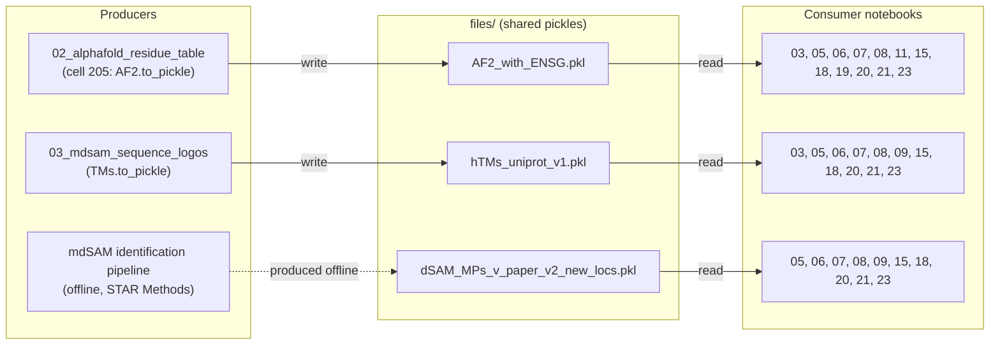
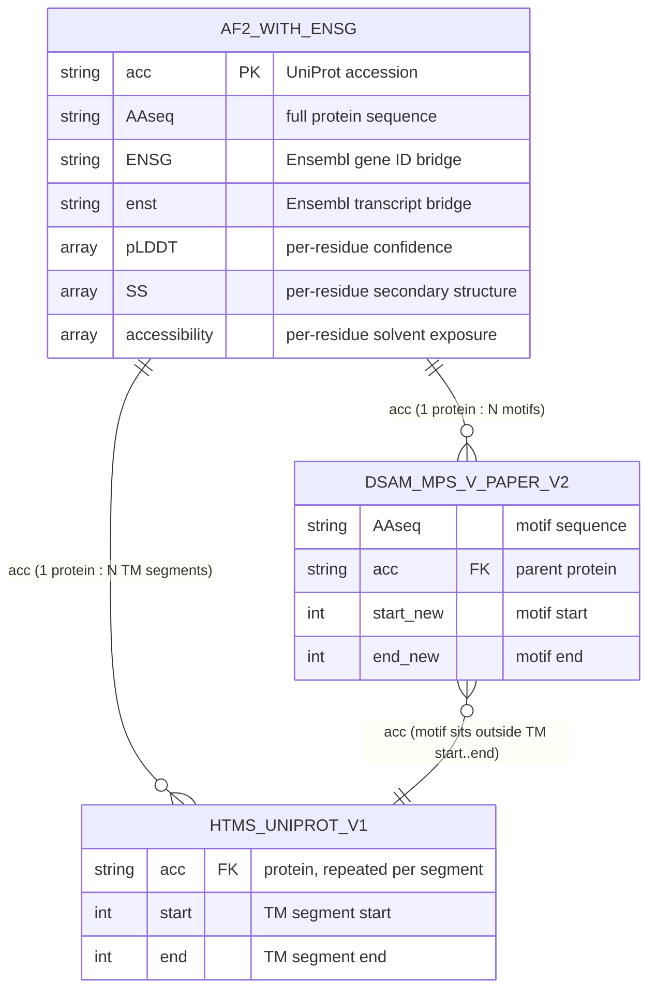

`files/` is the shared-data contract of the mdSAM repository: a small set of pickled pandas DataFrames that every analysis notebook reads as its common starting point. This page is a **reference document** — it catalogs each table, its producer, its verified column schema, its join semantics, and the notebooks that depend on it. Everything documented here was verified directly in the shipped files and notebooks; where the repository shows an inconsistency (a documented table missing from the shipped tree, or a notebook reading a local variant), that is flagged explicitly rather than papered over.

Sources: [files/README.md](files/README.md#L3-L11), [README.md](README.md#L33-L40)

## The files/ Directory at a Glance

The directory is deliberately small: three tables form the entire inter-notebook data plane. Two are shipped as `.pkl` artifacts (`dSAM_MPs_v_paper_v2_new_locs.pkl`, `hTMs_uniprot_v1.pkl`); a third (`AF2_with_ENSG.pkl`) is documented in `files/README.md` and is loaded by thirteen notebooks, but is **not present in the shipped `files/` tree** — you must regenerate it with notebook 02 before running most consumers. Notebooks reference the tables with the relative prefix `../files/<name>`, which means every notebook must be executed with `notebooks/` as the working directory.

Sources: [files/README.md](files/README.md#L7-L11), [notebooks/05_uniprot_keyword_enrichment.ipynb](notebooks/05_uniprot_keyword_enrichment.ipynb#L33-L34)

| File | Contents | Producer | Verified key columns | Shipped? |
|---|---|---|---|---|
| `dSAM_MPs_v_paper_v2_new_locs.pkl` | The mdSAM catalog (one row per motif); motif sequence in `AAseq` | mdSAM identification pipeline (offline, STAR Methods) | `AAseq`, `acc`, `start_new`, `end_new` | Yes |
| `hTMs_uniprot_v1.pkl` | Human transmembrane proteins with UniProt topology annotation (one row per TM segment) | `03_mdsam_sequence_logos.ipynb` (`TMs.to_pickle`) | `acc`, `start`, `end` | Yes |
| `AF2_with_ENSG.pkl` | AlphaFold-derived per-protein annotations with Ensembl gene IDs | `02_alphafold_residue_table_and_early_plots.ipynb` (`AF2.to_pickle`, cell 205) | `acc`, `AAseq`, `ENSG`, `pLDDT`, `SS`, `accessibility`, `enst` | **No — regenerate via notebook 02** |

Sources: [files/README.md](files/README.md#L7-L9), [README.md](README.md#L36-L38)

The dependency flow is one-directional: producers write into `files/`, consumers only read. Notebook 08 is the most complete example of the consumer pattern — its first cell loads all three tables in a single block:

```python
hTMs = pd.read_pickle('../files/hTMs_uniprot_v1.pkl')
AF2 = pd.read_pickle('../files/AF2_with_ENSG.pkl')
mdSAMs = pd.read_pickle('../files/dSAM_MPs_v_paper_v2_new_locs.pkl')
mdSAMs = mdSAMs.drop_duplicates('AAseq')
```

Sources: [notebooks/08_mdsam_topology_and_membrane_distance.ipynb](notebooks/08_mdsam_topology_and_membrane_distance.ipynb#L27-L30)

**Architecture note (prerequisite: the three tables above)** — the following diagram shows the verified producer→table→consumer graph. Solid arrows are load/write calls verified in notebook source; the dashed arrow marks the offline pipeline that produced the mdSAM table outside this repository.



Sources: [files/README.md](files/README.md#L7-L9), [README.md](README.md#L36-L38)

## Table 1: `dSAM_MPs_v_paper_v2_new_locs.pkl` — The mdSAM Catalog

This is the central result table of the study: one row per predicted mdSAM (membrane-disordered Self-Assembly Motif). The paper reports **1,425 high-confidence mdSAMs across 945 membrane proteins** (~20% of the 4,886 human membrane proteins analyzed), with motifs typically 7–9 residues (median 8). The filename suffix `new_locs` refers to the `_new` location columns — `start_new`/`end_new` — that encode each motif's coordinate window within its parent protein.

Sources: [files/README.md](files/README.md#L7), [README.md](README.md#L19-L19)

| Column | Type | Meaning | Evidence in notebooks |
|---|---|---|---|
| `AAseq` | `str` | The 7–9 residue motif sequence (the join-free identity used for de-duplication) | `mdSAMs.drop_duplicates('AAseq')`; `mdSAMs[mdSAMs.AAseq=='GSSVFLNRS']` |
| `acc` | `str` | Parent protein UniProt accession — the foreign key into the other two tables | `mdSAMs.acc.isin(SSTM_topology.From)`; `AF2[AF2.acc==dSAMs.loc[i,'acc']]` |
| `start_new` | `int` | 0-based start coordinate of the motif in the parent protein | `int(mdSAMs[...].start_new.values[0])` |
| `end_new` | `int` | Exclusive end coordinate of the motif | `for j in range(int(mdSAMs.loc[i,'start_new']), int(mdSAMs.loc[i,'end_new']))` |

Sources: [notebooks/08_mdsam_topology_and_membrane_distance.ipynb](notebooks/08_mdsam_topology_and_membrane_distance.ipynb#L30-L57), [notebooks/08_mdsam_topology_and_membrane_distance.ipynb](notebooks/08_mdsam_topology_and_membrane_distance.ipynb#L161-L165), [notebooks/08_mdsam_topology_and_membrane_distance.ipynb](notebooks/08_mdsam_topology_and_membrane_distance.ipynb#L255-L259), [notebooks/20_conservation_alignment_based.ipynb](notebooks/20_conservation_alignment_based.ipynb#L52-L54)

Consumers apply two canonical patterns against this table. Notebook 08 de-duplicates on motif sequence before topology analysis (`drop_duplicates('AAseq')`), because the same motif string can appear in multiple proteins; and notebook 20 treats the table as a pure seed list, iterating rows to extract `acc` + `AAseq` pairs for conservation scoring.

Sources: [notebooks/08_mdsam_topology_and_membrane_distance.ipynb](notebooks/08_mdsam_topology_and_membrane_distance.ipynb#L30-L30), [notebooks/20_conservation_alignment_based.ipynb](notebooks/20_conservation_alignment_based.ipynb#L52-L54)

> [!TIP]
> Coordinate frames differ between consumers: notebook 08 trusts the shipped `start_new`/`end_new` columns directly, while notebook 20 deliberately **re-derives** positions by running `AF2.AAseq.str.find(motif)` against the AlphaFold sequence table before computing `start`/`end`. If your analysis is sensitive to coordinate frame consistency, follow notebook 20's re-derivation pattern rather than assuming `start_new` aligns with the AF2 sequence index.

Sources: [notebooks/08_mdsam_topology_and_membrane_distance.ipynb](notebooks/08_mdsam_topology_and_membrane_distance.ipynb#L57-L57), [notebooks/20_conservation_alignment_based.ipynb](notebooks/20_conservation_alignment_based.ipynb#L52-L54)

## Table 2: `hTMs_uniprot_v1.pkl` — Human TM Proteins with Topology

This table is the universe definition for the study: all human transmembrane proteins with UniProt topology annotation. Unlike the mdSAM table, it is **long-shaped** — one row per transmembrane segment, so a polytopic protein contributes multiple rows with the same `acc`. Notebook 08 exploits this shape directly: `hTMs.acc.value_counts()` with a count of exactly 1 identifies single-pass (bitopic) proteins, the population used for the membrane-leaflet distance analysis.

Sources: [files/README.md](files/README.md#L8), [notebooks/08_mdsam_topology_and_membrane_distance.ipynb](notebooks/08_mdsam_topology_and_membrane_distance.ipynb#L77-L82)

| Column | Type | Meaning | Evidence in notebooks |
|---|---|---|---|
| `acc` | `str` | UniProt accession (repeated once per TM segment) | `set(TMs.acc)`; `hTMs[hTMs.acc==acc].start.values[0]` |
| `start` | `int` | TM segment start residue | `range(TMs.loc[i,'start'], TMs.loc[i,'end']+1)` |
| `end` | `int` | TM segment end residue | `hTMs[hTMs.acc==acc].end.values[0] - mdSAM_s` (leaflet distance) |

Sources: [notebooks/03_mdsam_sequence_logos.ipynb](notebooks/03_mdsam_sequence_logos.ipynb#L2663-L2669), [notebooks/08_mdsam_topology_and_membrane_distance.ipynb](notebooks/08_mdsam_topology_and_membrane_distance.ipynb#L135-L145)

Per `files/README.md`, the table is produced by notebook 03 via `TMs.to_pickle`. The verified read-back in notebook 03's late gnomAD cell (`TMs = pd.read_pickle('../files/hTMs_uniprot_v1.pkl')`) confirms the round-trip: the same notebook both writes and re-consumes the table in different sections. Consumers use `start`/`end` to mask transmembrane regions — for example, notebook 03 builds the set of all TM-segment residue positions per accession to exclude membrane-embedded hexapeptides from disorder analyses.

Sources: [files/README.md](files/README.md#L8), [notebooks/03_mdsam_sequence_logos.ipynb](notebooks/03_mdsam_sequence_logos.ipynb#L2824-L2824), [notebooks/03_mdsam_sequence_logos.ipynb](notebooks/03_mdsam_sequence_logos.ipynb#L2665-L2669)

## Table 3: `AF2_with_ENSG.pkl` — AlphaFold Per-Protein Annotations

This is the widest and most-consumed table (thirteen notebooks per `files/README.md`): one row per protein, carrying the full AlphaFold-derived annotation vector set plus cross-database identifiers. Its columns are the substrate for the disorder-filtering logic that defines what makes a SAM an mdSAM.

Sources: [files/README.md](files/README.md#L9), [README.md](README.md#L36-L38)

| Column | Type | Meaning | Evidence in notebooks |
|---|---|---|---|
| `acc` | `str` | UniProt accession (primary key) | `AF2[AF2.acc=='Q8IX19']` |
| `AAseq` | `str` | Full protein sequence; indexed by `str.find` to locate motifs | `AF2[AF2.acc==dSAMs.loc[i,'acc']].AAseq.str.find(...)` |
| `ENSG` | `str` | Ensembl gene ID — bridge from UniProt space to Ensembl space | `AF2[AF2.ENSG==topology_df.loc[i,'ENSG']].acc.values[0]` |
| `pLDDT` | array-like | Per-residue AlphaFold confidence; `<70` marks disordered residues | `AF2[AF2.acc=='Q6DN72']['pLDDT'].values[0][329:434]`; `pLDDT...if i>70` |
| `SS` | array-like | Per-residue secondary structure (`'H'` = helix) | `AF2...SS.values[0][pos-6:pos+6] if i=='H'` |
| `accessibility` | array-like | Per-residue solvent accessibility (`'*'` = exposed) | `accessibility.values[0][pos-6:pos+6] if i=='*'` |
| `enst` | `str` | Ensembl transcript ID (used in downstream joins) | `dSAM_df.ENST.isin(AF2[...].enst)` |

Sources: [notebooks/03_mdsam_sequence_logos.ipynb](notebooks/03_mdsam_sequence_logos.ipynb#L62-L63), [notebooks/03_mdsam_sequence_logos.ipynb](notebooks/03_mdsam_sequence_logos.ipynb#L2686-L2689), [notebooks/03_mdsam_sequence_logos.ipynb](notebooks/03_mdsam_sequence_logos.ipynb#L2830-L2830), [notebooks/08_mdsam_topology_and_membrane_distance.ipynb](notebooks/08_mdsam_topology_and_membrane_distance.ipynb#L225-L225), [notebooks/20_conservation_alignment_based.ipynb](notebooks/20_conservation_alignment_based.ipynb#L53-L53)

**Verification caveat**: `AF2_with_ENSG.pkl` is documented and loaded everywhere, but the repository's `files/` directory currently ships only the two other pickles. Concretely, this means the pipeline is **not** runnable end-to-end until notebook 02 regenerates this table first — notebook 02 is therefore not merely the earliest notebook, it is a hard build dependency for twelve others. Its producer cell (cell 205, per the README) executes `AF2.to_pickle`, closing the loop.

Sources: [files/README.md](files/README.md#L9), [README.md](README.md#L36-L38)

## Join Semantics and Identifier Space

The three tables interlock through a deliberate identifier hierarchy. `acc` (UniProt accession) is the **universal join key** present in all three tables; `ENSG` and `enst` exist only in the AF2 table and act as outbound bridges into Ensembl space. Notebook 03 demonstrates the canonical resolution pattern when a foreign table speaks Ensembl: look up the accession through AF2 first (`AF2[AF2.ENSG==x].acc.values[0]`), then join everything else on `acc`. The relationship structure:

Sources: [notebooks/03_mdsam_sequence_logos.ipynb](notebooks/03_mdsam_sequence_logos.ipynb#L62-L63), [notebooks/03_mdsam_sequence_logos.ipynb](notebooks/03_mdsam_sequence_logos.ipynb#L2830-L2830)



Sources: [notebooks/08_mdsam_topology_and_membrane_distance.ipynb](notebooks/08_mdsam_topology_and_membrane_distance.ipynb#L124-L149), [notebooks/08_mdsam_topology_and_membrane_distance.ipynb](notebooks/08_mdsam_topology_and_membrane_distance.ipynb#L255-L259)

Two multiplicity rules follow from this schema. First, `dSAM → hTMs` joins must use `isin`-style filtering, not positional lookup, because mdSAM-containing proteins can be polytopic (multiple TM rows). Second, `AF2 → anything` is strictly one-to-many keyed on `acc`, which is why every consumer indexes AF2 with boolean masks (`AF2[AF2.acc==x]`) and extracts with `.values[0]` — a pattern that silently assumes unique accessions and will break loudly on duplicates.

Sources: [notebooks/08_mdsam_topology_and_membrane_distance.ipynb](notebooks/08_mdsam_topology_and_membrane_distance.ipynb#L135-L141), [notebooks/08_mdsam_topology_and_membrane_distance.ipynb](notebooks/08_mdsam_topology_and_membrane_distance.ipynb#L67-L68)

## Provenance, Conventions, and Safety

The repository enforces three conventions around these tables. **Path convention**: all loads use `../files/<name>`, so notebooks fail unless run from `notebooks/` as the working directory. **Provenance convention**: derived tables stay *local* to the notebook that computes them — notebook 08, after annotating leaflet distances, writes `mdSAMs.to_pickle('mdSAM_loacation.pkl')` into `notebooks/`, not back into `files/`; only the three tables above earned shared status. **Version convention**: consumers may pin specific snapshots, and this is where a lineage trap exists.

Sources: [files/README.md](files/README.md#L3-L11), [notebooks/08_mdsam_topology_and_membrane_distance.ipynb](notebooks/08_mdsam_topology_and_membrane_distance.ipynb#L175-L175)

> [!TIP]
> Notebook 03's late LARKS/WIRS overlap cell loads `dSAM_MPs_v_paper_v2.pkl` — a **local file without the `new_locs` suffix** — rather than the shared `dSAM_MPs_v_paper_v2_new_locs.pkl`. When tracing which mdSAM snapshot a figure was built from, check the exact filename in the loading cell, not the table's conceptual identity.

Sources: [notebooks/03_mdsam_sequence_logos.ipynb](notebooks/03_mdsam_sequence_logos.ipynb#L2824-L2830)

Finally, the pickle format itself carries a standing warning in `files/README.md`: pickles **execute arbitrary code on load** and are sensitive to the pandas version that wrote them. Load them only from this repository, and match your pandas version to the one used at write time. This also explains the design decision to keep `files/` minimal — fewer serialized blobs, fewer compatibility and trust surfaces.

Sources: [files/README.md](files/README.md#L13-L13)

| Convention | Rule | Why it exists |
|---|---|---|
| Working directory | Run notebooks from `notebooks/`; paths are `../files/<name>` | All load calls use relative parent paths |
| Derivatives | Annotation tables derived from shared pickles stay local to the notebook | Keeps `files/` as a minimal, auditable contract |
| Naming | `dSAM` in filenames/variables == mdSAM; structured-region counterpart is `mSAM`/`sSAM` | Historical naming preserved for lineage with the paper |
| Safety | `pd.read_pickle` only on tables from this repo; pin pandas version | Pickle deserialization is code execution |

Sources: [files/README.md](files/README.md#L3-L13), [README.md](README.md#L21-L21)

## Reading Progression

This reference sits between the pipeline description and the notebook-specific deep dives. A logical continuation path: understand how these tables feed the analysis flow in [Notebook Pipeline Architecture](5-notebook-pipeline-architecture), then see how the classifier that produced the mdSAM table was built in [WALTZ-DB Random-Forest Classifier](6-waltz-db-random-forest-classifier), how the `pLDDT`/`SS`/`accessibility` columns gate motif calls in [AlphaFold-Based Disorder Filtering](7-alphafold-based-disorder-filtering), and how specific notebook cells map back to paper figures in [Figure-to-Notebook Reproducibility Map](9-figure-to-notebook-reproducibility-map).
