Every quantitative panel in the mdSAM manuscript can be traced to a specific notebook and a specific cell. This page is the reference for that trace: it consolidates the panel → notebook → cell mapping distributed in the repository's README, explains the conventions the map uses, documents which panels are intentionally not mapped, and shows how to regenerate any mapped panel locally. The map covers main Figures 1–7 and Supplementary Figures S1, S2, S3, S6 and S7; the notebooks are distributed with outputs cleared, so plots only exist after execution.

Sources: [README.md](README.md#L88-L90), [README.md](README.md#L244-L248)

## Where the Map Lives and Its Conventions

The authoritative map is the **"Where the paper figures come from"** section of the root README, organized as one table per paper figure. Each row names the panel, describes its content, and points to the notebook plus the cell that draws it. The README's repository-contents block also advertises a `FIGURE_MAP.csv` ("machine-readable map: paper panel -> notebook -> cell"), but that file is not present in the current repository tree — the README tables are the operative reference on this branch.

Four conventions govern how to read the map. First, cell numbers are **0-based indices** into the notebook's `cells` list — they are positional, not Jupyter execution counts. Second, notebook filename prefixes (`01`–`23`) reflect pipeline order, not figure order: Figure 2 panels, for example, come from notebooks 06, 07, 08 and 09. Third, a panel may list **multiple cells**; these are alternative or iterative renderings of the same content, and any of them reproduces the panel. Fourth, one cell may serve **multiple panels** (e.g., notebook 11 cells 16–17 are cited jointly as "4C / 5B"). The README also establishes the naming bridge you will hit in the code: older notebooks call the motifs **dSAM** in filenames and variables — this means mdSAM.

Sources: [README.md](README.md#L88-L90), [README.md](README.md#L26-L33), [README.md](README.md#L21), [README.md](README.md#L137-L142)

| Convention | Meaning for reproducibility |
|---|---|
| Cell index | 0-based position in the `.ipynb` `cells` list (e.g., "cell 2" = third cell), as stated in the README |
| Notebook numbering | `01`–`23` prefixes = pipeline order; figure order is independent |
| Multiple cells per panel | Iterative/alternative renderings — any listed cell reproduces the panel |
| Shared cells | One cell can be cited for several panels (e.g., `4C / 5B`, `4D / S5C`) |
| Outputs cleared | `.ipynb` files ship with `"outputs": []`; plots appear only after a run |
| Naming | `dSAM` in filenames/variables = **mdSAM** (e.g., `dSAM_MPs_v_paper_v2_new_locs.pkl`) |

Sources: [README.md](README.md#L31-L33), [README.md](README.md#L21), [notebooks/09_mdsams_per_protein.ipynb](notebooks/09_mdsams_per_protein.ipynb#L39-L67)

I verified the indexing convention by direct inspection rather than trusting the prose. Notebook 09 has exactly three cells; its third cell (index 2) draws the barplot and saves `number_of_mdSAMs_per_protein.svg` — precisely the README's Fig 2E row ("`09_mdsams_per_protein.ipynb` (cell 2)"). Notebook 12's cell 3 saves `Amytracker_100uM.svg`, matching the cited "4C" and "S3D" rows, and a late cell of notebook 01 saves `RF_classifier_test_set_v2.svg`, consistent with its Fig 1D citation at cell 26.

Sources: [notebooks/09_mdsams_per_protein.ipynb](notebooks/09_mdsams_per_protein.ipynb#L39-L67), [notebooks/12_amytracker_peptides.ipynb](notebooks/12_amytracker_peptides.ipynb#L37-L52), [notebooks/01_train_waltzdb_classifier.ipynb](notebooks/01_train_waltzdb_classifier.ipynb#L489-L509), [README.md](README.md#L92-L98), [README.md](README.md#L134)

> [!TIP]
> When a panel cites several cells (e.g., Fig 2A → cells 79, 87, 89), the numbers are not sequential refinement steps of one plot — they are independently runnable renderings. To reproduce a paper panel, running any single listed cell after its notebook's setup cells is sufficient.

## Resolving a Panel: Panel → Notebook → Cell

The map is consumed in a fixed four-step flow, and the resolution chain matters because the two index systems differ. A paper panel is looked up in the README table by its label (e.g., `2E`), which yields a notebook filename and a 0-based cell index; you then execute the notebook from its own working directory so relative paths resolve, and the figure emerges as an SVG file written into the notebook directory. The paper's final rendering remains the visual reference — the notebooks reproduce the analysis and the plot, not the typeset composite.

The working-directory requirement is structural, not stylistic: notebook code reads shared tables via relative paths such as `pd.read_pickle('../files/hTMs_uniprot_v1.pkl')`, and figure exports use relative filenames (`plt.savefig('number_of_mdSAMs_per_protein.svg', ...)`, `plt.savefig('Amytracker_100uM.svg', ...)`). Running from the wrong directory fails the table load or writes the SVG elsewhere.

Sources: [README.md](README.md#L88-L90), [README.md](README.md#L244-L248), [files/README.md](files/README.md#L1-L3), [notebooks/09_mdsams_per_protein.ipynb](notebooks/09_mdsams_per_protein.ipynb#L35-L36), [notebooks/09_mdsams_per_protein.ipynb](notebooks/09_mdsams_per_protein.ipynb#L65), [notebooks/12_amytracker_peptides.ipynb](notebooks/12_amytracker_peptides.ipynb#L50)

## Architecture: Notebooks Grouped by Figure Theme

Before reading the per-figure tables, it helps to see the production topology. The 23 notebooks fall into six thematic stages, and figures are generally assembled from one notebook per stage — Figure 2 is the notable exception, drawing on four notebooks because it spans organelle enrichment, topology, per-protein counts and sequence-space embedding. Notebooks 02 and 19 occupy supporting positions: 02 produces the shared AlphaFold residue table rather than panels, and 19 re-runs differential expression and gene-set enrichment that supports Fig 6E without a dedicated map row.

```mermaid
flowchart LR
    subgraph prep["Data preparation &amp; classifier"]
        NB01["01 RF classifier<br/>(WALTZ-DB)"]
        NB02["02 AlphaFold<br/>residue table"]
        NB03["03 Sequence<br/>logos"]
    end
    subgraph div["Discovery &amp; diversity"]
        NB04["04 PASTA<br/>comparison"]
        NB05["05 UniProt<br/>keywords"]
        NB06["06 Sequence-space<br/>embedding"]
        NB07["07 hyperLOPIT<br/>organelles"]
        NB08["08 Topology &amp;<br/>leaflet distance"]
        NB09["09 mdSAMs<br/>per protein"]
    end
    subgraph inv["In vitro self-assembly"]
        NB10["10 ThT<br/>96-well"]
        NB11["11 GPCR ThT<br/>proline mutants"]
        NB12["12 Amytracker"]
    end
    subgraph cb["Cell-based clustering"]
        NB13["13 TIRF<br/>Poisson GLM"]
        NB14["14 Flow<br/>cytometry"]
        NB15["15 BioGRID<br/>interactions"]
        NB16["16 dSTORM<br/>HTR7"]
    end
    subgraph sig["HTR7 signalling"]
        NB17["17 cAMP Emax/EC50"]
        NB18["18 RNA-seq<br/>PCA/volcano"]
        NB19["19 GSEA<br/>(support)"]
    end
    subgraph ev["Evolution"]
        NB20["20 Alignment<br/>conservation"]
        NB21["21 ESM<br/>conservation"]
        NB22["22 Ortholog ThT"]
        NB23["23 LARKS/WIRS/<br/>FINCHES"]
    end
    NB01 --> F1("Fig 1")
    NB06 --> F1
    NB05 --> F1
    NB07 --> F2("Fig 2")
    NB08 --> F2
    NB09 --> F2
    NB06 --> F2
    NB10 --> F3("Fig 3")
    NB12 --> F4("Fig 4")
    NB11 --> F4
    NB13 --> F4
    NB11 --> F5("Fig 5")
    NB13 --> F5
    NB16 --> F5
    NB17 --> F6("Fig 6")
    NB18 --> F6
    NB19 -.-> F6
    NB21 --> F7("Fig 7")
    NB20 --> F7
    NB22 --> F7
```

The supplementary figures reuse the same notebooks rather than introducing new ones: S1 is served by 01/03/04/05 (validation of the prediction), S2 by 06/07 (diversity and localisation), S3 by 10/12 (peptide assembly), S6 by 14/15/17 (expression controls and BioGRID), and S7 by 20/22/23 (conservation). This is why the notebook count (23) exceeds the figure count — each notebook typically feeds both a main figure and a supplementary one.

Sources: [README.md](README.md#L35-L86), [README.md](README.md#L175-L206), [README.md](README.md#L207-L213), [README.md](README.md#L215-L240), [README.md](README.md#L40), [README.md](README.md#L77)

## Main Figure Map (Figures 1–7)

The tables below reproduce the README map with repeated panel rows merged into single entries listing all cited cells. Cell numbers are the 0-based indices discussed above.

### Figures 1–2: Discovery and diversity

Figure 1 is spread across three notebooks — classifier evaluation (01), the sequence-space embedding (06) and keyword enrichment (05). Figure 2 is the widest figure in the repository, assembling organelle, topology, count and embedding panels from four notebooks.

| Panel | Content | Notebook | Cell index(es) |
|---|---|---|---|
| 1D | RF classifier test-set performance (amyloid vs non-amyloid) | `01_train_waltzdb_classifier.ipynb` | 26 |
| 1F | Dot matrix: membrane proteins with predicted mdSAMs | `06_mdsam_sequence_space_embedding.ipynb` | 14 |
| 1G | UniProt keyword categories (donut) | `05_uniprot_keyword_enrichment.ipynb` | 32 |
| 2A | mdSAM enrichment by organelle (hyperLOPIT) | `07_hyperlopit_organelle_enrichment.ipynb` | 79, 87, 89 |
| 2B | Bitopic vs polytopic enrichment | `08_mdsam_topology_and_membrane_distance.ipynb` | 70, 73 |
| 2C | N-/C-terminus vs loop | `08_mdsam_topology_and_membrane_distance.ipynb` | 146, 148, 168 |
| 2D | Distance to nearest membrane leaflet | `08_mdsam_topology_and_membrane_distance.ipynb` | 45, 55 |
| 2E | mdSAMs per protein | `09_mdsams_per_protein.ipynb` | 2 |
| 2F | mdSAM length distribution | `08_mdsam_topology_and_membrane_distance.ipynb` | 76 |
| 2G | Pairwise Levenshtein distance distribution/matrix | `06_mdsam_sequence_space_embedding.ipynb` | 207, 211 |
| 2H-I | Physicochemical embedding coloured by composition | `06_mdsam_sequence_space_embedding.ipynb` | 28, 37 |

Sources: [README.md](README.md#L92-L98), [README.md](README.md#L100-L119)

### Figures 3–4: Peptide and cell-based assembly evidence

Notebook 10 owns Figure 3 alone (the 96-well Thioflavin-T screen and charge-archetype ternary plot). Figure 4 is deliberately multi-source: Amytracker data (12), motif-swap TIRF puncta (13) and GPCR peptide ThT (11) all contribute to panel 4C, while panel 4D doubles as supplementary S5C.

| Panel | Content | Notebook | Cell index(es) |
|---|---|---|---|
| 3A | Charge archetypes (ternary plot) | `10_tht_peptide_screen_96well.ipynb` | 25, 26 |
| 3B | ThT fluorescence per peptide with buffer/MAPT lines | `10_tht_peptide_screen_96well.ipynb` | 54, 73 |
| 4C | Amytracker WT vs proline peptides | `12_amytracker_peptides.ipynb` | 3 |
| 4C | SNAPtm motif swaps: puncta density (HTR7, KCNE4 mdSAM) | `13_tirf_puncta_poisson_glm.ipynb` | 42, 43 |
| 4C / 5B | ThT of HTR7 WT vs V451P peptide | `11_tht_gpcr_peptides_proline_mutants.ipynb` | 16, 17 |
| 4D / S5C | Full-length protein puncta density, Poisson GLM, HEK vs U2OS | `13_tirf_puncta_poisson_glm.ipynb` | 12, 15, 19, 22 |

Sources: [README.md](README.md#L121-L128), [README.md](README.md#L130-L142)

### Figures 5–6: The HTR7 case study

The HTR7 arc links peptide biophysics (11), cellular clustering assays (13, 16) and signalling/transcriptomics (17, 18). Notebook 16 is the exploratory heavyweight of the map — its cited cells (409–453) sit deep in a notebook that also holds earlier analysis versions. Notebook 19 has no panel row of its own; the README's task table marks it as "supports Fig 6E".

| Panel | Content | Notebook | Cell index(es) |
|---|---|---|---|
| 5B | HTR7 and other GPCR peptide ThT spectra | `11_tht_gpcr_peptides_proline_mutants.ipynb` | 32 |
| 5E | HTR7 WT vs V451P TIRF puncta | `13_tirf_puncta_poisson_glm.ipynb` | 25 |
| 5F | dSTORM localisation map and Voronoi/cluster overlay | `16_dstorm_htr7_cluster_analysis.ipynb` | 409, 410 |
| 5G | Cluster stoichiometry by local density; bootstrap skewness | `16_dstorm_htr7_cluster_analysis.ipynb` | 440, 451, 452, 453 |
| 6D | HTR7 cAMP Emax and EC50 summary statistics | `17_htr7_camp_emax_ec50_and_expression_plots.ipynb` | 18 |
| 6E | RNA-seq PCA and V451P vs WT volcano | `18_htr7_rnaseq_pca_volcano.ipynb` | 3, 8 |

Sources: [README.md](README.md#L144-L155), [README.md](README.md#L157-L163), [README.md](README.md#L77)

### Figure 7: Evolutionary conservation

Conservation is measured two independent ways — alignment-based (20) and protein-language-model embedding-based (21) — both feeding panel 7B, with ortholog peptide ThT (22) supplying 7D.

| Panel | Content | Notebook | Cell index(es) |
|---|---|---|---|
| 7B | ESM2 embedding conservation by segment class | `21_conservation_esm_embedding.ipynb` | 15 |
| 7B | Conservation by segment class (alignment-based analyses) | `20_conservation_alignment_based.ipynb` | 22, 28 |
| 7D | Ortholog ThT: WT vs proline mutant per species | `22_ortholog_peptide_tht.ipynb` | 6, 16 |

Sources: [README.md](README.md#L165-L173)

## Supplementary Figure Map (S1–S3, S6–S7)

Supplementary coverage follows the same conventions. Note there are no dedicated sections for S4 or S5 in the map — S5 appears only through the joint "4D / S5C" citations above.

| Suppl. panel | Content | Notebook | Cell index(es) |
|---|---|---|---|
| S1F | ROC, stratified 5-fold CV | `01_train_waltzdb_classifier.ipynb` | 15 |
| S1G | Beta-strand energetics | `01_train_waltzdb_classifier.ipynb` | 12 |
| S1H | Sequence logos, mdSAMs vs SAMs | `03_mdsam_sequence_logos.ipynb` | 35, 37 |
| S1I | ROC for consecutive amyloid-positive windows | `04_pasta_aggregation_comparison.ipynb` | 17, 21 |
| S1J | PASTA energy of mdSAMs | `04_pasta_aggregation_comparison.ipynb` | 14 |
| S1K | UniProt keyword enrichment (process, function, disease) | `05_uniprot_keyword_enrichment.ipynb` | 47, 73, 74 |
| S2A | hyperLOPIT profiles per compartment | `07_hyperlopit_organelle_enrichment.ipynb` | 26, 29 |
| S2B-C | hyperLOPIT t-SNE and GMM organelle assignment | `07_hyperlopit_organelle_enrichment.ipynb` | 48, 68 |
| S2E-F | Amino-acid composition and organelle on physicochemical map | `06_mdsam_sequence_space_embedding.ipynb` | 101, 122, 124 |
| S2G | GMM groups and keyword enrichment | `06_mdsam_sequence_space_embedding.ipynb` | 49, 55, 65, 67, 69 |
| S3A | ThT spectra, all peptides | `10_tht_peptide_screen_96well.ipynb` | 86 |
| S3C | ThT spectra, WT vs proline mutants | `10_tht_peptide_screen_96well.ipynb` | 80 |
| S3D | Amytracker WT vs proline | `12_amytracker_peptides.ipynb` | 3 |
| S6A | Total expression bar plots, per protein | `17_htr7_camp_emax_ec50_and_expression_plots.ipynb` | 13, 17 |
| S6A | Total expression, WT vs proline, by DNA amount | `14_flow_cytometry_total_vs_surface.ipynb` | 45, 98 |
| S6B | BioGRID self-interactions, mdSAM+ (n=658) and mdSAM− (n=2,642) | `15_biogrid_interactions_by_mdsam.ipynb` | 171, 172 |
| S6C | Plasma-membrane PPIs by mdSAM status | `15_biogrid_interactions_by_mdsam.ipynb` | 78, 81, 84, 86 |
| S7A | Alignment-based conservation metrics by residue class | `20_conservation_alignment_based.ipynb` | 24, 25 |
| S7B | mdSAM retention in orthologs vs alignment depth | `20_conservation_alignment_based.ipynb` | 53, 71 |
| S7C | Ortholog ThT spectra | `22_ortholog_peptide_tht.ipynb` | 20, 21 |
| S7D | UpSet: overlap with LARKs, WIRS, FINCHES | `23_overlap_with_larks_wirs_finches.ipynb` | 16 |

Sources: [README.md](README.md#L175-L206), [README.md](README.md#L207-L213), [README.md](README.md#L215-L240)

## Notebook Involvement Summary

This inverted view answers the operational question: "what does notebook *N* contribute to the paper?" It also exposes the two notebooks with no map rows and the per-notebook cell-depth range (notebook 16's cited cells reach index 453, reflecting a long exploratory session alongside its final panels).

| Notebook | Thematic stage | Mapped panel(s) | Role |
|---|---|---|---|
| 01 | Data & classifier | 1D; S1F, S1G | Producer |
| 02 | Data & classifier | — | Input-table builder (`AF2_with_ENSG.pkl`) |
| 03 | Data & classifier | S1H | Producer |
| 04 | Discovery & diversity | S1I, S1J | Producer |
| 05 | Discovery & diversity | 1G; S1K | Producer |
| 06 | Discovery & diversity | 1F; 2G, 2H-I; S2E-F, S2G | Producer |
| 07 | Discovery & diversity | 2A; S2A, S2B-C | Producer |
| 08 | Discovery & diversity | 2B, 2C, 2D, 2F | Producer |
| 09 | Discovery & diversity | 2E | Producer |
| 10 | In vitro | 3A, 3B; S3A, S3C | Producer |
| 11 | In vitro | 4C/5B; 5B | Producer |
| 12 | In vitro | 4C; S3D | Producer |
| 13 | Cell-based | 4C; 4D/S5C; 5E | Producer |
| 14 | Cell-based | S6A | Producer |
| 15 | Cell-based | S6B, S6C | Producer |
| 16 | Cell-based | 5F, 5G | Producer |
| 17 | HTR7 signalling | 6D; S6A | Producer |
| 18 | HTR7 signalling | 6E | Producer |
| 19 | HTR7 signalling | — | Support for 6E |
| 20 | Evolution | 7B; S7A, S7B | Producer |
| 21 | Evolution | 7B | Producer |
| 22 | Evolution | 7D; S7C | Producer |
| 23 | Evolution | S7D | Producer |

Sources: [README.md](README.md#L88-L240), [README.md](README.md#L40), [README.md](README.md#L77)

## Coverage Boundaries: What the Map Omits

The map is explicitly partial, and its exclusions are as documented as its inclusions. The README states that panels that are schematics, microscopy or EM images, NMR or mass-photometry data, or produced outside these notebooks are not listed — so the absence of an S4/S5 section and of imaging-micrograph rows is by design, not an omission to be fixed. Within the notebooks themselves, several analyses are documented as beyond the paper: notebook 03 contains additional gnomAD analyses, notebook 15 contains further interaction analyses, and notebook 16 holds earlier analysis versions — none of these appear in the figure tables.

For intermediate developers the practical consequence is a triage rule: if a plot appears in a notebook but not in the map, treat it as exploratory or superseded; if a paper panel is absent from the map, check whether it belongs to an excluded category before searching for missing code.

Sources: [README.md](README.md#L242), [README.md](README.md#L41), [README.md](README.md#L68-L69)

> [!TIP]
> The "task" tables in the earlier README section and the figure map section are mutually consistent but not identical in scope — notebook 11's task row lists S3C, while the S3 map section attributes S3C's cited cells to notebook 10. When in doubt, the per-figure map section (panel → cell) is the operative reference for reproduction; the task tables describe notebook intent.

## Regenerating a Panel

A mapped panel is reproduced by executing its notebook in place. The repository ships the three shared input tables as pickled pandas DataFrames in `files/` — `dSAM_MPs_v_paper_v2_new_locs.pkl` (the mdSAM table with motifs in the `AAseq` column), `hTMs_uniprot_v1.pkl` (human transmembrane proteins with UniProt topology), and `AF2_with_ENSG.pkl` (AlphaFold-derived annotations with Ensembl IDs). Notebooks reference them as `../files/<name>`, so the run must start from `notebooks/` as the working directory. Then execute the notebook's cells top-to-bottom (imports and table loads come first in the `cells` list) and stop at the cited index; the panel is exported as an SVG into the notebook directory. Because the notebooks were written for interactive sessions, some read additional intermediate files not stored in `files/` — the README flags this for specific notebooks.

Two cautions from the repository's own documentation apply. First, pickle files execute code on load and are pandas-version dependent — load them only from this repository with a compatible pandas version. Second, cells above the cited index are required context, not optional: the target cell consumes variables defined upstream (e.g., notebook 09's cell 2 uses `dSAMs` loaded in cell 1).

Sources: [README.md](README.md#L244-L248), [files/README.md](files/README.md#L5-L13), [notebooks/09_mdsams_per_protein.ipynb](notebooks/09_mdsams_per_protein.ipynb#L34-L37), [notebooks/09_mdsams_per_protein.ipynb](notebooks/09_mdsams_per_protein.ipynb#L39-L65)

| Step | Action | Evidence |
|---|---|---|
| 1 | `cd notebooks/` (working directory requirement) | Relative pickle paths `../files/<name>` |
| 2 | Confirm `../files/` contains the three shared `.pkl` tables | `files/README.md` table |
| 3 | Run notebook cells 0 → target index (inclusive) | Cell indices are 0-based positions |
| 4 | Collect the exported SVG from the notebook directory | e.g., `number_of_mdSAMs_per_protein.svg` |
| 5 | Compare against the paper panel (final typeset rendering) | Notebooks reproduce analysis, not composite layout |

For deeper setup (environment, package imports spanning `Bio`, `Levenshtein`, `logomaker`, `fcsparser`, `gseapy`, and more) see [Quick Start](2-quick-start) and [Reusing the Analysis Toolkit](27-reusing-the-analysis-toolkit); for the full contents and provenance of the three pickles see [Shared Data Tables Reference](8-shared-data-tables-reference).

Sources: [README.md](README.md#L250), [files/README.md](files/README.md#L5-L13)

## Where to Go Next

This page is the index layer of the documentation; the concept and mechanics live one level down. A productive reading order follows the map's own structure.

| Goal | Recommended page |
|---|---|
| Understand what each notebook computes, end to end | [Notebook Pipeline Architecture](5-notebook-pipeline-architecture) |
| Trace how mdSAMs are predicted and filtered | [WALTZ-DB Random-Forest Classifier](6-waltz-db-random-forest-classifier), [AlphaFold-Based Disorder Filtering](7-alphafold-based-disorder-filtering) |
| Inspect the shared pickle tables cited in Step 2 | [Shared Data Tables Reference](8-shared-data-tables-reference) |
| Go deep on a figure's analysis (Fig 2H-I / 2G) | [Physicochemical Embedding and Clustering](11-physicochemical-embedding-and-clustering) |
| Go deep on the Figure 5–6 notebooks | [HTR7 End-to-End Case Study](21-htr7-end-to-end-case-study) |
| Stand up a working environment for regeneration | [Quick Start](2-quick-start), [Reusing the Analysis Toolkit](27-reusing-the-analysis-toolkit) |
