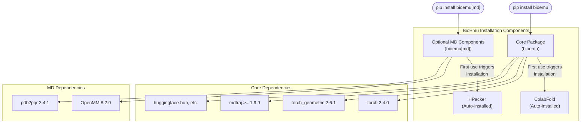
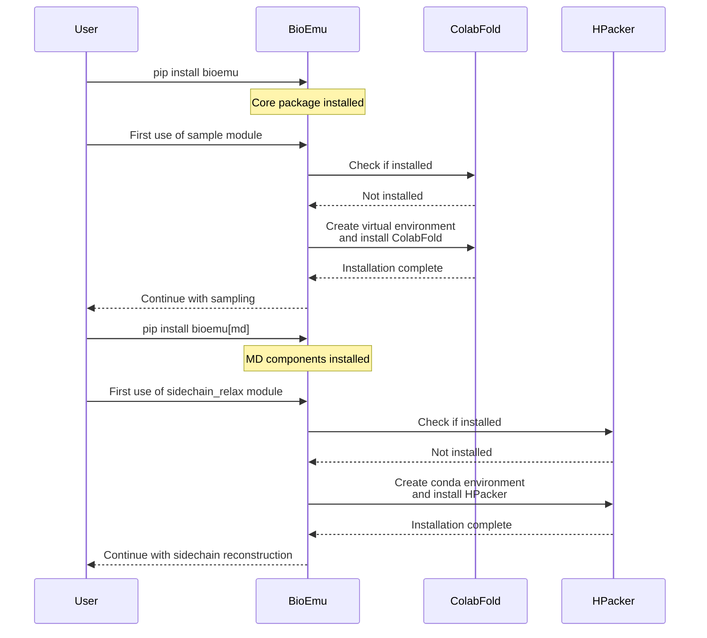

# Installation and Setup

<details>
<summary>Relevant source files</summary>

The following files were used as context for generating this wiki page:

- [README.md](README.md)
- [pyproject.toml](pyproject.toml)

</details>


This page provides comprehensive instructions for installing BioEmu and setting up all required dependencies. BioEmu is a Linux-only Python package that generates protein structure ensembles from amino acid sequences. For information about using BioEmu after installation, see [Core Functionality](#3).

## System Requirements

Before installing BioEmu, ensure your system meets the following requirements:

- **Operating System**: Linux only (Not compatible with Windows or macOS)
- **Python Version**: 3.10 or higher
- **Memory**: Recommended minimum 16GB RAM (more for longer sequences)
- **GPU**: Recommended for efficient sampling of longer sequences
- **Disk Space**: ~5GB for dependencies and model weights

## Basic Installation

BioEmu is provided as a pip-installable package:

```bash
pip install bioemu
```

This installs the core functionality for structure sampling. For sidechain reconstruction and MD relaxation capabilities, install the optional dependencies:

```bash
pip install bioemu[md]
```

Sources: [README.md:26-31](), [README.md:76-80](), [pyproject.toml:1-36]()

## Installation Components



Sources: [pyproject.toml:12-36](), [README.md:26-80]()

## External Dependencies Setup

BioEmu relies on two main external tools that are automatically set up during first use:

### ColabFold Setup

ColabFold is used for Multiple Sequence Alignment (MSA) and embedding generation. It's installed automatically in a separate virtual environment when you first use BioEmu to sample structures.

- **Default installation location**: `~/.bioemu_colabfold`
- **Custom location**: Set the `BIOEMU_COLABFOLD_DIR` environment variable before first use
- **Installation trigger**: First use of `bioemu.sample` module

```bash
# Example of setting custom ColabFold location
export BIOEMU_COLABFOLD_DIR=/path/to/custom/location
python -m bioemu.sample --sequence GYDPETGTWG --num_samples 1
```

Sources: [README.md:33-34](), [README.md:60-61]()

### HPacker Setup

HPacker is used for sidechain reconstruction. It's installed automatically when you first use the sidechain reconstruction functionality.

- **Default installation**: Creates a conda environment named `hpacker`
- **Custom environment name**: Set the `HPACKER_ENVNAME` environment variable before first use
- **Installation trigger**: First use of `bioemu.sidechain_relax` module
- **Requirement**: A conda-based package manager (e.g., Conda, Mamba) must be in your PATH

```bash
# Example of setting custom HPacker environment name
export HPACKER_ENVNAME=my_custom_hpacker
python -m bioemu.sidechain_relax --pdb-path path/to/topology.pdb --xtc-path path/to/samples.xtc
```

Sources: [README.md:71-88]()

## Dependency Installation Workflow



Sources: [README.md:33-34](), [README.md:76-88]()

## Directory Structure After Installation

After installation and first use, BioEmu creates the following directory structure:

```
$HOME/
├── .bioemu_colabfold/   # Default ColabFold installation directory
│   ├── bin/
│   ├── lib/
│   └── ... (virtual environment files)
├── .conda/
│   └── envs/
│       └── hpacker/     # Default HPacker conda environment
│           ├── bin/
│           ├── lib/
│           └── ... (conda environment files)
└── .cache/
    └── huggingface/     # Downloaded model weights from HuggingFace
        └── hub/
            └── models--microsoft--bioemu/
                └── ... (model files)
```

Sources: [README.md:33-34](), [README.md:76-88]()

## Model Weights

BioEmu automatically downloads model weights from HuggingFace when first used. The weights are stored in the HuggingFace cache directory (typically `~/.cache/huggingface/`).

Sources: [README.md:50]()

## Verifying Installation

To verify that BioEmu was installed correctly, run a small test sample:

```bash
python -m bioemu.sample --sequence GYDPETGTWG --num_samples 1 --output_dir ~/test-verification
```

If this command completes successfully and creates output files in the specified directory, your installation is working correctly.

Sources: [README.md:38-41]()

## Common Installation Issues

### ColabFold Installation Failures

If ColabFold installation fails, check:
- Internet connectivity (requires downloading packages)
- Python version compatibility
- Permissions to write to the installation directory

### HPacker Installation Failures

If HPacker installation fails, check:
- Conda is properly installed and in your PATH
- Internet connectivity
- Permissions to create conda environments

### GPU Availability

To check if your GPU is being detected by PyTorch:

```python
import torch
print(f"CUDA available: {torch.cuda.is_available()}")
print(f"Number of GPUs: {torch.cuda.device_count()}")
```

## Compatibility with Virtual Environments

BioEmu can be installed in a virtual environment (venv, conda, etc.). However, note that it will still create separate environments for ColabFold and HPacker as needed.

Sources: [README.md:33-34](), [README.md:76-88]()

## Optional Components

The core BioEmu package provides protein structure sampling functionality. For additional capabilities:

| Component | Installation Command | Features |
|-----------|----------------------|----------|
| Core Package | `pip install bioemu` | Structure sampling from amino acid sequences |
| MD Components | `pip install bioemu[md]` | Sidechain reconstruction and MD relaxation |
| Development Tools | `pip install bioemu[dev]` | Testing and development utilities |

Sources: [pyproject.toml:27-36]()

## Next Steps

After installing BioEmu, proceed to:
- [Protein Structure Sampling](#3.1) to learn how to generate protein structures
- [Sidechain Reconstruction and MD Relaxation](#3.3) for post-processing steps
- [Command Line Interface](#4.1) for command-line usage details

---