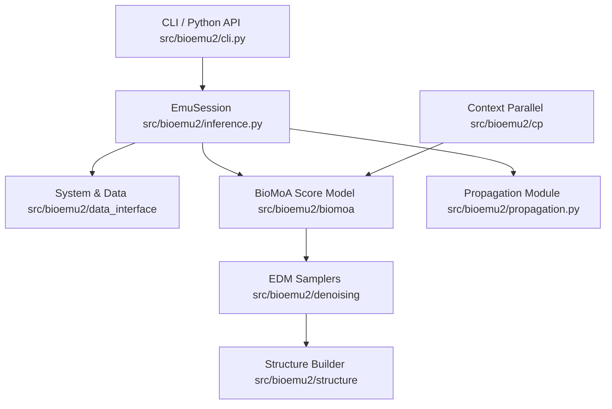
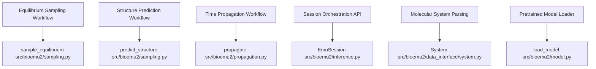

# Overview

Relevant source files

The following files were used as context for generating this wiki page:

- [MODEL_CARD.md](MODEL_CARD.md)
- [README.md](README.md)
- [assets/emu.png](assets/emu.png)
- [src/bioemu2/__init__.py](src/bioemu2/__init__.py)

BioEmu2 ("biomolecular emulator") is a foundation model developed by Microsoft Research AI for Science that generates ensembles of plausible all-atom 3D structures for biomolecules from their chemical composition [MODEL_CARD.md:3-9, README.md:23-24]. The framework supports multi-chain protein complexes, nucleic acids, and small-molecule ligands, enabling researchers to predict folded structures, sample equilibrium thermodynamic ensembles, and propagate molecular structures forward in time [MODEL_CARD.md:3, README.md:9, README.md:26-34].

## Core Capabilities and Architecture

BioEmu2 utilizes a diffusion-based all-atom score model stack known as **BioMoA** (approximately 500M parameters) to sample conformations via reverse diffusion [MODEL_CARD.md:10-13]. Key execution modes include:
- **Structure Prediction:** Deterministic or sampled single-state folding from sequence and template data [README.md:113-117].
- **Equilibrium Sampling:** Generating diverse conformational ensembles representing structural flexibility [README.md:105-108].
- **Time Propagation:** Advancing sampled conformations across specified lag times using implicit transfer operator models (`src/bioemu2/propagation.py`) [README.md:9, README.md:119-127].
- **Inference-Time Steering:** Guiding sampling trajectories using spatial potentials or contact maps (`src/bioemu2/conditioning`, `src/bioemu2/denoising/steering`) [README.md:33].
- **Context-Parallel Distributed Sampling:** Scaling inference across multi-GPU meshes for large macromolecular systems exceeding single-device memory limits (`src/bioemu2/cp`) [README.md:34, README.md:186-200].

Sources: `MODEL_CARD.md:3-13`, `README.md:9-34`, `README.md:105-200`, `src/bioemu2/__init__.py:33-39`

---

## Architectural Data Flow

The following diagram illustrates how user-facing interfaces interact with core data layers, model score networks, samplers, and propagation operators.

*Figure 1: High-level structural data flow connecting user sessions to backend modules.*

Sources: `src/bioemu2/__init__.py:28-46`, `README.md:131-156`

---

## Natural Language Space to Code Entity Space Mapping

To assist with codebase navigation, the diagram below bridges natural language user workflows to their defining implementation files, classes, and entrypoint functions.

*Figure 2: Mapping between high-level functional concepts and their underlying code definitions.*

Sources: `src/bioemu2/__init__.py:28-44`, `src/bioemu2/inference.py`, `src/bioemu2/sampling.py`, `src/bioemu2/propagation.py`

---

## Child Pages

For detailed instructions and technical documentation, refer to the following child pages:

- **[Installation and Environment Setup](#1.1)**: GPU and compute-capability requirements (`cuda` vs `cuda12` extras), virtual environment setup, notebook configuration, and Python version policies [README.md:36-96].
- **[Quick Start and Example Scripts](#1.2)**: CLI command references (`sample-equilibrium`, `predict-structure`, `propagate`), `EmuSession` Python integration examples, and sample dataset inputs [README.md:98-168].
- **[Model Card, Licensing and Third-Party Notices](#1.3)**: Intended model uses, technical limitations, the MIT license, third-party software notices, and responsible AI policies [MODEL_CARD.md:3-56].

Sources: `README.md:36-168`, `MODEL_CARD.md:3-56`

---