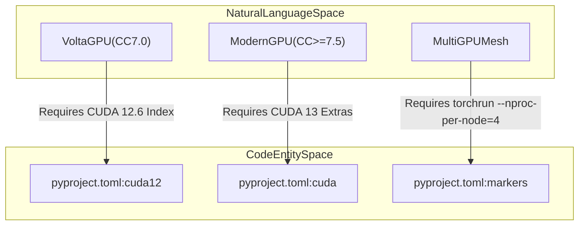
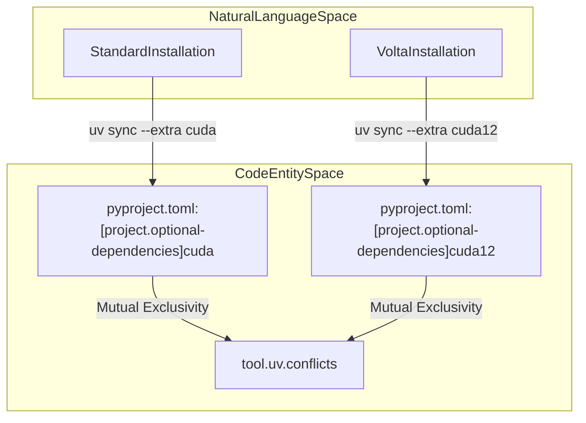

# Installation and Environment Setup

<details>
<summary>Relevant source files</summary>

The following files were used as context for generating this wiki page:

- [.python-version](.python-version)
- [DEVELOPER.md](DEVELOPER.md)
- [README.md](README.md)
- [pyproject.toml](pyproject.toml)

</details>


## Purpose and Scope
This page details the technical requirements, environment isolation strategies, package installation paths, and optional dependency configurations required to deploy BioEmu2. It covers operating system and hardware constraints, Python version policies, selection between `cuda` and `cuda12` extras for specific NVIDIA compute capabilities, virtual environment bootstrapping, and notebook/visualization setup.

---

## 1. Hardware and Operating System Requirements
BioEmu2 is engineered specifically for Linux operating systems equipped with NVIDIA GPUs; macOS and Windows environments are unsupported [README.md:36-38](). The codebase relies heavily on custom CUDA operations and tensor parallel primitives provided by `cuequivariance` and PyTorch.

Hardware tiers are categorized by NVIDIA Compute Capability (CC):
* **Compute Capability $\ge$ 7.5** (e.g., NVIDIA T4, A100, RTX A6000, L40S, H100, B200): Compatible with the default `cuda` installation extra, which installs CUDA 13-based cuEquivariance packages [README.md:39-41]().
* **Compute Capability 7.0** (Volta architecture, e.g., NVIDIA V100): Lacks native `bfloat16` hardware support (emulated via PyTorch autocast) and requires the `cuda12` installation extra coupled with PyTorch CUDA 12.6 binaries [DEVELOPER.md:10-23]().
* **Compute Capability < 7.0**: Unsupported entirely [README.md:86]().
* **Context-Parallel Deployments**: Multi-GPU sampling workflows scale across distributed node meshes and require a minimum of four visible CUDA GPUs [README.md:50]().


*Sources: [README.md:36-51](), [DEVELOPER.md:10-23](), [pyproject.toml:44-59]()*

---

## 2. Python Version Policy and Environment Isolation
The project targets modern Python releases. The repository enforces a baseline of Python $\ge 3.12$ as declared in `pyproject.toml` [pyproject.toml:9]() and `.python-version` [/.python-version:1](). 

While Python 3.12 has been extensively evaluated for benchmark metrics, Python 3.13 and 3.14 successfully compile and pass the core test suites [README.md:88-90](). 

To prevent host pollution, environments should be isolated using Python's built-in `venv` or `uv` [README.md:54-57]().

```bash
python3.12 -m venv .venv
source .venv/bin/activate
```
*Sources: [.python-version:1-1](), [README.md:54-64](), [pyproject.toml:9-17]*

---

## 3. Package Extras: `cuda` vs `cuda12`
Depending on the target GPU architecture, dependencies managed via `pyproject.toml` [pyproject.toml:44-59]() must be resolved with specific optional extras. The `uv` package manager handles dependency synchronization, enforcing mutual exclusivity between the `cuda` and `cuda12` extras via conflict rules [pyproject.toml:82]().


*Sources: [DEVELOPER.md:3-15](), [pyproject.toml:44-59](), [pyproject.toml:82-82]*

### Installation Commands

For modern hardware (Compute Capability $\ge 7.5$):
```bash
python -m pip install ".[cuda]"
```
[README.md:75]()

For Volta hardware (Compute Capability 7.0):
```bash
python -m pip install ".[cuda12]" --extra-index-url https://download.pytorch.org/whl/cu126
```
[README.md:82-84]()

*Sources: [README.md:70-84]()*

---

## 4. Notebook and Visualization Setup
Interactive environments (Jupyter or VS Code notebooks) require additional rendering and kernel dependencies specified under the `viz` optional extra [pyproject.toml:66-72](). 

To register the isolated environment as an active Jupyter kernel named `BioEmu2`, execute the following workflow:

```bash
uv sync --extra cuda --extra viz
uv run python -m ipykernel install --user --name bioemu2 --display-name "BioEmu2"
```
[DEVELOPER.md:35-38]()

*Sources: [DEVELOPER.md:31-38](), [pyproject.toml:66-72]*

---

## 5. Developer Environment Workflow
Contributors working directly on the source tree use `uv` to mirror CI dependency states and run pytest suites [DEVELOPER.md:3-29](). 

The `dev` optional-dependencies group configures `pre-commit`, `pytest`, `pytest-cov`, and `py3dmol` [pyproject.toml:60-65](). 

```bash
uv sync --extra cuda
uv run pytest tests
```
[DEVELOPER.md:6-8](), [DEVELOPER.md:28-28]()

*Sources: [DEVELOPER.md:1-30](), [pyproject.toml:60-65]*

---