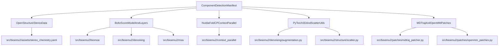

# Model Card, Licensing and Third-Party Notices

<details>
<summary>Relevant source files</summary>

The following files were used as context for generating this wiki page:

- [CODE_OF_CONDUCT.md](CODE_OF_CONDUCT.md)
- [LICENSE](LICENSE)
- [MODEL_CARD.md](MODEL_CARD.md)
- [NOTICES.md](NOTICES.md)
- [SECURITY.md](SECURITY.md)
- [cgmanifest.json](cgmanifest.json)
- [licenses/LICENSE.BOLTZ-MIT](licenses/LICENSE.BOLTZ-MIT)
- [licenses/LICENSE.GEOSTD](licenses/LICENSE.GEOSTD)
- [licenses/LICENSE.GPL-3.0](licenses/LICENSE.GPL-3.0)
- [licenses/LICENSE.LGPL-3.0](licenses/LICENSE.LGPL-3.0)
- [licenses/LICENSE.NVIDIA-FOLD-CP-MIT](licenses/LICENSE.NVIDIA-FOLD-CP-MIT)
- [licenses/LICENSE.PYTORCH3D-BSD](licenses/LICENSE.PYTORCH3D-BSD)
- [licenses/LICENSE.TORCH-SCATTER-MIT](licenses/LICENSE.TORCH-SCATTER-MIT)

</details>


This page documents the model card parameters, intended use cases, known technical limitations, licensing terms, third-party component tracking via `cgmanifest.json`, and security/conduct policies for BioEmu2.

Sources: [MODEL_CARD.md:1-113](), [NOTICES.md:1-135](), [cgmanifest.json:1-149]()

---

## 1.3.1 Model Card: Capabilities, Training, and Limitations

BioEmu2 is a diffusion-based biomolecular emulator foundation model containing approximately 500 million parameters [MODEL_CARD.md:1-11]. It accepts biomolecular sequences, optional multiple sequence alignments (MSAs), contact maps, and conditioning methods to generate generative ensembles of all-atom 3D structures in Cartesian coordinates [MODEL_CARD.md:10-13].

### Primary Use Cases
* Structural biology and computational chemistry research [MODEL_CARD.md:31].
* Predicting 3D structures and conformational ensembles of proteins, multi-chain complexes, ligands, and nucleic acids [MODEL_CARD.md:3].

### Out-of-Scope Use Cases
BioEmu2 is explicitly not validated or intended for:
* Clinical, diagnostic, treatment, dosing, or patient-care decisions [MODEL_CARD.md:37].
* Designing toxins, pathogens, gain-of-function constructs, or hazardous biological agents [MODEL_CARD.md:39].
* Quantitative binding-affinity or absolute free-energy prediction [MODEL_CARD.md:41].
* *De novo* small-molecule design [MODEL_CARD.md:43].
* High-risk, autonomous, or regulated decision-making domains (legal, financial, healthcare) [MODEL_CARD.md:45-47].

### Known Technical Limitations
* **MSA Dependence:** Prediction quality degrades on shallow or missing MSAs, including orphan proteins and viral constructs [MODEL_CARD.md:67].
* **Training-Distribution Bias:** Over-representation of well-studied protein families from the PDB and AFDB; uncharacterized generalization on under-represented classes [MODEL_CARD.md:69].
* **Uncalibrated Ensembles:** Sampling frequency must not be treated as a calibrated Boltzmann probability or absolute thermodynamic free energy [MODEL_CARD.md:71].
* **Physicality Scaling:** Extremely large complexes exceeding 10,000 tokens may exhibit reduced structural physicality [MODEL_CARD.md:75].

Sources: [MODEL_CARD.md:1-113]()

---

## 1.3.2 Licensing Architecture

Code authored directly by Microsoft for BioEmu2 is licensed under the **MIT License** [NOTICES.md:3]. 

```text
MIT License

Copyright (c) Microsoft Corporation.

Permission is hereby granted, free of charge, to any person obtaining a copy
of this software and associated documentation files (the "Software"), to deal
in the Software without restriction, including without limitation the rights
to use, copy, modify, merge, publish, distribute, sublicense, and/or sell
copies of the Software, and to permit persons to whom the Software is
furnished to do so, subject to the following conditions:
...
```

Sources: [LICENSE:1-21](), [NOTICES.md:1-4]()

---

## 1.3.3 Third-Party Notices and Component Manifest (`cgmanifest.json`)

The codebase incorporates or adapts several external open-source projects. These dependencies are tracked programmatically via `cgmanifest.json` and cataloged in `NOTICES.md`.

| Upstream Component | License | Target Code Entity / Asset Path | Upstream Reference |
| :--- | :--- | :--- | :--- |
| **OpenStructure** | LGPL-3.0 / GPL-3.0 | `src/bioemu2/assets/stereo_chemistry.yaml` | `git.scicore.unibas.ch/schwede/openstructure` [cgmanifest.json:9-17]() |
| **GeoSTD** | GeoSTD (LBNL) | `src/bioemu2/assets/stereo_chemistry.yaml` | `github.com/phenix-project/geostd` [cgmanifest.json:23-30]() |
| **Boltz (v1.0.0)** | MIT | `src/bioemu2/biomoa`, `src/bioemu2/denoising`, `src/bioemu2/msa`, `src/bioemu2/data_interface` | `github.com/jwohlwend/boltz` [cgmanifest.json:36-49]() |
| **PyTorch3D** | BSD | `src/bioemu2/denoising/augmentation.py` | `github.com/facebookresearch/pytorch3d` [cgmanifest.json:83-91]() |
| **torch_scatter** | MIT | `src/bioemu2/structure/scatter.py` | `github.com/rusty1s/pytorch_scatter` [cgmanifest.json:97-104]() |
| **NVIDIA Fold-CP** | MIT | `src/bioemu2/context_parallel` | `github.com/NVIDIA-BioNeMo/boltz-cp` [cgmanifest.json:110-117]() |
| **MDTraj & OpenMM** | LGPL-3.0 / MIT | `src/bioemu2/patches/mdtraj_patcher.py`, `src/bioemu2/patches/openmm_patches.py` | `github.com/mdtraj/mdtraj`, `github.com/openmm/openmm` [cgmanifest.json:123-146]() |


*Diagram: Mapping of external components registered in `cgmanifest.json` to internal codebase assets and source modules.*

Sources: [NOTICES.md:1-135](), [cgmanifest.json:1-149]()

---

## 1.3.4 Security and Conduct Policies

### Security Reporting
Vulnerabilities should not be reported through public GitHub issues [SECURITY.md:8]. Reports must be submitted according to the guidelines outlined at [https://aka.ms/SECURITY.md](https://aka.ms/SECURITY.md) [SECURITY.md:11-12].

### Code of Conduct
Contributors and maintainers are expected to adhere to the [Microsoft Open Source Code of Conduct](https://opensource.microsoft.com/codeofconduct/) [CODE_OF_CONDUCT.md:3]. Questions or moderation issues can be directed to `opencode@microsoft.com` [CODE_OF_CONDUCT.md:9].

Sources: [SECURITY.md:1-14](), [CODE_OF_CONDUCT.md:1-10]()

---