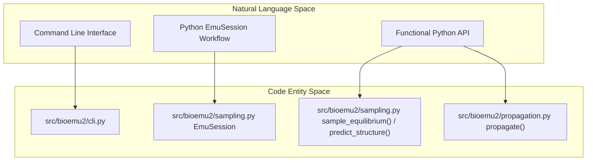
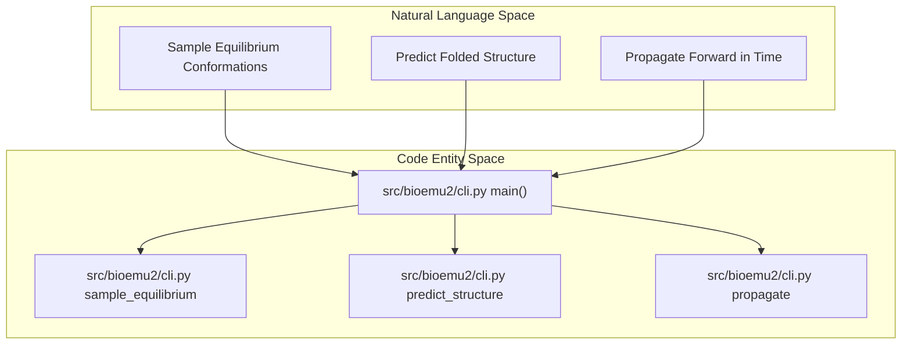

# User-Facing Interfaces

Relevant source files

The following files were used as context for generating this wiki page:

- [README.md](README.md)
- [docs/functional-api.md](docs/functional-api.md)
- [src/bioemu2/cli.py](src/bioemu2/cli.py)

BioEmu2 provides multiple user-facing entry points designed to support biomolecular modeling workflows from both the command line and interactive or programmatic Python environments. These interfaces abstract away the underlying complexities of the BioMoA score model stack, structure building, and denoising samplers.

For details, refer to the child pages:
- [Command Line Interface](#2.1)
- [Python API: EmuSession and Functional API](#2.2)
- [Defining Molecular Systems](#2.3)
- [Outputs, Trajectories and Visualization](#2.4)

*Sources: [src/bioemu2/cli.py:1-42](), [README.md:100-157](), [docs/functional-api.md:1-12]() unitarity*

---

## 2.1. Command Line Interface

The Command Line Interface (CLI) is built using `click` and exposes three primary subcommands: `sample-equilibrium`, `predict-structure`, and `propagate`. The CLI parses system configurations, checkpoint parameters, sampling algorithm presets (`edm`, `edm_gd`, `edm_fk`, `edm_fkc`), and hardware execution options.

For comprehensive documentation on CLI options, subcommands, arguments, and batch configurations, see the child page [Command Line Interface](#2.1).

*Sources: [src/bioemu2/cli.py:1-168](), [README.md:100-129]()*

- Sources: [src/bioemu2/cli.py:1-168](), [README.md:100-129]()

---

## 2.2. Python API: EmuSession and Functional API

For programmatic usage, BioEmu2 provides stateful class-based abstractions via `EmuSession` as well as high-level and low-level functional APIs. `EmuSession` maintains system representations and model states in memory across multiple sampling or propagation tasks, minimizing redundant computations.

High-level functions (`sample_equilibrium()`, `predict_structure()`, `propagate()`) handle end-to-end execution, whereas low-level counterparts (`sample_with_embeddings()`, `propagate_with_embeddings()`) allow precise control over MSA acquisition, custom samplers, and embedding reuse.

For details, see [Python API: EmuSession and Functional API](#2.2).

- Sources: [docs/functional-api.md:1-78](), [README.md:131-168]()

---

## 2.3. Defining Molecular Systems

Molecular systems in BioEmu2 are represented by the `System` class and can be configured through YAML specification files, RCSB PDB identifiers, or Boltz-format inputs. These specifications capture individual chains, polymers, ligands, nucleic acids, and custom bond constraints or contact maps.

The data interface layer parses and validates these entries into internal topological representations before structure generation or embedding calculations.

For details, see [Defining Molecular Systems](#2.3).

- Sources: [src/bioemu2/data_interface/__init__.py](), [docs/functional-api.md:25-31]()

---

## 2.4. Outputs, Trajectories and Visualization

Generated outputs are structured consistently across all user-facing interfaces. The `save_frames()` utility serializes generated conformational ensembles into standard file formats, notably `topology.cif` for system structure and `samples.xtc` for trajectory frames, alongside physicality reports and system YAML snapshots.

For information on trajectory I/O, format specifications, checkpoint resumption, and visualization notebook workflows, see [Outputs, Trajectories and Visualization](#2.4).

- Sources: [docs/functional-api.md:43-56](), [README.md:158-160]()

---