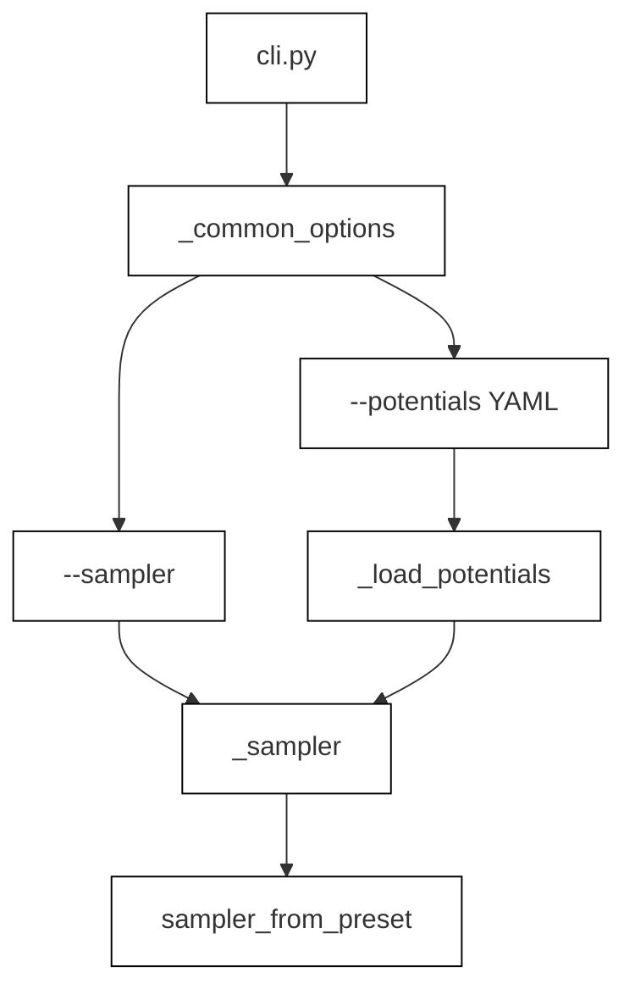
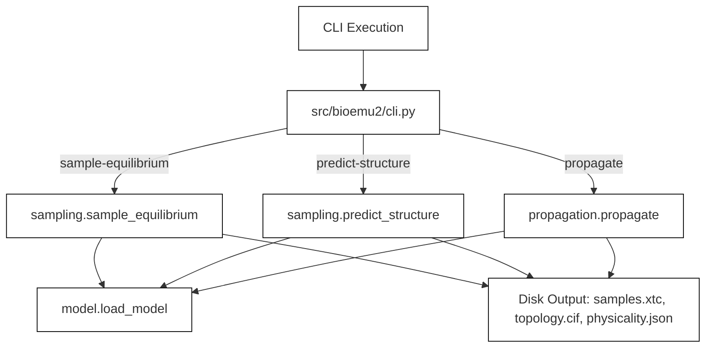

# Command Line Interface

Relevant source files

The following files were used as context for generating this wiki page:

- [docs/propagation.md](docs/propagation.md)
- [docs/sampling.md](docs/sampling.md)
- [src/bioemu2/cli.py](src/bioemu2/cli.py)

The command-line interface (CLI) for BioEmu2 is implemented in `src/bioemu2/cli.py` [src/bioemu2/cli.py:1-734]() using the `click` package. It exposes subcommands for equilibrium sampling, structure prediction, and time-resolved propagation, orchestrating model loading, MSA acquisition, sampler configuration, and file output generation.

Sources: [src/bioemu2/cli.py:1-734]()

## Subcommands and Core Workflows

The CLI exposes three primary operations for molecular emulation:

- **`sample-equilibrium`**: Draws independent conformations from the modeled equilibrium ensemble [docs/sampling.md:107-116](). It defaults to `step_scale=1.0` without heuristic sharpening.
- **`predict-structure`**: Generates an accurate individual folded structure [docs/sampling.md:107-116]() by applying heuristic sharpening (e.g., `step_scale=1.5`).
- **`propagate`**: Samples a structure $x_t$ at a future time lag $\tau$ (`--lag-time-ns`) from a starting conformation ($x_0$), allowing time-ordered trajectory simulation [docs/propagation.md:1-25]().

Each subcommand requires either a system specification YAML file via `--system` or an RCSB PDB entry via `--pdb-id` (except for `propagate`, which can infer the system directly from an external starting CIF file when both are omitted) [src/bioemu2/cli.py:73-88]().

Sources: [src/bioemu2/cli.py:73-88](), [docs/sampling.md:107-116](), [docs/propagation.md:1-25]()

## Common Options, Checkpoints, and Sampler Configuration

Common arguments and execution parameters are injected into CLI commands via the `_common_options` decorator helper [src/bioemu2/cli.py:71-165](). These include:

- `--system` and `--pdb-id`: Define the molecular entities, chains, and contact definitions.
- `--checkpoint` and `--checkpoint-path`: Configure model weights from Hugging Face (`SUPPORTED_CHECKPOINTS`) or local disk.
- `--out`: Mandatory output directory where trajectories and metadata are stored [src/bioemu2/cli.py:111-118]().
- `--sampler` and `--potentials`: Select sampling algorithms (`edm`, `edm_gd`, `edm_fk`, `edm_fkc`) and optional physical steering potential YAML files [src/bioemu2/cli.py:138-151]().

The helper function `_sampler()` initializes the appropriate `Sampler` instance by combining the preset name with physical potentials loaded through `_load_potentials()` [src/bioemu2/cli.py:48-69]().

*Figure 1: CLI option parsing and sampler construction pipeline bridging command-line flags to Python sampler objects.*

Sources: [src/bioemu2/cli.py:48-165]()

## Outputs, Trajectories, and Physicality Reporting

Execution via the CLI writes standardized outputs to the target directory specified by `--out` [src/bioemu2/cli.py:111-118](). Depending on the subcommand, these artifacts include:

- `samples.xtc`: MDTraj-compatible trajectory file containing all generated frames.
- `topology.cif`: mmCIF topology file matching the atoms and residue ordering of the trajectory frames.
- `physicality.json`: Structured report detailing physicality checks per frame (e.g., bond lengths, clashes, chirality, chain breaks) categorized by `passed`, `rejected`, or `not_checked` [docs/sampling.md:39-44]().
- `system.yaml` and `command.txt`: Metadata capturing the exact system specification and invocation command for reproducibility.

Sources: [src/bioemu2/cli.py:111-118](), [docs/sampling.md:39-44](), [docs/propagation.md:79-88]()

## Implementation Architecture

The CLI module acts as a thin wrapper around core library functions in `bioemu2.sampling`, `bioemu2.propagation`, and `bioemu2.context_parallel`. 

*Figure 2: Data flow architecture from CLI entrypoints in `src/bioemu2/cli.py` to backend inference routines and file outputs.*

Sources: [src/bioemu2/cli.py:20-40]()

---