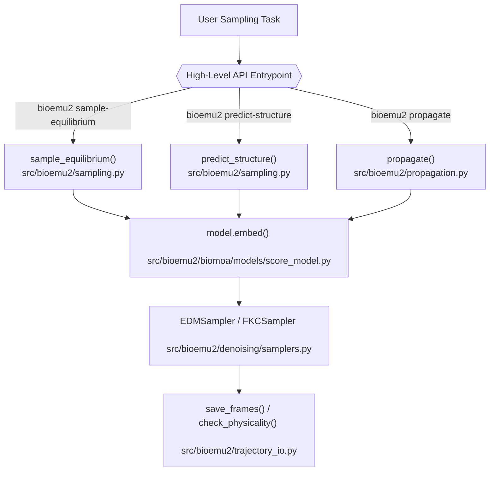
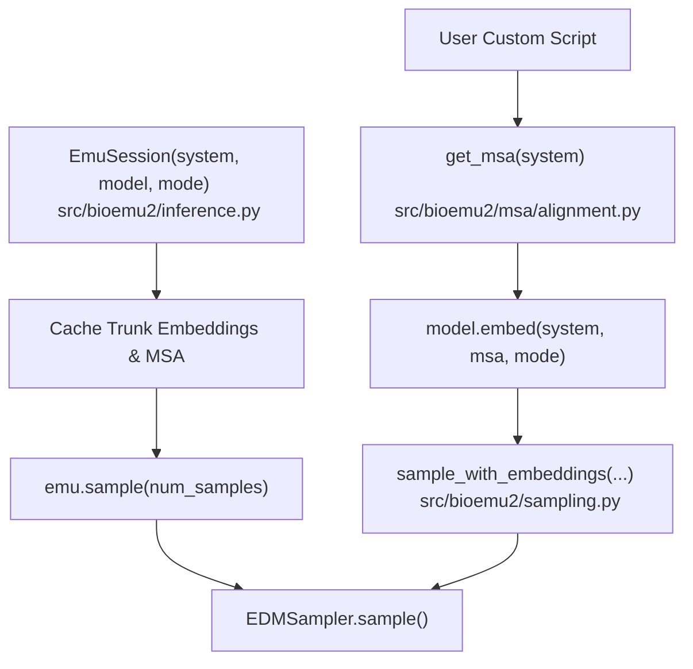

# Python API: EmuSession and Functional API

<details>
<summary>Relevant source files</summary>

The following files were used as context for generating this wiki page:

- [docs/functional-api.md](docs/functional-api.md)
- [docs/sampling.md](docs/sampling.md)
- [src/bioemu2/__init__.py](src/bioemu2/__init__.py)

</details>


The Python API for BioEmu2 provides flexible programmatic access to biomolecular emulation, structure prediction, equilibrium sampling, and time propagation. It spans three main abstraction levels: stateful sessions (`EmuSession`), convenient high-level functional wrappers (`sample_equilibrium`, `predict_structure`, `propagate`), and fine-grained low-level operators (`sample_with_embeddings`, `propagate_with_embeddings`, `model.embed`) that give full control over multiple sequence alignments (MSAs), token embeddings, and sampling configurations [docs/functional-api.md:1-18](), [docs/sampling.md:72-106]().

---

## 1. Core Python API Components and Entrypoints

The public Python interface is exposed directly through `src/bioemu2/__init__.py`, exporting core classes and functions such as `EmuSession`, `System`, `load_model`, `get_msa`, `EDMSampler`, `sample_equilibrium`, `predict_structure`, and `propagate` [src/bioemu2/__init__.py:10-46](). 

The architecture divides responsibilities across specialized execution modules:
* `src/bioemu2/inference.py`: Implements `EmuSession`, managing state caching for trunk embeddings, MSAs, and input validation.
* `src/bioemu2/sampling.py`: Implements high-level sampling functions (`sample_equilibrium`, `predict_structure`) and low-level workers (`sample_with_embeddings`), along with physicality checking routines (`check_physicality`).
* `src/bioemu2/propagation.py`: Implements implicit transfer operator (ITO) time propagation (`propagate`, `propagate_with_embeddings`, `simulate_trajectory`).

Sources: [src/bioemu2/__init__.py:1-87](), [docs/functional-api.md:1-18](), [docs/sampling.md:72-106]()

---

## 2. Stateful Sampling with `EmuSession`

`EmuSession` wraps a biomolecular `System`, a model loaded via `load_model()`, and an MSA to provide an object-oriented workflow [docs/sampling.md:72-87](). 

```python
from pathlib import Path
from bioemu2 import EmuSession, System, load_model, save_frames

system = System.from_pdb_id("1AKE")
model = load_model()
emu = EmuSession(system, model=model, mode="equilibrium")
samples = emu.sample(num_samples=64)
save_frames(samples, Path("outputs/adk-python"))
```

### Modes and Caching
`EmuSession` operates in two distinct task modes configured via `mode`:
1. `mode="equilibrium"`: Runs sampling with equilibrium conditioning and `step_scale=1.0`, targeting an ensemble of conformations [docs/sampling.md:107-116]().
2. `mode="structure"`: Runs sampling with structure-prediction conditioning and heuristic sharpening (`step_scale=1.5`), targeting high-accuracy individual folded structures [docs/sampling.md:107-116]().

An `EmuSession` caches its MSA and trunk embeddings in memory [docs/sampling.md:98-106](). Consequently, inputs must be treated as immutable. Modifying `EmuSession.system` or its contact definitions in place after initialization raises an error on subsequent calls to `.sample()` or `.propagate()` [docs/sampling.md:98-106](). To change inputs, instantiate a new `EmuSession` [docs/sampling.md:98-106](). Note that `EmuSession` does not support multi-GPU context-parallel sampling; for systems requiring context parallelism, use the functional API [docs/sampling.md:89-91]().

Sources: [docs/sampling.md:72-171]()

---

## 3. Functional API: High-Level vs. Low-Level Workflows

The functional API allows sampling and time propagation without manually managing an `EmuSession` state object [docs/functional-api.md:1-5]().

| Task | High-Level Function | Low-Level Equivalent |
| --- | --- | --- |
| Predict a structure | `predict_structure()` | `sample_with_embeddings()` with `mode="structure"` and `EDMSampler(step_scale=1.5)` [docs/functional-api.md:9]() |
| Sample equilibrium | `sample_equilibrium()` | `sample_with_embeddings()` with `mode="equilibrium"` and `EDMSampler(step_scale=1.0)` [docs/functional-api.md:10]() |
| Propagate structures | `propagate()` | `propagate_with_embeddings()` with `mode="equilibrium"` and `EDMSampler(step_scale=1.0)` [docs/functional-api.md:11]() |

Sources: [docs/functional-api.md:1-12]()

### High-Level Convenience Functions
High-level functions compute or fetch MSAs and trunk embeddings on every call (unless the automatic disk cache is enabled) and accept sampler preset strings like `"edm"`, `"edm_gd"`, `"edm_fk"`, or `"edm_fkc"` [docs/functional-api.md:13-15](), [docs/functional-api.md:33-37](). 

```python
from bioemu2 import System, load_model, sample_equilibrium

system = System.from_pdb_id("1AKE")
samples = sample_equilibrium(
    system, model=load_model(), num_samples=64, output_dir="outputs/adk-python",
)
```

When provided with an `output_dir`, these functions evaluate physicality filters (defaulting to `physicality_mode="high_quality"`), write all generated frames to `samples.xtc`, and store associated assets (`topology.cif`, `system.yaml`, and `physicality.json`) [docs/functional-api.md:43-47](). If interrupted, rerunning the identical command resumes execution from partial batches stored in `<output_dir>/partial` [docs/functional-api.md:49-55]().

### Low-Level Customization
The low-level API (`sample_with_embeddings`, `propagate_with_embeddings`) decouples MSA acquisition and trunk embedding computation from the sampling loop [docs/functional-api.md:13-18](). This avoids redundant trunk passes when performing multiple sampling or propagation tasks on the same system [docs/functional-api.md:143-149]().

```python
from bioemu2 import EDMSampler, System, get_msa, load_model, sample_with_embeddings

system = System.from_pdb_id("1AKE")
model = load_model()
msa = get_msa(system)
embeddings = model.embed(system, msa=msa, mode="equilibrium")
samples = sample_with_embeddings(
    system,
    embeddings,
    model=model,
    num_samples=8,
    sampler=EDMSampler(step_scale=1.0),
)
```

Sources: [docs/functional-api.md:1-78](), [docs/functional-api.md:143-152]()

---

## 4. Architecture and Control Flow Diagrams

The following diagrams bridge the natural language operations requested by users to the underlying code entities in the `bioemu2` package.

### High-Level Task to Code Entity Mapping


Sources: [src/bioemu2/__init__.py:1-87](), [docs/functional-api.md:1-12]()

### Stateful vs. Low-Level Execution Flow


Sources: [src/bioemu2/__init__.py:1-87](), [docs/functional-api.md:58-78](), [docs/sampling.md:72-106]()

---