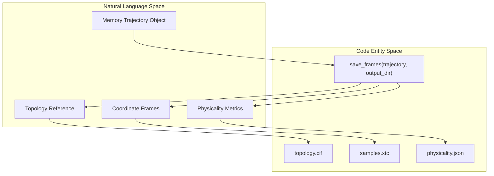
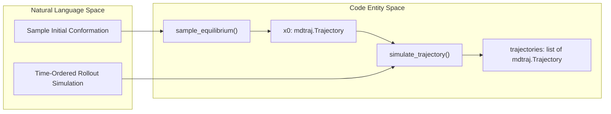
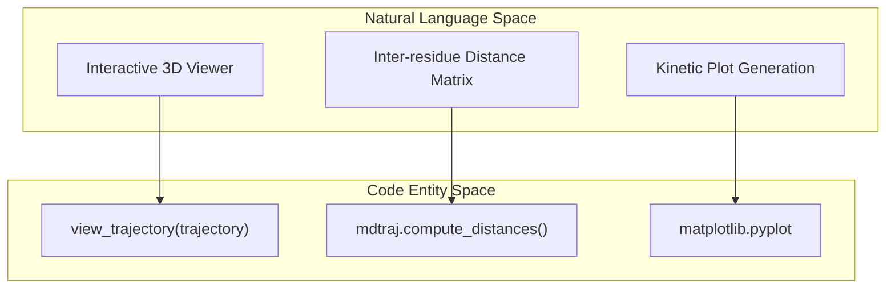

# Outputs, Trajectories and Visualization

<details>
<summary>Relevant source files</summary>

The following files were used as context for generating this wiki page:

- [DEVELOPER.md](DEVELOPER.md)
- [docs/propagation.md](docs/propagation.md)
- [examples/simulate_a_trajectory.py](examples/simulate_a_trajectory.py)

</details>


This section covers the data structures, serialization formats, visualization utilities, and notebook workflows used in BioEmu2 to manage, save, and inspect molecular conformations and time-ordered trajectories. BioEmu2 leverages [`mdtraj.Trajectory`]() objects [examples/simulate_a_trajectory.py:21]() as the standard memory container for structural coordinates, enabling direct integration with established cheminformatics and molecular dynamics toolchains.

---

## Output Formats and Serialization

BioEmu2 standardizes structural outputs into two primary files: a topology reference file (`topology.cif`) and a coordinate trajectory file (`samples.xtc`) [docs/propagation.md:108](). 

- **`topology.cif`**: An mmCIF-formatted file containing the system topology, residue definitions, and reference coordinates (typically frame 0 or the starting configuration).
- **`samples.xtc`**: An XTC binary trajectory file containing coordinate frames for all generated samples or trajectory steps.
- **`physicality.json`**: Optional JSON metadata storing metrics and validation flags evaluating the physical plausibility of each generated frame [docs/propagation.md:84]().

The utility function `save_frames()` handles writing these components to a target output directory [docs/propagation.md:108]().



Sources: [docs/propagation.md:79-88](), [docs/propagation.md:108-112]()

---

## Trajectories vs. Endpoints

BioEmu2 differentiates between unordered structural ensembles (such as those from equilibrium sampling) and time-ordered rollouts (`simulate_trajectory`) [examples/simulate_a_trajectory.py:8-10]().

- **Endpoints (`propagate`)**: Draws independent future conformations at a specified time lag (`lag_time_ns`), representing a distribution of endpoints rather than a continuous movie [docs/propagation.md:16-20]().
- **Time-Ordered Trajectories (`simulate_trajectory`)**: Computes sequential rollouts where each trajectory includes the starting structure at time zero followed by successive propagation steps [examples/simulate_a_trajectory.py:57-58](). 

MDTraj internally stores frame times in picoseconds [examples/simulate_a_trajectory.py:103](); users can extract elapsed time in nanoseconds by scaling `trajectory.time / 1000` [examples/simulate_a_trajectory.py:111]().



Sources: [docs/propagation.md:16-20](), [examples/simulate_a_trajectory.py:44-72]()

---

## Visualization Helpers and Notebook Integration

Interactive visualization is supported via `view_trajectory` from `bioemu2.visualization` [examples/simulate_a_trajectory.py:31](). This renders structural rollouts directly inside Jupyter environments [examples/simulate_a_trajectory.py:85]().

To set up a functional development and visualization notebook environment, install the `viz` package extra alongside CUDA dependencies and register an IPython kernel [DEVELOPER.md:31-38]():

```bash
uv sync --extra cuda --extra viz
uv run python -m ipykernel install --user \
  --name bioemu2 --display-name "BioEmu2"
```

Analytical workflows often combine `mdtraj` metric computations (such as alpha-carbon distance tracking across functional domains) with `matplotlib` for plotting trajectory kinetics [examples/simulate_a_trajectory.py:100-118]().



Sources: [DEVELOPER.md:31-38](), [examples/simulate_a_trajectory.py:31](), [examples/simulate_a_trajectory.py:100-118]()

---