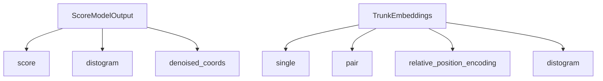
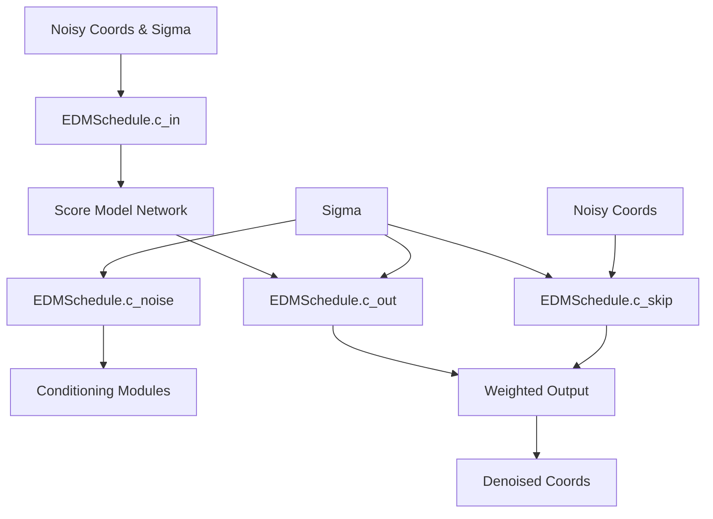
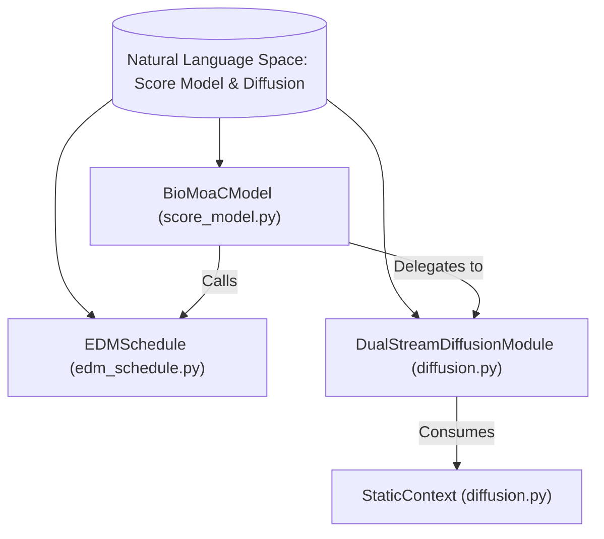
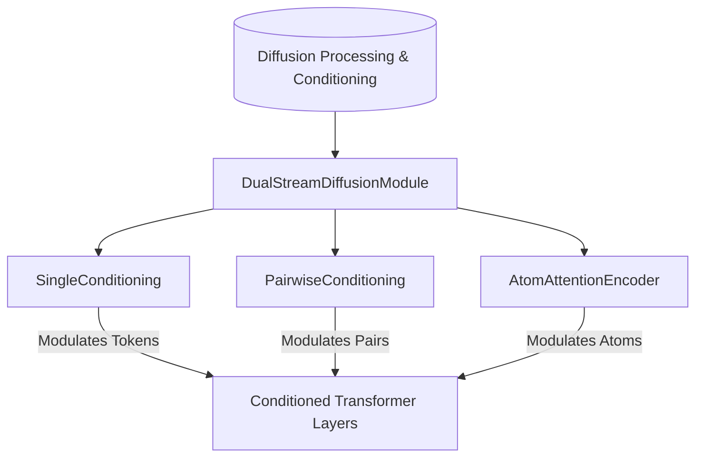

# Score Model and Diffusion Schedule

Relevant source files

The following files were used as context for generating this wiki page:

- [src/bioemu2/biomoa/models/base.py](src/bioemu2/biomoa/models/base.py)
- [src/bioemu2/biomoa/models/edm_schedule.py](src/bioemu2/biomoa/models/edm_schedule.py)
- [src/bioemu2/biomoa/models/score_model.py](src/bioemu2/biomoa/models/score_model.py)
- [src/bioemu2/biomoa/modules/diffusion.py](src/bioemu2/biomoa/modules/diffusion.py)

## Purpose and Scope

This page covers the core score model architecture and noise conditioning framework of BioEmu2, implemented within the `biomoa` subpackage. It details the Elucidating the Design Space of Diffusion-Based Generative Models (EDM) preconditioning framework [src/bioemu2/biomoa/models/edm_schedule.py:1-86](), the unified score model abstractions and embedding containers [src/bioemu2/biomoa/models/base.py:1-12](), [src/bioemu2/biomoa/models/score_model.py:1-94](), and how sequence trunks integrate with the dual-stream diffusion module [src/bioemu2/biomoa/modules/diffusion.py:1-67]().

Sources:
- `src/bioemu2/biomoa/models/base.py:1-13`
- `src/bioemu2/biomoa/models/edm_schedule.py:1-87`
- `src/bioemu2/biomoa/models/score_model.py:1-94`
- `src/bioemu2/biomoa/modules/diffusion.py:1-67`

---

## Base Model Abstractions and Output Containers

BioEmu2 defines dataclass containers to standardize inputs, intermediate representations, and outputs across score model components.

*   `ScoreModelOutput`: Shared output container defined in `src/bioemu2/biomoa/models/base.py` [src/bioemu2/biomoa/models/base.py:6-12](). It holds the unitless Karras EDM `score` tensor, optional `distogram` logits over distance bins, and reconstructed `denoised_coords` in Angstroms.
*   `TrunkEmbeddings`: Caches sequence-trunk representations in `src/bioemu2/biomoa/models/score_model.py` [src/bioemu2/biomoa/models/score_model.py:30-49]() (`s_inputs`, `single`, `pair`, `relative_position_encoding`, and `distogram`). It supports user-managed disk persistence via `.save()` and `.load()` [src/bioemu2/biomoa/models/score_model.py:50-79]() to enable embedding reuse.
*   `DenoiseOutput`: Encapsulates the score model outputs resulting from `BioMoaCModel.denoise` [src/bioemu2/biomoa/models/score_model.py:81-93]().

*Sources: `src/bioemu2/biomoa/models/base.py:1-13`, `src/bioemu2/biomoa/models/score_model.py:30-93`*

---

## EDM Noise Schedule and Preconditioning

The noise schedule and preconditioning framework are implemented by `EDMSchedule` in `src/bioemu2/biomoa/models/edm_schedule.py` [src/bioemu2/biomoa/models/edm_schedule.py:6-86](). Following Karras et al. (2022), the schedule scales network inputs and outputs based on noise level $\sigma$ and data standard deviation $\sigma_{\text{data}}$ (set to $16.0$ Å by default).

The key preconditioning scaling formulas implemented in code are:

*   **Input Scaling (`c_in`)**: Scales noisy coordinates passed to the score model [src/bioemu2/biomoa/models/edm_schedule.py:60-74]():
    $$\text{coords}_{\text{input}} = c_{\text{in}}(\sigma) \cdot \text{coords} = \frac{1}{\sqrt{\sigma^2 + \sigma_{\text{data}}^2}} \cdot \text{coords}$$
*   **Skip Scaling (`c_skip`)**: Weights the noisy coordinates in the final denoised reconstruction [src/bioemu2/biomoa/models/edm_schedule.py:30-44]():
    $$c_{\text{skip}}(\sigma) = \frac{\sigma_{\text{data}}^2}{\sigma^2 + \sigma_{\text{data}}^2}$$
*   **Output Scaling (`c_out`)**: Scales the raw neural network output before adding it to the skip connection [src/bioemu2/biomoa/models/edm_schedule.py:45-59]():
    $$c_{\text{out}}(\sigma) = \frac{\sigma \cdot \sigma_{\text{data}}}{\sqrt{\sigma_{\text{data}}^2 + \sigma^2}}$$
    $$\text{coords}_{\text{denoised}} = c_{\text{skip}}(\sigma) \cdot \text{coords}_{\text{noisy}} + c_{\text{out}}(\sigma) \cdot \text{model\_output}$$
*   **Noise Conditioning (`c_noise`)**: Computes time/noise conditioning inputs for embedding layers [src/bioemu2/biomoa/models/edm_schedule.py:75-86]():
    $$c_{\text{noise}}(\sigma) = \frac{1}{4} \ln\left(\frac{\sigma}{\sigma_{\text{data}}}\right)$$

*Sources: `src/bioemu2/biomoa/models/edm_schedule.py:6-87`*

---

## Score Model Architecture (`BioMoaCModel`)

The primary score model architecture is `BioMoaCModel`, defined in `src/bioemu2/biomoa/models/score_model.py` [src/bioemu2/biomoa/models/score_model.py:95-159](). It integrates a sequence embedder (`PairMixerSequenceEmbedder`) with a dual-stream diffusion module (`DualStreamDiffusionModule`) [src/bioemu2/biomoa/modules/diffusion.py:68-127]().

### Key Responsibilities and Data Flow
1.  **Sequence Trunk Processing**: Computes sequence and pair representations from inputs via `PairMixerSequenceEmbedder` and relative position encoders [src/bioemu2/biomoa/models/score_model.py:95-159]().
2.  **Static Context Construction**: Precomputes coordinate-independent conditioned pair representations and atom encoder contexts encapsulated in `StaticContext` [src/bioemu2/biomoa/modules/diffusion.py:30-66]().
3.  **Denoising Step (`denoise`)**: Applies `EDMSchedule` preconditioning coefficients (`c_in`, `c_skip`, `c_out`) to scale incoming coordinates before running the underlying dual-stream diffusion layers.

*Sources: `src/bioemu2/biomoa/models/score_model.py:95-159`, `src/bioemu2/biomoa/modules/diffusion.py:30-127`*

---

## Dual-Stream Diffusion Module

The `DualStreamDiffusionModule` handles alternating atom-level and token-level transformer layers combined with cross-stream coupling [src/bioemu2/biomoa/modules/diffusion.py:68-127]().

### Conditioning Subsystems
*   `SingleConditioning`: Injects noise conditioning (`c_noise`), single token features, and optional MD dynamics conditioning (`dt`) into the token stream [src/bioemu2/biomoa/modules/diffusion.py:140-149]().
*   `PairwiseConditioning`: Transforms pair representations and relative position features through transition blocks [src/bioemu2/biomoa/modules/diffusion.py:151-157]().
*   `AtomAttentionEncoder`: Embeds atomic node and pair features directly inside the diffusion module without requiring a separate encoder backbone [src/bioemu2/biomoa/modules/diffusion.py:159-161]().

*Sources: `src/bioemu2/biomoa/modules/diffusion.py:68-161`*

---