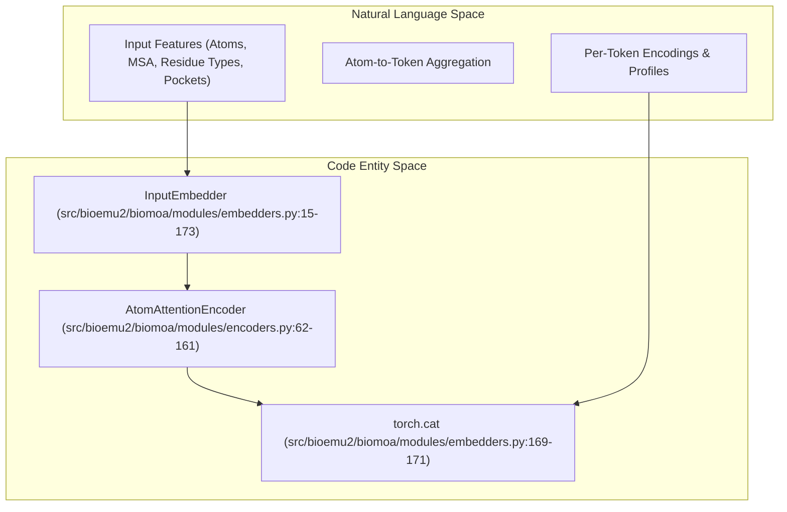
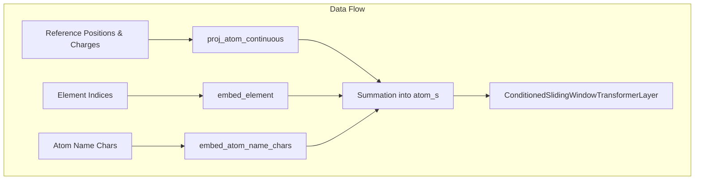

# Network Modules

Relevant source files

The following files were used as context for generating this wiki page:

- [src/bioemu2/biomoa/modules/__init__.py](src/bioemu2/biomoa/modules/__init__.py)
- [src/bioemu2/biomoa/modules/conditioning.py](src/bioemu2/biomoa/modules/conditioning.py)
- [src/bioemu2/biomoa/modules/embedders.py](src/bioemu2/biomoa/modules/embedders.py)
- [src/bioemu2/biomoa/modules/encoders.py](src/bioemu2/biomoa/modules/encoders.py)
- [src/bioemu2/biomoa/modules/pairmixer.py](src/bioemu2/biomoa/modules/pairmixer.py)
- [src/bioemu2/biomoa/modules/relative_position_encoder.py](src/bioemu2/biomoa/modules/relative_position_encoder.py)
- [src/bioemu2/biomoa/modules/time.py](src/bioemu2/biomoa/modules/time.py)
- [src/bioemu2/biomoa/modules/transformer.py](src/bioemu2/biomoa/modules/transformer.py)

The purpose of this page is to detail the architecture, implementation, and data flow of the core network modules within the BioEmu2 BioMoA model stack. These modules handle input feature extraction, atom-to-token aggregation, relative positioning, temporal decay, conditioning (contact and method maps), self-attention layers, and the PairMixer sequence trunk.

---

## 3.2.1 Input Embedder & Feature Integration

The input embedder aggregates atom-level representations and per-token sequence features into a unified single representation vector. It is implemented via `InputEmbedder` in `src/bioemu2/biomoa/modules/embedders.py`.

The `InputEmbedder` concatenates the token-aggregated output from the atom attention encoder with raw per-token features: residue type one-hot encodings, continuous MSA profiles, deletion means, and pocket feature class indicators.

*Diagram 1: Mapping input embedder concepts to `InputEmbedder` and `AtomAttentionEncoder`.*

Sources: `src/bioemu2/biomoa/modules/embedders.py:15-173`

---

## 3.2.2 Encoders and Atom Attention

Atom-level representations are processed using windowed self-attention layers inside `AtomAttentionEncoder`. The encoder maps continuous atom coordinates, charges, element types, and atom name characters into high-dimensional embedding spaces.

Key classes and logic:
- `AtomAttentionEncoderStaticContext`: Holds static caches for atom features `q`, conditioning features `c`, and windowed pair representations `p` (`[src/bioemu2/biomoa/modules/encoders.py:34-60]()`).
- `AtomAttentionEncoder`: Manages linear projections for continuous atom attributes, element embeddings (`nn.Embedding`), atom name character embeddings, and sliding window transformer layers (`[src/bioemu2/biomoa/modules/encoders.py:62-161]`).

*Diagram 2: Atom encoder feature transformation pipeline.*

Sources: `src/bioemu2/biomoa/modules/encoders.py:34-161`

---

## 3.2.3 Conditioning Modules (Contact & Method)

BioMoA supports specialized conditioning inputs, including distance-based contact maps and experimental method types, which inject biological priors into both single and pair representations.

- `ContactConditioning`: Encodes contact maps and distance thresholds using Fourier embeddings (`FourierEmbedding`), projecting them into pair biases with mask validation (`[src/bioemu2/biomoa/modules/conditioning.py:20-83]()`).
- `MethodConditioning`: Embeds assay/method type indices into additive single-representation biases and optional pair-representation biases (`[src/bioemu2/biomoa/modules/conditioning.py:85-125]()`).

Sources: `src/bioemu2/biomoa/modules/conditioning.py:20-126`

---

## 3.2.4 Time Embeddings

Lag times and diffusion timescales are injected using functional exponential embeddings located in `src/bioemu2/biomoa/modules/time.py`.

- `MultiExponentialTimeEmbedding`: Computes multi-exponential decay factors across log-spaced timescales $\tau$ (`[src/bioemu2/biomoa/modules/time.py:9-27]()`).
- `DampedHarmonicTimeEmbedding`: Computes exponentially damped sinusoidal and cosinusoidal harmonic oscillations over time scales (`[src/bioemu2/biomoa/modules/time.py:29-78]()`).

Sources: `src/bioemu2/biomoa/modules/time.py:9-79`

---

## 3.2.5 Relative Position Encoder

Pairwise relative coordinates, chain IDs, and entity flags are encoded without explicit one-hot intermediate allocations using `FusedRelativePositionEncoder` (`[src/bioemu2/biomoa/modules/relative_position_encoder.py:14-101]()`).

The module looks up embeddings for relative residue separation, relative token offsets, chain boundaries, and entity identity matches, initializing weights with a variance-preserving normal distribution $\mathcal{N}(0, 1/4)$.

Sources: `src/bioemu2/biomoa/modules/relative_position_encoder.py:14-102`

---

## 3.2.6 Transformers and Attention Layers

Transformer blocks combine self-attention with pair biases, supporting both full token attention and sliding-window atom attention (`[src/bioemu2/biomoa/modules/transformer.py:1-174]()`).

- `ada_ln`: Implements adaptive layer normalization scaling and shifting (`[src/bioemu2/biomoa/modules/transformer.py:26-42]()`).
- `AttentionLayer`: Wraps `AttentionPairBias` or `AttentionPairBiasSlidingWindow` to integrate pair representations directly into attention logits (`[src/bioemu2/biomoa/modules/transformer.py:57-146]()`).
- `SlidingWindowAttentionLayer`: Handles window reshaping for atom-level local attention (`[src/bioemu2/biomoa/modules/transformer.py:148-174]()`).

Sources: `src/bioemu2/biomoa/modules/transformer.py:1-174`

---

## 3.2.7 PairMixer Sequence Embedder

The main trunk architecture is encapsulated in `PairMixerSequenceEmbedder` (`[src/bioemu2/biomoa/modules/pairmixer.py:23-138]()`). It coordinates linear initializers (`s_init`, `z_init_1`, `z_init_2`), relative position encoding, contact/method conditioning, and iterative block updates using outer product mean (`OPM`) and triangle multiplication (`TriMul`) variants.

Sources: `src/bioemu2/biomoa/modules/pairmixer.py:23-138`

---