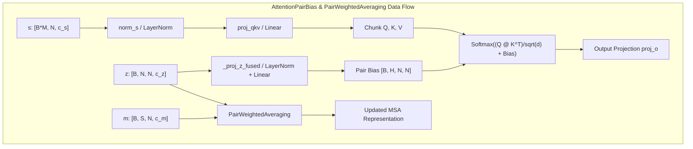
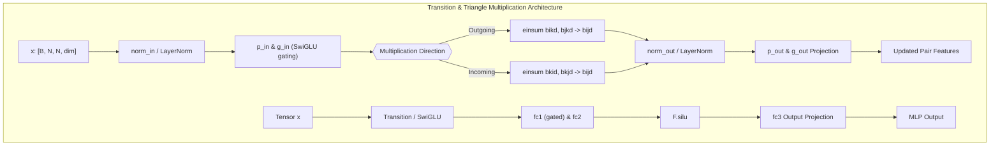
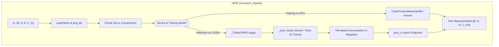
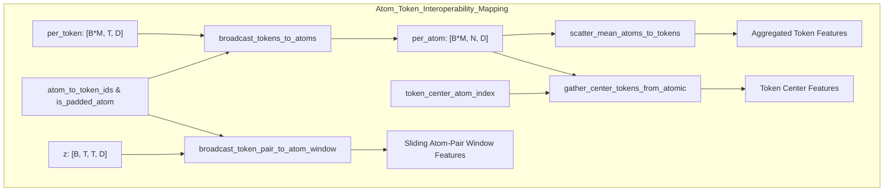
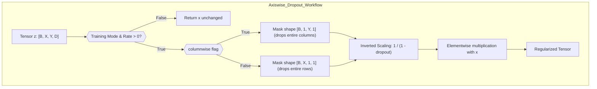

# Core Operators and Triton Kernels

Relevant source files

The following files were used as context for generating this wiki page:

- [src/bioemu2/biomoa/ops/__init__.py](src/bioemu2/biomoa/ops/__init__.py)
- [src/bioemu2/biomoa/ops/atom_token_ops.py](src/bioemu2/biomoa/ops/atom_token_ops.py)
- [src/bioemu2/biomoa/ops/attention_pair_bias.py](src/bioemu2/biomoa/ops/attention_pair_bias.py)
- [src/bioemu2/biomoa/ops/dropout.py](src/bioemu2/biomoa/ops/dropout.py)
- [src/bioemu2/biomoa/ops/outer_product_mean.py](src/bioemu2/biomoa/ops/outer_product_mean.py)
- [src/bioemu2/biomoa/ops/pair_weighted_averaging.py](src/bioemu2/biomoa/ops/pair_weighted_averaging.py)
- [src/bioemu2/biomoa/ops/transition.py](src/bioemu2/biomoa/ops/transition.py)
- [src/bioemu2/biomoa/ops/triangle_multiplication.py](src/bioemu2/biomoa/ops/triangle_multiplication.py)
- [src/bioemu2/biomoa/ops/triton/__init__.py](src/bioemu2/biomoa/ops/triton/__init__.py)
- [src/bioemu2/biomoa/ops/triton/opm.py](src/bioemu2/biomoa/ops/triton/opm.py)

This page documents the core mathematical operators, transformation layers, and Triton-accelerated kernels implemented in `src/bioemu2/biomoa/ops/`. These modules form the fundamental building blocks of the BioMoA architecture, operating across single representations (`s`), pair representations (`z`), sequence/MSA representations (`m`), and atomic coordinates.

---

## 1. Attention with Pair Bias and Pair-Weighted Averaging

BioMoA relies heavily on AlphaFold2-style attention mechanisms where pairwise relationships explicitly modulate token-to-token interactions.

### `AttentionPairBias`
The `AttentionPairBias` module [src/bioemu2/biomoa/ops/attention_pair_bias.py:42-144]() performs multi-head self-attention on single features `s` ($[B\cdot M, N, c_s]$) augmented by pair representation biases `z` ($[B, N, N, c_z]$). The projection of `z` to per-head biases is executed either via standard linear transformations or an efficient fused 2D convolution (`_proj_z_fused`) [src/bioemu2/biomoa/ops/attention_pair_bias.py:97-127]() when layer norm bias is disabled.

### `PairWeightedAveraging`
The `PairWeightedAveraging` class [src/bioemu2/biomoa/ops/pair_weighted_averaging.py:6-153]() updates MSA representations (`m`) using information from the pairwise representation tensor (`z`). It computes attention weights over the pair axis, applies gating via `proj_g`, and scales updates across multiple heads.

*Sources: [src/bioemu2/biomoa/ops/attention_pair_bias.py:42-144](), [src/bioemu2/biomoa/ops/pair_weighted_averaging.py:6-153]()*

---

## 2. Tensor Mixing and Message Passing

Pair representations are continuously refined using triangular update operations and position-wise MLPs.

### Triangle Multiplication
Triangle multiplication variants are registered under `TriMulVariant` [src/bioemu2/biomoa/ops/triangle_multiplication.py:56-60]() supporting incoming and outgoing edge updates:
* `TriangleMultiplicationFull` [src/bioemu2/biomoa/ops/triangle_multiplication.py:86-100](): Full materialization einsum implementation ($O(N^2 D)$).
* `TriangleMultiplicationCueq` [src/bioemu2/biomoa/ops/triangle_multiplication.py:102-152](): cuEquivariance-backed fused Triton kernel.
* `TriangleMultiplicationCueqTiled` [src/bioemu2/biomoa/ops/triangle_multiplication.py:170-395](): Tiled variant utilizing fused dual GEMM projections for large systems ($N > 3000$).

### `Transition` (SwiGLU MLP)
The `Transition` module [src/bioemu2/biomoa/ops/transition.py:16-91]() implements a SwiGLU gated two-layer feed-forward network. It supports optional pre-LayerNorm and chunked hidden-dimension execution during inference to minimize peak VRAM allocation.

*Sources: [src/bioemu2/biomoa/ops/transition.py:16-91](), [src/bioemu2/biomoa/ops/triangle_multiplication.py:56-177]()*

---

## 3. Outer Product Mean and Triton Acceleration

The Outer Product Mean (OPM) operator aggregates MSA statistics into pairwise representations.

### Variants and Registry
The OPM implementation uses a registry-based dispatch via `OPMVariant` [src/bioemu2/biomoa/ops/outer_product_mean.py:27-30]():
* `OuterProductMeanVanilla` [src/bioemu2/biomoa/ops/outer_product_mean.py:42-76](): Standard baseline computing full `einsum("bsic,bsjd->bijcd", a, b)` with an $O(N^2 C_H^2)$ memory footprint.
* `OuterProductMeanTritonMemorySaving` [src/bioemu2/biomoa/ops/outer_product_mean.py:78-153](): Automatically invokes Triton-fused token-tiled kernels during inference on CUDA devices while falling back to vanilla einsum during training.

### Triton Fused Kernel (`_opm_fused_kernel`)
The underlying Triton kernel `_opm_fused_kernel` [src/bioemu2/biomoa/ops/triton/opm.py:18-141]() computes tile-based contractions across MSA depth ($S$) without materializing the full intermediate outer product tensor in global memory.

*Sources: [src/bioemu2/biomoa/ops/outer_product_mean.py:27-153](), [src/bioemu2/biomoa/ops/triton/opm.py:18-141]()*

---

## 4. Structural Interoperability: Atom and Token Operations

BioMoA maps between coarse-grained token features and atomic representations using index-based gather and scatter operations defined in `atom_token_ops.py`.

### Key Functions
* `broadcast_tokens_to_atoms` [src/bioemu2/biomoa/ops/atom_token_ops.py:6-27](): Broadcasts per-token features (`[B*M, T, D]`) to atomic resolution via `atom_to_token_ids` [src/bioemu2/biomoa/ops/atom_token_ops.py:8](), routing padding atoms to a dedicated zero-initialized token slot.
* `scatter_mean_atoms_to_tokens` [src/bioemu2/biomoa/ops/atom_token_ops.py:29-55](): Aggregates atomic features back to token slots using `scatter_add_` in FP32 precision.
* `gather_center_tokens_from_atomic` [src/bioemu2/biomoa/ops/atom_token_ops.py:57-76](): Extracts anchor atom coordinates per token using `token_center_atom_index` [src/bioemu2/biomoa/ops/atom_token_ops.py:59]().
* `broadcast_token_pair_to_atom_window` [src/bioemu2/biomoa/ops/atom_token_ops.py:78-128](): Expands token pair representations (`z`) onto sliding atomic windows for atomic-level attention layers.

*Sources: [src/bioemu2/biomoa/ops/atom_token_ops.py:6-128]()*

---

## 5. Regularization and Utility Operators

### Axis-Wise Dropout
To prevent overfitting while preserving structural correlations along specific sequence or pair axes, BioMoA implements axis-wise dropout in `dropout.py` [src/bioemu2/biomoa/ops/dropout.py:3-70]().

* `get_axiswise_dropout_mask` [src/bioemu2/biomoa/ops/dropout.py:8-56](): Constructs rank-4 broadcast dropout masks (`[B, 1, Y, 1]` for column-wise or `[B, X, 1, 1]` for row-wise dropping) [src/bioemu2/biomoa/ops/dropout.py:41](). Masks are scaled by inverted dropout factors ($1 / (1 - \text{dropout})$) [src/bioemu2/biomoa/ops/dropout.py:20-21]() to avoid evaluation-time corrections.
* `apply_axiswise_dropout` [src/bioemu2/biomoa/ops/dropout.py:58-70](): Applies the generated mask conditional on training mode.

*Sources: [src/bioemu2/biomoa/ops/dropout.py:8-70]()*

---