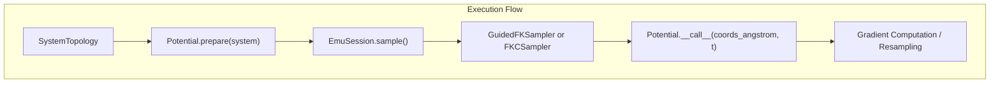

# Inference-Time Steering and Potentials

<details>
<summary>Relevant source files</summary>

The following files were used as context for generating this wiki page:

- [docs/potentials.md](docs/potentials.md)
- [docs/steering.md](docs/steering.md)
- [examples/improve_disulfide_physicality_with_steering.py](examples/improve_disulfide_physicality_with_steering.py)
- [examples/tilt_a_sample_distribution_with_steering.py](examples/tilt_a_sample_distribution_with_steering.py)

</details>


## Purpose and Scope

The steering subpackage (`bioemu2.denoising.steering`, comprising modules such as `edm_steered`, `edm_fkc`, `potentials`, `rdkit_constraints`, and `geometry_topology`) provides tools for modifying the target distribution sampled by the biomolecular emulator foundation model at inference time without retraining [docs/steering.md:16-17]. This page details the implementation architecture, core classes, mathematical formulation of tilted distributions, default physicality potentials, and custom potential definitions [docs/potentials.md:3-5, docs/steering.md:34-42].

Sources: `docs/potentials.md:1-10`, `docs/steering.md:16-22`

---

## Mathematical Foundation and Target Distribution

Let $x$ denote the atomic coordinates and $p_{\mathrm{base}}(x)$ be the probability distribution sampled by the unsteered base model for a given system and conditioning [docs/steering.md:36-37]. Given a steering potential $U(x)$, inference-time steering aims to sample from the **tilted distribution** [docs/steering.md:37-42]:

$$
p_{\mathrm{target}}(x) \propto p_{\mathrm{base}}(x)\exp[-U(x)]
$$

The overall energy $U(x)$ can be decomposed into a sum of sub-potentials, $U(x) = \sum_i U_i(x)$, where each sub-potential $U_i(x)$ favors a specific geometric or physical property [docs/steering.md:54-55]. Smaller energy values indicate more favorable configurations [docs/potentials.md:5].

Sources: `docs/steering.md:34-60`

---

## Steering Subpackage Architecture and Modules

The steering framework bridges high-level objectives with low-level samplers through distinct functional components. The following diagram illustrates the bridge from natural language steering concepts to code entities in the `bioemu2` codebase.

### Natural Language to Code Entity Mapping

```mermaid
graph TD
    subgraph "Natural Language Concepts"
        A[""Unsteered Diffusion""]
        B[""Gradient-Based Steering (FK)""]
        C[""Feynman-Kac Correctors (FKC)""]
        D[""Potential Energy Objective""]
    end

    subgraph "Code Entity Space"
        E["bioemu2.EDMSampler"]
        F["bioemu2.GuidedFKSampler"]
        G["bioemu2.FKCSampler"]
        H["bioemu2.Potential"]
    end

    A --> E
    B --> F
    C --> G
    D --> H
```
Sources: `docs/steering.md:128-156`, `examples/tilt_a_sample_distribution_with_steering.py:32-39`

The sampling algorithms and steering mechanisms interact with system topologies and coordinate tensors during reverse diffusion.


Sources: `docs/potentials.md:3-5`, `docs/steering.md:85-117`

Sources: `docs/steering.md:128-156`, `docs/potentials.md:3-10`

---

## Physicality Potentials

Default physicality potentials are instantiated via `get_default_potentials()` and utilized by `GuidedFKSampler` and `FKCSampler` (as well as CLI options `--sampler edm_gd`, `edm_fk`, and `edm_fkc`) [docs/potentials.md:31-34, 43-46]. These potentials penalize unrealistic geometry such as clashes, broken bonds, and valence violations [docs/potentials.md:48].

| Potential Class | What it Penalizes | Code Reference / Module |
| --- | --- | --- |
| `BondLengthPotential` | Bond lengths outside reference bounds | `bioemu2.denoising.steering.potentials` [docs/potentials.md:13-20] |
| `BondAnglePotential` | Bond angles outside reference bounds | `bioemu2.denoising.steering.potentials` [docs/potentials.md:13-21] |
| `InterChainVDWOverlapPotential` | Van der Waals overlaps between atoms in different chains | `bioemu2.denoising.steering.potentials` [docs/potentials.md:13-22] |
| `IntraChainVDWOverlapPotential` | Van der Waals overlaps within polymer chains | `bioemu2.denoising.steering.potentials` [docs/potentials.md:13-23] |
| `PolymerLocalClashPotential` | Short-range inter-residue clashes (2-3 bonds apart) | `bioemu2.denoising.steering.potentials` [docs/potentials.md:13-24] |
| `SymmetricChainCOMPotential` | Centres of mass of equivalent chains getting too close | `bioemu2.denoising.steering.potentials` [docs/potentials.md:13-25] |
| `PoseBustersPotential` | Violations of ligand distance bounds | `bioemu2.denoising.steering.potentials` [docs/potentials.md:13-26] |
| `ChiralAtomPotential` | Incorrect chirality at ligand stereocentres | `bioemu2.denoising.steering.potentials` [docs/potentials.md:13-27] |
| `StereoBondPotential` | Incorrect ligand bond stereochemistry | `bioemu2.denoising.steering.potentials` [docs/potentials.md:13-28] |
| `PlanarBondPotential` | Non-planar ligand bonds that should be planar | `bioemu2.denoising.steering.potentials` [docs/potentials.md:13-29] |

Specialized potentials include `ContactPotential` (penalizing atom pairs exceeding contact distances) and `TemplateReferencePotential` (penalizing deviations from a rigid-aligned reference template) [docs/potentials.md:36-39].

Sources: `docs/potentials.md:11-40`

---

## Custom Potentials and Parameter Scheduling

Users can define custom objectives by subclassing `Potential`, implementing `prepare(system)` for system-specific initialization, and `__call__(coords_angstrom, *, t)` to compute scalar energies per structure [docs/potentials.md:104-107]. 

### Example: Custom Potential Implementation

```python
class TerminiTargetExpPotential(Potential):
    """Energy = well * (Cα-Cα distance - target)², with distances in Å."""

    def __init__(self, target_angstrom: float) -> None:
        self.target_angstrom = target_angstrom
        self.well = 2
        self.atom_indices: tuple[int, int] | None = None

    def prepare(self, system) -> None:
        ca_indices = [atom.index for atom in system.topology.atoms if atom.name == "CA"]
        self.atom_indices = (ca_indices[0], ca_indices[-1])

    def __call__(self, coords_angstrom: torch.Tensor, *, t: float) -> torch.Tensor:
        start, end = self.atom_indices
        distance = torch.linalg.vector_norm(
            coords_angstrom[:, start] - coords_angstrom[:, end], dim=-1
        )
        return self.well * (distance - self.target_angstrom).pow(2)
```
Sources: `examples/tilt_a_sample_distribution_with_steering.py:64-81`

### Parameter Configuration

For `GuidedFKSampler`, parameter mappings control potential influence [docs/potentials.md:80-83]:
* `guidance_weight`: Scales the potential coordinate gradient during guidance [docs/potentials.md:85-87].
* `guidance_interval`: Applies the gradient every $N$ inner steps [docs/potentials.md:85-88].
* `resampling_weight`: Scales the potential contribution to reweighting/resampling [docs/potentials.md:85-89].

Scheduled values can change across denoising via `ParameterSchedule` variants such as `PiecewiseStepFunction`, `ExponentialInterpolation`, or `LinearInterpolation`, where normalized time runs from $t=1$ (high noise) to $t=0$ (clean endpoint) [docs/potentials.md:91-95].

Sources: `docs/potentials.md:80-97`, `examples/tilt_a_sample_distribution_with_steering.py:64-81`

---