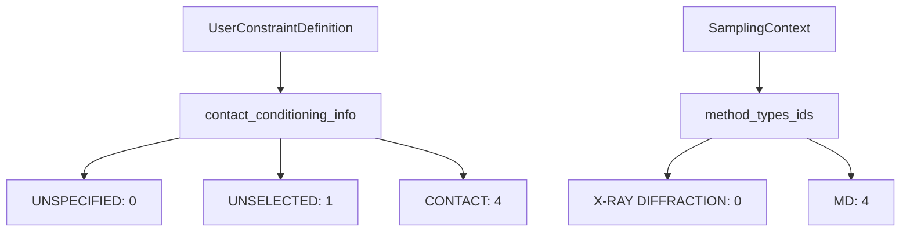
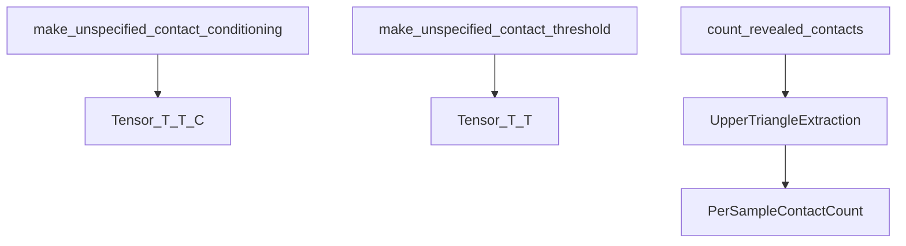
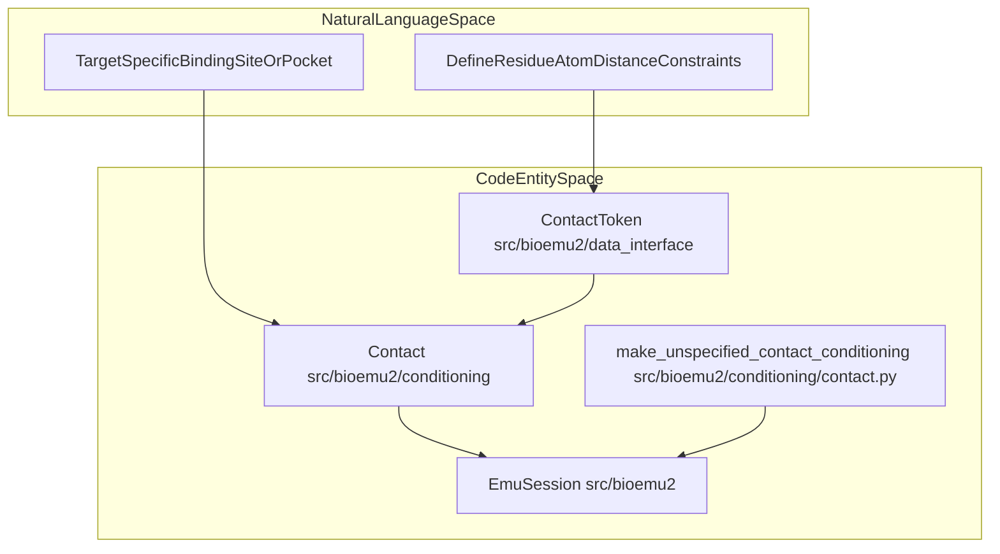
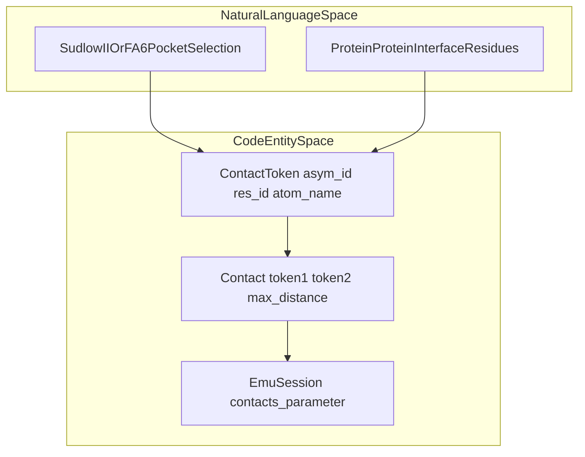

# Contact Conditioning

Relevant source files

The following files were used as context for generating this wiki page:

- [examples/sample_protein_ligand_constraints.py](examples/sample_protein_ligand_constraints.py)
- [examples/sample_protein_protein_constraints.py](examples/sample_protein_protein_constraints.py)
- [src/bioemu2/conditioning/__init__.py](src/bioemu2/conditioning/__init__.py)
- [src/bioemu2/conditioning/contact.py](src/bioemu2/conditioning/contact.py)
- [src/bioemu2/conditioning/method.py](src/bioemu2/conditioning/method.py)

## Purpose and Scope

The `src/bioemu2/conditioning` subpackage provides data structures, token maps, and conditioning matrices required to bias biomolecular complex and equilibrium predictions towards user-specified spatial constraints (such as protein-ligand binding pockets or protein-protein interfaces) and experimental sampling modes. This page details the internal representation of contact classes, tensor conditioning builders, experimental method type registries, and practical constraint specification patterns derived from example scripts.

Sources:
- `src/bioemu2/conditioning/contact.py` [src/bioemu2/conditioning/contact.py:1-82]()
- `src/bioemu2/conditioning/method.py` [src/bioemu2/conditioning/method.py:1-44]()

---

## 1. Conditioning Classes and Method Registries

BioEmu2 classifies pairwise interactions and experimental contexts using fixed integer mapping dictionaries. In `src/bioemu2/conditioning/contact.py`, `contact_conditioning_info` maps symbolic conditioning categories to integer identifiers [src/bioemu2/conditioning/contact.py:8-14] (`UNSPECIFIED`, `UNSELECTED`, `POCKET>BINDER`, `BINDER>POCKET`, and `CONTACT`).

Similarly, `src/bioemu2/conditioning/method.py` defines `method_types_ids`, mapping experimental or computational source descriptors (e.g., X-ray diffraction, electron microscopy, molecular dynamics) to normalized integer categories [src/bioemu2/conditioning/method.py:8-37], alongside the `SamplingMode` literal (`"structure"` or `"equilibrium"`) [src/bioemu2/conditioning/method.py:3-5].

Sources:
- `src/bioemu2/conditioning/contact.py` [src/bioemu2/conditioning/contact.py:8-17]()
- `src/bioemu2/conditioning/method.py` [src/bioemu2/conditioning/method.py:5-39]()

---

## 2. Matrix Generation and Feature Utilities

When no explicit contacts are provided, BioEmu2 initializes neutral conditioning tensors via dedicated factory functions. The function `make_unspecified_contact_conditioning` constructs a `(T, T, C)` one-hot tensor filled with `UNSPECIFIED` flags for all token pairs [src/bioemu2/conditioning/contact.py:19-42]. The companion function `make_unspecified_contact_threshold` builds a zero-valued `(T, T)` float tensor representing distance thresholds [src/bioemu2/conditioning/contact.py:44-60].

During batch processing, `count_revealed_contacts` extracts active constraint counts from batch collations by evaluating the upper triangle of the `CONTACT` channel mask [src/bioemu2/conditioning/contact.py:63-82].

Sources:
- `src/bioemu2/conditioning/contact.py` [src/bioemu2/conditioning/contact.py:19-82]()

---

## 3. Natural Language Space to Code Entity Space: Contact Conditioning Workflow

This diagram bridges high-level user concepts (such as targeting a binding pocket or interface) to the concrete classes and functions within `src/bioemu2/conditioning` and `src/bioemu2`.

Sources:
- `src/bioemu2/conditioning/contact.py` [src/bioemu2/conditioning/contact.py:19-42]()
- `examples/sample_protein_ligand_constraints.py` [examples/sample_protein_ligand_constraints.py:93-103]()
- `examples/sample_protein_protein_constraints.py` [examples/sample_protein_protein_constraints.py:54-60]()

---

## 4. Constraint Examples and Specification Patterns

Contact conditioning is supplied to `EmuSession` as a list of `Contact` objects linking two `ContactToken` endpoints with maximum distance limits [examples/sample_protein_ligand_constraints.py:88-103, examples/sample_protein_protein_constraints.py:53-60].

For protein-ligand interactions (e.g., human serum albumin with ibuprofen), protein residues anchor via Cα tokens while ligands anchor via named atoms [examples/sample_protein_ligand_constraints.py:55-57, 93-103]. For protein-protein complexes (e.g., the 1TEN design system), residues across chains are paired with specific Cα–Cα distance thresholds [examples/sample_protein_protein_constraints.py:39-60].

Sources:
- `examples/sample_protein_ligand_constraints.py` [examples/sample_protein_ligand_constraints.py:88-103]()
- `examples/sample_protein_protein_constraints.py` [examples/sample_protein_protein_constraints.py:53-60]()

---