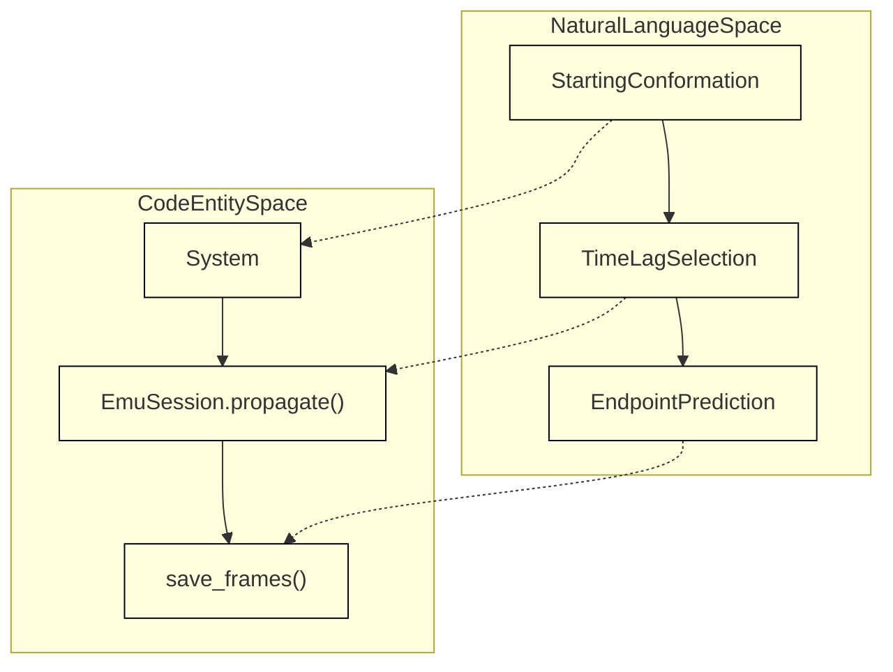
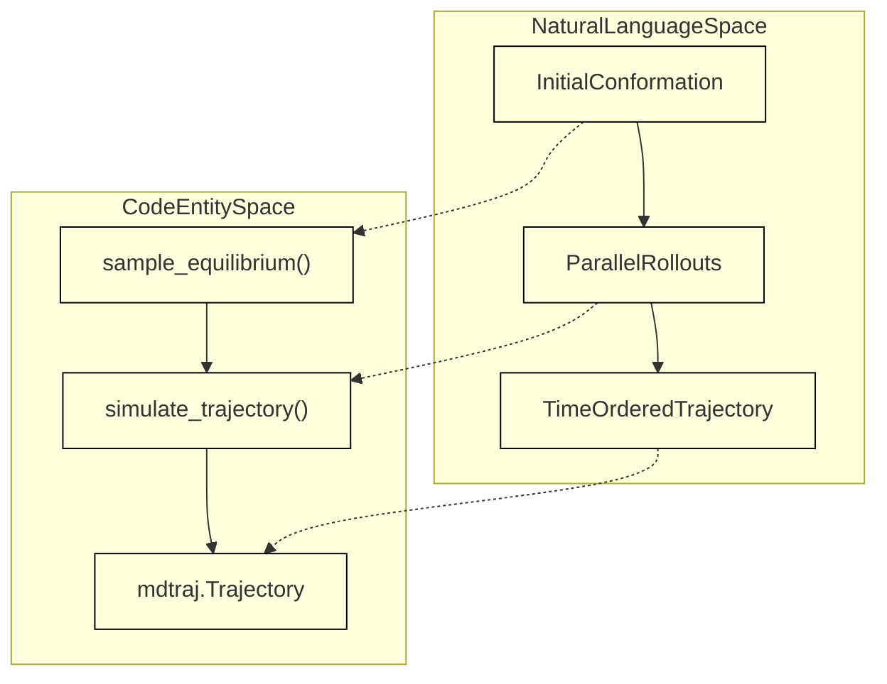

# Time Propagation (Implicit Transfer Operators)

<details>
<summary>Relevant source files</summary>

The following files were used as context for generating this wiki page:

- [docs/propagation.md](docs/propagation.md)
- [examples/simulate_a_trajectory.py](examples/simulate_a_trajectory.py)

</details>


## Purpose and Scope
This page details the time propagation framework in BioEmu2, which implements implicit transfer operators to sample future conformations (`x_t`) at a given time lag (`lag_time_ns`) from a starting conformation (`x0`). Unlike equilibrium sampling, propagation captures temporal evolution and kinetics over lag times ranging from 1 ns to 1 µs.

Sources: `docs/propagation.md:1-29`

---

## Core Concepts: Lag Times and Endpoints
Propagation in BioEmu2 models conditional distributions over future states given a starting structure. 
- **Endpoints**: Each propagation step generates an independent endpoint at time $t = \text{lag\_time\_ns}$, rather than recording physical intermediate steps of a continuous path.
- **Lag Time Range**: Optimal performance occurs with lag times from 1 ns to 1000 ns (the regime heavily represented during training). For multi-millisecond timescales, equilibrium sampling should be used instead.
- **Embedding Reuse**: Using `EmuSession.propagate()` preserves trunk embeddings in memory across multiple propagation calls for the same molecular system.


*Figure 1: Conceptual mapping between natural language propagation steps and BioEmu2 classes.*

Sources: `docs/propagation.md:16-29`

---

## Command Line Interface (CLI) Workflow
The CLI provides subcommands to initialize equilibrium conformations and propagate them forward in time.

### Single and Batch Propagation via CLI
To sample a starting conformation and propagate it at a 1 ns lag:
```bash
bioemu2 sample-equilibrium --pdb-id 1AKE --num-samples 1 --out outputs/adk-start
bioemu2 propagate --x0-cif outputs/adk-start/topology.cif --num-samples 8 --lag-time-ns 1 --out outputs/adk-propagated
```

To use an external CIF file along with a custom system specification YAML:
```bash
bioemu2 propagate --x0-cif initial.cif --system system.yaml --num-samples 8 --lag-time-ns 1 --out outputs/from-external-cif
```

- **Atom Ordering**: The CLI expects starting atoms to match the system order precisely; atoms cannot be reordered automatically during direct CIF ingestion unless mapped beforehand.
- **Outputs**: Generates `samples.xtc`, `topology.cif`, and `physicality.json` detailing physicality metrics for each generated endpoint.

Sources: `docs/propagation.md:30-89`

---

## Python API: EmuSession and Trajectory Simulation
The Python API allows granular control over session states, starting structures, and multi-step rollout trajectories.

### EmuSession Propagation
```python
system = System.from_pdb_id("1AKE")
model = load_model()
emu = EmuSession(system, model=model, mode="equilibrium")
x0 = emu.sample(num_samples=1)
x_tau = emu.propagate(x0, lag_time_ns=1.0)
save_frames(x_tau, Path("outputs/adk-endpoint"))
```

### Simulating Time-Ordered Trajectories
While standard propagation produces unordered bags of endpoints, `simulate_trajectory()` strings together rollouts into time-ordered trajectories where each frame builds upon the previous step:


*Figure 2: Workflow mapping from equilibrium sampling to time-ordered trajectory simulation.*

Using `simulate_trajectory()` from `examples/simulate_a_trajectory.py`:
```python
lag_time_ns = 50
num_trajectory_steps = 20
num_trajectories = 4

trajectories = simulate_trajectory(
    system,
    model=model,
    x0=x0[[0] * num_trajectories],
    lag_time_ns=lag_time_ns,
    num_trajectory_steps=num_trajectory_steps,
    seed=1,
)
```

Sources: `docs/propagation.md:90-119`, `examples/simulate_a_trajectory.py:37-76`

---

## External Starting Structures and Atom Mapping
When propagating from external CIF structures (such as those downloaded from the PDB), coordinates must be aligned with the system's expected atom order using `map_cif_atom_order()`:

```python
system = System.from_yaml("system.yaml")
x0 = map_cif_atom_order(system, "initial.cif")
emu = EmuSession(system, model=load_model(), mode="equilibrium")
endpoints = emu.propagate(x0, lag_time_ns=1.0)
save_frames(endpoints, Path("outputs/from-external-cif"))
```

- **Constraints**: The target file must provide coordinates for every chain, residue, and atom specified in the system definition. Missing atoms cannot be populated automatically during the propagation mapping stage.

Sources: `docs/propagation.md:120-149`

---