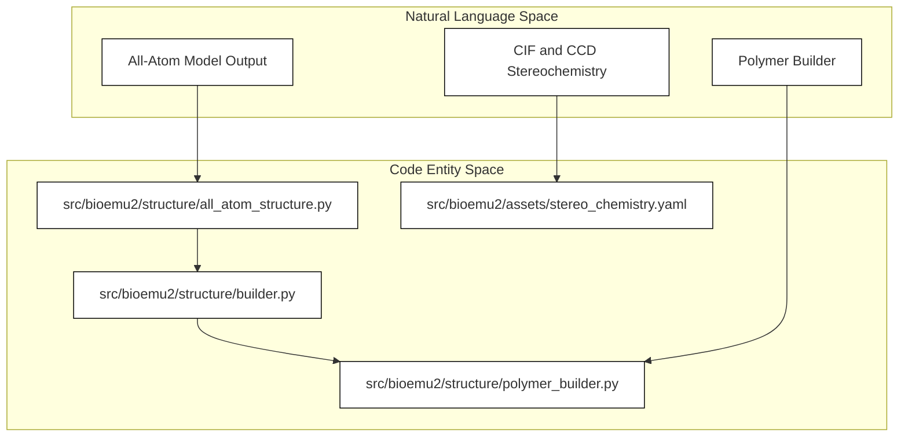
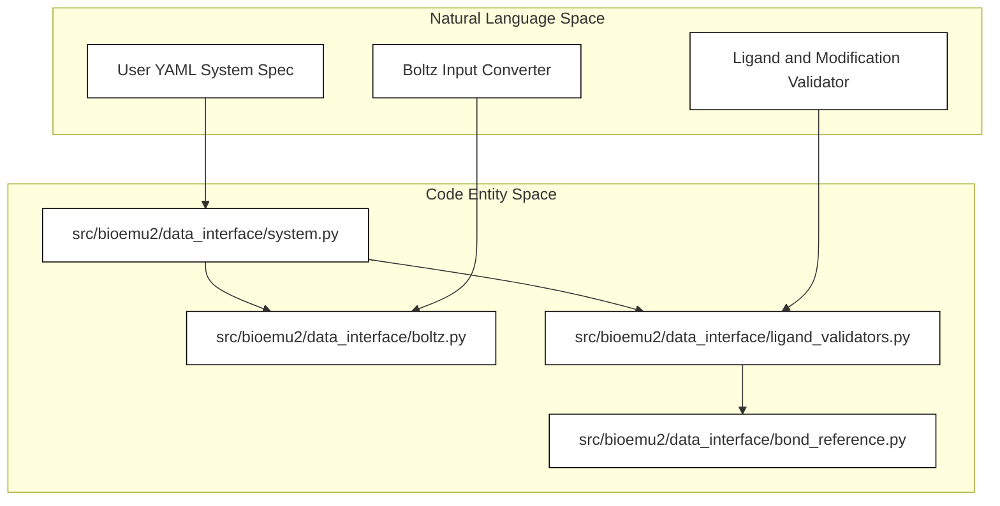

# Structure and Chemistry Data Layer

Relevant source files

The following files were used as context for generating this wiki page:

- [docs/system.md](docs/system.md)
- [src/bioemu2/assets/stereo_chemistry.yaml](src/bioemu2/assets/stereo_chemistry.yaml)

The Structure and Chemistry Data Layer manages molecular system definitions, sequence and alignment inputs, stereochemical restraints, and all-atom structure generation. It translates high-level domain concepts—such as proteins, nucleic acids, ligands, modified residues, and branched glycans—into tensor representations and coordinates suitable for the BioMoA score model stack.

For detailed technical implementations, refer to the child pages:
- [Structure Representation and Building](#5.1) (`src/bioemu2/structure`)
- [Data Interface and System Parsing](#5.2) (`src/bioemu2/data_interface`)
- [MSA Generation and Embedding Reuse](#5.3) (`src/bioemu2/msa`)

---

## 5.1. Structure Representation and Building

The structure subpackage (`src/bioemu2/structure`) is responsible for converting numerical model outputs and internal tokenized graphs back into physical, all-atom Cartesian coordinates and standard file formats like mmCIF and XTC. It manages polymer builders, rigid-body alignment, scatter operations, template parsing, and Chemical Component Dictionary (CCD) bond and angle definitions.

For comprehensive details on all-atom handling, scatter operations, reference structures, and CCD IO routines, see the child page [Structure Representation and Building](#5.1).

Sources: [`src/bioemu2/assets/stereo_chemistry.yaml:1-200`]().

---

## 5.2. Data Interface and System Parsing

The data interface module (`src/bioemu2/data_interface`) handles the parsing, validation, and conversion of molecular system configurations. Users define molecular systems programmatically via `System` classes or declarative YAML files [docs/system.md:1-23](). 

BioEmu2 supports proteins, RNA, DNA, ligands (via CCD code, SMILES, or InChI), modified residues, and branched molecules [docs/system.md:33-207](). It also provides a CLI converter for Boltz-format input files [docs/system.md:28-31]().

For full documentation on parsing schemas, bond references, hierarchy representations, and validation logic, see the child page [Data Interface and System Parsing](#5.2).

Sources: [`docs/system.md:1-100`]().

---

## 5.3. MSA Generation and Embedding Reuse

Multiple Sequence Alignments (MSAs) and template embeddings provide evolutionary context to the BioMoA models. The MSA subpackage (`src/bioemu2/msa`) manages sequence searching, ColabFold integration, alignment filtering, feature extraction, and embedding caching workflows. Reusing cached embeddings allows rapid iterative sampling and prevents redundant compute overhead during large batch screens.

For details on MSA parsing, feature extraction pipelines, and the embedding reuse workflow, see the child page [MSA Generation and Embedding Reuse](#5.3).

---