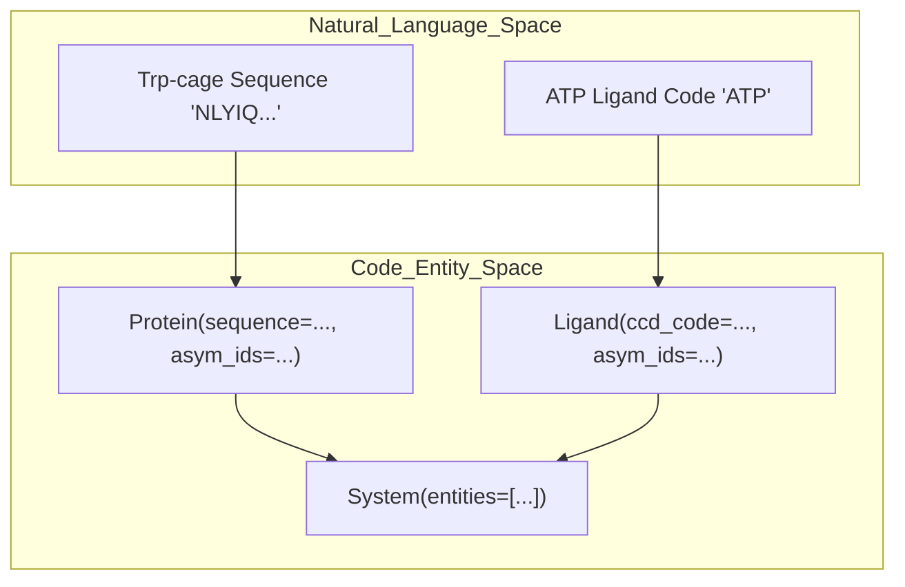
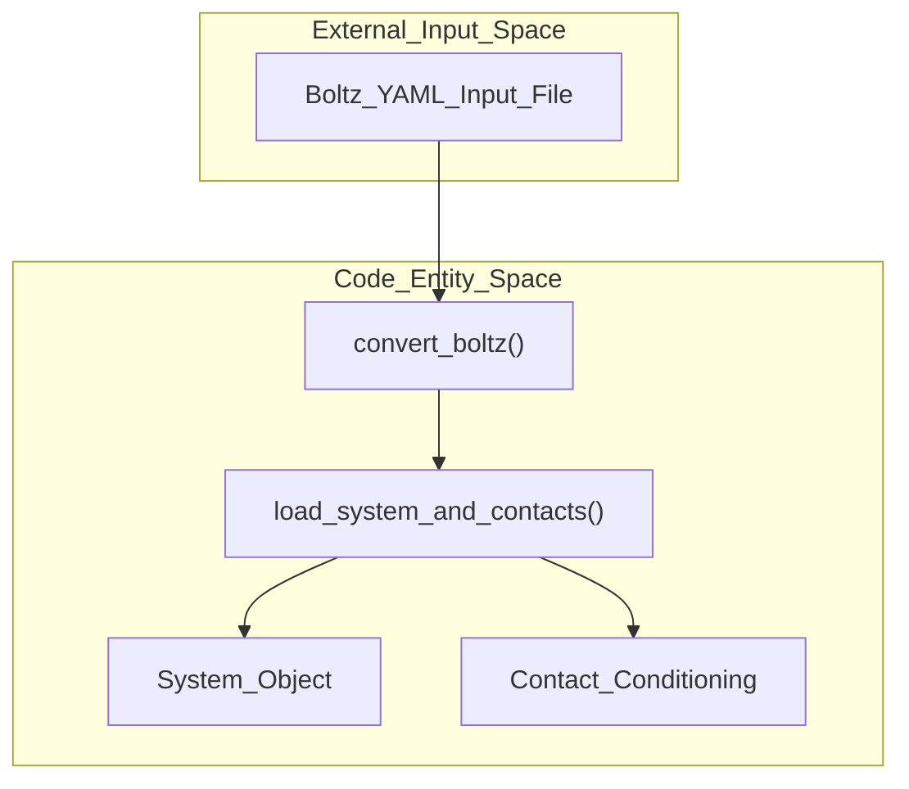

# Data Interface and System Parsing

Relevant source files

The following files were used as context for generating this wiki page:

- [docs/boltz.md](docs/boltz.md)
- [docs/system.md](docs/system.md)

## Purpose and Scope
The data interface subsystem (`src/bioemu2/data_interface`) is responsible for defining, validating, serializing, and parsing molecular system specifications for BioEmu2 [docs/system.md:18-23](), [docs/boltz.md:3-8](). It bridges external file formats (such as Boltz-1 and Boltz-2 input YAMLs) and native Python data structures (`System`, `Protein`, `RNA`, `DNA`, `Ligand`, `Branched`, and `ModifiedResidue`) utilized across structure prediction, equilibrium sampling, and time propagation workflows [docs/system.md:18-104](), [docs/boltz.md:3-8]().

Sources: `docs/boltz.md:3-8`, `docs/system.md:18-23`

## 1. Molecular System Representation and Validation (`system.py`)
The `System` class defines the complete molecular composition passed to BioEmu2 [docs/system.md:18-23](). It encapsulates molecular entities, optional non-standard covalent bonds, and mappings from canonical chain IDs to author chain IDs [docs/system.md:18-23]().

- **Entity Types**: Systems support `Protein`, `RNA`, `DNA`, `Ligand`, and `Branched` entities [docs/system.md:86]().
- **Validation**: Upon initialization, `System` validates that canonical chain identifiers (`asym_ids`) are unique across the system and restricted to a maximum length of four characters [docs/system.md:60-62]().
- **Convenience Builders**: Systems can be instantiated directly or via `System.from_description()`, which assigns sequential chain IDs starting at `A` from lists of polymer sequences and ligand codes [docs/system.md:88-104]().
- **Modifications**: Modified or non-canonical residues are specified using `ModifiedResidue` objects containing a 1-based `res_id` and a chemical identifier (CCD code or InChI) [docs/system.md:112-121]().

*Figure 1: Mapping natural language molecular descriptions to BioEmu2 `Protein`, `Ligand`, and `System` code entities.*

Sources: `docs/system.md:18-136`

## 2. Boltz Format Conversion and Loading (`boltz.py`)
BioEmu2 provides conversion utilities to ingest external Boltz-format input files into native BioEmu2 system configurations [docs/boltz.md:3-8]().

- **Conversion CLI and API**: The `bioemu2 convert-boltz` command-line tool and the programmatic `convert_boltz()` function translate `version: 1` Boltz input YAMLs into BioEmu2 system YAMLs [docs/boltz.md:3-8](), [docs/boltz.md:73-83]().
- **Supported Fields**: The converter preserves polymer sequences, chain IDs, polymer modifications (`ModifiedResidue`), SMILES/CCD ligands, and covalent bond definitions [docs/boltz.md:108-118]().
- **Contact Constraints**: Contact constraints defined in Boltz inputs are extracted into contact tokens and loaded alongside the system via `load_system_and_contacts()` [docs/boltz.md:82-89](), [docs/boltz.md:117-118]().
- **Ignored Fields**: Per-chain MSA paths, template configurations, and affinity properties in Boltz files are explicitly ignored with warnings; alignments must be handled separately via `get_msa()` [docs/boltz.md:67-71](), [docs/boltz.md:131-139]().

*Figure 2: Data flow from external Boltz YAML files through `convert_boltz()` and `load_system_and_contacts()` into BioEmu2 system and contact structures.*

Sources: `docs/boltz.md:3-89`, `docs/boltz.md:108-141`

---