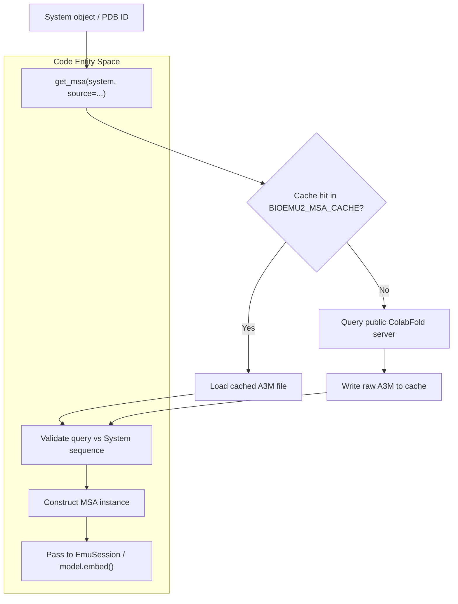
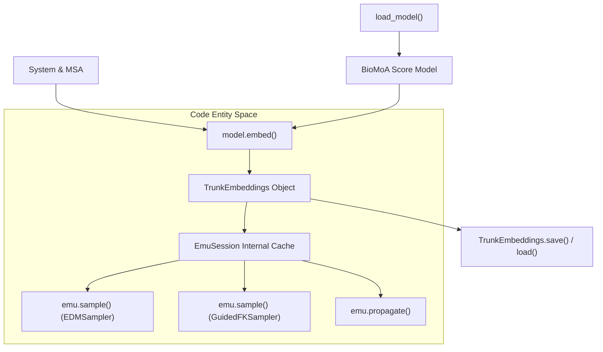

# MSA Generation and Embedding Reuse

<details>
<summary>Relevant source files</summary>

The following files were used as context for generating this wiki page:

- [docs/msa.md](docs/msa.md)
- [docs/reuse-embeddings.md](docs/reuse-embeddings.md)

</details>


## Purpose and Scope

BioEmu2 relies on multiple sequence alignments (MSAs) to provide evolutionary information for both structure prediction and equilibrium sampling [docs/msa.md:14-16](). Because running the model trunk to generate representations accounts for a significant portion of computation time, BioEmu2 provides mechanisms to cache, reuse, and persist trunk embeddings [docs/reuse-embeddings.md:17-27](). This page details the MSA retrieval subsystem, the `MSA` and `TrunkEmbeddings` data structures, ColabFold integration, and embedding reuse workflows across memory and disk [docs/msa.md:1-217](), [docs/reuse-embeddings.md:1-172]().

---

## MSA Data Structures and Retrieval

The `MSA` class and `get_msa()` function form the entry point for incorporating evolutionary data into a `System` [docs/msa.md:18-21](). MSAs are stored as raw A3M strings per chain, preserving sequence headers, gap symbols, lowercase insertions, and row order [docs/msa.md:183-186]().

For single-chain, homomeric, or heteromeric protein systems, `get_msa()` coordinates alignment acquisition and validation against the protein sequences defined in the system object [docs/msa.md:23-26](), [docs/msa.md:97-137](). Non-protein entities such as ligands, DNA, RNA, and branched polymers do not require MSA entries [docs/msa.md:185-186]().

```python
from bioemu2 import System, get_msa, MSA
from bioemu2.paths import EXAMPLES_DIR
from pathlib import Path

# Retrieve or fetch MSA for a system
system = System.from_yaml(EXAMPLES_DIR / "systems/ake.yaml")
msa = get_msa(system)

# Inspect represented chains and retrieve A3M text
chain_ids = msa.chain_ids  # e.g., ["A"]
raw_a3m = msa.a3m("A")
```

Sources: [docs/msa.md:14-186]()

### MSA Retrieval Workflow


Sources: [docs/msa.md:23-58](), [docs/msa.md:97-137]()

---

## ColabFold Client and Caching Mechanics

By default, BioEmu2 queries the public ColabFold server to fetch independent unpaired alignments for each unique protein sequence, as well as positionally paired alignments for heteromers [docs/msa.md:23-26](). 

- **Cache Directory**: Raw A3M results are cached under `~/.cache/bioemu2/colabfold_msa` [docs/msa.md:44-45](). Override this location by exporting the `BIOEMU2_MSA_CACHE` environment variable [docs/msa.md:46-50]().
- **Pairing Strategies**: Configure pairing via `pairing_strategy`, supporting `"greedy"` and `"complete"` [docs/msa.md:66-76]().
- **Local Workflows**: For large-scale structure prediction, users should use ColabFold's local `colabfold_search` utility and load output A3M files directly via `get_msa(system, source=Path("path.a3m"))` to avoid overloading public infrastructure [docs/msa.md:60-64](), [docs/msa.md:141-149]().

Sources: [docs/msa.md:23-76](), [docs/msa.md:141-149]()

---

## Embedding Computation and Invalidation Rules

BioEmu2 separates inference into two stages:
1. **Trunk**: Processes the system structure, MSA, and task conditioning into internal embedding tensors (`TrunkEmbeddings`) [docs/reuse-embeddings.md:17-18]().
2. **Diffusion Module (Denoiser)**: Uses trunk embeddings to iteratively generate or propagate molecular structures [docs/reuse-embeddings.md:18-19]().

### Inputs Dictating Embedding Validity
Trunk embeddings depend strictly on a bounded set of input parameters [docs/reuse-embeddings.md:30-37]():
- The target `System` definition [docs/reuse-embeddings.md:32]()
- The `MSA` alignment data [docs/reuse-embeddings.md:33]()
- The sampling mode (`"structure"` or `"equilibrium"`) [docs/reuse-embeddings.md:34]()
- Contact constraints (if any) [docs/reuse-embeddings.md:35]()
- The underlying model checkpoint [docs/reuse-embeddings.md:36]()
- The embedding precision configured via `load_model(precision=...)` [docs/reuse-embeddings.md:37]()

Embeddings *do not* depend on the choice of sampler, steering potentials, random seeds, number of samples, batch sizes, or propagation lag times [docs/reuse-embeddings.md:39-42](). Modifying any non-dependent parameter allows immediate reuse of cached embeddings [docs/reuse-embeddings.md:41-42]().

Sources: [docs/reuse-embeddings.md:17-57]()

---

## In-Memory and Disk Embedding Reuse

To maximize throughput, embeddings can be retained in GPU memory across multiple sampling or propagation tasks, or serialized to disk [docs/reuse-embeddings.md:23-26]().

### Reusing Embeddings with `EmuSession`
An `EmuSession` automatically computes and retains trunk embeddings in memory upon the first invocation of `sample()` or `propagate()` [docs/reuse-embeddings.md:70-74](). Subsequent calls to alternative samplers or propagation operators bypass trunk recomputation entirely [docs/reuse-embeddings.md:76-120]().

```python
from bioemu2 import EmuSession, EDMSampler, GuidedFKSampler, System, get_msa, load_model
from bioemu2.denoising.steering.potentials import BondLengthPotential

system = System.from_pdb_id("1AKE")
model = load_model()
msa = get_msa(system)
emu = EmuSession(system, model=model, mode="equilibrium", msa=msa)

# 1. First call computes and caches trunk embeddings in the session
unsteered_samples = emu.sample(num_samples=8, sampler=EDMSampler(), seed=42)

# 2. Second call reuses cached trunk embeddings with a different sampler/potential
steered_samples = emu.sample(
    num_samples=8,
    sampler=GuidedFKSampler(
        potentials=[BondLengthPotential(sigma_tolerance=10.0, parameters={"guidance_weight": 0.05})]
    ),
    seed=43
)

# 3. Propagation reuses the same cached trunk embeddings
endpoints = emu.propagate(unsteered_samples, lag_time_ns=1.0)

# Release session-level GPU memory cache when complete
emu.cache_clear()
```
Sources: [docs/reuse-embeddings.md:70-135]()

### Low-Level Functional API and Disk Persistence
Using the functional API, developers invoke `model.embed()` directly to retrieve a `TrunkEmbeddings` object, which can then be passed to `sample_with_embeddings()` or serialized via built-in `save()` and `load()` methods [docs/reuse-embeddings.md:141-172]().

```python
from bioemu2 import EDMSampler, System, get_msa, load_model, sample_with_embeddings

system = System.from_pdb_id("1AKE")
model = load_model()

# Explicit trunk embedding extraction
embeddings = model.embed(system, msa=get_msa(system), mode="equilibrium")

# Execute multiple sampling runs with identical embeddings
samples_run_1 = sample_with_embeddings(system, embeddings, model=model, sampler=EDMSampler(), seed=1)
samples_run_2 = sample_with_embeddings(system, embeddings, model=model, sampler=EDMSampler(num_steps=100), seed=2)
```

Sources: [docs/reuse-embeddings.md:141-172]()

### Embedding Lifecycle and Reuse Architecture


Sources: [docs/reuse-embeddings.md:70-172]()

---