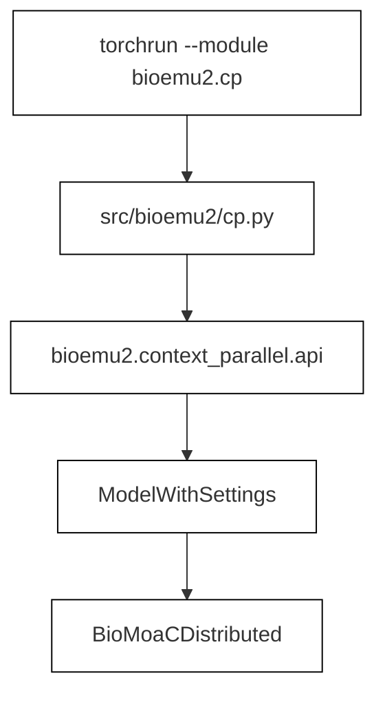
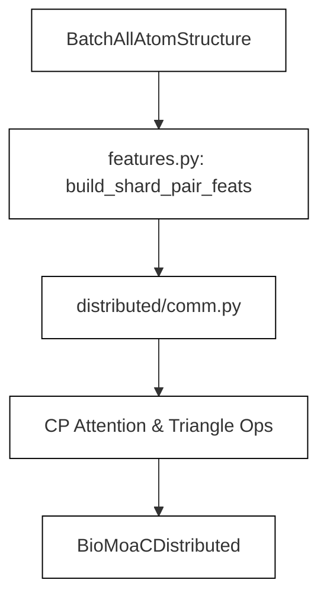

# Context-Parallel Sampling

Relevant source files

The following files were used as context for generating this wiki page:

- [docs/context-parallel-sampling.md](docs/context-parallel-sampling.md)
- [src/bioemu2/context_parallel/__init__.py](src/bioemu2/context_parallel/__init__.py)
- [src/bioemu2/context_parallel/api.py](src/bioemu2/context_parallel/api.py)

This page provides a high-level overview of multi-GPU context parallelism (Fold-CP) in BioEmu2, designed to scale inference for large molecular systems whose quadratic pair representations exceed single-GPU memory limits [docs/context-parallel-sampling.md:18-22](), [src/bioemu2/context_parallel/__init__.py:1-1](). 

Context parallelism splits $O(N^2)$ pair tensors across a two-dimensional device mesh, allowing models with thousands of tokens to be sampled efficiently [docs/context-parallel-sampling.md:18-22](), [docs/context-parallel-sampling.md:35-39](). 

*Figure 1: High-level invocation pipeline bridging CLI entrypoints to distributed context-parallel structures.*

Sources: `docs/context-parallel-sampling.md:18-22`, `docs/context-parallel-sampling.md:35-39`, `docs/context-parallel-sampling.md:60-63`, `src/bioemu2/context_parallel/__init__.py:1-1`, `src/bioemu2/context_parallel/api.py:35-47`.

---

## 6.1. Context-Parallel API and Diagnostics

The context-parallel Python API mirrors the standard single-GPU workflow while introducing multi-rank coordination primitives [docs/context-parallel-sampling.md:135-141](). High-level operations such as `predict_structure()` and `sample_equilibrium()` are exposed through `bioemu2.context_parallel.api`, managing synchronized padding, structured feature sharding, and rank-zero file output [docs/context-parallel-sampling.md:143-156](), [src/bioemu2/context_parallel/api.py:65-74](). Diagnostic utilities (`diagnostics.py`) and feature processors (`features.py`) track communication overhead and prepare sharded input slabs before accelerator transfer [src/bioemu2/context_parallel/api.py:28-34]().

For details, see [Context-Parallel API and Diagnostics](#6.1).

Sources: `docs/context-parallel-sampling.md:135-156`, `src/bioemu2/context_parallel/api.py:28-74`.

---

## 6.2. Distributed Communication and Sharded Ops

To evaluate score models across multiple devices without exhausting GPU memory, BioEmu2 implements custom sharded operators and communication wrappers [src/bioemu2/context_parallel/__init__.py:1-1](). Primitives defined in `distributed/comm.py` handle cross-rank tensor exchanges, while specialized modules execute sharded attention, triangular multiplication, outer product mean (OPM), and scatter-gather routines [src/bioemu2/context_parallel/api.py:35-40](). These operations mirror core single-GPU layers while distributing the memory burden of large sequence and pair representations across an $n \times n$ device grid [docs/context-parallel-sampling.md:35-39]().

*Figure 2: Sharded data flow mapping input batches across communication primitives and distributed attention operators.*

For details, see [Distributed Communication and Sharded Ops](#6.2).

Sources: `docs/context-parallel-sampling.md:35-39`, `src/bioemu2/context_parallel/__init__.py:1-1`, `src/bioemu2/context_parallel/api.py:28-40`.

---

## 6.3. Performance: Speed, Capacity and Batch Sizing

Because memory scaling for pair representations and triangular updates grows quadratically with token length, hardware planning requires careful balancing of GPU grid size, batch configuration, and precision settings [docs/context-parallel-sampling.md:110-118](). System capacity guidelines—such as matching token counts to 1, 4, or 16 GPU configurations—are detailed alongside checkpoint loading costs and throughput benchmarks in the project documentation [docs/context-parallel-sampling.md:110-134](). Adjusting batch sizes and tiling strategies helps mitigate communication overhead for large biological systems [docs/context-parallel-sampling.md:26-31](), [docs/context-parallel-sampling.md:132-133]().

For details, see [Performance: Speed, Capacity and Batch Sizing](#6.3).

Sources: `docs/context-parallel-sampling.md:26-31`, `docs/context-parallel-sampling.md:110-134`.

---