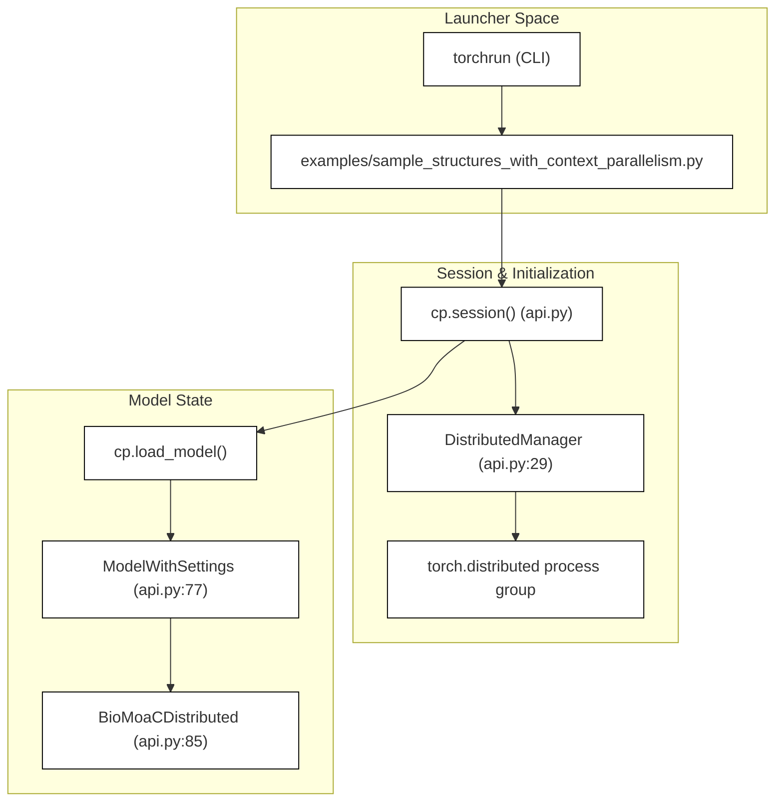
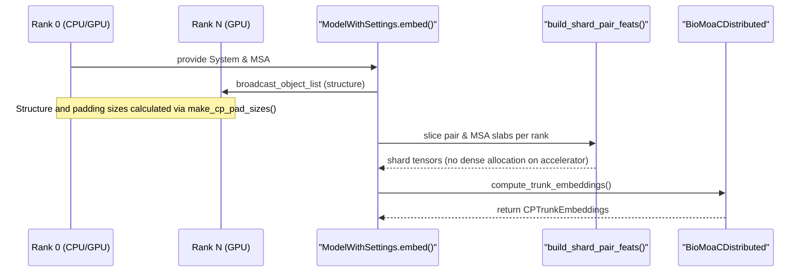
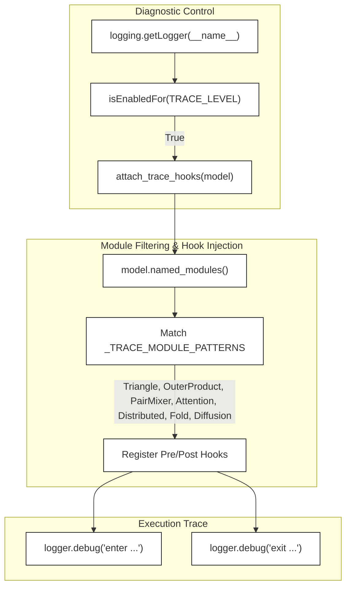

# Context-Parallel API and Diagnostics

Relevant source files

The following files were used as context for generating this wiki page:

- [examples/sample_structures_with_context_parallelism.py](examples/sample_structures_with_context_parallelism.py)
- [src/bioemu2/context_parallel/api.py](src/bioemu2/context_parallel/api.py)
- [src/bioemu2/context_parallel/diagnostics.py](src/bioemu2/context_parallel/diagnostics.py)

This document details the context-parallel (CP) API, feature sharding utilities, diagnostic hooks, and script entry wiring under `src/bioemu2/context_parallel/` [src/bioemu2/context_parallel/api.py:1-4](). Context parallelism enables scaling BioEmu2 model inference across multiple GPUs for large molecular systems by sharding sequence, pair, and attention dimensions.

---

## 1. Session Management and Entry Wiring

Context-parallel execution requires initializing a distributed process group before loading models or performing inference. The entry wiring is exposed via `cp.session` [src/bioemu2/context_parallel/api.py:42]() and managed by `DistributedManager` [src/bioemu2/context_parallel/api.py:29]().

*Diagram 1: Natural Language to Code Entity Space mapping for Session and Entry Wiring.*

The `ModelWithSettings` dataclass [src/bioemu2/context_parallel/api.py:77-91]() holds the sharded `BioMoaCDistributed` score model [src/bioemu2/context_parallel/api.py:85](), target device [src/bioemu2/context_parallel/api.py:86](), autocast dtype [src/bioemu2/context_parallel/api.py:87](), and distributed process group [src/bioemu2/context_parallel/api.py:88]().

Sources:
- `src/bioemu2/context_parallel/api.py:29-91`
- `examples/sample_structures_with_context_parallelism.py:47-51`

---

## 2. Context-Parallel API Workflow

The core sampling and embedding workflows are coordinated through methods on `ModelWithSettings`. When invoking `embed()` [src/bioemu2/context_parallel/api.py:92](), rank 0 prepares the sequence structure while other ranks receive broadcasted control flow before sharding features across the device mesh.

*Diagram 2: Data flow during context-parallel embedding calculation.*

The `embed()` method handles structure preparation, padding size calculation (`make_cp_pad_sizes`) [src/bioemu2/context_parallel/api.py:117](), batch collation (`batch_collate`) [src/bioemu2/context_parallel/api.py:124](), and sharded pair/MSA feature extraction (`build_shard_pair_feats`, `build_shard_msa_feats`) [src/bioemu2/context_parallel/api.py:127-134]().

Sources:
- `src/bioemu2/context_parallel/api.py:92-141`

---

## 3. Feature Sharding and Padding

To accommodate context parallelism without excessive memory overhead on accelerators, dense tensors are sliced and padded on the host before transfer. 

- **`build_shard_pair_feats`**: Extracts rank-specific pair feature slabs [src/bioemu2/context_parallel/api.py:127-128]().
- **`build_shard_msa_feats`**: Shards multiple sequence alignment tensors across device mesh subgroups [src/bioemu2/context_parallel/api.py:130-134]().
- **`pad_feats_for_cp`**: Applies required padding dimensions to match window constraints (`atoms_per_window`) expected by context-parallel operators [src/bioemu2/context_parallel/api.py:33]().

Sources:
- `src/bioemu2/context_parallel/api.py:30-34`
- `src/bioemu2/context_parallel/api.py:127-140`

---

##  4. Diagnostics and Tracing

Debugging multi-GPU collective operations and hanging kernels in distributed settings is supported by forward-hook diagnostics in `src/bioemu2/context_parallel/diagnostics.py` [src/bioemu2/context_parallel/diagnostics.py:1-45]().

*Diagram 3: Diagnostic hook registration and execution tracing flow.*

The module patterns tracked for context-parallel performance and hang isolation (`_TRACE_MODULE_PATTERNS`) include classes handling `Triangle`, `OuterProduct`, `PairMixer`, `Attention`, `Distributed`, `Fold`, and `Diffusion` [src/bioemu2/context_parallel/diagnostics.py:14-22]().

Sources:
- `src/bioemu2/context_parallel/diagnostics.py:1-46`

---

## 5. Launch Scripts and Example Integration

Multi-GPU context-parallel sampling is invoked via `torchrun` and scripts such as `examples/sample_structures_with_context_parallelism.py` [examples/sample_structures_with_context_parallelism.py:1-76](). 

Key steps executed in launch scripts:
1. Initialize the session context via `with cp.session():` [examples/sample_structures_with_context_parallelism.py:48]()
2. Load system configurations using `System.from_yaml()` [examples/sample_structures_with_context_parallelism.py:49]()
3. Retrieve MSAs on rank 0 only (`dist.get_rank() == 0`) [examples/sample_structures_with_context_parallelism.py:50]()
4. Load the context-parallel model with specified precision (`cp.load_model("bioemu2-preview", precision="bf16-mixed")`) [examples/sample_structures_with_context_parallelism.py:51]()
5. Generate equilibrium samples with `cp.sample_equilibrium()` [examples/sample_structures_with_context_parallelism.py:53-61]()

Sources:
- `examples/sample_structures_with_context_parallelism.py:1-77`

---