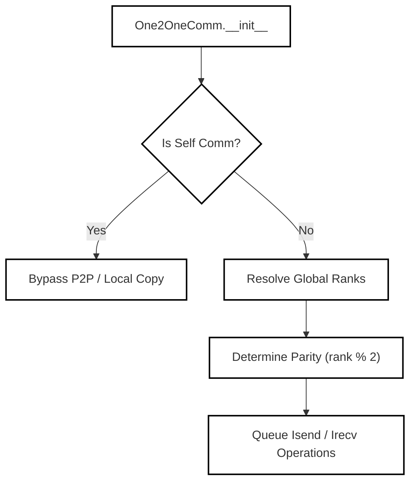
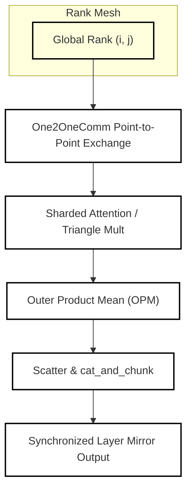

# Distributed Communication and Sharded Ops

Relevant source files

The following files were used as context for generating this wiki page:

- [docs/context-parallel-sampling.md](docs/context-parallel-sampling.md)
- [src/bioemu2/context_parallel/diffusion/__init__.py](src/bioemu2/context_parallel/diffusion/__init__.py)
- [src/bioemu2/context_parallel/distributed/__init__.py](src/bioemu2/context_parallel/distributed/__init__.py)
- [src/bioemu2/context_parallel/distributed/comm.py](src/bioemu2/context_parallel/distributed/comm.py)

## Purpose and Scope
This page details the distributed communication infrastructure and sharded operator implementations used for context-parallel sampling in BioEmu2 [docs/context-parallel-sampling.md:18-22](). It covers point-to-point communication primitives [src/bioemu2/context_parallel/distributed/comm.py:37-160](), communication grouping, and how sequence-sharded layers, models, and operations (such as attention, triangular multiplication, outer product mean, scatter, and chunking primitives) execute across a 2D grid of GPU ranks [docs/context-parallel-sampling.md:35-39]().

---

## Distributed Communication Primitives (`distributed/comm.py`)

BioEmu2 implements point-to-point and collective communication abstractions to facilitate context-parallel updates where token and pair representations are distributed across an $n \times n$ grid of devices [docs/context-parallel-sampling.md:35-39](). The core communication primitive is defined in `src/bioemu2/context_parallel/distributed/comm.py` [src/bioemu2/context_parallel/distributed/comm.py:1-3]。

### The `One2OneComm` Class
The `One2OneComm` class handles asynchronous point-to-point (P2P) transfers between specific ranks within a process group [src/bioemu2/context_parallel/distributed/comm.py:37-63]().

*Figure 1: Initialization and routing logic for `One2OneComm`.*

* **Initialization Arguments**: `group` (`dist.ProcessGroup`), `rank_send_to` (`int`), `rank_recv_from` (`int`), and `parity` (`bool | None`) [src/bioemu2/context_parallel/distributed/comm.py:38-44]().
* **Parity Control**: To prevent deadlocks in the NCCL backend during batch send/receive operations, `One2OneComm` assigns an operation order based on `parity` (or `rank % 2` if unspecified) [src/bioemu2/context_parallel/distributed/comm.py:52-57]().
* **Self-Communication Optimization**: When `rank_send_to == rank and rank_recv_from == rank`, `is_self_comm` is set to `True`, converting communication routines into local tensor cloning or copy operations [src/bioemu2/context_parallel/distributed/comm.py:74-85](), [src/bioemu2/context_parallel/distributed/comm.py:149-156]().

Sources: [src/bioemu2/context_parallel/distributed/comm.py:37-160]()

---

## Sharded Operators and Module Mirrors

Context parallelism in BioEmu2 distributes pair representations and token sequences across multiple device ranks [docs/context-parallel-sampling.md:18-20](). Operations that interact globally across tokens (such as attention mechanisms, triangular updates, outer product mean (OPM), scatter operations, and chunked sequence transformations) are sharded to maintain memory efficiency [docs/context-parallel-sampling.md:112-117]().

### Architectural Data Flow for Sharded Ops

*Figure 2: Execution pipeline for sharded operators across process ranks.*

* **Point-to-Point Coordination**: Operations rely on `One2OneComm` to exchange boundary token activations and pair slices between neighboring ranks in the process grid.
* **Sharded Attention & Triangular Updates**: Pair matrices are split quadratically with respect to token length, distributing memory overhead across the $n \times n$ GPU grid [docs/context-parallel-sampling.md:35-39]().
* **Scatter and Chunking (`cat_and_chunk`)**: Sequence dimensions are concatenated and chunked across ranks to align with downstream transformer and pair-mixer block requirements.

Sources: [docs/context-parallel-sampling.md:18-39](), [src/bioemu2/context_parallel/distributed/comm.py:37-160]()

---