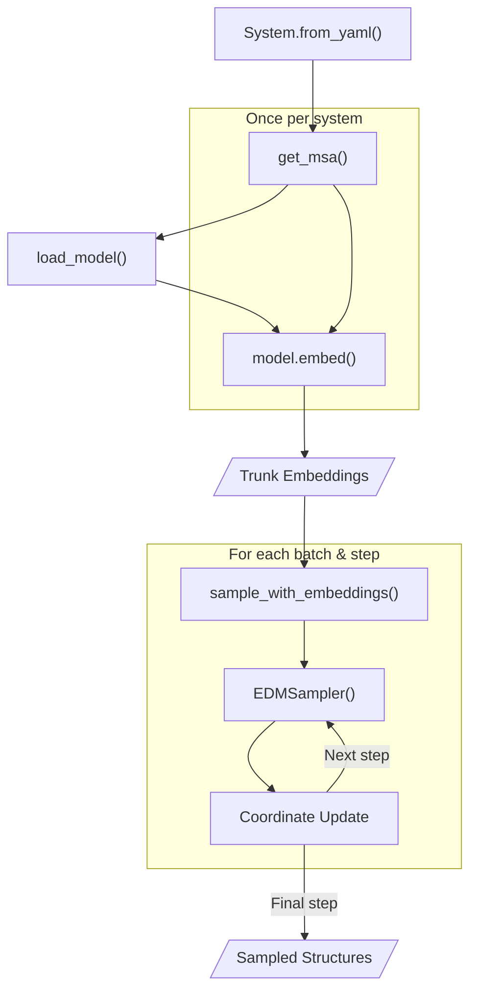
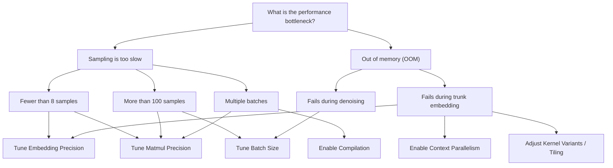
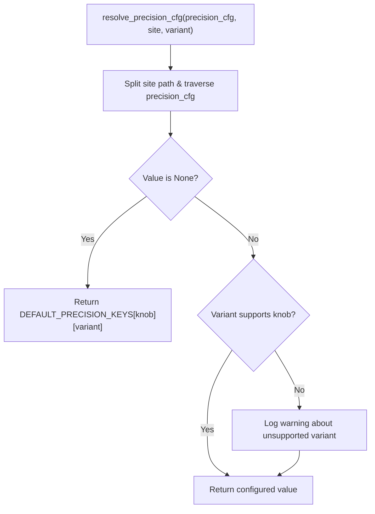

# Performance: Speed, Capacity and Batch Sizing

<details>
<summary>Relevant source files</summary>

The following files were used as context for generating this wiki page:

- [docs/speed-and-capacity.md](docs/speed-and-capacity.md)
- [examples/search_batch_size.py](examples/search_batch_size.py)
- [src/bioemu2/biomoa/utils/precision.py](src/bioemu2/biomoa/utils/precision.py)

</details>


This leaf page details the performance characteristics of BioEmu2, covering runtime profiling (trunk embedding versus denoising), automated batch size searching, precision and tiling tradeoffs, and configuration knobs. 

---

## 1. Workflow Performance Breakdown: Where the Time Goes

BioEmu2 execution divides into two major compute-intensive phases: **Trunk Embedding** (executed once per molecular system) and **Denoising** (executed iteratively across multiple steps for each batch of samples) [docs/speed-and-capacity.md:20-52](). 


*Sources: [docs/speed-and-capacity.md:20-39](), [examples/search_batch_size.py:113-129]()*

### Computational Complexity Summary

Let $N$ be the number of tokens [docs/speed-and-capacity.md:59-65](), $R$ the MSA depth (number of rows) [docs/speed-and-capacity.md:59-65](), and $B$ the batch size [docs/speed-and-capacity.md:59-65]().

| Action | Peak Memory | Compute Complexity |
| --- | --- | --- |
| Fetch or load MSA | $O(RN)$ host [docs/speed-and-capacity.md:67-69]() | $O(RN)$ local/cached; remote fetch depends on service [docs/speed-and-capacity.md:67-69]() |
| Run trunk (`model.embed`) | $O(RN + N^2)$ GPU [docs/speed-and-capacity.md:67-70]() | $O(RN^2 + N^3)$ [docs/speed-and-capacity.md:67-70]() |
| Initialize sample batch | $O(N^2 + BN)$ GPU [docs/speed-and-capacity.md:67-71]() | $O(N^2 + BN)$ [docs/speed-and-capacity.md:67-71]() |
| Call denoiser (per step) | $O(N^2 + BN)$ GPU [docs/speed-and-capacity.md:67-72]() | $O(BN^2)$ [docs/speed-and-capacity.md:67-72]() |
| Update coordinates (per step) | $O(N^2 + BN)$ GPU [docs/speed-and-capacity.md:67-73]() | $O(BN)$ without steering [docs/speed-and-capacity.md:67-73]() |

*Sources: [docs/speed-and-capacity.md:59-74]*

---

## 2. Performance Controls and Tuning Decision Tree

Tuning controls allow adjusting throughput, memory limits, and precision characteristics [docs/speed-and-capacity.md:92-107]().

| Control | Interface | Target Stage | Impact | Changes Results? |
| --- | --- | --- | --- | --- |
| Batch Size | `--batch-size` / `batch_size=` [docs/speed-and-capacity.md:94-96]() | Denoising [docs/speed-and-capacity.md:94-96]() | Higher speed on large GPUs; lower memory with smaller batches [docs/speed-and-capacity.md:94-96]() | Yes (changes exact samples; affects resampling populations) [docs/speed-and-capacity.md:94-96]() |
| Denoising Steps | `--num-steps` / `num_steps=` [docs/speed-and-capacity.md:94-97]() | Denoising [docs/speed-and-capacity.md:94-97]() | Linear scaling of runtime with step count [docs/speed-and-capacity.md:94-97]() | Yes [docs/speed-and-capacity.md:94-97]() |
| Compilation | `--compile-denoiser` / `load_model(compile_denoiser=True)` [docs/speed-and-capacity.md:94-98]() | Denoising [docs/speed-and-capacity.md:94-98]() | Improves throughput via `torch.compile` [docs/speed-and-capacity.md:94-98]() | No [docs/speed-and-capacity.md:94-98]() |
| Embedding Precision | `--precision` / `load_model(precision=...)` [docs/speed-and-capacity.md:94-99]() | Trunk Embedding [docs/speed-and-capacity.md:94-99]() | Speed and peak memory [docs/speed-and-capacity.md:94-99]() | Slightly [docs/speed-and-capacity.md:94-99]() |
| Matmul Precision | `--matmul-precision` / `load_model(matmul_precision=...)` [docs/speed-and-capacity.md:94-100]() | Denoising [docs/speed-and-capacity.md:94-100]() | Speed [docs/speed-and-capacity.md:94-100]() | Slightly [docs/speed-and-capacity.md:94-100]() |
| Context Parallelism | `torchrun --module bioemu2.cp` [docs/speed-and-capacity.md:94-101]() | Both [docs/speed-and-capacity.md:94-101]() | Reduces peak memory per GPU across ranks [docs/speed-and-capacity.md:94-101]() | No [docs/speed-and-capacity.md:94-101]() |
| Kernel Variant | `trimul_variant`, `opm_variant`, `tiling_cfg` [docs/speed-and-capacity.md:94-102]() | Trunk Embedding [docs/speed-and-capacity.md:94-102]() | Peak memory vs. speed trade-off [docs/speed-and-capacity.md:94-102]() | Slightly [docs/speed-and-capacity.md:94-102]() |

*Sources: [docs/speed-and-capacity.md:92-103]*

### Diagnostic Flowchart for Performance Tuning


*Sources: [docs/speed-and-capacity.md:114-140]*

---

## 3. Automated Batch Size Search

To optimize sampling throughput without encountering Out-Of-Memory (OOM) errors, BioEmu2 provides an automated batch size search script (`examples/search_batch_size.py`) [examples/search_batch_size.py:1-135]().

### Measurement and Search Algorithm

The measurement function (`measure_batch`) uses CUDA events for precise GPU timing while cleaning up tensor caches between trials [examples/search_batch_size.py:29-54]():

```python
def measure_batch(sample: Callable[[int], object], size: int, device: torch.device) -> float:
    """Log median CUDA-event batch time and return samples/sec; zero means CUDA OOM."""
    gc.collect()
    torch.cuda.empty_cache()
    try:
        sample(size)  # Untimed warmup
        torch.cuda.synchronize(device)
        start = torch.cuda.Event(enable_timing=True)
        end = torch.cuda.Event(enable_timing=True)
        # ... timing iterations ...
    except torch.cuda.OutOfMemoryError:
        logger.info("batch=%d CUDA OOM", size)
    ...
```
*Sources: [examples/search_batch_size.py:29-54]()*

The search routine (`search_batch_sizes`) starts at batch size 1, doubles until an OOM or stall is detected, and refines candidate sizes around the local maximum [examples/search_batch_size.py:57-107]().

---

## 4. Precision, Tiling, and Kernel Tradeoffs

Precision configuration is handled via nested configuration dictionaries parsed by `src/bioemu2/biomoa/utils/precision.py` [src/bioemu2/biomoa/utils/precision.py:1-42]().

### Matmul Precision Routing

Individual kernels (`opm_matmul_precision`, `trimul_matmul_precision`) accept precision modes such as `"ieee"`, `"tf32"`, or `"tf32x3"` [src/bioemu2/biomoa/utils/precision.py:1-5](). The helper function `resolve_precision_cfg` retrieves specific settings from the precision configuration dictionary [src/bioemu2/biomoa/utils/precision.py:44-85]():


*Sources: [src/bioemu2/biomoa/utils/precision.py:44-86]*

### Supported Variants and Precision Knobs

* `opm_matmul_precision`: Supported by `"triton_memory_saving"` (default: `"ieee"`) [src/bioemu2/biomoa/utils/precision.py:27-36]().
* `trimul_matmul_precision`: Supported by `"cueq"` and `"cueq_tiled"` (default: `"ieee"`) [src/bioemu2/biomoa/utils/precision.py:27-36]().

---

## 5. Checkpoint Loading Costs and Memory Management

Checkpoint loading involves parsing model weights, instantiating network modules, and allocating persistent memory buffers on the target device. 

* **Host vs. GPU Memory**: Checkpoint weights are initially loaded into host memory before being transferred to GPU memory during model instantiation.
* **Embedding Cache Reuse**: To mitigate the high computational cost of trunk embedding on large systems ($O(RN^2 + N^3)$), reuse embeddings in memory within a Python session or persist them to disk for cross-session execution [docs/speed-and-capacity.md:53-57]().

*Sources: [docs/speed-and-capacity.md:20-57]()*

---