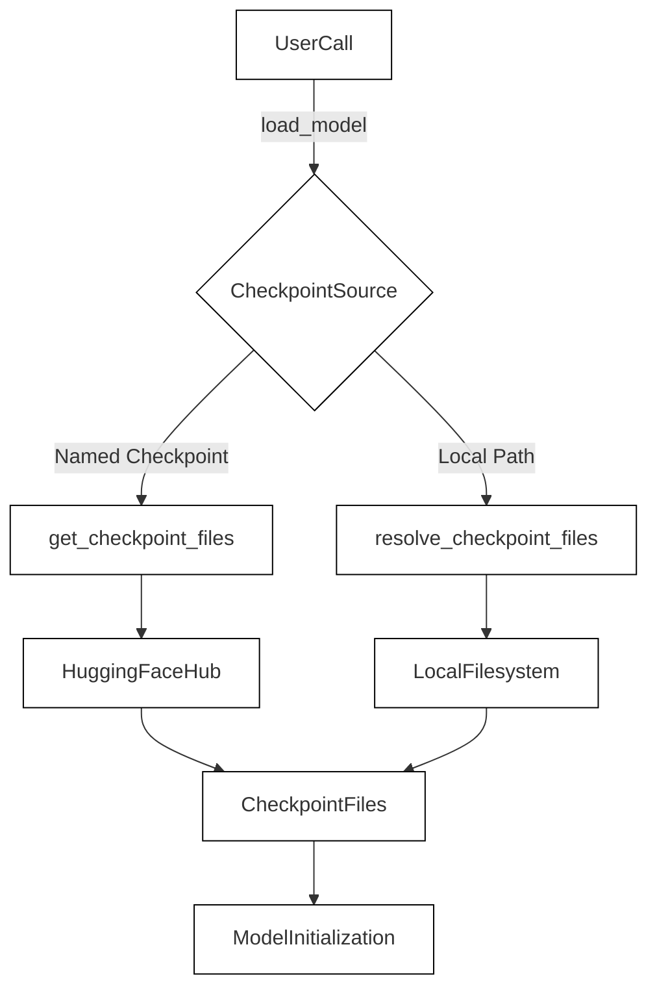
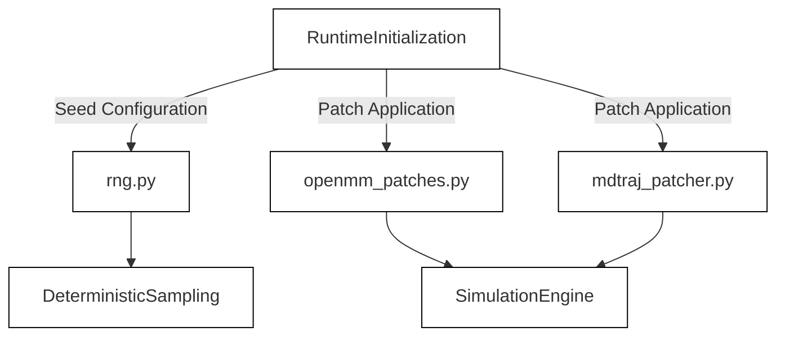

# Checkpoints, Patens and Runtime Infrastructure

Relevant source files

The following files were used as context for generating this wiki page:

- [docs/checkpoints.md](docs/checkpoints.md)
- [src/bioemu2/checkpoints.py](src/bioemu2/checkpoints.py)

## Purpose and Scope

This section provides a high-level overview of the runtime infrastructure in BioEmu2, encompassing model weight management, checkpoint caching, third-party library patches (such as MDTraj and OpenMM adjustments), and random number generation (RNG) utilities ensuring reproducibility. 

BioEmu2 relies on external weight repositories, local asset layouts, and specific environment configurations to ensure deterministic molecular emulations.

Sources:
- `src/bioemu2/checkpoints.py:1-115`
- `docs/checkpoints.md:1-81`

---

## 7.1 Checkpoint Download and Loading

Model weight management is handled primarily via Hugging Face Hub integration and local filesystem path resolution [src/bioemu2/checkpoints.py:1-114](). The core entry point `load_model()` orchestrates downloading default checkpoints or reading local file paths alongside their corresponding configuration files [docs/checkpoints.md:1-57]().

*Figure 1: Checkpoint resolution flow through `checkpoints.py`.*

Sources:
- `src/bioemu2/checkpoints.py:21-115`
- `docs/checkpoints.md:1-81`

For detailed information on local cache directories, asset layouts, and hub configurations, see [Checkpoint Download and Loading](#7.1).

---

## 7.2 Third-Party Patches and Determinism

BioEmu2 integrates with external molecular dynamics and simulation tooling like OpenMM and MDTraj. Because these libraries may have upstream behaviors that conflict with rigorous seeding or specific gradient/sampling expectations, custom patches are applied at runtime. Additionally, `rng.py` manages global seeding to guarantee deterministic trajectories across runs.

*Figure 2: Runtime patching and determinism infrastructure.*

Sources:
- `src/bioemu2/checkpoints.py:1-15`

For detailed technical breakdowns of the patching mechanisms, OpenMM workarounds, and global RNG handling, see [Third-Party Patches and Determinism](#7.2).

---