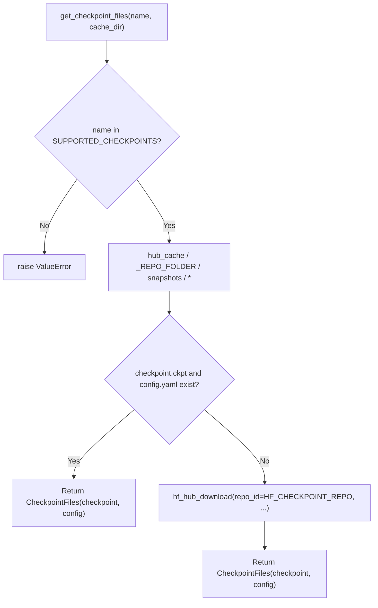
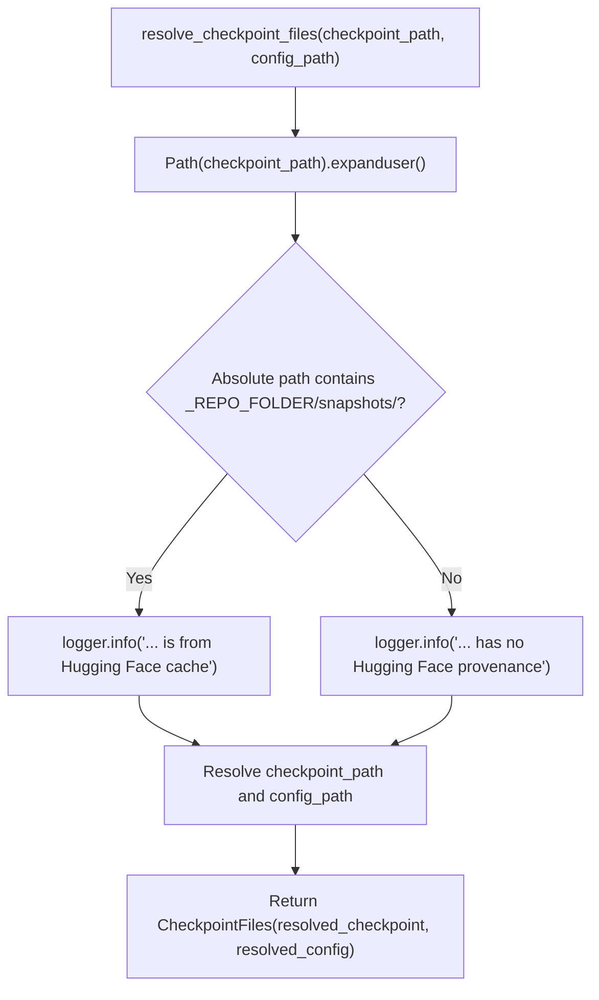

# Checkpoint Download and Loading

<details>
<summary>Relevant source files</summary>

The following files were used as context for generating this wiki page:

- [docs/checkpoints.md](docs/checkpoints.md)
- [src/bioemu2/checkpoints.py](src/bioemu2/checkpoints.py)

</details>


## Purpose and Scope

This page covers the technical implementation of checkpoint management, asset layouts, Hugging Face caching integrations, and path resolution utilities in BioEmu2. It details the functions and data structures defined in `src/bioemu2/checkpoints.py` and how they support the model loading interface [docs/checkpoints.md:1-8](), [src/bioemu2/checkpoints.py:1-15]().

Sources: [docs/checkpoints.md:1-8](), [src/bioemu2/checkpoints.py:1-15]()

---

## Remote Repositories and Asset Layout

BioEmu2 hosts its weights and configurations on the Hugging Face Hub under the repository ID `microsoft/bioemu2` [docs/checkpoints.md:4-6](), [src/bioemu2/checkpoints.py:12](). 

The repository layout follows a deterministic directory structure where each supported checkpoint name maps to a distinct folder containing the model weights and its YAML configuration [src/bioemu2/checkpoints.py:69-73]():

```text
checkpoints/
└── <name>/
    ├── checkpoint.ckpt
    └── config.yaml
```

The codebase maintains a tuple of currently supported checkpoint versions, anchored by `bioemu2-preview` [src/bioemu2/checkpoints.py:15-18](). Published checkpoint directories are never overwritten on the Hub; updates introduce new directory names [src/bioemu2/checkpoints.py:15-16]().

Sources: [docs/checkpoints.md:4-6](), [src/bioemu2/checkpoints.py:12-19](), [src/bioemu2/checkpoints.py:69-73]()

---

## Core Data Structures and Functions

The checkpoint module defines a frozen dataclass to encapsulate resolved file locations and primary resolution routines [src/bioemu2/checkpoints.py:21-63](), [src/bioemu2/checkpoints.py:66-114]().

### `CheckpointFiles`

`CheckpointFiles` is a frozen dataclass holding absolute paths to the model weights file and the corresponding configuration file [src/bioemu2/checkpoints.py:21-27]():

* `checkpoint_path`: Resolved `Path` to `checkpoint.ckpt` [src/bioemu2/checkpoints.py:25]()
* `config_path`: Resolved `Path` to `config.yaml` [src/bioemu2/checkpoints.py:26]()

### `get_checkpoint_files()`

`get_checkpoint_files(name, *, cache_dir)` checks the local Hugging Face cache directory before attempting a network download via `huggingface_hub.hf_hub_download` [src/bioemu2/checkpoints.py:66-114](). 

Data flow and operations inside `get_checkpoint_files()`:
1. Validates that `name` is present in `SUPPORTED_CHECKPOINTS` [src/bioemu2/checkpoints.py:87-88]().
2. Iterates over existing local snapshots under `hub_cache / _REPO_FOLDER / "snapshots"` [src/bioemu2/checkpoints.py:90]().
3. Checks for the existence of `checkpoints/<name>/checkpoint.ckpt` and `config.yaml` [src/bioemu2/checkpoints.py:91-93]().
4. If cached files are present, returns them without contacting the Hub [src/bioemu2/checkpoints.py:93-100]().
5. Otherwise, downloads both files via `hf_hub_download()` [src/bioemu2/checkpoints.py:101-110]().

Diagram: Remote Checkpoint Discovery and Caching Workflow in `src/bioemu2/checkpoints.py`


Sources: [src/bioemu2/checkpoints.py:21-114]()

### `resolve_checkpoint_files()`

`resolve_checkpoint_files(checkpoint_path, config_path)` handles user-supplied local checkpoint paths [src/bioemu2/checkpoints.py:29-63](). It inspects whether the path resides inside a Hugging Face cache snapshot by scanning for `_REPO_FOLDER / "snapshots/"` and logs provenance metadata accordingly [src/bioemu2/checkpoints.py:47-53](). If `config_path` is omitted, it defaults to resolving `config.yaml` in the parent directory of `checkpoint_path` [src/bioemu2/checkpoints.py:55-59]().

Diagram: Local Path Resolution Workflow in `src/bioemu2/checkpoints.py`


Sources: [src/bioemu2/checkpoints.py:29-63]()

---

## Runtime Model Loading and Caching Configuration

The high-level entrypoint `load_model()` delegates to `get_checkpoint_files()` or `resolve_checkpoint_files()` depending on whether a named checkpoint or a direct file path is specified [docs/checkpoints.md:1-56]().

### Caching Control Options

* **`cache_dir` parameter**: Explicitly overrides the Hugging Face cache directory target when downloading checkpoints [docs/checkpoints.md:27-33]().
* **Environment Variables**: Setting `HF_HUB_CACHE` or `HF_HOME` redirects the default cache directory without requiring code changes [docs/checkpoints.md:35-36]().
* **Local Checkpoints**: Passing `checkpoint_path=Path("checkpoints/model.ckpt")` bypasses the Hugging Face hub check, provided that `config.yaml` exists alongside the checkpoint [docs/checkpoints.md:38-56]().

Sources: [docs/checkpoints.md:1-80](), [src/bioemu2/checkpoints.py:66-114]()

---