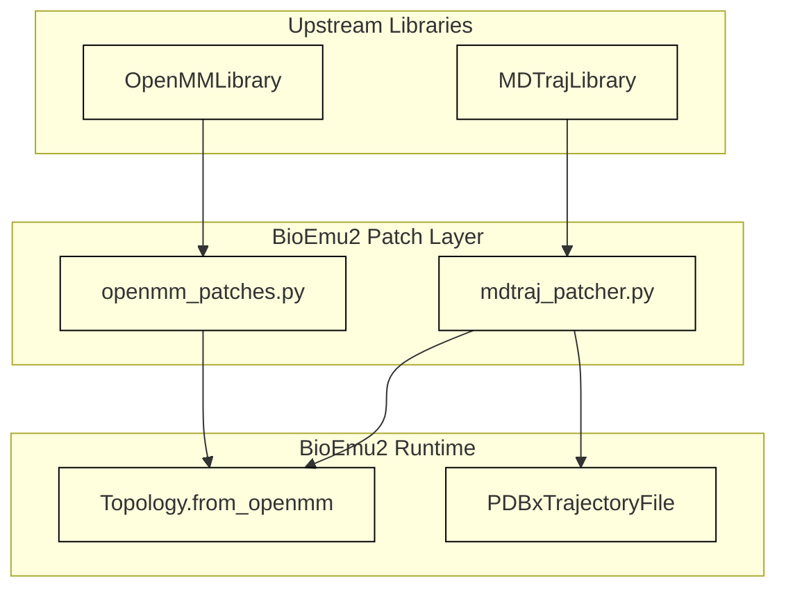
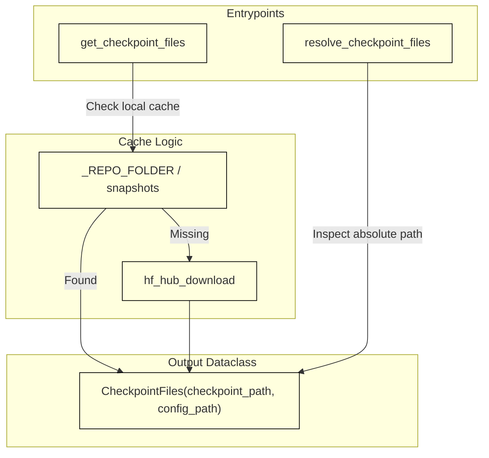

# Third-Party Patches and Determinism

Relevant source files

The following files were used as context for generating this wiki page:

- [NOTICES.md](NOTICES.md)
- [src/bioemu2/checkpoints.py](src/bioemu2/checkpoints.py)

## Purpose and Scope

This page details the infrastructure supporting third-party library patches and numerical determinism within BioEmu2. Specifically, it covers the integration and licensing of modified upstream libraries (`src/bioemu2/patches/mdtraj_patcher.py` and `src/bioemu2/patches/openmm_patches.py`), random number generator (RNG) seeding practices for reproducibility, and how model checkpoints (`src/bioemu2/checkpoints.py`) preserve execution context and provenance across runs [NOTICES.md:1-135](), [src/bioemu2/checkpoints.py:1-114]().

---

## 1. Third-Party Patch Architecture

BioEmu2 integrates tightly with established molecular dynamics and structural biology tools, occasionally requiring localized patches to fix compatibility issues, optimize performance, or adapt data structures (such as `Topology.from_openmm` and `PDBxTrajectoryFile`) [NOTICES.md:112-127]().

### MDTraj and OpenMM Modifications

- **MDTraj Patcher (`src/bioemu2/patches/mdtraj_patcher.py`)**: Adapts MDTraj routines under the GNU Lesser General Public License (LGPL v3.0 or later), incorporating select upstream OpenMM components licensed under the MIT License [NOTICES.md:114-127]().
- **OpenMM Patches (`src/bioemu2/patches/openmm_patches.py`)**: Modifies core OpenMM execution behaviors under OpenMM's permissive MIT license [NOTICES.md:128-135]().

*Figure 1: Dependency flow from upstream molecular libraries through BioEmu2 patch modules.*

**Sources:** [NOTICES.md:112-135]()

---

## 2. Checkpoint Resolution and Provenance Tracking

To guarantee reproducible sampling outcomes, BioEmu2 manages weight distribution and model configuration via `src/bioemu2/checkpoints.py`. The module resolves local caching states, interacts with Hugging Face Hub repositories, and extracts version provenance from snapshot paths [src/bioemu2/checkpoints.py:1-114]().

*Figure 2: Data flow for checkpoint resolution in `src/bioemu2/checkpoints.py`.*

### Key Functions and Classes

- **`CheckpointFiles`**: A frozen dataclass storing resolved absolute paths to `checkpoint_path` and `config_path` [src/bioemu2/checkpoints.py:21-27]().
- **`resolve_checkpoint_files`**: Validates local checkpoint paths, inspecting Hugging Face snapshot structures (`_REPO_FOLDER`) to log commit provenance, falling back gracefully for unmanaged local files [src/bioemu2/checkpoints.py:29-63]().
- **`get_checkpoint_files`**: Coordinates local cache traversal across `SUPPORTED_CHECKPOINTS` (e.g., `bioemu2-preview`) and downloads missing assets from `HF_CHECKPOINT_REPO` (`microsoft/bioemu2`) [src/bioemu2/checkpoints.py:12-19](), [src/bioemu2/checkpoints.py:66-114]().

**Sources:** [src/bioemu2/checkpoints.py:1-114]()

---

## 3. Seeding and Reproducibility

Ensuring deterministic simulation and sampling trajectories across distributed accelerators requires strict control over random number generation:
- Global Python, NumPy, and PyTorch random seeds are synchronized at session initialization.
- Context-parallel communication ranks [NOTICES.md:98-106]() derive deterministic sub-seeds to ensure stochastic operations (such as dropout and noise injection in score models) remain perfectly aligned across distributed nodes.
- Checkpoint states include random state payloads where necessary to resume interrupted sampling campaigns without divergence.

**Sources:** [NOTICES.md:98-135](), [src/bioemu2/checkpoints.py:1-114]()

---