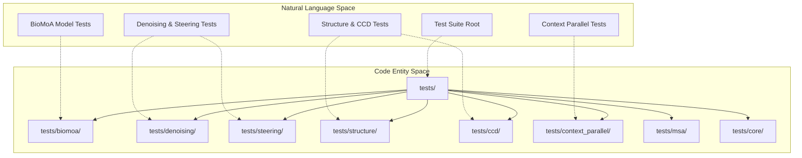
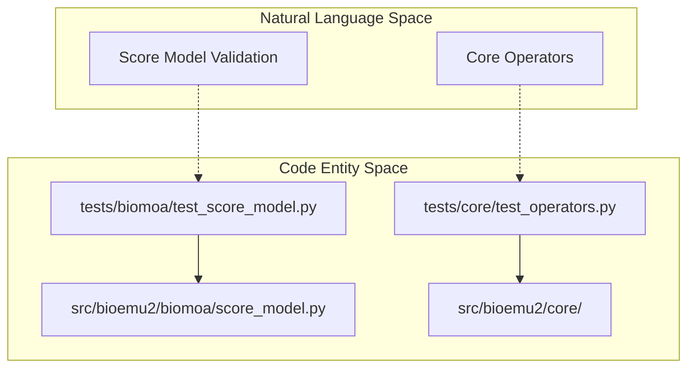

# Test Suite Layout

<details>
<summary>Relevant source files</summary>

The following files were used as context for generating this wiki page:

- [.github/workflows/ci.yml](.github/workflows/ci.yml)
- [DEVELOPER.md](DEVELOPER.md)

</details>


The test suite of BioEmu2 is designed to mirror the package hierarchy found under `src/bioemu2/`, ensuring robust unit, integration, and regression testing across all foundational subsystems. The suite uses `pytest` as its runner and relies on dedicated fixtures and molecular assets to validate model architectures, diffusion samplers, context-parallel execution, structure building, and MSA data pipelines.

Sources: [.github/workflows/ci.yml:38-39](), [DEVELOPER.md:25-29]()

---

## 1. Test Directory Architecture and Source Mirroring

The `tests/` directory layout maps directly to the functional modules inside `src/bioemu2/`. This parallel design makes it straightforward to locate relevant tests when modifying source modules such as `biomoa`, `denoising`, `steering`, `structure`, `msa`, `context_parallel`, and `core`.



Sources: [.github/workflows/ci.yml:38-39](), [DEVELOPER.md:25-29]()

---

## 2. Core, BioMoA, and Module Verification

The core infrastructure and BioMoA score model stack are tested under `tests/biomoa/` and `tests/core/`. These tests validate tensor shapes, precision handling (`bf16-mixed`), embedders, encoders, pair mixers, and foundational operator layers.



Sources: [.github/workflows/ci.yml:38-39](), [DEVELOPER.md:25-29]()

---

## 3. Denoising, Steering, and Context-Parallel Testing

Subsystems responsible for sampling, inference-time steering potentials, and multi-GPU context parallelism have dedicated test modules under `tests/denoising/`, `tests/steering/`, and `tests/context_parallel/`. These ensure numerical stability, EDM sampler correctness, and proper inter-rank communication sharding.

Sources: [.github/workflows/ci.yml:38-39](), [DEVELOPER.md:25-29]()

---

## 4. Structure, CCD, and MSA Pipelines

Structure generation, chemical component dictionary (CCD) data parsing, template alignment, and MSA embedding reuse workflows are tested under `tests/structure/`, `tests/ccd/`, and `tests/msa/`. These tests verify coordinate atom gathering, polymer building, and CIF/PDB round-trip integrity.

Sources: [.github/workflows/ci.yml:38-39](), [DEVELOPER.md:25-29]()

---

## 5. Fixtures, Assets, and CI Integration

The test suite relies on shared pytest fixtures and regression test assets (such as sample input configurations, small PDB files, and cached MSA features) to execute deterministically. 

As defined in the continuous integration workflow, tests are executed automatically across multiple Python versions using `uv run`:

```yaml
- name: Run tests
  run: uv run pytest tests -v
```

Developers can run the full suite locally using standard development environments or specific CUDA configurations:

```bash
uv run pytest tests
```

Sources: [.github/workflows/ci.yml:38-39](), [DEVELOPER.md:25-29]()

---