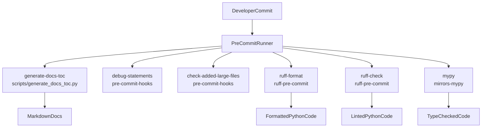
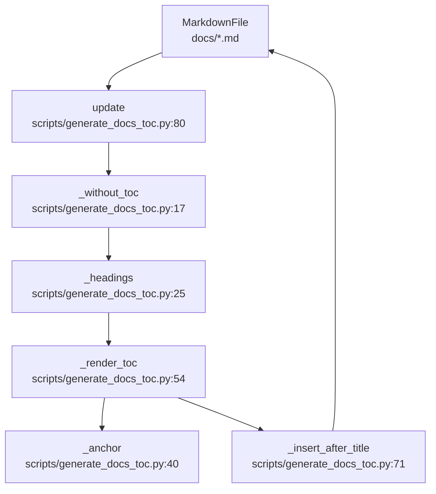

# Code Quality Tooling

Relevant source files

The following files were used as context for generating this wiki page:

- [.gitignore](.gitignore)
- [.pre-commit-config.yaml](.pre-commit-config.yaml)
- [pyproject.toml](pyproject.toml)
- [scripts/generate_docs_toc.py](scripts/generate_docs_toc.py)

## Purpose and Scope
This page documents the code quality tooling, static analysis configurations, pre-commit automation, project build specifications, and ignore conventions used across the BioEmu2 repository. It details how tools like Ruff, Mypy, and custom scripts enforce coding standards and formatting rules.

Sources: `[.pre-commit-config.yaml:1-42]()`, `[pyproject.toml:1-152]()`, `[scripts/generate_docs_toc.py:1-98]()`, `[.gitignore:1-219]()`

## Pre-Commit Automation Workflow
BioEmu2 uses `pre-commit` to run checks and formatters automatically before commits are finalized. The configuration is defined in `[.pre-commit-config.yaml:1-42]()`.

### Pre-Commit Hook Stages
The pre-commit pipeline executes local and remote hooks in sequence:
1. **Documentation TOC Generation**: Runs a local Python script `[scripts/generate_docs_toc.py:1-98]()` matching markdown files in `docs/`.
2. **Standard Repository Checks**: Uses `pre-commit-hooks` to catch debugging statements and prevent committing oversized files above 500 KB via `[.pre-commit-config.yaml:10-18]()`.
3. **Ruff Formatting and Linting**: Uses `ruff-pre-commit` to format Python code (`ruff-format`) and perform fast lint checks (`ruff-check`) with auto-fix capabilities on `[src/]()` and `[tests/]()` (`[.pre-commit-config.yaml:19-28]()`).
4. **Mypy Static Type Checking**: Runs static type analysis using `mirrors-mypy` under Python 3.12 with stubs for PyYAML and requests (`[.pre-commit-config.yaml:29-42]()`).

*Figure 1: Pre-commit pipeline execution flow linking configuration hooks to validation targets.*

Sources: `[.pre-commit-config.yaml:1-42]()`, `[scripts/generate_docs_toc.py:1-98]()`

## Documentation TOC Generation Tool
To keep extensive markdown documentation in `docs/` organized, BioEmu2 includes an automated TOC generator script located at `[scripts/generate_docs_toc.py:1-98]()`.

### Key Functions
- `_without_toc(text: str) -> str`: Removes existing generated TOC blocks bracketed by `<!-- BEGIN GENERATED TOC -->` and `<!-- END GENERATED TOC -->` (`[scripts/generate_docs_toc.py:17-22]()`).
- `_headings(text: str) -> list[tuple[int, str]]`: Parses markdown headings (level 2 to 4) while ignoring code fences (`[scripts/generate_docs_toc.py:25-37]()`).
- `_anchor(title: str, counts: dict[str, int]) -> str`: Generates URL-safe slugs for headings, handling duplicates by appending numerical suffixes (`[scripts/generate_docs_toc.py:40-51]()`).
- `_render_toc(headings: list[tuple[int, str]]) -> str`: Renders the Markdown unordered list of links representing the table of contents (`[scripts/generate_docs_toc.py:54-68]()`).
- `update(path: Path) -> None`: Conditionally updates files if they exceed `MIN_LINES` (200 lines) or `MIN_SECTIONS` (6 sections) (`[scripts/generate_docs_toc.py:80-94]()`).

*Figure 2: Data flow for the documentation TOC generator script.*

Sources: `[scripts/generate_docs_toc.py:1-98]()`

## Project and Linter Configuration (`pyproject.toml`)
Project metadata, dependencies, optional packages, and tool configurations are centralized in `[pyproject.toml:1-152]()`.

### Ruff Configuration
Ruff is configured with a line length of 100 characters targeting Python 3.12 (`[pyproject.toml:120-122]()`). 
- **Formatting**: Uses double quotes, space indentation, and preserves magic trailing commas (`[pyproject.toml:124-128]()`).
- **Linting Selectors**: Selects rules `E`, `W`, `F`, `UP` (pyupgrade), `PLE`, `PLC0415`, and `I` (isort) (`[pyproject.toml:130-139]()`).
- **Ignores**: Ignores specific lint rules like `W605`, `E501`, `E402`, `E741`, and `UP007` (`[pyproject.toml:140-146]()`).
- **Isort**: Treats `bioemu2` as a known first-party package (`[pyproject.toml:149-151]()`).

### Pytest Options
Test markers are registered under `[tool.pytest.ini_options:112-118]()`, including `gpu`, `requires_4gpu`, `slow`, and `serial`.

Sources: `[pyproject.toml:1-152]()`

## Git Ignore Conventions
The `.gitignore` file (`[.gitignore:1-219]()`) defines exclusions for build artifacts, temporary files, editor settings, and large model outputs.

### Key Excluded Categories
- **IDE and Editor Configs**: `.vscode/`, `.cursor/`, `.idea/`, `.run/` (`[.gitignore:8-19]()`).
- **Python Bytecode and Packaging**: `__pycache__/`, `*.py[cod]`, `build/`, `dist/`, `*.egg-info/` (`[.gitignore:23-47]()`).
- **Test and Coverage Reports**: `htmlcov/`, `.tox/`, `.coverage`, `.pytest_cache/` (`[.gitignore:60-73]()`).
- **Environment Directories**: `.env`, `.venv/`, `env/`, `venv/`, `.pixi/` (`[.gitignore:136-144]()`).
- **Tool Caches**: `.mypy_cache/`, `.ruff_cache/` (`[.gitignore:156-162]()`).
- **Model Outputs and Checkpoints**: `**/outputs/`, `**/testdata/`, `*.pt`, `*.pth`, `*.ckpt`, `.data/` (`[.gitignore:173-182]()`).

Sources: `[.gitignore:1-219]()`

---