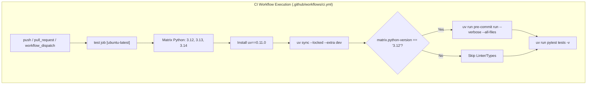
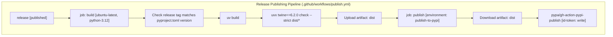

# CI Workflows and Release Publishing

Relevant source files

The following files were used as context for generating this wiki page:

- [.github/dependabot.yml](.github/dependabot.yml)
- [.github/workflows/ci.yml](.github/workflows/ci.yml)
- [.github/workflows/publish-pages.yml](.github/workflows/publish-pages.yml)
- [.github/workflows/publish.yml](.github/workflows/publish.yml)

This page details the Continuous Integration (CI), automated release publishing, GitHub Pages deployment, and dependency management infrastructure defined in the GitHub Actions workflows and configuration files of the BioEmu2 repository.

---

## 1. Continuous Integration Matrix (`ci.yml`)

The primary CI pipeline is defined in [.github/workflows/ci.yml:1-39]() and runs automated checks across multiple Python versions on pull requests and pushes to the `main` branch.

### Workflow Triggers and Concurrency
The CI workflow is triggered by pushes to `main`, pull requests, and manual dispatches [.github/workflows/ci.yml:3-8](). Concurrency groups are configured to cancel in-progress runs for pull requests while preserving runs on `main` [.github/workflows/ci.yml:10-12]().

### Job Matrix and Setup
The `test` job runs on `ubuntu-latest` and utilizes a matrix strategy across Python versions `"3.12"`, `"3.13"`, and `"3.14"` [.github/workflows/ci.yml:18-23](). 
1. **Environment Setup**: Actions check out the repository [.github/workflows/ci.yml:27]() and configure Python [.github/workflows/ci.yml:28-30]().
2. **Package Manager**: Installs `uv==0.11.0` via `pip` [.github/workflows/ci.yml:31-32]().
3. **Dependency Synchronization**: Synchronizes environment dependencies locked to the repository state with the `dev` extra enabled using `uv sync --locked --extra dev` [.github/workflows/ci.yml:33-34]().

### Linter, Type Check, and Test Execution
* **Pre-commit Checks**: Formatting, linting, and type checking (`ruff`, `mypy`) are executed via `uv run pre-commit run --verbose --all-files`, restricted conditionally to Python version `'3.12'` [.github/workflows/ci.yml:35-37]().
* **Test Suite**: Executes the test runner using `uv run pytest tests -v` across all matrix Python versions [.github/workflows/ci.yml:38-39]().

*Sources: [.github/workflows/ci.yml:1-39]()*

---

## 2. Release Publishing and Trusted Publishing (`publish.yml`)

Automated packaging and distribution to PyPI upon publishing a release is configured in [.github/workflows/publish.yml:1-57](). It uses a two-job pipeline (`build` followed by `publish`) implementing OpenID Connect (OIDC) trusted publishing.

### Build Job
The `build` job runs on `ubuntu-latest` with Python `3.12` [.github/workflows/publish.yml:11-21]():
1. **Tag Validation**: Compares the GitHub release tag (`${{ github.event.release.tag_name }}`) against the version reported by `uv version --short` from `pyproject.toml`, failing the build if a mismatch is detected [.github/workflows/publish.yml:25-33]().
2. **Distribution Generation**: Builds source and binary distributions using `uv build` [.github/workflows/publish.yml:34-35]().
3. **Distribution Verification**: Validates built distributions against strict specifications using `uvx twine==6.2.0 check --strict dist/*` [.github/workflows/publish.yml:36-37]().
4. **Artifact Upload**: Uploads the `dist/` directory as a workflow artifact named `dist` [.github/workflows/publish.yml:38-42]().

### Publish Job
The `publish` job depends on the successful completion of the `build` job and executes in the `publish-to-pypi` GitHub environment [.github/workflows/publish.yml:44-47]():
1. **Permissions**: Grants `id-token: write` permissions required for OIDC trusted publishing with PyPI [.github/workflows/publish.yml:48-49]().
2. **Artifact Retrieval**: Downloads the built distributions artifact [.github/workflows/publish.yml:51-55]().
3. **PyPI Upload**: Publishes the package using `pypa/gh-action-pypi-publish` [.github/workflows/publish.yml:56-57]().

*Sources: [.github/workflows/publish.yml:1-57]()*

---

## 3. GitHub Pages Deployment (`publish-pages.yml`)

The workflow for publishing notebook and static documentation pages is defined in [.github/workflows/publish-pages.yml:1-36]().

### Execution Flow
* **Trigger**: Activated exclusively via manual workflow dispatch (`workflow_dispatch`) [.github/workflows/publish.yml:3-4]().
* **Concurrency**: Grouped under `github-pages` with `cancel-in-progress: false` [.github/workflows/publish-pages.yml:6-8]().
* **Permissions**: Requires `contents: read`, `pages: write`, and `id-token: write` [.github/workflows/publish-pages.yml:10-14]().
* **Deployment Steps**:
  1. Checks out the `pages` branch into a local `site` directory using `actions/checkout` [.github/workflows/publish-pages.yml:22-27]().
  2. Configures GitHub Pages via `actions/configure-pages` [.github/workflows/publish.yml:28-29]().
  3. Uploads the static site artifact using `actions/upload-pages-artifact` [.github/workflows/publish.yml:30-33]().
  4. Deploys to GitHub Pages via `actions/deploy-pages` [.github/workflows/publish.yml:34-36]().

*Sources: [.github/workflows/publish-pages.yml:1-36]()*

---

## 4. Automated Dependency Maintenance (`dependabot.yml`)

Dependency updates are automated via Dependabot configuration in [.github/dependabot.yml:1-22](). 

### Ecosystem Configuration
Dependabot tracks three package ecosystems on a weekly schedule with a 14-day cooldown period for updates:
* **`uv`**: Manages Python dependencies rooted at `/` [.github/dependabot.yml:3-8]().
* **`github-actions`**: Manages GitHub Actions workflow action versions rooted at `/` [.github/dependabot.yml:10-15]().
* **`pre-commit`**: Manages pre-commit hook versions rooted at `/` [.github/dependabot.yml:17-22]().

*Sources: [.github/dependabot.yml:1-22]()*

---