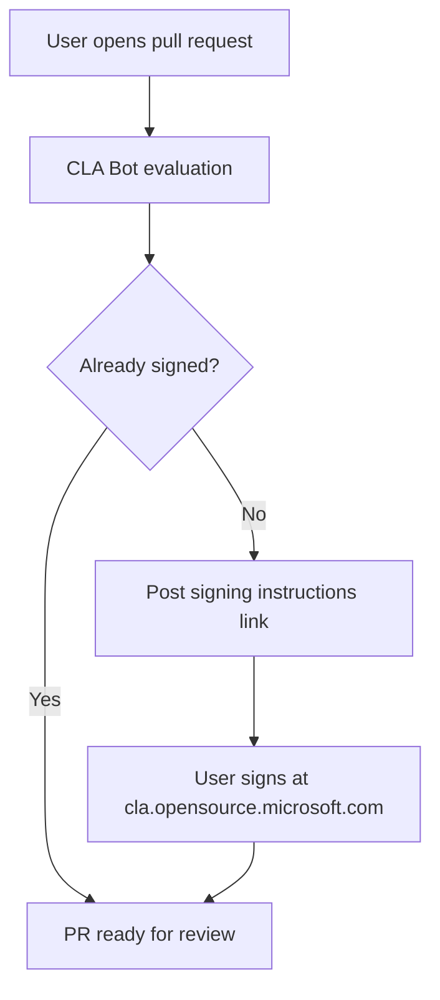
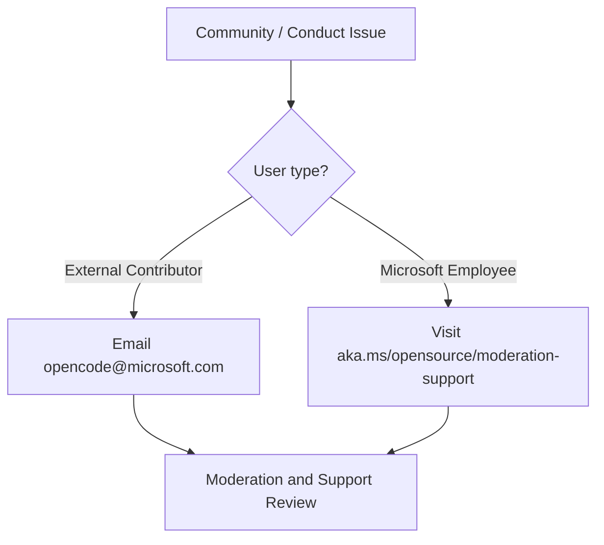

# Contributing and Governance

Relevant source files

The following files were used as context for generating this wiki page:

- [CODE_OF_CONDUCT.md](CODE_OF_CONDUCT.md)
- [CONTRIBUTING.md](CONTRIBUTING.md)
- [SECURITY.md](SECURITY.md)

## Purpose and Scope
This section outlines the community guidelines, contribution pathways, licensing requirements, code of conduct, and security reporting policies for the `bioemu2` repository. BioEmu2 welcomes community participation, bug reports, feature proposals, and code contributions under structured governance policies established for Microsoft open-source repositories.

Sources: [CONTRIBUTING.md:1-11](), [CODE_OF_CONDUCT.md:1-10](), [SECURITY.md:1-14]()

---

## Contributor License Agreement (CLA) Process
All external code contributions and substantial suggestions to BioEmu2 require agreement to a Contributor License Agreement (CLA). This process ensures that contributors retain copyright while granting Microsoft the necessary rights to use, modify, and distribute the contribution.

When a contributor opens a pull request, an automated CLA bot inspects the PR status [CONTRIBUTING.md:9-10]():
1. **Verification**: The bot checks whether the author has previously signed the Microsoft open-source CLA.
2. **Instructions**: If unsigned, the bot posts a comment containing instructions and a link to complete the agreement at [https://cla.opensource.microsoft.com](https://cla.opensource.microsoft.com) [CONTRIBUTING.md:6-10]().
3. **Scope**: Contributors only need to sign the CLA once across all repositories utilizing the Microsoft CLA infrastructure [CONTRIBUTING.md:10-11]().

*Figure 1: The automated Contributor License Agreement (CLA) verification workflow upon opening a pull request.*

Sources: [CONTRIBUTING.md:1-11]()

---

## Pull Request Workflow
Proposing changes to BioEmu2 follows standard GitHub fork-and-pull workflows. Contributors are encouraged to open a pull request to initiate discussion and code review for any proposed changes [CONTRIBUTING.md:3-4]().

- **Proposal**: Changes should be submitted via a pull request against the main repository branches [CONTRIBUTING.md:3-4]().
- **Automated Checks**: PRs trigger automated validation pipelines (such as linting, formatting checks, and test suites) to maintain code quality across the codebase.
- **Review**: Maintainers evaluate pull requests for functional correctness, adherence to code quality tooling, and alignment with the BioEmu2 foundation model design.

Sources: [CONTRIBUTING.md:1-4]()

---

## Code of Conduct
BioEmu2 has adopted the official Microsoft Open Source Code of Conduct [CODE_OF_CONDUCT.md:1-3](). This policy defines expected behavior, inclusivity standards, and anti-harassment rules for all community spaces, issues, pull requests, and communications.

- **Primary Resources**: 
  - [Microsoft Open Source Code of Conduct](https://opensource.microsoft.com/codeofconduct/) [CODE_OF_CONDUCT.md:3-7]()
  - [Microsoft Code of Conduct FAQ](https://opensource.microsoft.com/codeofconduct/faq/) [CODE_OF_CONDUCT.md:8]()
- **Reporting Concerns**: 
  - General questions or concerns regarding conduct can be directed to `opencode@microsoft.com` [CODE_OF_CONDUCT.md:9]().
  - Internal Microsoft employees can reach out via `aka.ms/opensource/moderation-support` [CODE_OF_CONDUCT.md:10]().

*Figure 2: Escalation pathways for code of conduct violations and moderation support.*

Sources: [CODE_OF_CONDUCT.md:1-10]()

---

## Security Reporting
Microsoft takes the security of software products, services, and source code repositories seriously [SECURITY.md:5-6](). 

- **Vulnerability Reporting Policy**: **Please do not report security vulnerabilities through public GitHub issues [SECURITY.md:8]().** Public disclosures before a fix is available put users at risk.
- **Reporting Channels**: For security reporting guidelines, vulnerability disclosure instructions, and contact details, review the guidance maintained at [https://aka.ms/SECURITY.md](https://aka.ms/SECURITY.md) [SECURITY.md:10-12]().

Sources: [SECURITY.md:1-14]()

---