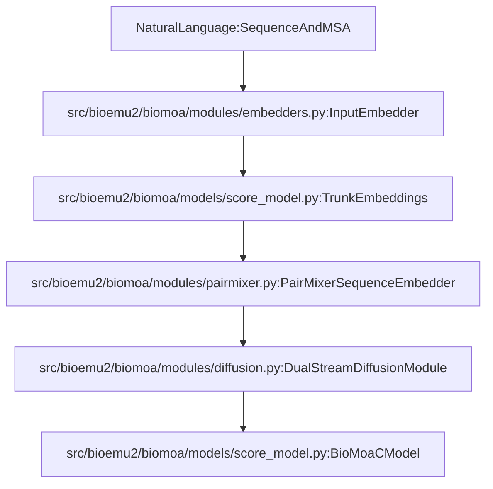
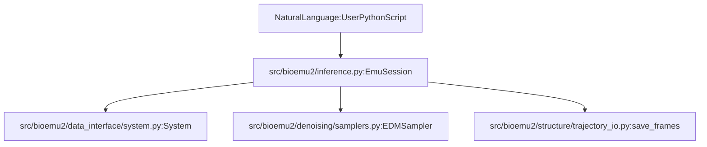

# Glossary

Relevant source files

The following files were used as context for generating this wiki page:

- [README.md](README.md)
- [docs/context-parallel-sampling.md](docs/context-parallel-sampling.md)
- [docs/steering.md](docs/steering.md)
- [docs/system.md](docs/system.md)
- [src/bioemu2/biomoa/models/score_model.py](src/bioemu2/biomoa/models/score_model.py)

This page provides technical definitions for core concepts, architectural modules, and algorithms specific to BioEmu2. Each entry details the theoretical background, implementation context within the codebase, and relevant code pointers.

---

## BioMoA (Biomolecular Architecture)

BioMoA is the underlying foundation model architecture of BioEmu2, combining a sequence trunk (via a pairmixer) with interleaved atom and token diffusion streams. It parameterizes the score model used for both equilibrium sampling and structure prediction.

* **Implementation:** Defined by `BioMoaCModel` in `src/bioemu2/biomoa/models/score_model.py:95-125`(). It orchestrates input embedders, sequence representations, and the `DualStreamDiffusionModule`.
* **Data Flow:** Input features (sequences, MSA, pocket classes, and time embeddings) are processed by sequence/pair embedders (`TrunkEmbeddings`) and passed into the dual-stream transformer layers to predict coordinate updates (scores) and denoised coordinates.

### Diagram: BioMoA Natural Language to Code Entities

Title: "BioMoA Architecture Mapping"

Sources: `src/bioemu2/biomoa/models/score_model.py:1-125`()

---

## EmuSession

`EmuSession` is the high-level Python API session manager designed for end users to coordinate molecular systems, model loading, equilibrium sampling, structure prediction, and time propagation workflows.

* **Implementation:** Encapsulates system configuration, device placement, and execution modes (`"equilibrium"`, `"structure"`). It exposes high-level methods like `.sample()` and `.propagate()`.
* **Data Flow:** Initialized with a `System` object (`docs/system.md:1-23`()) and an optional pre-loaded model, `EmuSession` manages intermediate feature generation, sampler dispatch (`docs/steering.md:135-141`()), and trajectory output formatting.

### Diagram: EmuSession User Workflow Mapping

Title: "EmuSession API Mapping"

Sources: `README.md:131-156`(), `docs/system.md:1-23`()

---

## EDM (Elucidating the Design Space of Diffusion-Based Generative Models)

EDM refers to the formalization of diffusion models, noise schedules, and preconditioning used for training and sampling continuous biomolecular coordinates in BioEmu2.

* **Implementation:** Noise scheduling and preconditioning parameters are managed via `EDMSchedule` (`src/bioemu2/biomoa/models/score_model.py:9-10`()). Sampling trajectories are driven by EDM-based samplers (`docs/steering.md:135-141`()).
* **Data Flow:** Maps continuous noise levels $\sigma$ to model inputs and applies scaling factors to network skip-connections and loss weightings during denoising steps.

Sources: `src/bioemu2/biomoa/models/score_model.py:9-10`(), `docs/steering.md:135-141`()

---

## FK and FKC Steering (Feynman-Kac Steering and Correctors)

Inference-time steering techniques used to bias the generative process toward desired physical or geometrical properties without retraining the model. 

* **Implementation:** Implemented via `GuidedFKSampler` and `FKCSampler` classes (`docs/steering.md:135-141`()). They evaluate user-defined `Potential` objectives (`docs/steering.md:44-60`()) during denoising steps.
* **Data Flow:** At each diffusion step, candidate structures receive gradient guidance or particle weights (using Feynman-Kac resampling/correctors) based on potential evaluations like `BondLengthPotential` (`docs/steering.md:107-111`()) or default physicality potentials.

Sources: `docs/steering.md:16-156`()

---

## Context Parallelism

A distributed multi-GPU execution framework that shards large pair representations and attention tensors across a 2D mesh of GPUs to accommodate massive biomolecular complexes that exceed single-device memory.

* **Implementation:** Configured via `bioemu2.cp` (`docs/context-parallel-sampling.md:51-52`()) and distributed communication primitives (`docs/context-parallel-sampling.md:135-146`()). Requires at least four GPUs arranged in an $n \times n$ grid (`docs/context-parallel-sampling.md:35-39`()).
* **Data Flow:** Pair activations, triangular updates, and attention matrices are split across process ranks (`docs/context-parallel-sampling.md:18-20`()), with synchronized gradient/denoising steps coordinated through `torchrun`.

Sources: `docs/context-parallel-sampling.md:1-156`()

---

## CCD (Chemical Component Dictionary)

A standardized repository of chemical component definitions (monomers, ligands, modified residues) utilized by BioEmu2 to construct covalent geometry and bond topologies for non-standard residues and small molecules.

* **Implementation:** Parsed and validated through data interface modules (`docs/system.md:189-202`()). CCD codes map directly to atom coordinates, bond graphs, and reference stereochemistry during structure building.
* **Data Flow:** System specifications containing `ccd_code` parameters query the CCD database to assemble `BatchAllAtomStructure` instances.

Sources: `docs/system.md:189-202`(), `src/bioemu2/biomoa/models/score_model.py:22`()

---

## MSA (Multiple Sequence Alignment)

An input feature representation consisting of aligned homologous sequences that provide evolutionary covariance information to the sequence trunk embedders.

* **Implementation:** Processed via `bioemu2.msa` modules and integrated into input feature tensors.
* **Data Flow:** Raw sequence inputs or alignment files generate token features and MSA depth matrices (`TrunkEmbeddings`, `src/bioemu2/biomoa/models/score_model.py:30-49`()), which inform the pairmixer and attention layers about conserved residue contacts.

Sources: `src/bioemu2/biomoa/models/score_model.py:30-49`(), `README.md:115-125`()

---

## ITO Propagation (Implicit Transfer Operator Propagation)

A time-lagged dynamical simulation mode that propagates sampled molecular conformations forward in physical time (e.g., nanoseconds) using learned transfer operator models.

* **Implementation:** Triggered via the `propagate` CLI subcommand (`README.md:119-127`()) or `EmuSession.propagate()` (`README.md:153-155`()).
* **Data Flow:** Takes starting atomic coordinates (`topology.cif` and `samples.xtc`) and a specified `lag_time_ns` (`README.md:123-125`()) to generate forward trajectory endpoints representing physical dynamics.

Sources: `README.md:119-127`(), `README.md:153-155`()

---

## Pair Bias Attention & Pair Representations

Core attention mechanisms within BioMoA that incorporate pairwise residue-residue relationships (distance distributions, relative positions, and pair activations) directly into token and atom attention scoring.

* **Implementation:** Managed via sequence embedders, distogram modules (`TrunkEmbeddings`, `src/bioemu2/biomoa/models/score_model.py:30-49`()), and relative position encoders (`src/bioemu2/biomoa/models/score_model.py:16-18`()).
* **Data Flow:** Pair representations ($z$) of shape `(B, N_token, N_token, token_z)` modulate attention weights across transformer layers, allowing spatial geometry to guide feature mixing.

Sources: `src/bioemu2/biomoa/models/score_model.py:14-49`()