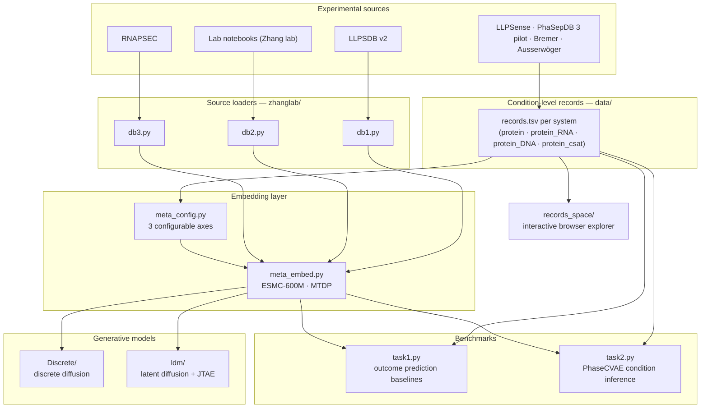

This page is the entry point to the OpenPhase repository. It explains what OpenPhase is, what problems it solves, how the codebase is organized into a dataset, benchmark tasks, generative models, and an interactive explorer — and it gives you a guided reading path into the rest of this documentation. No prior knowledge of Liquid-Liquid Phase Separation or this codebase is assumed; every concept introduced here is expanded in later catalog pages.

## What Is OpenPhase?

**OpenPhase** is an open-source platform and dataset for studying **Liquid-Liquid Phase Separation (LLPS)** — the process by which biomolecules (proteins, RNA, DNA) condense into droplet-like phases inside and outside cells. Its distinguishing claim is being the **first condition-aware platform** for system-level exploration: instead of treating phase behavior as a property of a protein sequence alone, OpenPhase treats every experiment as a tuple of *components* (the protein, optionally a nucleic acid) and *environmental conditions* (pH, salt, temperature, crowders, concentrations) together with a measured outcome.


Why does the condition-aware framing matter? A protein like FUS may phase-separate at pH 6 with 150 mM NaCl but stay dissolved at pH 8 with 1 M salt. A dataset that collapses all of those experiments into one binary "this protein is a phase-separating protein" label throws away exactly the information experimentalists need. OpenPhase keeps every condition of every experiment as a separate record, which enables three canonical tasks defined in the repository:

1. **Phase outcome prediction** — given components (x) and conditions (c), predict whether the system undergoes LLPS (y ∈ {0, 1}).
2. **Condition inference** — given components and an outcome, infer the conditions that produce it, enabling rational experimental design.
3. **Phase system design** — generate protein sequences (x) that exhibit desired phase behavior under target conditions, using generative models.

Sources: [README.md](README.md#L11-L14), [README.md](README.md#L56-L67), [data/README.md](data/README.md#L3-L4)

## The Three Pillars: Dataset, Benchmarks and Models, and the Explorer

OpenPhase is best understood as three cooperating layers, each visible in the repository root:


**Pillar 1 — the condition-level dataset.** The `data/` folder holds one `records.tsv` table per *system*, where a **system** is the set of an experiment's components without concentrations (protein-only, protein + RNA, protein + DNA, or protein with a measured saturation concentration). A thin API in `openphase_systems.py` — `list_systems()`, `load_system()`, `load_all()` — loads these tables as pandas DataFrames, with optional filtering by source. In total the four systems hold **11,439 records** merged and de-duplicated from LLPSDB v2, LLPSense, RNAPSEC, a PhaSepDB 3 pilot extraction, Bremer 2022 and Ausserwöger 2025.

| System | What it contains | Records | Folder |
|---|---|---:|---|
| `protein` | protein only | 7,490 | `data/protein/` |
| `protein_RNA` | protein + RNA | 2,511 | `data/protein_RNA/` |
| `protein_DNA` | protein + DNA | 662 | `data/protein_DNA/` |
| `protein_csat` | protein, saturation concentration (a measured value, no binary label) | 776 | `data/protein_csat/` |

Sources: [README.md](README.md#L32-L41), [data/README.md](data/README.md#L6-L14), [openphase_systems.py](openphase_systems.py#L1-L11), [openphase_systems.py](openphase_systems.py#L28-L46), [README.md](README.md#L43-L47)

**Pillar 2 — benchmarks and generative models.** The task scripts formalize the canonical tasks: `task1.py` runs **outcome-prediction baselines** (an AdaBoost classifier tuned with Optuna and evaluated with AUROC/AUPRC/kappa/MCC, plus a Droppler-style self-attention neural baseline), while `task2.py` trains **PhaseCVAE**, a Conditional Variational Autoencoder for condition inference and phase-diagram prediction on protein-RNA systems. The generative side lives in two model packages: `Discrete/` (a discrete diffusion model over amino-acid sequences, built around `DiscreteMarginalTransition` and ESM2 embeddings) and `ldm/` (a latent diffusion pipeline with a conditional UNet denoiser and classifier-free guidance). All of these consume sequences and conditions through a unified embedding layer configured by `meta_config.py` and produced by `meta_embed.py`.

Sources: [task1.py](task1.py#L59-L104), [task1.py](task1.py#L143-L176), [task2.py](task2.py#L1-L4), [Discrete/protein_diffusion_model.py](Discrete/protein_diffusion_model.py#L1-L12), [ldm/training.py](ldm/training.py#L4-L27)

**Pillar 3 — the records space explorer.** The `records_space/` folder builds and hosts an entirely browser-based interactive map of all 11,439 single-protein records, published via GitHub Pages. Each dot is one experiment; the layout is a t-SNE of a weighted distance combining protein similarity (ESMC-600M embeddings), nucleic-acid properties, experimental conditions, and buffer/additive families. A companion page shows **35,107 negative and unlabelled proteins** (the training negatives of ten LLPS-prediction tools against a Swiss-Prot reference sample). You can filter, colour, and deep-link into specific systems or sources directly from a URL.

| Distance block | Weight | Content |
|---|---:|---|
| protein | 0.40 | ESMC-600M layer-18 embedding (z-score, PCA to 64 dims, cosine) |
| conditions | 0.35 | protein concentration, pH, temperature, salts, crowders |
| nucleic acid | 0.15 | present/absent, RNA/DNA class, length, concentration, fold features |
| buffer and additives | 0.10 | buffer family and additive families |

Sources: [records_space/README.md](records_space/README.md#L1-L4), [records_space/README.md](records_space/README.md#L11-L20), [records_space/README.md](records_space/README.md#L52-L58)

> [!TIP]
> Unreported values are **never imputed** anywhere in OpenPhase. In the record tables a missing condition is left empty and flagged by a paired `st_*` state column (`obs` / `miss` / `zero` / `rt`); in the explorer, a non-reported value counts as *its own state* in the distance model. If you build on this data, preserve that convention — silently filling gaps will distort both benchmarks and the map.

## Software Architecture at a Glance

The Mermaid diagram below shows how the three pillars connect. Reading guide: boxes are components (a folder, script, or table), arrows are data flow, and each `subgraph` groups one architectural layer — raw sources on the left flow rightward into records, embeddings, tasks/models, and finally the explorer.



Two distinct data paths exist, and beginners frequently confuse them. The **merged path** goes straight into `data/<system>/records.tsv` — flat, de-duplicated tables that `openphase_systems.py` loads. The **per-source path** goes through `zhanglab/db1.py`, `db2.py`, and `db3.py`, which download raw upstream data and build one *embedded* AnnData (`.h5ad`) dataset per source; these must be run from the repository root because they import `meta_config.py` and `meta_embed.py`. Notably, the laboratory-notebook records (db2) exist only on this second path — they are **not** in the `data/` tables.

Sources: [zhanglab/README.md](zhanglab/README.md#L1-L14), [data/README.md](data/README.md#L22-L26), [openphase_systems.py](openphase_systems.py#L1-L11), [meta_embed.py](meta_embed.py#L1-L12)

## The Embedding System in One Table

Every model in OpenPhase consumes sequences and conditions as vectors, and *which* vectorizer to use is a first-class configuration choice. `meta_config.py` defines a `MetaEmbeddingConfig` Pydantic model with three independent axes, each validated against a fixed set of allowed methods; `create_meta_config()` is the factory the task scripts call. This design is what makes benchmark comparisons across embedding choices possible, and it is covered in depth in the Embedding System catalog section.

| Axis | Allowed values | Pydantic field default | `create_meta_config()` default |
|---|---|---|---|
| `protein_embedding` | `esmc`, `mtdp`, `rnapsec_protein`, `seq2ind`, `seq2onehot` | `esmc` | `mtdp` |
| `dna_rna_embedding` | `rnapsec_rna`, `dictionary` | `dictionary` | `dictionary` |
| `condition_embedding` | `droppler`, `rnapsec_condition`, `rnapsec_condition_class` | `droppler` | `droppler` |

Sources: [meta_config.py](meta_config.py#L6-L16), [meta_config.py](meta_config.py#L33-L41), [meta_embed.py](meta_embed.py#L38-L60)

> [!TIP]
> The two "default" columns above deliberately disagree: instantiating `MetaEmbeddingConfig()` bare gives you **ESMC** proteins, but the `create_meta_config()` factory used throughout the benchmarks defaults to **MTDP**. When reproducing baseline numbers, check which constructor a script actually calls — the protein embedding affects every downstream result.

## Repository Map

The tree below is the same structure you will browse on GitHub, annotated by pillar. The data layer is self-contained (TSV tables plus one loading module); everything else builds on it.

```
OpenPhase/
├── data/                  # [Pillar 1] records by system (protein, protein_RNA, protein_DNA, protein_csat)
├── openphase_systems.py   # [Pillar 1] list_systems / load_system / load_all API
├── zhanglab/              # [Pillar 1] archived loaders: db1 (LLPSDB v2), db2 (notebooks), db3 (RNAPSEC)
├── meta_config.py         # [Pillar 2] embedding configuration (3 axes)
├── meta_embed.py          # [Pillar 2] embedding generation (ESMC, MTDP)
├── task1.py               # [Pillar 2] outcome-prediction baselines
├── task2.py               # [Pillar 2] PhaseCVAE condition inference
├── Discrete/              # [Pillar 2] discrete diffusion model for sequences
├── ldm/                   # [Pillar 2] latent diffusion (JTAE + conditional UNet)
├── MTDP/                  # [Pillar 2] MTDP embedder
├── params_all.yaml        # global hyperparameters
├── records_space/         # [Pillar 3] explorer site, build scripts, exports, figures
├── assets/                # figures used by the README and this site
└── index.html             # GitHub Pages home page
```

Sources: [README.md](README.md#L69-L86), [data/README.md](data/README.md#L1-L4), [records_space/README.md](records_space/README.md#L68-L77)

## Where to Go Next

The catalog is ordered so that each page assumes only what came before it. If you want to *use* OpenPhase first and understand it later, follow the Get Started track top to bottom; if you are architecturally minded, jump to the Deep Dive after this page.

1. **[Quick Start](2-quick-start)** — install, load your first records, run a first command in minutes.
2. **[Loading Records by System](3-loading-records-by-system)** — the `openphase_systems` API in detail, including source filtering and the full column schema preview.
3. **[Interactive Explorer Tour](4-interactive-explorer-tour)** — a guided walk through the browser-based records map and its URL deep-links.
4. **[Building Source Datasets with Loaders](5-building-source-datasets-with-loaders)** — the `zhanglab` db1/db2/db3 path and AnnData outputs.
5. **[Architecture Overview](6-architecture-overview)** — the module-level design behind the diagram you saw above.
