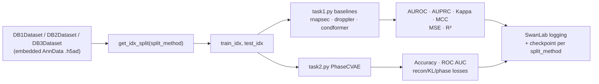
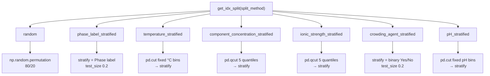

This page documents how OpenPhase partitions its benchmark datasets into train/test sets and which metrics quantify model performance on the canonical tasks. The split machinery is centralized in the archived dataset loaders under `zhanglab/` — most notably `DB1Dataset.get_idx_split()`, which exposes **seven named split strategies** driven by condition columns — while the task scripts (`task1.py`, `task2.py`) define the metric suites, model selection rules, and experiment logging. Everything here applies to the **Outcome Prediction** and **Condition Inference** benchmarks; generative-model evaluation is covered separately in [Sequence Generation Evaluation](18-sequence-generation-evaluation), and the record schema that feeds the stratification columns is described in [Condition-Level Record Schema](7-condition-level-record-schema).

Sources: [db1.py](zhanglab/db1.py#L422-L502), [README.md](README.md#L49-L55)

## Where Splits Live in the Benchmark Stack

The benchmark flow is deliberately simple: each task script instantiates a dataset with an embedding configuration, requests a split by *name*, indexes its feature matrices with the returned indices, then trains, evaluates, and logs. The split step is the only component that is aware of experimental conditions; models and metrics remain agnostic to how the partition was made.



The `split_method` string travels with the experiment: it is logged to SwanLab as a first-class field and is baked into checkpoint filenames, so every reported number is traceable to both an embedding configuration and a split strategy.

Sources: [task1.py](task1.py#L58-L102), [task2.py](task2.py#L462-L520), [meta_config.py](meta_config.py#L38-L41)

## The Split Engine: `get_idx_split`

`DB1Dataset.get_idx_split(split_method, seed)` is the canonical entry point. It re-reads the system's embedded AnnData file (`{system}.no_missing.h5ad`), extracts the label vector `y` plus six raw condition columns, and dispatches on `split_method` via a Python `match` statement. All strategies return a `(train_idx, test_idx)` tuple of NumPy index arrays; an unrecognized name raises a `ValueError` that echoes the full list of valid strategies, making the API self-documenting at the call site.

```python
train_idx, test_idx = system_dataset.get_idx_split(split_method="pH_stratified")
```

The optional `seed` parameter seeds both `torch.manual_seed` and `np.random.seed` before any sampling, which is the intended reproducibility hook. All stratified variants delegate the actual partitioning to `sklearn.model_selection.train_test_split` with a fixed `test_size=0.2`; only the `random` strategy does its own 80/20 cut via `np.random.permutation`.

Sources: [db1.py](zhanglab/db1.py#L422-L437), [db1.py](zhanglab/db1.py#L459-L462), [db1.py](zhanglab/db1.py#L497-L502)

> [!TIP]
> Inside `get_idx_split`, the condition key is built as `c_key = 'c_{self.embedding_config.condition_embedding}'` — a plain string literal, **not** an f-string (db1.py#L445). When reproducing splits against your own embedded h5ad files, ensure the `obsm` key matches what this lookup actually resolves to, or the `c` extraction will fail before any split logic runs.

## Anatomy of the Seven Split Strategies

The strategy family splits cleanly into two groups: one unconditioned baseline and six **condition-stratified** variants. The design goal is that each test set preserves the distribution of one specific experimental factor, so benchmark results measure generalization *across* that factor's values rather than within an uncontrolled random sample.



| Strategy | Stratification variable | Binning method | Bins / classes | Test size |
|---|---|---|---|---|
| `random` | none | `np.random.permutation` | — | 20% |
| `phase_label_stratified` | `Phase label` | raw labels | per-label | 20% |
| `temperature_stratified` | mean temperature | `pd.cut` fixed edges | −25–25, 25–50, 50–75, 75–100 °C | 20% |
| `component_concentration_stratified` | component concentration | `pd.qcut` quantiles | low → high (5) | 20% |
| `ionic_strength_stratified` | ionic strength | `pd.qcut` quantiles | low → high (5) | 20% |
| `crowding_agent_stratified` | `Crowding agent` | raw binary values | Yes / No | 20% |
| `pH_stratified` | buffer pH | `pd.cut` fixed edges | (2.5, 5.5], (5.5, 8.5], (8.5, 11.5] | 20% |

Each stratified branch logs the resulting bin counts (e.g., `temperature_bins.value_counts()`) and, for quantile methods, the computed bin edges — useful diagnostics when a sparse bin makes the stratification fragile.

Sources: [db1.py](zhanglab/db1.py#L458-L498)

## How Stratification Columns Are Derived

Before dispatch, the six stratification inputs are parsed out of the AnnData dataframe with string operations tailored to each column's messy experimental format. Temperature values arrive as comma-separated lists and are averaged (`str.split(', ', expand=True).astype(float).mean(axis=1)`); concentrations and ionic strengths keep only the leading numeric token and fill missing entries with `0` (`fillna(0)`); pH extracts the second whitespace-separated token; crowding agent is used as-is.

The binning choice is the analytically interesting part: **fixed-edge `pd.cut`** is used for temperature and pH, where physically meaningful ranges exist (e.g., the (2.5, 5.5], (5.5, 8.5], (8.5, 11.5] pH windows), while **data-driven `pd.qcut` quintiles** are used for component concentration and ionic strength, whose distributions are skewed and best balanced by quantiles labeled `low` through `high`. Quantile edges are returned (`retbins=True`) and logged, so the exact numeric boundaries of every run are recoverable from its console output.

Sources: [db1.py](zhanglab/db1.py#L444-L455), [db1.py](zhanglab/db1.py#L469-L478), [db1.py](zhanglab/db1.py#L493-L495)

## Dataset-Specific Splits: DB2 and DB3

Only DB1 implements a split *method* on the dataset object. The other two loaders leave partitioning to their task scripts, with a distinctly different ratio — **50/50** instead of 80/20 — reflecting their use in transfer and per-system phase-diagram experiments where within-system coverage matters more than a large training pool.

| Dataset | Split call | Stratified on | Ratio | Where |
|---|---|---|---|---|
| DB1 (LLPSDBv2) | `get_idx_split(split_method=…)` | 6 selectable factors | 80/20 | [db1.py](zhanglab/db1.py#L422-L502) |
| DB2 (IDR subset) | `train_test_split(idx, test_size=0.5, random_state=42)` | no | 50/50 | [task1.py](task1.py#L376-L381) |
| DB3 (RNAPSEC) | `StratifiedShuffleSplit(n_splits=1, test_size=0.5, random_state=42).split(x_protein, y)` | phase label `y` | 50/50 | [task2.py](task2.py#L88-L91) |

The DB3 split in `task2.py` is the condition-inference benchmark's protocol: after selecting a protein–RNA system (e.g., `P35637` + `MAPT`), the split stratifies on the binary phase label so train and test phase diagrams have matching class balance, and both partitions are simultaneously packaged into `SelectedSystemDataset` dataloaders plus phase-diagram arrays for grid visualization.

Sources: [task1.py](task1.py#L365-L381), [task2.py](task2.py#L78-L111), [task2.py](task2.py#L462-L476)

## The Metric Suite

Metrics are task-shaped. Outcome-prediction baselines report a four-metric classification panel computed with scikit-learn; the IDR transfer experiment reports regression quality; the PhaseCVAE condition-inference loop reports accuracy plus AUC and a decomposed loss vector.

### Outcome Prediction (task1.py, classification)

All three baselines — the AdaBoost `rnapsec` model, the self-attention `droppler` model, and the `condformer` encoder/classifier pair — report the identical panel:

| Metric | Function | Notes |
|---|---|---|
| AUROC | `roc_auc_score(…, multi_class="ovr", average="macro")` | primary selection metric for condformer |
| AUPRC | `average_precision_score(…, average="macro")` | threshold-free, reported alongside AUROC |
| Cohen's Kappa | `cohen_kappa_score(y_test, y_pred)` | chance-corrected agreement at 0.5 threshold |
| MCC | `matthews_corrcoef(y_test, y_pred)` | balanced correlation at 0.5 threshold |

For the droppler and condformer baselines, hard predictions are derived by thresholding probabilities at **0.5** (`y_probs >= 0.5`); the rnapsec baseline uses `predict()` directly and reads `predict_proba(…)[:, 1]` for the ranking metrics.

Sources: [task1.py](task1.py#L86-L102), [task1.py](task1.py#L205-L226), [task1.py](task1.py#L304-L312)

### IDR Regression (task1.py, transfer)

The regression head is evaluated each epoch with `mean_squared_error` and `r2_score` on the test half; the **best checkpoint is the one with lowest test MSE**, and a final pass re-loads that head to emit `y_true`/`y_pred` CSV pairs per transferred encoder.

| Metric | Function | Role |
|---|---|---|
| MSE | `torch.nn.functional.mse_loss` / `mean_squared_error` | training loss and checkpoint criterion |
| R² | `r2_score` | variance explained, logged per epoch |

Sources: [task1.py](task1.py#L414-L439), [task1.py](task1.py#L448-L456)

### Condition Inference (task2.py, PhaseCVAE)

The VAE loop binarizes continuous predictions at 0.5 and reports `accuracy_score` and `roc_auc_score` for both partitions each epoch. In parallel it tracks the weighted loss decomposition — reconstruction (`alpha=10.0`), KL (`beta=0.1`), and phase prediction (`gamma=5.0`) — because the scheduler and best-checkpoint rule operate on the **mean total test loss**, not on a classification metric.

| Signal | Computation | Used for |
|---|---|---|
| accuracy / AUC | threshold 0.5 on `y_pred` | per-epoch quality trend |
| recon / KL / phase losses | `model.compute_loss(...)` components | `ReduceLROnPlateau` + best-model selection |
| ROC & PR curves | `plot_roc_pr_curves(...)` images | SwanLab visual logging |

Sources: [task2.py](task2.py#L398-L409), [task2.py](task2.py#L417-L441), [task2.py](task2.py#L514-L519)

## Model Selection and Split-Aware Experiment Logging

Every benchmark run ties its artifacts back to the split. The condformer loop evaluates the full test set **every epoch**, logs the metric panel via SwanLab, and keeps a running best keyed on AUROC — saving encoder and classifier state dictionaries plus all four metrics into `condformer_{system_name}_{split_method}_best.pth`. Because the split method is embedded in the filename, the repository's transfer experiment can sweep a single classifier across all seven DB1 partitions and compare downstream regression quality per split.

Sources: [task1.py](task1.py#L314-L330), [task1.py](task1.py#L470-L476)

The rnapsec and droppler baselines additionally wrap training in an **Optuna study** (32 trials, `n_jobs=32`) whose objective is 5-fold cross-validated macro-OVR AUROC on the *training split only* — the test indices produced by `get_idx_split` are never touched during hyperparameter search, keeping the reported test metrics honest.

Sources: [task1.py](task1.py#L40-L48), [task1.py](task1.py#L79-L84)

All three logging sites record a common metadata block — `system_name`, `split_method`, and the three embedding methods — so any SwanLab dashboard row uniquely identifies a (dataset, split, embedding, metric) cell of the benchmark grid. The full space of embedding options that combine with these splits is tabulated in [Embedding Configuration Matrix](11-embedding-configuration-matrix).

Sources: [task1.py](task1.py#L94-L102), [task1.py](task1.py#L213-L226), [task2.py](task2.py#L320-L336)

> [!TIP]
> The checkpoint naming convention `condformer_{system}_{split}_best.pth` (task1.py#L329) is effectively the benchmark's comparison contract: seven split-tagged checkpoints already exist for the `protein(1)` system, and `protein1_regression` consumes them as frozen encoders. Preserve this naming if you add strategies, or downstream transfer sweeps will silently miss your runs.

## Reproducibility Notes and Practical Usage

A complete, reproducible benchmark cell is three lines of configuration:

```python
from meta_config import create_meta_config
from zhanglab.db1 import DB1Dataset

config = create_meta_config(protein="rnapsec_protein", condition="rnapsec_condition")
dataset = DB1Dataset(root="./data", name="DB1", system="protein(1)", embedding_config=config)
train_idx, test_idx = dataset.get_idx_split(split_method="pH_stratified", seed=42)
```

Three caveats follow directly from the code. First, `get_idx_split` **re-reads the h5ad on every call**, so a split is always consistent with the embeddings currently on disk rather than with an in-memory dataset — regenerate splits only after embeddings are finalized. Second, the `seed` argument is the only reproducibility control; when it is `None` (the task scripts' default), each call yields a fresh partition. Third, stratified splits can fail on systems whose binned factor has classes with fewer than two members, which is a plausible failure mode for the smaller `protein(2)`/`protein(3)` systems — the fixed pH and temperature bins in particular assume the LLPSDBv2 condition coverage documented in [Condition-Level Record Schema](7-condition-level-record-schema).

Sources: [db1.py](zhanglab/db1.py#L435-L448), [db1.py](zhanglab/db1.py#L460-L465), [task1.py](task1.py#L58-L77)

For a decision guide between strategies: use `random` as the variance floor, `phase_label_stratified` as the default classification benchmark, and the five condition-stratified variants when the research question concerns robustness to a specific environmental axis — the paired checkpoints let you quantify exactly how much each stratification choice costs or gains in AUROC, AUPRC, Kappa, and MCC.

Sources: [task1.py](task1.py#L309-L330), [task1.py](task1.py#L470-L476)

## Where to Go Next

Continue the benchmark track with [Outcome Prediction Baselines](8-outcome-prediction-baselines) for the model architectures behind the metric panel, and [Condition Inference with PhaseCVAE](9-condition-inference-with-phasecvae) for the loss-weighted VAE protocol. To see how these splits interplay with the embedding choices listed above, read [Embedding Configuration Matrix](11-embedding-configuration-matrix); for the complete hyperparameter surface that Optuna searches within, see [Hyperparameter Grid Reference](22-hyperparameter-grid-reference).
