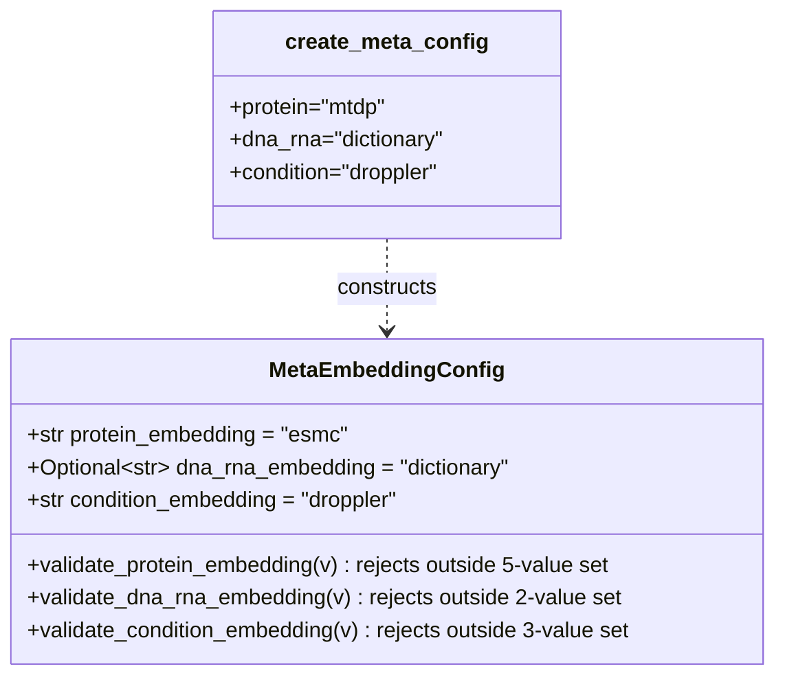
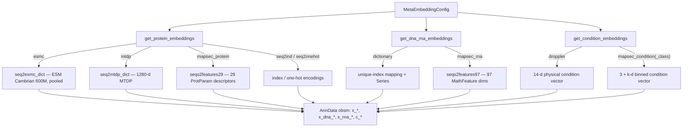
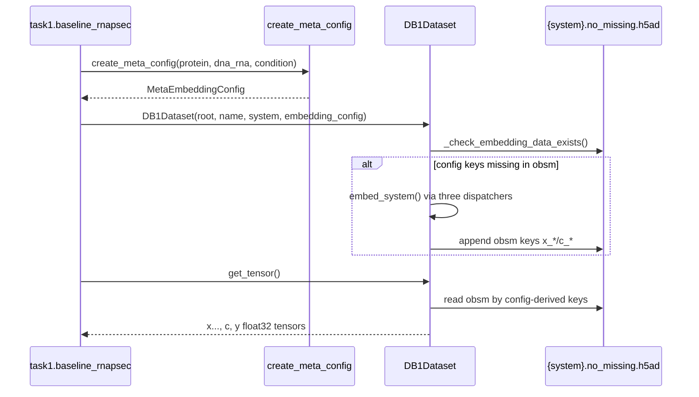

OpenPhase does not hard-code any single feature representation. Instead, every benchmark task selects its feature space through a **three-slot embedding configuration**: one slot for the protein component, one for the DNA/RNA component, and one for the experimental condition component. This page documents that matrix — the exact set of legal options per slot, the backend functions that implement each option, the dimensionality contracts they guarantee, and how the configuration is materialized into AnnData `obsm` keys and consumed by the benchmark tasks. The matrix is declarative: you name three strings, validators enforce legality, and a dispatcher layer turns those names into tensors.

Sources: [meta_config.py](meta_config.py#L1-L41), [meta_embed.py](meta_embed.py#L390-L430)

## The Three-Slot Contract: `MetaEmbeddingConfig`

The single source of truth for the matrix is `MetaEmbeddingConfig`, a Pydantic `BaseModel` with three fields and one validator per field. Each validator holds a closed set of allowed identifiers and rejects anything else with a `ValueError`, which makes invalid combinations fail at construction time rather than mid-training. The three fields are:

| Slot | Field | Default (class) | Default (factory) | Allowed values |
|---|---|---|---|---|
| Protein | `protein_embedding` | `"esmc"` | `"mtdp"` | `esmc`, `mtdp`, `rnapsec_protein`, `seq2ind`, `seq2onehot` |
| DNA/RNA | `dna_rna_embedding` (Optional) | `"dictionary"` | `"dictionary"` | `rnapsec_rna`, `dictionary` |
| Condition | `condition_embedding` | `"droppler"` | `"droppler"` | `droppler`, `rnapsec_condition`, `rnapsec_condition_class` |

Note the deliberate divergence between the class-level defaults (`protein_embedding="esmc"`) and the convenience factory `create_meta_config(protein="mtdp", ...)`, whose signature defaults to MTDP. When you construct the config directly, you get ESM Cambrian; when you go through the factory, you get MTDP unless you override it. Choose one entry path and stay consistent across experiment sweeps to avoid silently comparing different protein spaces.

Sources: [meta_config.py](meta_config.py#L5-L41)



Sources: [meta_config.py](meta_config.py#L16-L41)

> [!TIP]
> Naming semantics matter: `rnapsec_*` options do **not** run a neural RNAPSEC checkpoint. They reproduce the RNAPSEC project's *handcrafted feature recipes* — 29 Biopython-derived protein descriptors and 97 MathFeature-derived RNA descriptors. The `rnapsec_protein` dispatcher branch literally calls the 29-dimensional ProtParam extractor, despite an inline comment suggesting an ESM fallback.

Sources: [meta_embed.py](meta_embed.py#L120-L134), [meta_embed.py](meta_embed.py#L419-L420)

## Options Grid: Backends, Dimensions, and Dependencies

Multiplying the validator sets gives the full configuration space: **5 protein × 2 DNA/RNA × 3 condition = 30 legal combinations** per system. Each combination resolves to a concrete backend function in `meta_embed.py` with a fixed output contract:

| Slot | Option | Backend | Output contract | External dependency |
|---|---|---|---|---|
| protein | `esmc` | `seq2esmc_dict` | One pooled vector per sequence (mean/max/sum/norm/prod/median) | `Synthyra/ESMplusplus_large` checkpoint (ESM Cambrian 600M) |
| protein | `mtdp` | `seq2mtdp_dict` | `(1280,)` float vector per sequence | Local `./MTDP/models/UniProtKB/UniProtKB.bin` + T5 tokenizer |
| protein | `rnapsec_protein` | `seqs2features29` | DataFrame `(n, 29)` | Biopython `ProteinAnalysis` |
| protein | `seq2ind` | `seqs2ind` | DataFrame `(n, 2048)` integer indices | None (pad or random-crop to 2048) |
| protein | `seq2onehot` | `seq2onehot` | ndarray `(n, 2048, 21)` | None (20 AA + `X` catch-all) |
| dna_rna | `dictionary` | inline logic | `(Series of unique integer indices, mapping dict)` | None |
| dna_rna | `rnapsec_rna` | `seqs2features97` | DataFrame `(n, 97)` | MathFeature toolkit via subprocess |
| condition | `droppler` | inline logic | DataFrame `(n, 14)` | None |
| condition | `rnapsec_condition` | inline logic | DataFrame `(n, 3 + k)` log-scale scalars | None |
| condition | `rnapsec_condition_class` | inline logic | DataFrame `(n, 3 + k)` categorical bins | None |

Two structural facts follow from this grid. First, the `seq2ind` and `seq2onehot` protein options are legal in the config but are **excluded from the benchmark hyperparameter grid** (`params_all.yaml` sweeps only `rnapsec_protein`, `esmc`, `mtdp`), reducing the swept protein axis to 3 options. Second, the DNA/RNA slot is only materialized for nucleic-acid systems; the dataset-level existence check treats the slot as satisfied (`True`) whenever the system has no nucleic acid, so the 30-combination space collapses gracefully for protein-only systems.

Sources: [meta_embed.py](meta_embed.py#L44-L117), [meta_embed.py](meta_embed.py#L318-L387), [meta_embed.py](meta_embed.py#L433-L459), [params_all.yaml](params_all.yaml#L17-L27), [zhanglab/db1.py](zhanglab/db1.py#L615-L620)

## Dispatcher Architecture

The matrix resolves through three dispatcher functions — `get_protein_embeddings`, `get_dna_rna_embeddings`, and `get_condition_embeddings` — each accepting the option string and branching to its backend. The dispatchers, not the callers, own the output normalization: protein dispatchers return a pandas `DataFrame` (one row per input sequence, order preserved), the DNA/RNA dispatcher returns a `(embeddings, mapping)` tuple, and the condition dispatcher returns a single `DataFrame` indexed like the input conditions.



Sources: [meta_embed.py](meta_embed.py#L395-L430), [meta_embed.py](meta_embed.py#L433-L459), [meta_embed.py](meta_embed.py#L462-L470)

Three implementation details are worth internalizing before you extend the matrix. **ESM deduplication**: `seq2esmc_dict` iterates over `set(seqs)`, so duplicate sequences across a system are embedded once and re-indexed by the caller — an important cost control given the 2048-token truncation budget. **Pooling pluggability**: the ESM branch passes `pooling_method="mean"` down to `tensor_pooling`, which also implements `max`, `sum`, `norm`, `prod`, and `median`; pooling is currently hard-wired at the dispatcher call site, not exposed as a fourth config slot. **Return-shape normalization for MTDP**: the MTDP forward pass yields `(2, 1280)` logits that are squeezed to `(1280,)` per unique sequence before DataFrame assembly, matching the dispatcher's row-per-sequence contract.

Sources: [meta_embed.py](meta_embed.py#L17-L41), [meta_embed.py](meta_embed.py#L62-L69), [meta_embed.py](meta_embed.py#L113-L116), [meta_embed.py](meta_embed.py#L408-L411)

## Condition Slots: Two Numerical Philosophies

The condition slot offers two competing encodings of the same five experimental variables (temperature, component concentration, ionic strength, crowding agent, pH), and understanding their difference is the key design decision in the matrix. **Droppler** produces a fixed 14-dimensional physical vector: temperatures are distributed over 10 one-hot bins spanning 0–100 °C in 10 °C increments (`temperature_to_bins`, e.g. `25°C → [0,0,1,0,0,0,0,0,0,0]`, and out-of-range ranges default to the full 0–100 span with a logged warning), while concentration and ionic strength are `log10`-transformed with a `5e-4` epsilon to smooth zeros, crowding agent is binary, and pH is raw.

**`rnapsec_condition`** instead emits `3 + k` log-scale scalars — pH, temperature (ranges averaged to a midpoint), quintile-digitized ionic strength, plus one `log10` concentration column per component (`conc_0 … conc_{k-1}`). **`rnapsec_condition_class`** returns the same shape but replaces the first three columns with categorical bin indices: pH cut into `[0, 7, 8, 14]`, temperature cut into `[0, 25, 30, 40, 100]`, and ionic strength digitized at the 20/40/60/80 percentiles. The dispatcher selects between the two via a suffix check: `endswith("_class")`.

| Aspect | `droppler` (14-d) | `rnapsec_condition` | `rnapsec_condition_class` |
|---|---|---|---|
| Temperature | 10 one-hot bins (0–100 °C) | Scalar midpoint | Class bin `[0,25,30,40,100]` |
| pH | Raw scalar | Raw scalar | Class bin `[0,7,8,14]` |
| Ionic strength | `log10` scalar | `log10` + quintile classes | Quintile class |
| Concentration | Summed `log10` per entry | Per-component `log10` columns | Per-component `log10` columns |
| Crowding agent | Binary column | Absent | Absent |
| Output width | Fixed 14 | `3 + k` | `3 + k` |

Sources: [meta_embed.py](meta_embed.py#L499-L527), [meta_embed.py](meta_embed.py#L529-L586), [meta_embed.py](meta_embed.py#L588-L652)

## Materialization: AnnData Key Convention and Additive Caching

The configuration string does not just select a backend — it becomes part of the **storage key layout** inside a per-system AnnData file (`{system}.no_missing.h5ad`). `DB1Dataset.get_tensor()` reconstructs key names from the config at read time: `x_{protein_embedding_model}` (with `x_1_`/`x_2_`/`x_3_` prefixes for multi-protein systems), `x_dna_{dna_rna_method}` or `x_rna_{dna_rna_method}` for nucleic-acid systems, and `c_{condition_embedding_model}` for conditions, alongside the fixed label key `y`.

| System | Returned obsm keys (per `get_tensor`) |
|---|---|
| `protein(1)` | `x_{p}`, `c_{c}`, `y` |
| `protein(2)` / `protein(3)` | `x_1_{p}`, (`x_2_{p}`, `x_3_{p}`), `c_{c}`, `y` |
| `protein(1) + DNA` | `x_{p}`, `x_dna_{d}`, `c_{c}`, `y` |
| `protein(1) + RNA` | `x_{p}`, `x_rna_{d}`, `c_{c}`, `y` |
| `protein(2) + DNA/RNA` | `x_1_{p}`, `x_2_{p}`, `x_dna/x_rna_{d}`, `c_{c}`, `y` |

Sources: [zhanglab/db1.py](zhanglab/db1.py#L504-L572)

Caching is **additive, not destructive**: one `.h5ad` file exists per system, and multiple embedding variants coexist inside it as differently suffixed `obsm` keys. Before embedding, `_check_embedding_data_exists` reads the file's `obsm` keys and verifies via substring matching that keys containing the configured `protein_method`, `condition_method`, and `dna_rna_method` are present — skipping the nucleic-acid check entirely when the system has none. Because the file name encodes only the system and not the configuration, switching options either reuses an existing variant already in the file or augments it with new keys; it never orphans the previous ones.



> [!TIP]
> The substring-based key check (`protein_method in k`) is both a feature and a hazard: it makes the cache forward-compatible with new options, but any `obsm` key that happens to contain the option string under the matching prefix counts as "present." When debugging stale caches, inspect `adata.obsm.keys()` directly rather than trusting the boolean result.

Sources: [zhanglab/db1.py](zhanglab/db1.py#L118-L121), [zhanglab/db1.py](zhanglab/db1.py#L601-L628), [zhanglab/db1.py](zhanglab/db1.py#L20-L22)

## Wiring into the Benchmark Grid

The matrix is swept mechanically by `task1.py`: `baseline_rnapsec(system_name, split_method, protein_method, dna_rna_method, condition_method)` calls `create_meta_config(...)` with the four sweep axes and hands the resulting config straight to `DB1Dataset`. The legal values for these axes come from `params_all.yaml`, which defines the full factorial benchmark space — 7 systems × 7 split methods × 3 protein methods × 2 DNA/RNA methods × 3 condition methods × 3 tasks — while `task2.py` (the PhaseCVAE path) addresses the same matrix downstream by reading config-derived keys (`protein_embedding`, `dna_rna_embedding`, defaulting to `c_rnapsec_condition`) out of `obsm`.

| `params_all.yaml` axis | Values | Matrix slot |
|---|---|---|
| `protein_method` | `rnapsec_protein`, `esmc`, `mtdp` | protein (grid subset of 5) |
| `dna_rna_method` | `rnapsec_rna`, `dictionary` | dna_rna (full set) |
| `condition_method` | `rnapsec_condition`, `rnapsec_condition_class`, `droppler` | condition (full set) |
| `system_name` | 7 systems (protein-only, +DNA, +RNA) | storage/gating dimension |
| `split_method`, `task` | 7 splits, 3 tasks | orthogonal to embeddings |

This yields an 18-combination embedding sweep per system for task1 — the benchmark-relevant subset of the 30-combination legal space. Note also the task-level coupling guard in `task1.py`: the Droppler-based loader asserts `embedding_config.condition_embedding == "droppler"` before use, so condition options are constrained by downstream model expectations, not just by validators.

Sources: [params_all.yaml](params_all.yaml#L1-L32), [task1.py](task1.py#L58-L68), [task1.py](task1.py#L120), [task2.py](task2.py#L52-L83)

## Recipes and Pitfalls

A minimal, valid configuration recipe looks like this — the factory returns a validated `MetaEmbeddingConfig` that can be passed to any `DB*Dataset`:

```python
from meta_config import create_meta_config

cfg = create_meta_config(protein="esmc", dna_rna="dictionary", condition="rnapsec_condition_class")
# DB1Dataset(root="./data", name="DB1", system="protein(1) + RNA", embedding_config=cfg)
```

| Symptom / scenario | Root cause | Resolution |
|---|---|---|
| `ValueError: Protein embedding '...' not allowed` | Name outside the validator set (`esmc`, `mtdp`, `rnapsec_protein`, `seq2ind`, `seq2onehot`) | Use an allowed identifier; the error message enumerates the set |
| `KeyError` on an `obsm` key at `get_tensor()` | Config strings and stored keys drifted apart (e.g., cache written under a different condition option) | Re-check `adata.obsm.keys()`; the key must literally contain the option string |
| First run is very slow with `esmc` or `mtdp` | Model checkpoint download / loading happens inside `seq2esmc_dict` / `seq2mtdp_dict` per fresh process | Reuse the process; subsequent systems hit the per-system `.h5ad` cache |
| Comparing runs shows unexpected baseline shift | Class default (`esmc`) vs. factory default (`mtdp`) divergence | Construct configs via one entry point and log all three slot values (task1 already logs `protein_embed_method`, `dna_rna_embed_method`, `condition_embed_method`) |
| Protein-only system seems to ignore `dna_rna_embedding` | Slot is `Optional` and skipped by the existence check when no nucleic acid is present | Expected behavior; set it anyway for sweep consistency |
| Long RNA/protein sequences silently altered | `seq2ind` random-crops over 2048; `seq2onehot` truncates and pads with `X`; ESM truncates at tokenization | Pre-filter by length if truncation is unacceptable for your analysis |

Sources: [meta_config.py](meta_config.py#L38-L41), [meta_embed.py](meta_embed.py#L352-L358), [meta_embed.py](meta_embed.py#L379-L382), [meta_embed.py](meta_embed.py#L63), [task1.py](task1.py#L94-L98)

## Where to Go Next

This page covered the *selection and storage* layer of the embedding system. To understand what each representation actually encodes, continue to [Protein and Nucleic Acid Embeddings](12-protein-and-nucleic-acid-embeddings) and [Condition Feature Engineering](13-condition-feature-engineering), which detail the semantic content and preprocessing history behind the backends listed here. For how these configurations feed experiment design, see [Outcome Prediction Baselines](8-outcome-prediction-baselines) for the task1 sweep mechanics, [Split Strategies and Metrics](10-split-strategies-and-metrics) for the orthogonal `split_method` axis, and [Hyperparameter Grid Reference](22-hyperparameter-grid-reference) for the complete factorial enumeration. The downstream schema these embeddings populate is documented in [Condition-Level Record Schema](7-condition-level-record-schema).
