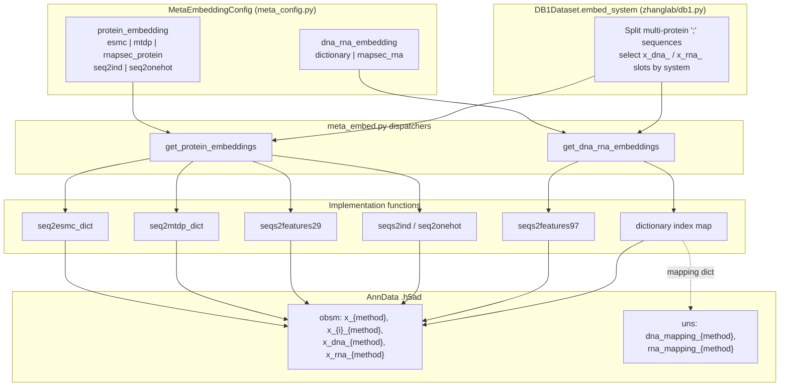
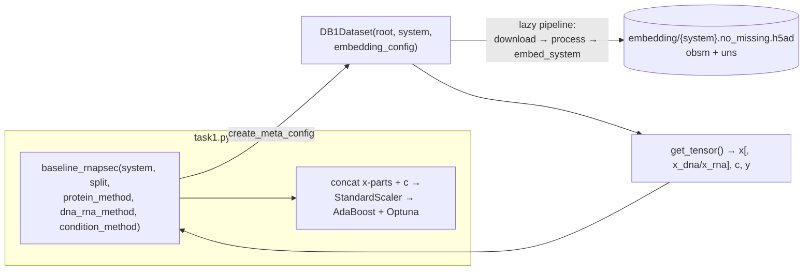

This page explains how OpenPhase converts raw protein and nucleic-acid sequences into fixed-size numerical representations. The embedding layer sits between the record parsers and every benchmark or generative model: five methods encode proteins (two protein language models, one handcrafted feature extractor, two index encodings) and two methods encode DNA/RNA. We cover the configuration contract, the dispatch pipeline, each method's algorithm and output shape, the AnnData persistence schema, and how downstream tasks retrieve the tensors. Condition-feature engineering is deliberately out of scope here — see [Condition Feature Engineering](13-condition-feature-engineering).

## Embedding Slots and the Method Registry

The embedding system is organized around a three-slot configuration model defined in `MetaEmbeddingConfig`, a Pydantic `BaseModel` whose field validators enforce an exact whitelist of method names per slot. This page concerns the first two slots: `protein_embedding` (default `esmc`) and `dna_rna_embedding` (default `dictionary`). The `create_meta_config` factory is the single entry point used by every dataset class and benchmark script, guaranteeing that invalid method names fail fast at construction time rather than deep inside an embedding run.

| Slot | Allowed values | Default | Output form |
|---|---|---|---|
| `protein_embedding` | `esmc`, `mtdp`, `rnapsec_protein`, `seq2ind`, `seq2onehot` | `esmc` | DataFrame / ndarray per protein |
| `dna_rna_embedding` | `rnapsec_rna`, `dictionary` | `dictionary` | index Series + mapping, or feature DataFrame |
| `condition_embedding` | `droppler`, `rnapsec_condition`, `rnapsec_condition_class` | `droppler` | 14-D condition frame (see [Condition Feature Engineering](13-condition-feature-engineering)) |

Sources: [meta_config.py](meta_config.py#L5-L28), [meta_config.py](meta_config.py#L31-L41), [params_all.yaml](params_all.yaml#L17-L21)

## From Configuration to Dispatch

Embedding never happens at config time. A dataset instance receives a `MetaEmbeddingConfig`, and only when the requested system has no cached embeddings does it call the two module-level dispatchers in `meta_embed.py`: `get_protein_embeddings` and `get_dna_rna_embeddings`. Both resolve the method by string equality against the same whitelists as the config validators, then delegate to a dedicated implementation function. Every protein path returns a DataFrame or array keyed positionally to the input sequence list; every nucleic-acid path returns a tuple `(embeddings, mapping)` where `mapping` is a plain dict (or `None` for the feature-based method).



Sources: [meta_config.py](meta_config.py#L16-L28), [meta_embed.py](meta_embed.py#L395-L430), [meta_embed.py](meta_embed.py#L433-L459), [zhanglab/db1.py](zhanglab/db1.py#L344-L348)

> [!TIP]
> Both dispatchers and the Pydantic validators duplicate the same method-name whitelists. If you add a new embedding method, you must update three places: the `MetaEmbeddingConfig` validator, the dispatcher's `if/elif` chain, and the `params_all.yaml` grid — otherwise the config will reject names the dispatcher supports, or vice versa.

## Protein Embeddings

### Language-Model Embeddings: `esmc` and `mtdp`

The `esmc` path loads `Synthyra/ESMplusplus_large` (the ESM Cambrian 600M model) through `AutoModelForMaskedLM` with `trust_remote_code=True`, tokenizes each sequence with truncation and padding at `max_length=2048`, and pools the `last_hidden_state` over the sequence dimension. Two details matter for reproducibility: only the set of unique sequences is forwarded through the model (duplicates resolve via a sequence→tensor dict), and the pooling strategy is fixed to `"mean"` at the call site with an explicit comment that the method varies — `tensor_pooling` supports `mean`, `max`, `sum`, `norm`, `prod`, and `median`.

The `mtdp` path instead depends on local assets: a T5 tokenizer from `./MTDP/MTDP_tokenizer/` and a checkpoint at `./MTDP/models/UniProtKB/UniProtKB.bin` loaded into the `MTDP` architecture from `MTDP.mtdp_embedder`. Tokenized sequences pass through a Hugging Face `Dataset` shim before the forward call, and the model's logits are squeezed to a **1280-dimensional** vector per unique sequence, returned as detached CPU NumPy arrays.

Sources: [meta_embed.py](meta_embed.py#L13-L31), [meta_embed.py](meta_embed.py#L34-L71), [meta_embed.py](meta_embed.py#L85-L103), [meta_embed.py](meta_embed.py#L407-L417)

### Handcrafted Features: `rnapsec_protein` (29-D)

The `rnapsec_protein` method requires no model download — it computes a 29-column physical-chemical profile with Biopython's `ProteinAnalysis`: molecular weight, per-residue percentage for all 20 standard amino acids (`protein_{AA}` columns), aromaticity, instability index, GRAVY hydropathy, mean flexibility, isoelectric point, and three secondary-structure fractions (helix, turn, sheet). Sequences that are empty or consist solely of `X` placeholders are zero-filled across all 29 columns rather than crashing, which matters because parsed records tolerate ambiguous residues.

Sources: [meta_embed.py](meta_embed.py#L134-L198), [meta_embed.py](meta_embed.py#L419-L420)

### Index Encodings: `seq2ind` and `seq2onehot`

These two methods are the lightweight, dependency-free tier, and their fixed-length behavior is asymmetric by design. `seqs2ind` maps residues through a **24-symbol alphabet** — the 20 standard amino acids plus `X`, `J` (commented as padding), `*` (any amino acid), and `-`; sequences shorter than `max_len` are right-padded with `-`, while longer sequences are **randomly cropped** from a `np.random.randint` start position. `seq2onehot` is stricter: any character outside `"ACDEFGHIKLMNPQRSTVWYX"` is regex-rewritten to `X`, sequences are truncated and right-padded with `X`, and a `np.eye` lookup yields a float32 array of shape `(max_len, 21)` — one class for each of 20 amino acids plus the `X` catch-all.

Sources: [meta_embed.py](meta_embed.py#L318-L362), [meta_embed.py](meta_embed.py#L365-L387), [meta_embed.py](meta_embed.py#L422-L427)

### Protein Method Comparison

| Method | Category | Output shape | External dependency | Notes |
|---|---|---|---|---|
| `esmc` | Pooled PLM hidden state | `(n, model_hidden_dim)` DataFrame | HF `transformers`, remote model weights | GPU-bound; dedup before forward |
| `mtdp` | Pooled PLM logits | `(n, 1280)` DataFrame | local MTDP tokenizer + checkpoint | T5-style tokenization |
| `rnapsec_protein` | Handcrafted features | `(n, 29)` DataFrame | Biopython | zero-fill for empty/`X`-only sequences |
| `seq2ind` | Integer token indices | `(n, 2048)` int columns | none | `-` padding; random crop if longer |
| `seq2onehot` | One-hot matrix | `(n, 2048, 21)` float32 | none | `X` fallback for non-standard residues |

Sources: [meta_embed.py](meta_embed.py#L395-L430), [params_all.yaml](params_all.yaml#L17-L19)

## Nucleic Acid Embeddings

### `dictionary`: Category Index Mapping

The default `dictionary` method does **not** run any model. It deduplicates the nucleic-acid entries and assigns each unique value an integer index, returning a `pd.Series` of indices aligned to the input order plus a value→index mapping dict. Crucially, what gets indexed depends on the caller: in `DB1Dataset.embed_system` the argument is the `Nucleic acid` **name column**, so indices enumerate nucleic-acid categories (the docstring states this explicitly — "processes the nucleic acid names and gives an index tensor for further embedding"), whereas `DB2Dataset.embed` passes the `Nucleic acid sequence` column. The mapping dict is persisted separately in AnnData's `uns` slot so the index semantics are never lost.

Sources: [meta_embed.py](meta_embed.py#L445-L453), [zhanglab/db1.py](zhanglab/db1.py#L324-L324), [zhanglab/db1.py](zhanglab/db1.py#L374-L386), [zhanglab/db2.py](zhanglab/db2.py#L222-L233)

> [!TIP]
> The `dictionary` index space is **dataset-dependent**: its cardinality equals the number of unique nucleic-acid entries in the filtered system slice, so two systems (or DB1 vs DB2) produce incompatible vocabularies. Downstream models treat these indices as lookup keys into an embedding table, not as ordinal features — always load the companion `*_mapping_{method}` from `uns` when interpreting them.

### `rnapsec_rna`: 97-D MathFeature Vectors

The `rnapsec_rna` method shells out to the external **MathFeature** toolkit (adapted from RNAPSEC) via eight `subprocess` calls executed inside a temporary directory: 3-mer k-mer composition, Fickett score, ORF statistics, Tsallis entropy (`k=2, q=0.1`), Shannon entropy, and three Fourier encodings (binary, Z-curve, real). The resulting CSV fragments are numerically sanitized, column-renamed with an `rna_` prefix, and concatenated into the 97-column frame promised by the docstring. Non-zero subprocess exit codes are logged as warnings rather than raised, and a numeric-coercion filter (`pd.to_numeric(...).notna()`) silently drops malformed rows — so verify output row counts when integrating new RNA sources.

Sources: [meta_embed.py](meta_embed.py#L199-L240), [meta_embed.py](meta_embed.py#L252-L311), [meta_embed.py](meta_embed.py#L455-L459)

| Method | Output | External dependency | Returns mapping? |
|---|---|---|---|
| `dictionary` | index `pd.Series` (one int per entry) | none | yes — value→index dict into `uns` |
| `rnapsec_rna` | `(n, 97)` feature DataFrame | MathFeature toolkit (subprocess) | no — `None` |

Sources: [meta_embed.py](meta_embed.py#L433-L459)

## Persistence: The AnnData Key Contract

Both dataset classes serialize embeddings into a single `.h5ad` file per system (`{system}.no_missing.h5ad` for DB1, `{subset}.h5ad` for DB2) using a strict key-naming convention that encodes the method name. Multi-protein systems (up to `protein(7)` in DB1's system list) generate one key per component by splitting the `;`-joined sequence column positionally. Mapping dicts land in `uns` while everything else lands in `obsm`, and an idempotency guard skips keys that already exist — meaning a second run with a *different* config adds new keys alongside the old ones instead of overwriting.

| Key pattern | Contents | AnnData slot |
|---|---|---|
| `y` | binary phase label (`Yes`→1, `No`→0) | `obsm` |
| `x_{protein_method}` | single-protein embedding | `obsm` |
| `x_{i}_{protein_method}` | i-th protein in multi-protein systems | `obsm` |
| `x_dna_{method}` / `x_rna_{method}` | nucleic-acid embedding | `obsm` |
| `dna_mapping_{method}` / `rna_mapping_{method}` | dictionary value→index map | `uns` |
| `c_{condition_method}` | condition embedding | `obsm` |

Sources: [zhanglab/db1.py](zhanglab/db1.py#L117-L126), [zhanglab/db1.py](zhanglab/db1.py#L356-L386), [zhanglab/db1.py](zhanglab/db1.py#L404-L420), [zhanglab/db2.py](zhanglab/db2.py#L217-L257)

> [!TIP]
> Cache freshness is checked per-method, not per-file: `_check_embedding_data_exists` scans `obsm` keys with `any(method in k for k in keys)` per slot and requires *all* slots to be present. Switching only `protein_embedding` therefore triggers a re-embedding pass (the protein key is missing) while leaving existing nucleic-acid and condition keys untouched.

## End-to-End Retrieval and Consumption

Retrieval is system-polymorphic: `DB1Dataset.get_tensor()` matches on the configured system name and returns exactly the right tuple of float32 tensors — e.g. `(x, c, y)` for `protein(1)` but `(x1, x2, x_rna, c, y)` for `protein(2) + RNA`. The benchmark harness in `task1.py` demonstrates the canonical consumption pattern: `baseline_rnapsec` concatenates all returned `x` components along the last axis with the condition vector, applies `StandardScaler`, and feeds the flat feature matrix to an AdaBoost classifier inside an Optuna loop — logging the chosen `protein_embed_method` and `dna_rna_embed_method` alongside AUROC/AUPRC/MCC so every metric is traceable back to its embedding configuration.



Sources: [zhanglab/db1.py](zhanglab/db1.py#L504-L572), [task1.py](task1.py#L17-L31), [task1.py](task1.py#L69-L118)

A minimal end-to-end invocation follows the same shape as `db2.py`'s `__main__` block: build the config, instantiate the dataset (download/process/embed run lazily and idempotently), then request tensors or split indices:

```python
from meta_config import create_meta_config
from zhanglab.db1 import DB1Dataset

cfg = create_meta_config(protein="esmc", dna_rna="dictionary", condition="droppler")
ds = DB1Dataset(root="./data", name="DB1", system="protein(1) + RNA", embedding_config=cfg)
x, x_rna, c, y = ds.get_tensor()                       # method-keyed tensors from obsm
train_idx, test_idx = ds.get_idx_split(split_method="phase_label_stratified")
```

Sources: [zhanglab/db1.py](zhanglab/db1.py#L82-L115), [zhanglab/db2.py](zhanglab/db2.py#L372-L378)

## Where to Go Next

The method-selection matrix — which combinations of protein, nucleic-acid, and condition methods were benchmarked together — is tabulated in [Embedding Configuration Matrix](11-embedding-configuration-matrix). To understand the third embedding slot in depth, continue to [Condition Feature Engineering](13-condition-feature-engineering). For how these embeddings drive downstream scoring across the seven split strategies, see [Outcome Prediction Baselines](8-outcome-prediction-baselines), and for the grid of all admissible method combinations consult the [Hyperparameter Grid Reference](22-hyperparameter-grid-reference). If your destination is sequence *generation* rather than prediction, the index-style encodings here foreshadow the token-space design described in [Discrete Diffusion Foundations](14-discrete-diffusion-foundations).