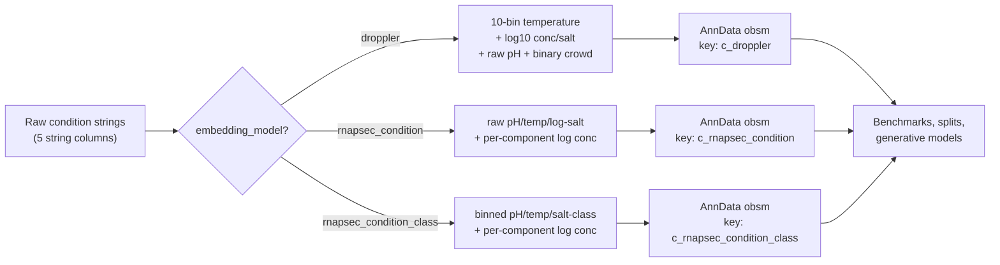
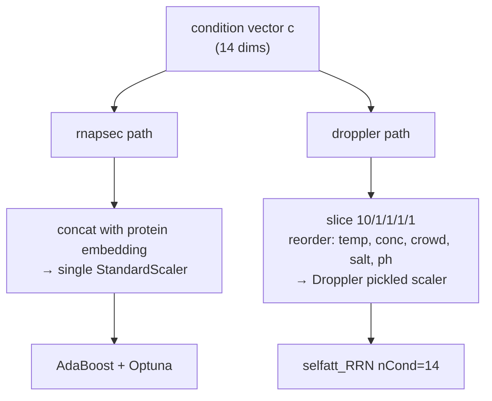

Phase separation is not a property of a protein alone — it emerges from a protein placed under specific experimental conditions. This page documents how OpenPhase converts raw, human-entered condition text (temperatures, concentrations, pH values) into the fixed-length numeric vectors that every benchmark model and split strategy consumes. The engineering lives almost entirely in one function, `get_condition_embeddings` in `meta_embed.py`, configured through a validated Pydantic slot and dispatched to three interchangeable strategies.

Sources: [meta_embed.py](meta_embed.py#L462-L470), [meta_config.py](meta_config.py#L12-L14)

## The Condition Input Space

Every condition vector is computed from **five canonical string columns** that the source loaders carry alongside each record: `Temperature`, `Protein (DNA/RNA) concentration`, `Ionic strength`, `Crowding agent`, and `Buffer pH`. These columns are assembled from LLPSDB v2's raw experiment spreadsheets and passed as a DataFrame into `get_condition_embeddings`. The formats are deliberately messy because they mirror laboratory notebooks: temperatures arrive as single values or comma-separated low/high pairs, concentrations carry unit suffixes in several Unicode variants (`µM`, `μM`, `uM`), and multi-component systems separate values with semicolons.

| Column | Example raw values | Parsing hazards |
|---|---|---|
| `Temperature` | `"25"`, `"4, 25"` | single value vs. comma-separated low/high pair |
| `Protein (DNA/RNA) concentration` | `"10 µM; 5 µM"` | unit variants, semicolon-joined components |
| `Ionic strength` | `"150 mM;"` | trailing separators, zero-salt records |
| `Buffer pH` | `"pH 7.4"` | textual prefix must be stripped |
| `Crowding agent` | `"Yes"` / `"No"` | binary string, not a concentration |

Sources: [zhanglab/db1.py](zhanglab/db1.py#L451-L455), [meta_embed.py](meta_embed.py#L617-L629)

The full engineering pipeline is a straight linear flow — parse, normalize, bin or scale, assemble — with strategy selection at the dispatch point:



Note that this embedding layer is distinct from the merged benchmark tables in `data/`, which ship conditions already numerically normalized (e.g., `log10_protein_conc_uM`, `ionic_strength_mM`) with explicit `st_*` missingness state flags and no imputation. The embedding pipeline documented here operates on the loader-side string columns before that point.

Sources: [meta_embed.py](meta_embed.py#L462-L470), [data/README.md](data/README.md#L34-L40)

## Strategy Selection: the `condition_embedding` Slot

Condition embedding is one of three pluggable slots in `MetaEmbeddingConfig`, alongside protein and DNA/RNA embeddings. The config enforces its vocabulary with a Pydantic field validator — an invalid strategy fails at construction time, not deep inside a training run — and `create_meta_config` provides the one-call factory used by every benchmark entry point.

```python
MetaEmbeddingConfig(condition_embedding="droppler")   # validated: droppler | rnapsec_condition | rnapsec_condition_class
create_meta_config(protein="mtdp", dna_rna="dictionary", condition="droppler")
```

The hyperparameter grid in `params_all.yaml` declares exactly these three condition methods as the search space, which means every ablation over condition representations cycles through the three implementations described below.

| Strategy | Output shape per record | Transforms applied | Numeric character |
|---|---|---|---|
| `droppler` | 14 dims | temperature → 10-bin coverage; concentration & salt → log10; pH → raw float; crowder → 0/1 | mixed: binary/binned/continuous |
| `rnapsec_condition` | 5+ dims | pH, temperature, log10 salt continuous; per-component log10 concentrations | fully continuous |
| `rnapsec_condition_class` | 3 + n dims | pH/temp/salt → ordinal classes; per-component log10 concentrations | ordinal + continuous |

Sources: [meta_config.py](meta_config.py#L30-L40), [params_all.yaml](params_all.yaml#L24-L27), [task1.py](task1.py#L65-L68)

## The Droppler Vector: 14 Dimensions of Mixed Encoding

The `droppler` strategy reproduces the condition encoding of the Droppler phase-separation predictor (Bioinformatics, 2021, cited in-source) and produces a fixed 14-dimensional vector. Its most interesting component is **temperature coverage binning**: instead of a single scalar, temperature occupies 10 binary bins spanning 0–100 °C in 10 °C increments, and a temperature *range* sets every bin it covers. `"25"` becomes `[0, 0, 1, 0, 0, 0, 0, 0, 0, 0]`; `"0-20"` becomes `[1, 1, 0, 0, 0, 0, 0, 0, 0, 0]`; `"<40"` becomes `[1, 1, 1, 1, 0, 0, 0, 0, 0, 0]`. This preserves range uncertainty that a point estimate would destroy — a laboratory-reported "25–37 °C" is genuinely a distribution, not a mean.

Sources: [meta_embed.py](meta_embed.py#L499-L527), [meta_embed.py](meta_embed.py#L566-L574)

The remaining ten dimensions are scalar transforms. **Component concentration** and **ionic strength** both get a log10 compression, since phase behavior spans orders of magnitude in µM and mM. Both also aggregate multi-component entries by summation — a fusion construct like `[gfp-protein]` contributes all semicolon-separated parts. Ionic strength handles reported-zero salt explicitly with a conditional (`0 if x == 0 else np.log10(x)`), while concentration uses an additive epsilon before the log. pH passes through as a raw float after stripping the `"pH "` prefix, and crowding agent is a simple `Yes`/`No` → `1`/`0` map.

| Dims | Feature | Transform | Zero/edge handling |
|---|---|---|---|
| 0–9 | `temperature_0..9` | 10-bin coverage encoding, 10 °C bins over 0–100 °C | out-of-range logs a warning; sub-zero lows yield an all-zero profile |
| 10 | `component_concentration` | `log10(x + 5e-4)` after summing components | epsilon smooths log10(0) |
| 11 | `ionic_strength` | `log10(x)` after summing salt parts | exact zero kept at 0 |
| 12 | `crowding_agent` | binary map | — |
| 13 | `ph` | raw float | `"pH "` prefix stripped |

> [!TIP]
> The concentration epsilon of `5e-4` is documented in-source as ~1% of the smallest non-zero concentration. This matters for interpretability: a missing concentration is *not* encoded as a distinguished sentinel but as `log10(5e-4) ≈ -3.3`, deliberately close to genuine trace concentrations. Downstream models cannot distinguish "not reported" from "vanishingly dilute" in the Droppler vector — that distinction lives only in the merged tables' `st_*` flags.

Sources: [meta_embed.py](meta_embed.py#L529-L586), [meta_embed.py](meta_embed.py#L533-L536)

One subtlety in the temperature path: the two-value parse contract is the comma-separated `"low, high"` form. The docstring of `temperature_validate` advertises broader range syntax like `"25-40, 50-60"`, but the implementation splits strictly on `", "` and floats each part, so the effective contract for ranged input is exactly two comma-separated numbers. Inputs outside 0–100 °C trigger a logged warning about defaulting to full 0–100 °C bins; the documented behavior for a sub-zero low (`-2 °C` → all-zero temperature profile) follows from the empty-slice bin assignment.

Sources: [meta_embed.py](meta_embed.py#L472-L497), [meta_embed.py](meta_embed.py#L509-L527)

## RNAPSEC Vectors: Continuous and Quintile-Class Variants

The `rnapsec_condition*` family shares a single code path and returns one of two DataFrames depending on the `_class` suffix. The **continuous variant** keeps pH, temperature, and log10 ionic strength as raw floats, and adds one log10 concentration column *per component* — `conc_0`, `conc_1`, … — so a two-protein or protein+nucleic-acid entry contributes independent concentration axes rather than a summed scalar. Unit parsing here is defensive, stripping all three micro-sign variants before the semicolon split.

The **class variant** discretizes the same signals into ordinal categories designed around the observed experimental distribution. pH falls into three biologically motivated bands (`0–7`, `7–8`, `8–14`); temperature into four bands with a fine split in the crowded 25–40 °C regime (`0–25`, `25–30`, `30–40`, `40–100`); and ionic strength is quantile-digitized into quintile classes by computing the 20/40/60/80 percentiles of the log-transformed values and applying `np.digitize`. Concentration columns are shared verbatim between both variants.

| Signal | `rnapsec_condition` | `rnapsec_condition_class` |
|---|---|---|
| pH | raw float | `pd.cut` bins [0, 7, 8, 14] |
| Temperature | averaged float from low/high pair | `pd.cut` bins [0, 25, 30, 40, 100] |
| Ionic strength | `log10`, zero preserved | quintile classes via 20/40/60/80 percentiles + `np.digitize` |
| Concentrations | per-component `log10(x + 5e-4)` | identical to continuous variant |

This quantile-based salt binning is the same discretization philosophy later reused by the condition-stratified split strategies, where ionic strength and component concentration are both binned into five quantile labels (`low` → `high`) before stratification — so the class vector's ordinal scales are calibrated to how the benchmark itself reasons about condition balance.

Sources: [meta_embed.py](meta_embed.py#L588-L652), [zhanglab/db1.py](zhanglab/db1.py#L473-L485)

## Storage Contract: AnnData `obsm` Keys

Embeddings are persisted as AnnData (`.h5ad`) per system, and the condition matrix is stored under an `obsm` key that encodes its strategy: `c_<condition_embedding>`. Retrieval is fully parameter-driven — `get_tensor` reads `c_{self.embedding_config.condition_embedding}`, so swapping strategies is a config change, and no consumer code hardcodes a key. The cache-validity check mirrors this: an existing `.h5ad` file is considered complete only if an `obsm` key starting with `c_` contains the currently configured method name, which forces re-embedding whenever the strategy changes.

> [!TIP]
> Because cache existence is keyed on the embedding *method name inside the h5ad*, mixing experiments with different `condition_embedding` values against one shared data root will trigger redundant re-embeddings rather than collisions. If you switch strategies repeatedly, expect the embedding stage to rerun each time the config name changes — the check is existence-based, not content-hashed.

Sources: [zhanglab/db1.py](zhanglab/db1.py#L520-L524), [zhanglab/db1.py](zhanglab/db1.py#L601-L628)

## Downstream Consumption in the Benchmarks

The two task1 baselines consume condition vectors in markedly different ways, and both paths reveal assumptions worth knowing before you extend them. The **RNAPSEC baseline** treats the condition vector as ordinary tabular features: it concatenates `c` onto the pooled protein embedding along the last axis and applies a single `StandardScaler` across the joint matrix, so condition dimensions compete with sequence dimensions under one normalization.

The **Droppler baseline** is more faithful to the source architecture. It slices the 14-dim vector by index — `c[:, :10]` temperature, then concentration, salt, crowder, pH — and reassembles them as `np.c_[temp, conc, crowd, salt, ph]`, then applies a pickled scaler shipped from the original Droppler codebase (`./droppler/marshalled/scaler.pickle`) before feeding `nCond=14` inputs to a self-attention residue network.



Sources: [task1.py](task1.py#L26-L37), [task1.py](task1.py#L105-L139), [task1.py](task1.py#L157-L170)

That reassembly order deserves attention: the canonical `droppler` vector stores dimensions as `[temperature(10), concentration, ionic_strength, crowding_agent, ph]` (salt at index 11, crowd at index 12), but `load_droppler_dataset` swaps the two scalars when rebuilding `X_cond`. This is intentional — it matches the column order the pre-trained Droppler scaler was fitted on — but it means **you cannot feed the raw `c_droppler` vector into that scaler directly**; it expects the crowd/salt-swapped ordering.

Sources: [meta_embed.py](meta_embed.py#L576-L586), [task1.py](task1.py#L131-L137)

## Design Notes and Where to Go Next

Three engineering decisions define the character of this subsystem. First, **range information is preserved, not averaged** — the Droppler temperature bins encode coverage, and split strategies stratify on condition bins rather than means, respecting that a reported "4–25 °C" experiment is a family of conditions. Second, **order-of-magnitude features are log-compressed everywhere** concentrations and salt appear, with two distinct zero-handling idioms (epsilon smoothing vs. explicit zero). Third, **strategy identity is carried through the entire stack** — config validation, h5ad keys, tensor retrieval, and the YAML search grid all reference the same three names, making condition representation a first-class experimental variable rather than a preprocessing afterthought.

When extending this subsystem, add your method name to the validator's allowed set in `meta_config.py`, add a branch in `get_condition_embeddings` that returns a DataFrame indexed like the input conditions, and register it in `params_all.yaml` — the AnnData storage and retrieval layers will then pick it up without modification.

For the surrounding context: the merged benchmark tables expose these conditions with explicit missingness semantics on [Condition-Level Record Schema](7-condition-level-record-schema); the full cross-product of embedding slots is tabulated on [Embedding Configuration Matrix](11-embedding-configuration-matrix); the companion sequence-side pipelines are covered on [Protein and Nucleic Acid Embeddings](12-protein-and-nucleic-acid-embeddings); and how these condition-derived bins drive train/test separation is detailed on [Split Strategies and Metrics](10-split-strategies-and-metrics). To see the vectors in action inside a classifier, continue to [Outcome Prediction Baselines](8-outcome-prediction-baselines).
