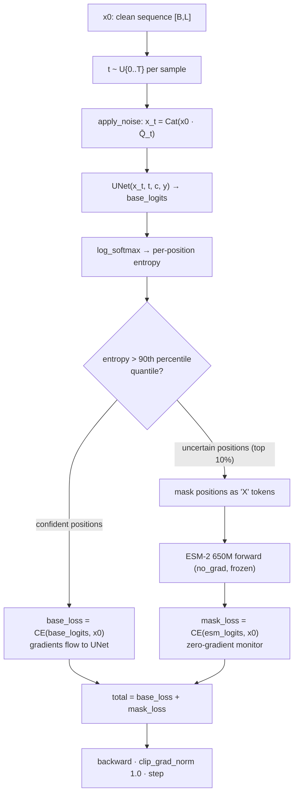
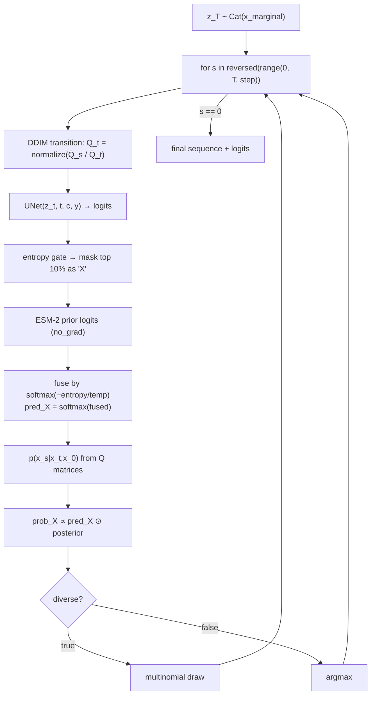

This page establishes the conceptual and architectural basis of the discrete diffusion stack in the `Discrete/` directory: how OpenPhase corrupts amino-acid sequences through a learnable-free forward process, how the conditional denoiser is trained, and how sequences are generated through an entropy-gated, ESM-2-fused reverse process. Deep dives into the transition matrices and the denoiser internals are deferred to [Marginal Transition Matrices](15-marginal-transition-matrices) and [Conditional UNet Denoiser](16-conditional-unet-denoiser) respectively.

## Why Discrete Diffusion for Protein Sequences

Protein sequences are categorical objects — each residue position holds one of 21 symbols (20 amino acids plus `X` for unknown), not a continuous value. Gaussian DDPM machinery (noise addition, ε-prediction) has no meaningful analog on token indices. OpenPhase therefore adopts the **D3PM-family formulation**: the forward process is a Markov chain over categorical distributions driven by transition matrices, and the reverse process reconstructs clean sequences through posterior computations over the same matrices.

The key structural consequence is that the *entire* diffusion geometry is encoded in transition matrices rather than in a variance schedule alone. The corruption kernel is a blend of the identity matrix and a data-dependent stationary distribution, which preserves biological plausibility at high noise levels — a corrupted sequence never drifts toward a uniform token soup, but toward the empirical amino-acid distribution of the training corpus.

| Dimension | Continuous (Gaussian) Diffusion | Discrete Diffusion (this codebase) |
|---|---|---|
| State space | ℝⁿ (latent vectors) | 21-token vocabulary per residue |
| Forward operator | x_t = √ᾱ_t·x₀ + √(1−ᾱ_t)·ε | x_t ~ Cat(x₀ Q̄_t) via transition matrix |
| Noise parameter | β_t scalar | β_t blending identity with marginal distribution `u_x` |
| Network output | predicted noise ε̂ | per-position logits over 21 classes |
| Terminal state | N(0, I) | categorical limit distribution `x_marginal` |
| Loss surrogate | MSE on ε or x₀ | cross-entropy on x₀ prediction |

Sources: [tensor_to_list.py](/Discrete/tensor_to_list.py#L1-L4), [Discrete_marginal_transition.py](/Discrete/Discrete_marginal_transition.py#L4-L13)

## System Architecture: The Diffusion Cycle

The stack decomposes into five cooperating modules. `ProteinDiffusionModel` is the orchestrator: it owns the noise schedule and the transition model, wraps the conditional UNet, and exposes both the training loss and the sampling loop.

```mermaid
flowchart LR
    subgraph DATA["Data Layer"]
        DS[ConditionalProteinDataset<br/>x: [N,L] tokens · c: [N,14] · y: labels]
    end
    subgraph CORE["Diffusion Core"]
        NS[PredefinedNoiseScheduleDiscrete<br/>cosine β_t → ᾱ_t]
        TM[DiscreteMarginalTransition<br/>Q_t and Q̄_t from x_marginal]
        PDM[ProteinDiffusionModel<br/>forward corruption · loss · sampling]
    end
    subgraph NET["Neural Modules"]
        UNET[UNet denoiser<br/>[B,L,21] logits]
        ESM[ESM-2 650M prior<br/>frozen, torch.hub]
    end
    subgraph EVAL["Evaluation Harness"]
        TR[Trainer<br/>train/validate/test]
        EV[Evaluator<br/>recovery · perplexity · BLOSUM]
    end
    DS --> TR
    TR --> PDM
    PDM --> NS
    PDM --> TM
    PDM --> UNET
    PDM --> ESM
    TR --> EV
```

| File | Class | Responsibility |
|---|---|---|
| `Discrete/protein_diffusion_model.py` | `ProteinDiffusionModel` | Forward corruption, dual-component loss, MC-DDIM sampling |
| `Discrete/protein_diffusion_model.py` | `UNet` (+ embedding/block classes) | Conditional per-position denoiser producing 21-way logits |
| `Discrete/Discrete_marginal_transition.py` | `DiscreteMarginalTransition` | Builds one-step `Q_t` and cumulative `Q̄_t` matrices |
| `Discrete/utils_.py` | `PredefinedNoiseScheduleDiscrete` | Cosine β lookup; derives α, ᾱ via cumulative log-products |
| `Discrete/utils_.py` | `get_entropy`, `fuse_logits_by_log_probs` | Entropy computation and confidence-weighted logit fusion |
| `Discrete/training.py` | `Trainer` | Optimization loop, ensemble validation, test metrics |
| `Discrete/dataset.py` | `ConditionalProteinDataset` | Token/condition/label tensor contract |
| `Discrete/tensor_to_list.py` | `tensor_to_sequence_list` | One-hot [B,L,21] → amino-acid strings with `X` masking |

Sources: [protein_diffusion_model.py](/Discrete/protein_diffusion_model.py#L369-L393), [utils_.py](/Discrete/utils_.py#L9-L47), [training.py](/Discrete/training.py#L24-L84), [dataset.py](/Discrete/dataset.py#L4-L32), [tensor_to_list.py](/Discrete/tensor_to_list.py#L6-L22)

## The Forward Corruption Process

The forward process defines how a clean sequence x₀ degrades into x_t. For a single step, each token survives unchanged with probability 1−β_t and is resampled from the empirical marginal distribution with probability β_t. Collapsing t steps into one closed form eliminates the need to iterate corruption:

**Q_t = β_t · u_x + (1 − β_t) · I** and **Q̄_t = ᾱ_t · I + (1 − ᾱ_t) · u_x**

where `u_x` is the position-averaged amino-acid marginal loaded from `train_marginal_x.pt`, and ᾱ_t is the cumulative product of the cosine schedule's alphas. Sampling x_t is then a single matrix-vector product followed by a categorical draw per position — implemented exactly this way in `apply_noise`:

```python
alpha_t_bar = self.noise_schedule.get_alpha_bar(t_normalized=t_float)
Qtb = self.transition_model.get_Qt_bar(alpha_t_bar, device=x.device)
prob_X = torch.bmm(x_flat, Qtb_mat.transpose(1, 2)).squeeze(1)  # [B*L, 21]
X_t = prob_X.multinomial(1).squeeze(-1)                          # [B*L]
```

Three details deserve attention. First, the schedule is **non-learned**: `PredefinedNoiseScheduleDiscrete` materializes a cosine β table at construction and registers it as a buffer, so ᾱ_t is a pure lookup keyed by normalized time. Second, timesteps are passed as **normalized floats in [0,1]** at every call site (`t_int / self.timesteps`), keeping the interface uniform between training and sub-sampled inference. Third, corruption is i.i.d. across positions — the transition matrices broadcast over the flattened [B·L, 1, 21] tensor, meaning no inter-residue coupling exists in the forward direction; all sequential structure must be learned by the reverse model.

Sources: [protein_diffusion_model.py](/Discrete/protein_diffusion_model.py#L415-L441), [Discrete_marginal_transition.py](/Discrete/Discrete_marginal_transition.py#L15-L45), [utils_.py](/Discrete/utils_.py#L27-L47), [utils_.py](/Discrete/utils_.py#L113-L122)

## The Training Objective

Training samples a random timestep per sequence, corrupts it in closed form, and asks the UNet to recover the original tokens — the `pred_x0` objective (hard-enforced; any other value raises). The loss has two components, and their asymmetry is the most distinctive design decision in this stack:



The **base loss** is cross-entropy between UNet logits and ground-truth tokens across all positions — a variational-bound surrogate that directly optimizes x₀ reconstruction. The **mask loss** isolates the top-decile highest-entropy positions, renders them as `X` in a decoded sequence, and evaluates how well the frozen ESM-2 prior predicts the true residues at exactly those positions.

> [!TIP]
> The mask loss is computed entirely under `torch.no_grad()` on the frozen prior (lines 500–503), so it carries **no gradient path** into any trainable parameter — it is a zero-cost diagnostic of prior-target agreement on hard positions, not a distillation loss. The prior's *active* influence on generation happens exclusively at inference time via logit fusion.

| Component | Scope | Trains what | Gradient flow |
|---|---|---|---|
| `base_loss` | All L positions | UNet denoiser | Full — through `model(x_t, t, c, y)` |
| `mask_loss` | Top 10% entropy positions only | Nothing (monitor) | None — ESM runs under `no_grad` |

The `Trainer` aggregates both losses additively, clips global gradient norm to 1.0, and tracks validation quality by **median sequence recovery** from an MC ensemble: `ensemble_num=50` stochastic DDIM samples are drawn per validation batch with dropout re-enabled (MC Dropout), their logits averaged, then recovery and perplexity computed. Model selection keeps the checkpoint with the best median recovery; testing additionally reports BLOSUM-normalized similarity recovery at 45/62/80/90 thresholds.

Sources: [protein_diffusion_model.py](/Discrete/protein_diffusion_model.py#L475-L510), [protein_diffusion_model.py](/Discrete/protein_diffusion_model.py#L489-L503), [training.py](/Discrete/training.py#L88-L134), [training.py](/Discrete/training.py#L139-L187), [training.py](/Discrete/training.py#L192-L246)

## The Generative Reverse Process

Generation inverts the corruption. Starting from the terminal state — tokens drawn i.i.d. from the flattened `x_marginal` limit distribution — the model iteratively refines x_t toward x₀ by combining three quantities per step: the network's fused x₀ prediction, the categorical posterior, and a per-sample fusion of two "expert opinions".

**Posterior.** The exact reverse conditional q(x_s | x_t, x_0) is computed in closed form from the transition matrices:

**p(x_s | x_t, x_0) ∝ (x_t Q_tᵀ) ⊙ (x₀ Q̄_s) / (x_t Q̄_tᵀ)**

**Expert fusion.** Instead of trusting the UNet alone, each step constructs two predictions: the UNet's log-probabilities and the ESM-2 prior's log-probabilities on the currently-masked-high-entropy view of the sequence. `fuse_logits_by_log_probs` weights the two sources per sample by softmax(−entropy / temp) — whichever expert is *more confident* (lower entropy) on a given sequence dominates the fused logits, which then become pred_X after softmax.



The **DDIM construction** is what makes fast sampling possible: rather than the one-step Q_t used in DDPM mode, the DDIM path synthesizes an equivalent multi-step transition as the row-normalized ratio Q̄_s / Q̄_t. Because this ratio is computed from cumulative matrices, the loop `reversed(range(stop, T, step))` can traverse the trajectory in `step=50` jumps regardless of the training timestep count — sampling cost decouples from T.

| Decision point | Options | Code location |
|---|---|---|
| Transition construction | `"ddpm"` → one-step `get_Qt(β_t)`; `"ddim"` → normalized `Q̄_s/Q̄_t` | `sample_p_zs_given_zt` branch |
| Final token choice | `diverse=True` → multinomial; `diverse=False` → argmax | end of each step |
| Terminal step | `last_step` → return argmax of pred_X directly, skip posterior | early return |
| Trajectory granularity | `step` (default 50), `stop` (default 0) | range parameters |
| Validation ensemble | `ensemble_num=50`, `ddim_steps=50`, stochastic | `Trainer` defaults |

> [!TIP]
> The entropy gate appears in **both** training and sampling with the same threshold (90th percentile of per-position entropy). This symmetry is deliberate: the same positions the UNet finds hard during training are the positions where the ESM prior gets a vote during generation — the gate defines a consistent division of labor between the learned denoiser and the protein language prior.

Sources: [protein_diffusion_model.py](/Discrete/protein_diffusion_model.py#L512-L526), [protein_diffusion_model.py](/Discrete/protein_diffusion_model.py#L530-L571), [protein_diffusion_model.py](/Discrete/protein_diffusion_model.py#L576-L645), [utils_.py](/Discrete/utils_.py#L165-L184)

## Data Contract and Token Vocabulary

The diffusion core operates on a strictly typed tuple `(x, c, y)`. The dataset normalizes inputs on construction: one-hot encodings [N, L, 21] are collapsed to long indices via argmax, while conditions and labels are cast to float tensors. The vocabulary maps indices 0–19 to the twenty standard amino acids and reserves index 20 for `X`, which serves double duty as an unknown-token encoding and as the visual mask marker for entropy-gated positions handed to ESM-2.

| Field | Shape | Dtype | Role |
|---|---|---|---|
| `x` | [N, L] | long (or [N, L, 21] one-hot → collapsed) | Token indices into the 21-class vocabulary |
| `c` | [N, 14] | float | Condition vector consumed by `ConditionalEmbedding` (defaults `cond_dim=14`) |
| `y` | [N] | float (cast to long at embedding) | Class label consumed by `LabelEmbedding` (`num_classes=21`) |

The UNet's contract matches this exactly: it accepts token indices [B, L] plus timestep, condition, and label, embeds tokens into a channel dimension, injects all three conditioning signals as additive per-channel biases inside every `ResBlock`, and emits logits [B, L, 21]. Full architectural internals — attention placement, skip-connection topology, channel multipliers — are covered in [Conditional UNet Denoiser](16-conditional-unet-denoiser); the condition-vector semantics are covered in [Condition Feature Engineering](13-condition-feature-engineering).

Sources: [dataset.py](/Discrete/dataset.py#L4-L32), [tensor_to_list.py](/Discrete/tensor_to_list.py#L1-L22), [protein_diffusion_model.py](/Discrete/protein_diffusion_model.py#L302-L367), [protein_diffusion_model.py](/Discrete/protein_diffusion_model.py#L200-L206)

## Module Interaction Map

The class-level dependency structure makes the layering explicit: `ProteinDiffusionModel` is the only component that touches both the mathematical scaffolding (schedule, transitions) and the neural experts (UNet, ESM), while `Trainer` orchestrates without ever constructing transition matrices itself.

```mermaid
classDiagram
    class PredefinedNoiseScheduleDiscrete {
        +betas : buffer
        +alphas_bar : buffer
        +forward(t_normalized) betas
        +get_alpha_bar(t_normalized) ᾱ
    }
    class DiscreteMarginalTransition {
        +x_marginal : [L, 21]
        +u_x : [21, 21]
        +get_Qt(beta_t) Q_t
        +get_Qt_bar(alpha_bar_t) Q̄_t
    }
    class ProteinDiffusionModel {
        +noise_schedule
        +transition_model
        +model : UNet
        +prior_model : ESM-2
        +apply_noise(x, t)
        +forward(x, c, y) base_loss, mask_loss
        +mc_ddim_sample(x, cond, y)
        -sample_p_zs_given_zt(t, s, zt)
        -compute_batched_over0_posterior_distribution()
    }
    class UNet {
        +token_embed : Embedding(21, ch)
        +time_embedding : TimeEmbedding(T)
        +cond_embedding : ConditionalEmbedding(14)
        +label_embedding : LabelEmbedding(21)
        +forward(x, t, c, y) logits [B,L,21]
    }
    class Trainer {
        +train()
        +validate()
        +test(epoch)
        +evaluator : Evaluator
    }
    ProteinDiffusionModel --> PredefinedNoiseScheduleDiscrete : β, ᾱ lookups
    ProteinDiffusionModel --> DiscreteMarginalTransition : Q_t, Q̄_t
    ProteinDiffusionModel --> UNet : denoising predictions
    ProteinDiffusionModel --> "ESM-2 650M" : prior logits (frozen)
    Trainer --> ProteinDiffusionModel : loss + mc_ddim_sample
    Trainer --> Evaluator : recovery, perplexity, BLOSUM
```

Note that ESM-2 is loaded at module import time via `torch.hub` (`esm2_t33_650M_UR50D`) in both the model and training files, then injected as `prior_model` into the constructor — the prior is a hard dependency of the stack, not an optional enhancement.

Sources: [protein_diffusion_model.py](/Discrete/protein_diffusion_model.py#L12-L14), [protein_diffusion_model.py](/Discrete/protein_diffusion_model.py#L369-L393), [training.py](/Discrete/training.py#L14-L21)

## Position in the Generative Catalog and Next Steps

This page covered the invariant machinery: the corruption algebra, the loss decomposition, and the reverse-process control flow. The remaining generative-track pages specialize each pillar:

- **[Marginal Transition Matrices](15-marginal-transition-matrices)** — the linear algebra of `u_x`, `Q_t`, and `Q̄_t`, including the construction of the empirical marginal from training data.
- **[Conditional UNet Denoiser](16-conditional-unet-denoiser)** — block-by-block anatomy of the denoiser, attention placement, and embedding-injection mechanics referenced here only at contract level.
- **[Latent Diffusion with JTAE](17-latent-diffusion-with-jtae)** — the continuous-diffusion counterpart operating in JTAE latent space (`ldm/`), useful as a contrast to this discrete stack.
- **[Sequence Generation Evaluation](18-sequence-generation-evaluation)** — full treatment of the `Evaluator` metrics (recovery, perplexity, BLOSUM NSSR) that the `Trainer` consumes here.
