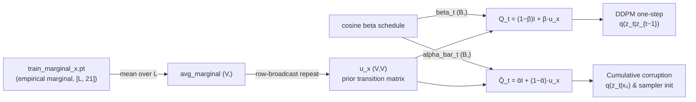
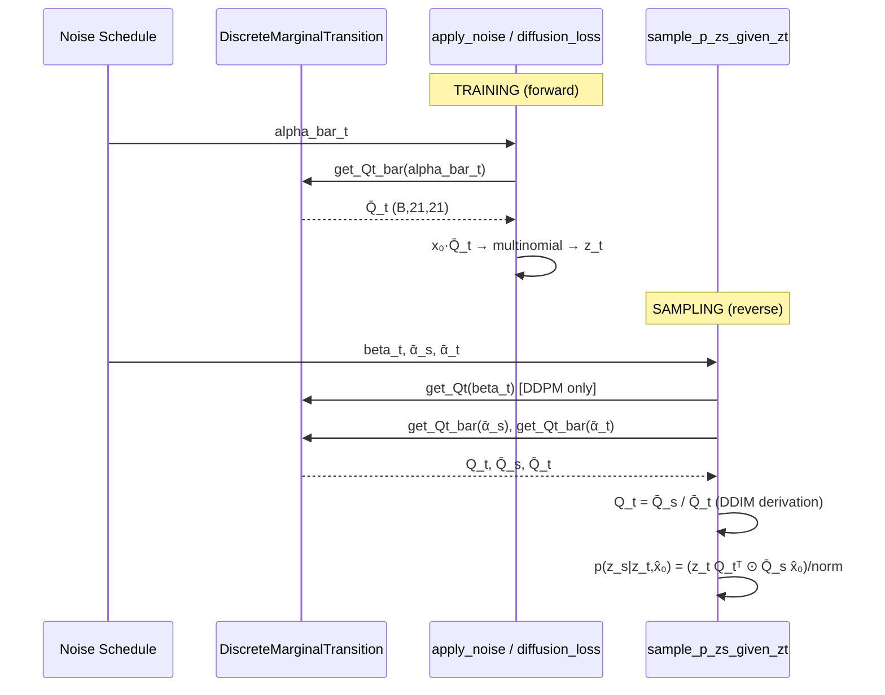
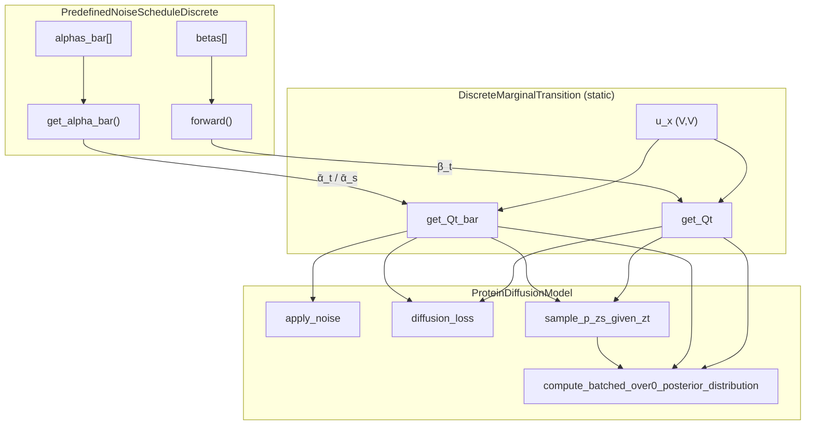

In OpenPhase's discrete diffusion pipeline, every corrupted token and every denoising step is governed by a pair of transition matrices, `Q_t` and `Q̄_t`, that encode *where amino-acid tokens drift as noise accumulates*. Rather than corrupting sequences toward a uniform or absorbing state, the system corrupts them toward the **empirical residue distribution of the training corpus** — a design borrowed from D3PM-style discrete diffusion that keeps the noise terminal state biologically plausible. This page dissects the `DiscreteMarginalTransition` component (45 lines of code in `Discrete/Discrete_marginal_transition.py`), the scalar schedules that scale it, and how the matrices are consumed across the forward noising, training loss, and reverse sampling paths.

Sources: [Discrete_marginal_transition.py](Discrete/Discrete_marginal_transition.py#L1-L45), [protein_diffusion_model.py](Discrete/protein_diffusion_model.py#L369-L394)

## Conceptual Foundation: Why a "Marginal" Prior?

Continuous diffusion adds Gaussian noise whose terminal state is a standard normal; discrete diffusion must instead choose a *stationary distribution* over tokens. OpenPhase selects the **marginal amino-acid frequency vector** measured over the training set (stored as `train_marginal_x.pt`), so that at `t = T` a fully noised sequence looks statistically like a real random draw from the corpus. This matters concretely in two places: the reverse sampler *initializes* its trajectory by drawing tokens from exactly this marginal, and the forward process saturates toward it — the noise floor is a plausible protein-like token soup, not white noise. The design contrasts with the more common uniform-diffusion (`u = 1/V`) or absorbing-state (token → `[MASK]`) kernels; here the kernel rows are the corpus frequencies themselves.

Sources: [Discrete_marginal_transition.py](Discrete/Discrete_marginal_transition.py#L4-L13), [protein_diffusion_model.py](Discrete/protein_diffusion_model.py#L541-L544)



## Anatomy of `DiscreteMarginalTransition`

The class has no learned parameters — it is a **pure data container plus two closed-form matrix factories**. The constructor loads the marginal file, defensively squeezes a stray leading batch dimension (`dim()==3, shape[0]==1` case), asserts a 2D shape with exactly `X_classes = 21` columns (20 canonical residues plus one extra token slot), and then builds `u_x` in two lines: `avg_marginal = x_marginal.mean(dim=0)` collapses any per-position structure into a single vocabulary-length vector `(V,)`, and `.unsqueeze(0).repeat(V, 1)` tiles it so **every row of `u_x` is identical** — meaning that from any source token, the "noise jump" lands on residue `v` with probability equal to the corpus frequency of `v`. Note the asymmetry between the two factory formulas: `get_Qt` writes `(1−β)I + β·u_x` while `get_Qt_bar` writes `ᾱI + (1−ᾱ)·u_x` — the coefficients are mirrored because `β` is a per-step noise *rate* while `ᾱ` is a cumulative *signal retention* factor.

Sources: [Discrete_marginal_transition.py](Discrete/Discrete_marginal_transition.py#L3-L13)

```python
# L15-29 — one-step kernel, batch-aware
Q_t = beta_t * u_x + (1 - beta_t) * I        # (B, V, V)

# L31-45 — cumulative kernel, batch-aware
Q_t_bar = alpha_bar_t * I + (1 - alpha_bar_t) * u_x   # (B, V, V)
```

Both methods accept **per-sample** scalars of shape `(B,)`, reshaped to `(B, 1, 1)` so a batch may contain heterogeneous noise levels simultaneously; broadcasting against the `(1, V, V)`-shaped `u_x` and identity yields per-sample matrices with zero Python-loop overhead. Because `u_x` is row-stochastic and `I`'s rows sum to one, any convex combination — which both formulas are — remains a valid transition matrix; this is the invariant that later legitimizes interpreting matrix rows as categorical sampling distributions.

Sources: [Discrete_marginal_transition.py](Discrete/Discrete_marginal_transition.py#L15-L45)

| Property | `get_Qt(beta_t)` | `get_Qt_bar(alpha_bar_t)` |
|---|---|---|
| Input scalar | per-step noise rate `β_t` | cumulative retention `ᾱ_t = Π α_s` |
| Formula | `(1−β)I + β·u_x` | `ᾱI + (1−ᾱ)·u_x` |
| Semantics | `q(z_t \| z_{t−1})`, one hop | `q(z_t \| x₀)`, arbitrary horizon |
| Output shape | `(B, V, V)` | `(B, V, V)` |
| Primary consumers | DDPM reverse step, training loss | `apply_noise`, DDIM `Q_t` derivation, posterior |

Sources: [Discrete_marginal_transition.py](Discrete/Discrete_marginal_transition.py#L15-L45), [protein_diffusion_model.py](Discrete/protein_diffusion_model.py#L456-L458)

## The Scalar Engine: `PredefinedNoiseScheduleDiscrete`

The matrices are scale-free templates; the noise schedule supplies their coefficients. `PredefinedNoiseScheduleDiscrete` (declared with `noise_schedule='cosine'` by `ProteinDiffusionModel`) precomputes a **non-learned lookup table**: `cosine_beta_schedule_discrete` produces the per-step `betas` array, then `alphas = 1 − clamp(betas, 0, 0.9999)`, and `alphas_bar = exp(cumsum(log(alphas)))` — a numerically stable cumulative product in log space. Two accessors bridge the schedule to the transition class: `forward(t_normalized)` returns `betas[t]` for `get_Qt`, and `get_alpha_bar(t_normalized)` returns `alphas_bar[t]` for `get_Qt_bar`. Both accept *normalized* time in `[0,1]` and internally round `t_normalized × timesteps` to integer indices, which is why the diffusion model can pass continuous `t_int / self.timesteps` values straight through. The cosine family is deliberate: it retains signal longer than linear schedules, which suits the 21-token discrete space where an aggressive early corruption would destroy motif information the denoiser needs.

Sources: [utils_.py](Discrete/utils_.py#L9-L47), [utils_.py](Discrete/utils_.py#L113-L122), [protein_diffusion_model.py](Discrete/protein_diffusion_model.py#L388-L390)

## Lifecycle of the Matrices Across the Pipeline

The same three matrix requests — `Qt`, `Qsb`, `Qtb` — recur in every phase of the model's life, but with different roles. In the **forward pass** (`apply_noise`, used by `forward()` for training), only `Q̄_t` matters: one-hot `x₀` tokens are multiplied through `Q̄_t` (`torch.bmm`) to obtain categorical distributions `prob_X`, from which noisy tokens `z_t` are multinomially drawn. In the **reverse pass** (`sample_p_zs_given_zt`, called by `mc_ddim_sample`), all three participate in the D3PM Bayesian posterior `q(z_s | z_t, x̂₀) ∝ Σ_{x₀} [z_t Q_t^T] ⊙ [Q̄_s x̂₀]`, normalized by `z_t^T Q̄_t x₀` — implemented batched in `compute_batched_over0_posterior_distribution` with a `1e-6` floor on the denominator to avoid division by zero.

Sources: [protein_diffusion_model.py](Discrete/protein_diffusion_model.py#L415-L441), [protein_diffusion_model.py](Discrete/protein_diffusion_model.py#L512-L526), [protein_diffusion_model.py](Discrete/protein_diffusion_model.py#L631-L638)



Sources: [protein_diffusion_model.py](Discrete/protein_diffusion_model.py#L415-L468), [protein_diffusion_model.py](Discrete/protein_diffusion_model.py#L576-L645)

> [!TIP]
> The DDIM branch never calls `get_Qt` at all — it *derives* the effective one-step matrix algebraically as `Qt = Qsb / (Qtb + 1e-12)` followed by row re-normalization (lines 595-599). This lets `mc_ddim_sample` take stride-`step` jumps (default 50) through the trajectory while remaining consistent with the cumulative marginal kernels; it is why DDIM evaluation with `ddim_steps=500` in the Trainer costs ~10× fewer denoiser evaluations than DDPM-equivalent sampling.

## Reverse-Process Coupling with the Marginal Prior

Two subtle integrations tie the transition model to sampling quality. **Initialization**: `mc_ddim_sample` draws its starting tokens directly from `self.transition_model.x_marginal.view(-1)` via `torch.multinomial` with replacement, clamped to indices `[0, 20]` — i.e., the sampler begins at the noise terminal state defined by the very same marginal that shaped `u_x`, guaranteeing forward/backward distributional consistency. **Posterior fusion**: the posterior `p_sXt` derived from the matrices is multiplied elementwise with `pred_X` (denoiser logits entropy-fused with ESM-2 protein-language-model logits), renormalized, and either sampled (`diverse=True`) or argmaxed. The transition matrices thus act as a *transport prior* — steering the language-model-informed predictions along statistically legal residue-substitution paths rather than allowing arbitrary categorical jumps.

Sources: [protein_diffusion_model.py](Discrete/protein_diffusion_model.py#L530-L571), [protein_diffusion_model.py](Discrete/protein_diffusion_model.py#L601-L645)

| Pipeline stage | Matrices requested | Role of marginal `u_x` |
|---|---|---|
| Forward noising (`apply_noise`) | `Q̄_t` | Saturation target of corruption |
| Training loss (`diffusion_loss`) | `Q̄_t`, `Q̄_s`, `Q_t` | Defines noise distribution seen by denoiser |
| DDPM reverse step | `Q_t`, `Q̄_s`, `Q̄_t` | Builds exact posterior `q(z_s\|z_t,x̂₀)` |
| DDIM reverse step | `Q̄_s`, `Q̄_t` (Q_t derived) | Ratio yields strided transition kernel |
| Sampler initialization | `x_marginal` vector only | Terminal-state draw for `z_T` |

Sources: [protein_diffusion_model.py](Discrete/protein_diffusion_model.py#L415-L468), [protein_diffusion_model.py](Discrete/protein_diffusion_model.py#L530-L645)

> [!TIP]
> The marginal file path is resolved three different ways across the codebase: the class default is `'data/train_marginal_x.pt'`, the checked-in artifact lives at `Discrete/train_marginal_x.pt`, and `build_diffusion_model` overrides with the absolute author-machine path `/home/peiranj/mapdiff/train_marginal_x.pt` (training.py L563). If you reuse the Trainer, pass an explicit `marginal_dist_path` — otherwise the assert on shape `[L, 21]` at construction time is your first line of defense against a silently wrong vocabulary file.

## Extension Points and Constraints

Three constraints define the component's contract. **Vocabulary rigidity**: both `_to_onehot` and `_ensure_indices` hard-code `num_classes=21`, so swapping to a different tokenizer requires touching the transition class constructor argument, the one-hot helpers, and the UNet head simultaneously. **Marginal shape contract**: the loaded tensor may carry per-position marginals `[L, 21]` (position-aware frequencies, e.g., from aligned homologs) or a pre-averaged vector — the `mean(dim=0)` handles both uniformly, but it always collapses to position-independent corruption; a position-conditional kernel would require replacing `u_x` construction, not the factory methods. **Schedule coupling**: because `get_Qt_bar` receives `ᾱ` from the cosine lookup rather than computing `(β)ᵀ` products itself, customizing the schedule (`utils_.py` supports only `'cosine'`; the `'custom'` branch is commented out) is fully decoupled from the matrix code — swap the schedule and the transition math remains untouched.

Sources: [Discrete_marginal_transition.py](Discrete/Discrete_marginal_transition.py#L4-L13), [protein_diffusion_model.py](Discrete/protein_diffusion_model.py#L405-L413), [utils_.py](Discrete/utils_.py#L18-L23)



Sources: [protein_diffusion_model.py](Discrete/protein_diffusion_model.py#L369-L394), [protein_diffusion_model.py](Discrete/protein_diffusion_model.py#L512-L526)

## Where to Go Next

The matrices on this page are consumed by a denoiser that predicts clean tokens `x̂₀` — its architecture (time/condition/label embeddings, 1D ResBlocks with entropy-gated ESM fusion) is covered in [Conditional UNet Denoiser](16-conditional-unet-denoiser). For the broader discrete-diffusion framing — loss objectives, the `pred_x0` parameterization, and schedule theory — see [Discrete Diffusion Foundations](14-discrete-diffusion-foundations). The latent-space counterpart, where a JTAE encoder compresses sequences before diffusion, is documented in [Latent Diffusion with JTAE](17-latent-diffusion-with-jtae), and the metrics used to judge samples produced through these kernels (recovery, perplexity) appear in [Sequence Generation Evaluation](18-sequence-generation-evaluation).