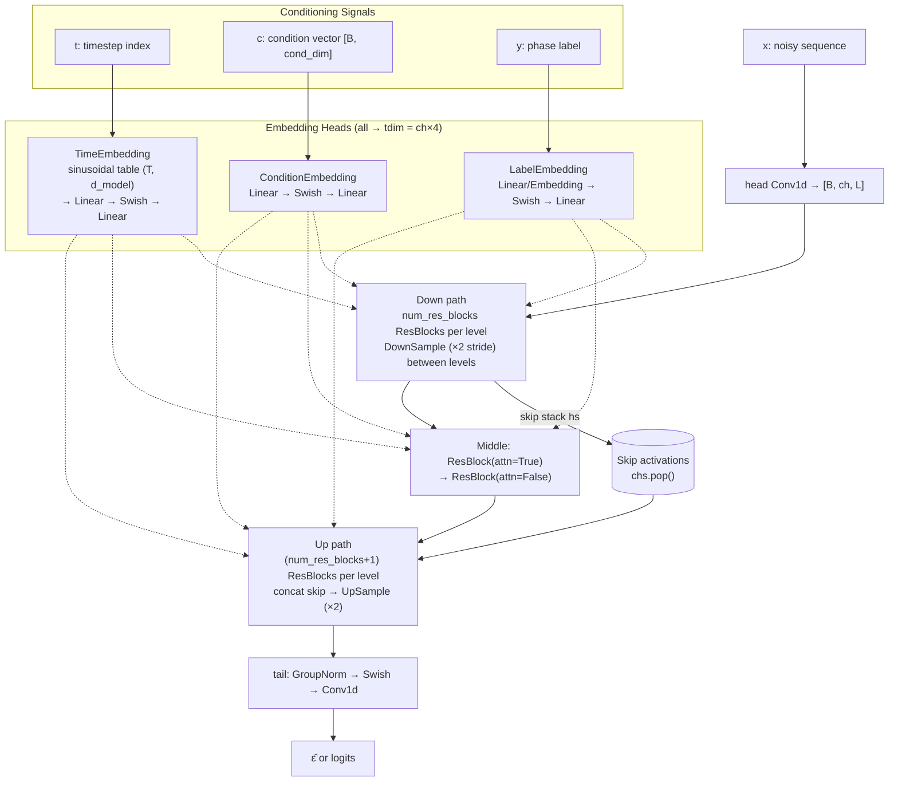
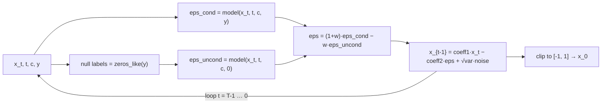

This page documents the denoiser networks that sit at the center of the OpenPhase generative stack: 1D conditional UNet variants that predict either Gaussian noise (continuous diffusion, `ldm/`) or per-position amino-acid logits (discrete diffusion, `Discrete/`). We dissect the shared architecture, the triple-conditioning injection mechanism (timestep + condition vector + phase label), the continuous-vs-discrete I/O contracts, and the classifier-free guidance (CFG) interface that the surrounding diffusion trainers and samplers rely on. Schedule mathematics, latent compression, and evaluation are covered by their own catalog pages.

## A Family of Three Denoisers

The repository ships three UNet implementations that share an identical skeleton — sinusoidal time embedding, dual-branch conditioning embeddings, encoder/decoder with skip connections, residual self-attention — but diverge in their I/O contract. The canonical continuous variant is `ldm/unet_conditional_model.py`; a "minimal" refactor used by the compact diffusion loop lives at `ldm/ldm_minimal/diffusion/unet_denoising_esmc.py`; and the discrete-sequence variant lives inside `Discrete/protein_diffusion_model.py` as the token-level backbone of `ProteinDiffusionModel`.

| Property | `ldm/unet_conditional_model.py` | `ldm_minimal/.../unet_denoising_esmc.py` | `Discrete/protein_diffusion_model.py` |
|---|---|---|---|
| Input `x` | Scalar sequence `[B, L]`, unsqueezed internally to `[B, 1, L]` | Already-shaped `[B, L]` continuous signal | Token indices `[B, L]` → token-embedded to `[B, ch, L]` |
| Label embedding | `Linear(1, dim)` on `y.view(-1, 1).float()` (continuous label projection) | `nn.Embedding(num_classes=2, tdim)` | `nn.Embedding(num_classes=21, tdim)`, tolerates `y=None` |
| Default condition dim | Constructor argument `condition_dim` | `cond_dim=14` | `cond_dim=14` |
| Up-path attention | Default `attn=True` on up ResBlocks | `attn=False` forced | `attn=False` forced |
| Output | `[B, L]` noise estimate (`squeeze(1)`) | `[B, 1, L]` noise estimate | Per-token logits `[B, L, num_classes]` |
| Extra features | — | `assert len(hs) == 0` skip-stack check | `_time_to_index` (accepts float t ∈ [0,1]), `debug` shape tracing, nullable condition/label inputs |

The three variants exist because the two diffusion regimes impose different contracts: the Gaussian pipeline denoises a continuous per-residue signal, while the discrete pipeline must map a categorical token distribution back to sequence logits. Everything between input and output — the conditioning plumbing and block layout — is deliberately parallel across the three files.

Sources: [unet_conditional_model.py](/ldm/unet_conditional_model.py#L141-L148), [unet_denoising_esmc.py](/ldm/ldm_minimal/diffusion/unet_denoising_esmc.py#L144-L152), [protein_diffusion_model.py](/Discrete/protein_diffusion_model.py#L220-L243), [protein_diffusion_model.py](/Discrete/protein_diffusion_model.py#L365-L367)

## Shared Architecture Anatomy

Every variant follows the same dataflow: three embedding heads compress their conditioning signals into a common width `tdim = ch * 4`, then the 1D encoder–decoder processes the noisy sequence while these embeddings are injected at every residual block. Skip activations from the encoder stack are consumed LIFO-style by the decoder via channel concatenation.



The **encoder** allocates `num_res_blocks` residual blocks per channel-multiplier level (`ch_mult`, e.g. `[1, 2, 4]`), appending each output to a skip list and inserting a `DownSample` between levels except after the last one. `DownSample` is a parallel pair of strided convolutions — kernel 3 / stride 2 and kernel 5 / stride 2 — summed elementwise, halving the sequence length each time ([unet_conditional_model.py#L69-L76](/ldm/unet_conditional_model.py#L69-L76)). The **bottleneck** is exactly two residual blocks, with self-attention enabled only on the first. The **decoder** mirrors the pyramid but with `num_res_blocks + 1` blocks per level; each decoder ResBlock first concatenates a popped skip activation (`chs.pop() + now_ch` channels), so skip consumption order is structurally guaranteed to mirror encoder emission. `UpSample` inverts the downsampling with a `ConvTranspose1d(kernel=5, stride=2, padding=2, output_padding=1)` followed by a smoothing `Conv1d(kernel=3)` ([unet_conditional_model.py#L79-L88](/ldm/unet_conditional_model.py#L79-L88)). Two of the three variants assert `len(hs) == 0` after the decoder to catch skip-stack bookkeeping errors at runtime ([unet_denoising_esmc.py#L208](/ldm/ldm_minimal/diffusion/unet_denoising_esmc.py#L208), [protein_diffusion_model.py#L362](/Discrete/protein_diffusion_model.py#L362)).

Sources: [unet_conditional_model.py](/ldm/unet_conditional_model.py#L150-L181), [unet_denoising_esmc.py](/ldm/ldm_minimal/diffusion/unet_denoising_esmc.py#L153-L181), [protein_diffusion_model.py](/Discrete/protein_diffusion_model.py#L244-L275)

The **`TimeEmbedding`** deserves a precise reading: it builds a `(T, d_model)` sinusoidal table (frequencies following the standard `10000^(-2i/d_model)` decay, split into sin/cos halves), loads it into an `nn.Embedding.from_pretrained(..., freeze=False)`, and then refines it through a two-layer MLP with Swish. Because `freeze=False`, the network starts from a mathematically well-conditioned positional prior but is free to adapt it to the diffusion schedule during training ([unet_conditional_model.py#L21-L40](/ldm/unet_conditional_model.py#L21-L40)). The discrete variant additionally accepts normalized float timesteps in `[0, 1]` and quantizes them to table indices via `_time_to_index`, which is necessary because the discrete sampler expresses time as a continuous fraction ([protein_diffusion_model.py#L284-L300](/Discrete/protein_diffusion_model.py#L284-L300)).

Sources: [unet_conditional_model.py](/ldm/unet_conditional_model.py#L21-L40), [protein_diffusion_model.py](/Discrete/protein_diffusion_model.py#L284-L300)

## Triple-Condition Injection in the Residual Block

The `ResBlock` is where all three conditioning signals meet the sequence representation. The pattern is a lightweight, additive analogue of FiLM: each embedding is projected from `tdim` to the block's output width through its own `Swish → Linear` MLP, then broadcast across the length axis via `[:, :, None]` and **added** to the post-convolution feature map:

```python
h = self.block1(x)                      # GroupNorm → Swish → Conv1d(k=3)
h += self.temb_proj(temb)[:, :, None]   # timestep, broadcast over L
h += self.cemb_proj(cemb)[:, :, None]   # condition vector
h += self.yemb_proj(yemb)[:, :, None]   # phase label
h = self.block2(h) + self.shortcut(x)   # GroupNorm → Swish → Dropout → Conv1d, residual
return self.attn(h)
```

Sources: [unet_conditional_model.py](/ldm/unet_conditional_model.py#L112-L138)

Because the projection is per-channel (not per-position), conditioning acts as a **global, sequence-wide modulation**: the label and condition vectors bias which residue patterns the block favors, without distorting positional structure. The `shortcut` is a 1×1 convolution only when channel widths differ (`nn.Identity()` otherwise), and the optional trailing `AttnBlock` applies residual self-attention over the length axis: `GroupNorm(32)` → 1×1-conv Q/K/V projections → scaled dot-product attention (`w = bmm(q, k) * C^-0.5` → softmax → `bmm(w, v)`) → additive residual. This gives every block cheap access to long-range residue correlations that strided convolutions cannot express ([unet_conditional_model.py#L91-L109](/ldm/unet_conditional_model.py#L91-L109)).

> [!TIP]
> The discrete variant hardens this pattern for production: its `_squeeze_embedding` helper accepts embeddings as `[B, tdim]`, `[B, 1, tdim]`, or `None` (falling back to additive zero), and its GroupNorm uses `min(8, in_ch)` groups instead of a fixed 32 — so small channel widths (e.g. `ch=8` at the stem) do not crash GroupNorm's group-count constraint. When porting blocks between variants, these defensive defaults are the ones to carry over ([protein_diffusion_model.py#L156-L214](/Discrete/protein_diffusion_model.py#L156-L214)).

Sources: [unet_conditional_model.py](/ldm/unet_conditional_model.py#L91-L109), [protein_diffusion_model.py](/Discrete/protein_diffusion_model.py#L172-L214)

## Continuous vs Discrete I/O Contract

The head and tail conventions encode the diffusion regime. In the **continuous** variants, the head expands a single input channel to `ch` (`Conv1d(1, ch, 3)`) — in `ldm/unet_conditional_model.py` the `unsqueeze(1)` happens *inside* `forward`, whereas the minimal variant expects the caller to deliver `[B, 1, L]` already. The tail projects back to one channel; the canonical variant squeezes to `[B, L]`, the minimal variant returns `[B, 1, L]` and leaves squeezing to the trainer, which computes MSE against noise reshaped identically ([unet_conditional_model.py#L183-L202](/ldm/unet_conditional_model.py#L183-L202), [gaussian_diffusion.py#L30-L31](/ldm/ldm_minimal/diffusion/gaussian_diffusion.py#L30-L31)).

In the **discrete** variant, the head is preceded by a token embedding: `nn.Embedding(num_classes=21, ch)` maps amino-acid indices to dense vectors, permuted to `[B, ch, L]` before the convolutional stem (`Conv1d(ch, ch, 3)`). The tail emits `num_classes` logits per position, and `forward` returns `[B, L, num_classes]` after a final permute — exactly the shape cross-entropy losses and DDIM sampling consume ([protein_diffusion_model.py#L238-L242](/Discrete/protein_diffusion_model.py#L238-L242), [protein_diffusion_model.py#L365-L367](/Discrete/protein_diffusion_model.py#L365-L367)). The underlying diffusion wrapper (`ProteinDiffusionModel`) treats this UNet purely as a denoiser network and layers marginal transition matrices and a cosine noise schedule on top — those mechanics belong to [Marginal Transition Matrices](15-marginal-transition-matrices) and [Discrete Diffusion Foundations](14-discrete-diffusion-foundations).

| Contract element | Continuous (Gaussian) | Discrete (token) |
|---|---|---|
| Stem | `Conv1d(1 → ch)` on scalar signal | `nn.Embedding(21 → ch)` + `Conv1d(ch → ch)` |
| Tail | `Conv1d(ch → 1)` | `Conv1d(ch → num_classes)` |
| Output semantics | ε̂, regressed against sampled Gaussian noise (MSE) | Class logits per residue (CE) |
| Downstream loss site | `GaussianDiffusionTrainer.forward` | `ProteinDiffusionModel` loss + `Evaluator` recovery/perplexity |
| Timestep form | Long indices into the embedding table | Long indices **or** float `[0,1]` (auto-quantized) |

Sources: [unet_conditional_model.py](/ldm/unet_conditional_model.py#L183-L202), [protein_diffusion_model.py](/Discrete/protein_diffusion_model.py#L302-L367), [gaussian_diffusion.py](/ldm/ldm_minimal/diffusion/gaussian_diffusion.py#L25-L32)

## The Classifier-Free Guidance Interface

All three denoisers expose the same four-argument signature — `forward(x, t, c, y)` — precisely so the diffusion wrappers can perform **classifier-free guidance** with two forward passes per sampling step: one conditioned on the real label, one on a null label. The samplers then extrapolate: `eps = (1 + w) * eps_cond − w * eps_uncond`, where the unconditional pass substitutes `torch.zeros_like(labels)` (canonical) or `torch.zeros_like(y)` (minimal). The guidance weight comes from configuration (`args.dif_w` in `ldm/diffusion_utils.py`, default `w=0.5` in the minimal sampler).



Training complements this with **label dropout**: `ldm/training.py` zeroes the labels with 10% probability per batch (`if np.random.rand() < 0.1`), teaching the network the unconditional distribution that CFG later extrapolates from ([training.py#L26-L30](/ldm/training.py#L26-L30)). The loss is reduced as `loss.sum() / B²`, a per-element normalization that keeps gradient scale stable across batch sizes ([training.py#L33-L35](/ldm/training.py#L33-L35)). The discrete pipeline goes further at inference: validation runs MC-dropout DDIM sampling ensembles (`ensemble_num=50`, `ddim_steps=50`) and averages the logit ensembles before computing recovery and perplexity — the UNet's dropout layers double as a Bayesian uncertainty source ([training.py#L139-L178](/Discrete/training.py#L139-L178)).

> [!TIP]
> Watch the positional argument order when wiring a trainer to a denoiser. `ldm/ldm_minimal/diffusion/gaussian_diffusion.py` calls `self.model(x_t.unsqueeze(1), t, c, y)` — condition vector third, matching the UNet signature — while `ldm/diffusion_utils.py` calls `self.model(x_t, t, labels, cond)`, passing the label as the third positional argument. With the canonical `LabelEmbedding` being a `Linear(1, dim)` on a float view and `ConditionEmbedding` being `Linear(input_dim, dim)`, swapping these two arguments silently changes which embedding head receives the 14-dim condition vector versus the scalar label. Verify `forward` order against the caller before reusing either diffusion wrapper ([diffusion_utils.py#L26-L37](/ldm/diffusion_utils.py#L26-L37), [gaussian_diffusion.py#L30](/ldm/ldm_minimal/diffusion/gaussian_diffusion.py#L30)).

Sources: [diffusion_utils.py](/ldm/diffusion_utils.py#L40-L88), [gaussian_diffusion.py](/ldm/ldm_minimal/diffusion/gaussian_diffusion.py#L53-L73), [training.py](/ldm/training.py#L26-L35)

## Constructor Surface

All variants expose a small, uniform configuration surface; `tdim` is always derived as `ch * 4`, so the embedding width scales automatically with the channel budget.

| Parameter | Meaning | Notes / defaults |
|---|---|---|
| `T` | Number of diffusion timesteps | Sizes the `TimeEmbedding` lookup table; must match the wrapper's schedule (`dif_T` at training time) |
| `ch` | Base channel width | Also drives embedding width `tdim = ch * 4` |
| `ch_mult` | Channel pyramid, e.g. `[1, 2, 4]` | Length is halved at each interior level via `DownSample` |
| `num_res_blocks` | ResBlocks per level (down path) | Up path uses `num_res_blocks + 1` to absorb skip concatenations |
| `dropout` | Dropout inside `block2` of every ResBlock | Also serves MC-dropout sampling in the discrete pipeline |
| `condition_dim` / `cond_dim` | Width of the condition vector | Default `14` in both minimal and discrete variants; matches `(B, 14)` batches in the minimal trainer |
| `num_classes` | Label/输出 vocabulary size | `2` (binary phase label) minimal; `21` (amino acids) discrete; controls token embedding and tail width |

Sources: [unet_conditional_model.py](/ldm/unet_conditional_model.py#L141-L148), [unet_denoising_esmc.py](/ldm/ldm_minimal/diffusion/unet_denoising_esmc.py#L144-L150), [protein_diffusion_model.py](/Discrete/protein_diffusion_model.py#L220-L236), [training.py](/ldm/ldm_minimal/diffusion/training.py#L26-L35)

One integration note: the end-to-end latent pipeline mixes the diffusion loss into a composite objective — cross-entropy on reconstructed tokens (with token 21 down-weighted to 0.8), an L2 penalty on the latent representation, and the diffusion term — before the UNet's noise prediction ever sees the sequence directly ([losses.py#L8-L41](/ldm/utils/losses.py#L8-L41)). How the JTAE compressor produces the latent sequence that the continuous denoiser then diffuses is the subject of [Latent Diffusion with JTAE](17-latent-diffusion-with-jtae).

Sources: [losses.py](/ldm/utils/losses.py#L8-L41)

## Where This Fits — and Where to Go Next

Within the Generative Models track, this page is the network-level deep dive: upstream, [Discrete Diffusion Foundations](14-discrete-diffusion-foundations) and [Marginal Transition Matrices](15-marginal-transition-matrices) define the corruption process the discrete UNet inverts; downstream, [Latent Diffusion with JTAE](17-latent-diffusion-with-jtae) wraps the continuous variant inside a compressed latent space, and [Sequence Generation Evaluation](18-sequence-generation-evaluation) measures what the denoiser's sampled outputs are worth (recovery, perplexity — the exact metrics the discrete `Trainer` optimizes model selection against). If your goal is to reuse the denoiser in a new pipeline, start from the minimal variant (`ldm/ldm_minimal/`) — its trainer/sampler pair has the cleanest positional-argument contract — and carry over the discrete variant's defensive embedding handling only when your inputs can be missing or variable-shaped.
