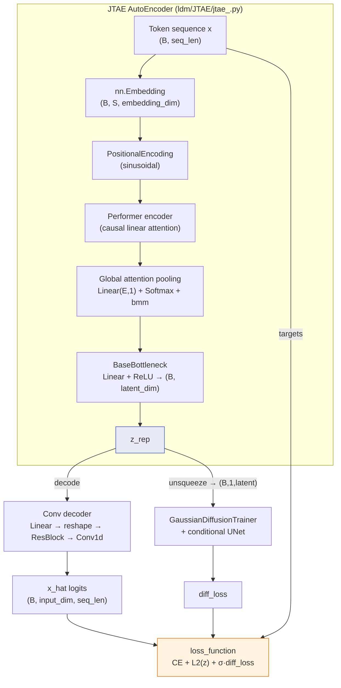
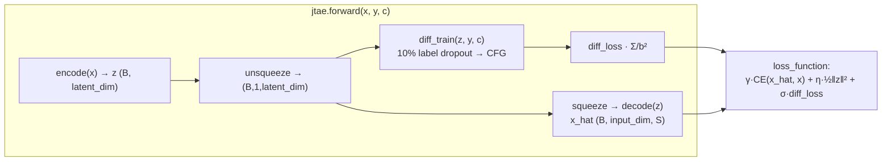

This page documents the `ldm/` module of OpenPhase: a latent diffusion system in which a **Joint Transformer AutoEncoder (JTAE)** compresses protein sequences into compact continuous vectors, and a conditional Gaussian diffusion model learns to generate those vectors directly in latent space. Unlike the discrete token-space diffusion covered in [Discrete Diffusion Foundations](14-discrete-diffusion-foundations), here the diffusion process never touches token IDs — it operates entirely on the JTAE bottleneck output, while sequence reconstruction is handled by a convolutional decoder. We cover the encoder stack, the joint training objective, the latent-space diffusion trainer/sampler, the conditional UNet denoiser specialized for latent vectors, and the two available implementations (token-level and minimal embedding-level).

Sources: [jtae_.py](ldm/JTAE/jtae_.py#L1-L152), [diffusion_utils.py](ldm/diffusion_utils.py#L1-L90)

## Why Latent Diffusion

The core architectural decision is to factor generation into two cooperating components. The **JTAE** learns a bijective-ish mapping between a full-length token sequence and a single `latent_dim`-sized vector, while a **Gaussian diffusion model** learns the distribution of those vectors conditioned on labels and condition vectors. This design trades off against the discrete-diffusion pipeline in two ways: the diffusion model's denoising target is a short continuous vector rather than a full token grid, and reconstruction quality is owned by the autoencoder rather than by the diffusion step itself. Notably, both components are trained **jointly** in a single forward pass — the encoder, decoder, and latent diffusion share one optimizer step — rather than in the classic two-stage (autoencode-then-freeze) recipe.

The module's lineage is explicitly acknowledged: the bottleneck, decoder blocks, positional encoding, and loss function are adapted from the PRO-LDM repository, while the diffusion trainer and conditional UNet follow the ConDiff classifier-free-guidance design.

Sources: [jtae_.py](ldm/JTAE/jtae_.py#L84-L99), [bneck.py](ldm/JTAE/bneck.py#L3-L13), [losses.py](ldm/utils/losses.py#L5-L7)

## Architecture at a Glance

The following diagram shows the complete data flow through the system during a training forward pass. A token sequence `x` is embedded, encoded by a Performer attention network, pooled to a single vector via learned global attention, and compressed by a bottleneck. That latent vector `z_rep` feeds **two** paths simultaneously: the decoder (for reconstruction loss) and the Gaussian diffusion trainer (for latent-space denoising loss). Both losses are summed into one objective.

The key structural fact: the diffused object is a **single vector per sample**. The UNet receives it as a length-1 sequence (`z_rep.unsqueeze(1)`), so the entire U-Net hierarchy operates on `(B, 1, latent_dim)` tensors rather than the `(B, seq_len, vocab)` grids used by token-space diffusion.

Sources: [jtae_.py](ldm/JTAE/jtae_.py#L146-L152), [unet_conditional_model.py](ldm/unet_conditional_model.py#L141-L200)

## The JTAE Encoder Stack

Encoding proceeds through five stages, each with a precise shape contract. First, token IDs are mapped into an `embedding_dim`-sized space via `nn.Embedding`. Second, sinusoidal positional encodings are added so the permutation-invariant attention can recover residue order — the encoding buffer follows the standard `sin/cos` formulation with a 10000.0 wavelength base and is registered as a non-persistent buffer (not saved in checkpoints). Third, a **Performer** encoder with causal linear attention (4 heads by default, `layers` depth, `probs` dropout on both feed-forward and attention) produces contextualized residue representations.

Fourth — and this is the pivotal design point — a learned **global attention pooling** collapses the whole sequence into one vector: a `Linear(embedding_dim, 1)` + `Softmax(dim=1)` head produces per-residue weights `(B, S, 1)`, and a batched matrix multiply computes the weighted sum, yielding `(B, embedding_dim)`. Finally, the `BaseBottleneck` applies `Linear(embedding_dim, latent_dim)` followed by ReLU, producing the non-negative latent vector that diffusion will model.

| Stage | Module | Input → Output shape | Notes |
|---|---|---|---|
| Token embedding | `nn.Embedding` | `(B, S)` → `(B, S, E)` | `input_dim` classes |
| Positional encoding | `PositionalEncoding` | `(B, S, E)` → `(B, S, E)` | Sinusoidal, `max_len=seq_len` |
| Contextual encoding | `Performer` | `(B, S, E)` → `(B, S, E)` | Causal, 4 heads, dropout `probs` |
| Global pooling | `Linear(E,1)+Softmax` + `bmm` | `(B, S, E)` → `(B, E)` | Learned per-residue weights |
| Bottleneck | `BaseBottleneck` | `(B, E)` → `(B, latent_dim)` | Linear + ReLU |

Sources: [jtae_.py](ldm/JTAE/jtae_.py#L53-L79), [jtae_.py](ldm/JTAE/jtae_.py#L108-L128), [positionalencoding.py](ldm/JTAE/positionalencoding.py#L12-L32), [bneck.py](ldm/JTAE/bneck.py#L6-L13)

> [!TIP]
> The global-attention pooling at [jtae_.py](ldm/JTAE/jtae_.py#L118-L128) is what makes the latent diffusion tractable at all: because the sequence is reduced to one vector **before** the bottleneck, the diffusion UNet never has to denoise a `seq_len × vocab` tensor. If you adapt this code to longer sequences or larger latent grids, the UNet channel budget in `dif_channel_mult` — not the encoder — becomes the bottleneck.

## The Convolutional Decoder

Decoding inverts the compression geometrically rather than autoregressively. The latent vector is first projected by a linear layer to `seq_len × (hidden_dim // 2)` values, then reshaped into `(B, hidden_dim // 2, seq_len)` — this reshape happens at index 1 of the decoder `ModuleList`. A residual 1D convolution `Block` (two 3-kernel convolutions with BatchNorm, plus a 1×1 skip projection when channel counts differ) expands to `hidden_dim` channels, and a final `Conv1d(hidden_dim, input_dim, kernel_size=3, padding=1)` emits per-position logits over the full token vocabulary.

The residual `Block` is adapted from PRO-LDM and uses an explicit `use_skip` flag: the skip path activates only when `stride != 1` or channel counts mismatch, otherwise it is an `nn.Identity`. The decoder's output is consumed as classification logits — reconstruction quality is measured by cross-entropy against token IDs, not by continuous regression.

Sources: [jtae_.py](ldm/JTAE/jtae_.py#L101-L136), [convolution.py](ldm/JTAE/convolution.py#L10-L42)

## Joint Training Objective

The complete loss is assembled in `loss_function` and combines three weighted terms:

- **Reconstruction** (`ae_loss`): weighted cross-entropy between decoder logits `(B, input_dim, seq_len)` and token targets, with the token class at index 21 downweighted to 0.8 (a vocabulary-specific adjustment) and the whole term scaled by `gamma_val`.
- **Latent regularization** (`zrep_l2_loss`): `0.5 · mean(‖z_rep‖₂²)` scaled by `eta_val` — this shrinks the latent geometry that the diffusion model must fit.
- **Latent diffusion** (`diff_loss`): the MSE denoising loss from the Gaussian trainer, scaled by `sigma_val`.

Two mechanics deserve attention. First, **the label-dropout trick for classifier-free guidance is embedded inside `diff_train` itself**: with probability 0.1 per batch, labels are zeroed before the diffusion trainer is invoked, teaching the UNet both a conditional and an unconditional denoising direction. Second, the diffusion loss is normalized as `loss.sum() / (b ** 2)` — sum-then-divide-by-batch-squared — matching the PRO-LDM convention, so the effective per-element scale shrinks as batch size grows. A diagnostic, `seq_difference` (fraction of positions where `argmax(x_hat)` disagrees with the target), is logged to W&B alongside the three loss components.

Sources: [losses.py](ldm/utils/losses.py#L8-L54), [jtae_.py](ldm/JTAE/jtae_.py#L138-L152)

> [!TIP]
> Because encoder, decoder, and diffusion model are optimized in **one** step, the loss weights `gamma_val`, `eta_val`, and `sigma_val` are a three-way tug-of-war over the latent space: raising `sigma_val` pressures `z_rep` toward the diffusion model's preferred distribution, while raising `gamma_val` pressures it toward reconstruction fidelity. When generation quality degrades, tune this triple before touching diffusion-side hyperparameters.

## Diffusion in Latent Space: Trainer and Sampler

The diffusion machinery in [diffusion_utils.py](ldm/diffusion_utils.py) implements the standard DDPM pair of algorithms with a **linear** beta schedule interpolated from `dif_beta_1` to `dif_beta_T` across `dif_T` steps. The trainer samples `t` uniformly per example, constructs `x_t = √ᾱ_t · x_0 + √(1−ᾱ_t) · ε`, predicts the noise `ε` through the conditional UNet, and returns element-wise MSE. Coefficients are stored as registered buffers (`sqrt_alphas_bar`, `sqrt_one_minus_alphas_bar`) in double precision.

The sampler implements Algorithm 2 (reverse process) with **classifier-free guidance extrapolation** at every step: it runs the UNet twice — once with the true label and once with zeroed labels — and combines them as `ε = (1+w)·ε_cond − w·ε_null`, where `w = args.dif_w`. It then steps backward through the posterior mean/variance formulation for `T` iterations and clips the final latent to `[-1, 1]`. During generation, this clipped latent `z̃` replaces `z_rep` as decoder input to synthesize sequences.

| Aspect | Trainer | Sampler |
|---|---|---|
| Schedule | Linear betas `β₁→β_T`, cumulative `ᾱ` | Same buffers + posterior variance |
| Input | Clean latent `z` + labels + condition | Pure noise `x_T` + labels + condition |
| Guidance | 10% label dropout (in `diff_train`) | Extrapolation `(1+w)·ε_cond − w·ε_null` |
| Output | Element-wise MSE loss | Latent `x_0` clipped to `[-1, 1]` |

Sources: [diffusion_utils.py](ldm/diffusion_utils.py#L14-L88), [jtae_.py](ldm/JTAE/jtae_.py#L138-L144)

## The Conditional UNet for Latents

The denoiser in [unet_conditional_model.py](ldm/unet_conditional_model.py) is a 1D U-Net purpose-built for latent vectors: the stem is `Conv1d(1, ch)`, treating the `latent_dim` vector as a single-position sequence, and the tail projects back to one channel. It fuses **three** conditioning signals into every residual block via additive projections: a sinusoidal **time embedding** (`TimeEmbedding`: `T`-sized lookup table → 2-layer MLP), a **continuous condition embedding** (`ConditionEmbedding`: MLP over the condition vector `c`), and a **label embedding** (`LabelEmbedding`: MLP over the scalar label viewed as `(B, 1)` float). Each `ResBlock` computes `h += temb_proj(t)[:,:,None] + cemb_proj(c)[:,:,None] + yemb_proj(y)[:,:,None]` between its two conv stacks.

The topology is conventional but attention-heavy: each resolution level contributes `num_res_blocks` ResBlocks in the down path with strided `DownSample` between levels, the bottleneck carries two ResBlocks both with self-attention (`AttnBlock`: GroupNorm + single-head scaled dot-product over the length-1 axis), and the up path uses `num_res_blocks + 1` blocks with skip concatenation and transposed-conv `UpSample`. Note the input channel arithmetic: `ResBlock`s in the up path receive `chs.pop() + now_ch` channels, wiring every encoder feature map into its decoder counterpart.

Sources: [unet_conditional_model.py](ldm/unet_conditional_model.py#L21-L66), [unet_conditional_model.py](ldm/unet_conditional_model.py#L112-L138), [unet_conditional_model.py](ldm/unet_conditional_model.py#L141-L203)

## Two Implementations: Token-Level vs. Minimal

The repository ships two JTAE variants for different input regimes. The full version in `ldm/JTAE/jtae_.py` consumes **token IDs** and owns the entire embedding pipeline (lookup table → positional encoding → Performer). The minimal version in `ldm/ldm_minimal/JTAE_minimal.py` assumes you arrive with **pre-computed residue embeddings** (e.g., language-model outputs): it concatenates the protein embedding `x` with the condition vector `c` into a single `input_dim = D_x + D_c` vector, then uses plain linear layers for embedding and bottleneck — no attention at all. The decoder stacks and diffusion trainers are structurally identical between the two.

| Dimension | `ldm/JTAE/jtae_.py` (full) | `ldm/ldm_minimal/JTAE_minimal.py` (minimal) |
|---|---|---|
| Input | Token IDs `(B, S)` | Fused ESM + condition `(B, D_x + D_c)` |
| Token embedding | `nn.Embedding` | `nn.Linear` over concatenated features |
| Sequence context | Performer (causal, multi-layer) | None (order handled upstream by ESM) |
| Pooling | Global attention + bottleneck | Single linear bottleneck |
| Batch interface | `forward(x, y, c)` tuple | `forward_dict({x, c, y})` |
| Guidance dropout | In-model, `np.random.rand() < 0.1` | In-model, `torch.rand < 0.1`, labels cast `.long()` |
| External deps | `performer_pytorch`, ConDiff | ConDiff (DiffusionFreeGuidence) |

Sources: [jtae_.py](ldm/JTAE/jtae_.py#L53-L99), [JTAE_minimal.py](ldm/ldm_minimal/JTAE_minimal.py#L23-L85)

## Training Loop and Optimization Setup

The reference driver in [utils/training.py](ldm/utils/training.py) wires everything together with W&B project tracking (`Open-Phase`), an h5ad data source split 90/10 with seed 42, and per-batch steps of: `zero_grad → forward(x, c, y) → loss_function → backward → step`. Checkpointing saves model/optimizer/scheduler state plus the full `args` namespace every 50 epochs and at the final epoch, and resume support restores all three states from disk.

Optimization uses **AdamW** (lr `2e-5`, weight decay `1e-4`) under a composite schedule: a custom `GradualWarmupScheduler` ramps the learning rate linearly to `multiplier × base_lr` over `n_epochs // 10` epochs, then hands off to `CosineAnnealingLR` decayed to zero. The default model geometry is substantial — `embedding_dim` 512, `hidden_dim` 512, `latent_dim` 256, `seq_len` 2048 — and the diffusion defaults are `T=1000` steps, base channels 64 with multipliers `[1, 2, 4]`, 2 residual blocks per level, dropout 0.15, and betas from `1e-4` to `0.028`.

| Hyperparameter group | Defaults (argparse) |
|---|---|
| Autoencoder | `input_dim=1152`, `embedding_dim=512`, `hidden_dim=512`, `latent_dim=256`, `seq_len=2048`, `layers=4`, `probs=0.2` |
| Objective weights | `gamma_val=1.0`, `eta_val=0.001`, `sigma_val=1.5` |
| Diffusion | `dif_T=1000`, `dif_channel=64`, `dif_channel_mult=[1,2,4]`, `dif_res_blocks=2`, `dif_dropout=0.15`, `dif_beta_1=1e-4`, `dif_beta_T=0.028` |
| Optimization | `lr=2e-5`, `batch_size=8`, `n_epochs=100`, warmup multiplier `2.5` |

Sources: [utils/training.py](ldm/utils/training.py#L53-L175), [utils/scheduler.py](ldm/utils/scheduler.py#L4-L31)

## Module Map and Code Organization

The `ldm/` tree contains some deliberate duplication worth knowing about before you edit. `ldm/Scheduler.py` and `ldm/utils/scheduler.py` are identical copies of `GradualWarmupScheduler`; `ldm/bneck.py` and `ldm/convolution.py` are dict-batch-flavored variants (they unpack a `batch['x']` key) of the JTAE tensor-flavored originals. The file `ldm/training.py` is a standalone per-batch diffusion training function that trains the UNet directly on a batch's `x_0` — including the same 10% label-dropout and `Σ/b²` normalization — useful when you want to fine-tune the denoiser without the autoencoder in the loop.

| File | Role | Reuse note |
|---|---|---|
| `ldm/JTAE/jtae_.py` | Full token-level JTAE + embedded diffusion | Primary model |
| `ldm/JTAE/{bneck,convolution,positionalencoding}.py` | Encoder/decoder building blocks | Adapted from PRO-LDM |
| `ldm/diffusion_utils.py` | DDPM trainer + CFG sampler | Shared by both variants |
| `ldm/unet_conditional_model.py` | Triple-conditioned 1D UNet | Latent-space denoiser |
| `ldm/utils/{losses,training,scheduler}.py` | Objective, driver, LR schedule | Canonical versions |
| `ldm/training.py` | Standalone diffusion-only train step | Fine-tuning path |
| `ldm/Scheduler.py`, `ldm/bneck.py`, `ldm/convolution.py` | Duplicates / dict-batch variants | Prefer `utils/` + `JTAE/` originals |
| `ldm/ldm_minimal/JTAE_minimal.py` | ESM-embedding-level variant | No attention encoder |

Sources: [Scheduler.py](ldm/Scheduler.py#L1-L32), [utils/scheduler.py](ldm/utils/scheduler.py#L1-L32), [bneck.py](ldm/bneck.py#L1-L21), [convolution.py](ldm/convolution.py#L1-L50), [training.py](ldm/training.py#L6-L36)

## Where This Fits and What to Read Next

Conceptually, this page sits between the token-space diffusion stack and evaluation: the discrete pipeline denoises sequences position-by-position (see [Marginal Transition Matrices](15-marginal-transition-matrices) and [Conditional UNet Denoiser](16-conditional-unet-denoiser) for that contrast), whereas this latent pipeline denoises a pooled sequence summary and delegates token-level fidelity to the decoder. To measure whether latent-space generation produces viable proteins, continue to [Sequence Generation Evaluation](18-sequence-generation-evaluation); to understand where the condition vectors `c` consumed by the UNet come from, see [Condition Feature Engineering](13-condition-feature-engineering); and for the full grid of tunable parameters referenced above, consult the [Hyperparameter Grid Reference](22-hyperparameter-grid-reference).
