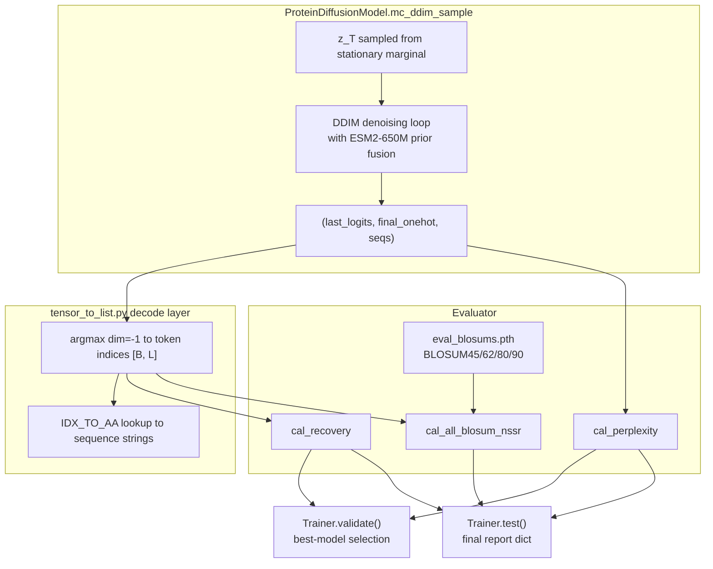
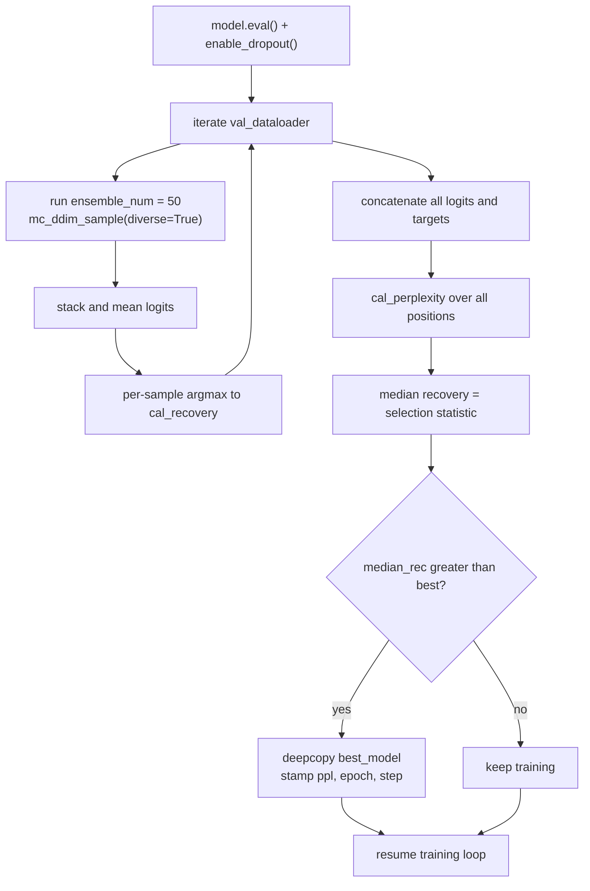

Generated protein sequences are only as useful as our ability to score them. This page documents OpenPhase's discrete-diffusion evaluation subsystem: the `Evaluator` class that computes recovery, BLOSUM-based substitution scores, and perplexity; the tensor-to-string decoding layer that bridges model output to human-readable sequences; and the validation/test protocols embedded in `Trainer` that turn raw scores into model selection decisions. A generated sequence is scored against its paired ground-truth target along two axes — exact positional agreement and biochemical substitution plausibility — under both stochastic (validation) and deterministic (test) decoding regimes.

Sources: [evaluator.py](Discrete/evaluator.py#L1-L45), [training.py](Discrete/training.py#L62-L83)

## Evaluation Pipeline Architecture

The evaluation subsystem is a three-module pipeline with a strictly typed interface contract. The sampler (`ProteinDiffusionModel.mc_ddim_sample`) produces a three-element tuple — fused logits, one-hot sequences, and decoded strings. The decode layer (`tensor_to_sequence_list`) performs argmax over the 21-class vocabulary and maps indices to amino acid characters. The `Evaluator` consumes index tensors directly from the sampler's argmax outputs and the fused logits, producing the final metric suite. This separation means the metrics are sampler-agnostic: any component emitting `(logits [B, L, 21], onehot [B, L, 21], seqs [list[str]])` can be evaluated without modification.

Sources: [protein_diffusion_model.py](Discrete/protein_diffusion_model.py#L530-L571), [tensor_to_list.py](Discrete/tensor_to_list.py#L6-L22), [evaluator.py](Discrete/evaluator.py#L5-L21)

A subtle but important interface detail: in `Trainer.validate()` and `Trainer.test()`, the ground-truth tensor `x` passed to `mc_ddim_sample` acts only as a **batch shape template** — the sampler initializes from the stationary marginal distribution and conditions generation on `c` alone; `x` is never consulted inside the denoising step. Evaluation therefore measures *conditional generation from the condition vector* scored against the paired target, with sequence length inherited from the target. The returned string list `seqs` is produced by the sampler but unused by the Trainer, leaving a clean hook for downstream string-level analyses (e.g., export or external property predictors).

Sources: [protein_diffusion_model.py](Discrete/protein_diffusion_model.py#L534-L544), [protein_diffusion_model.py](Discrete/protein_diffusion_model.py#L576-L601), [training.py](Discrete/training.py#L153-L166)

## The Evaluator Class: Metric Implementations

`Evaluator` is a plain object (no nn.Module dependency) constructed around a precomputed BLOSUM archive. On init, it loads `eval_blosums.pth` — a dictionary of four 20×20 substitution matrices keyed by `BLOSUM45`, `BLOSUM62`, `BLOSUM80`, `BLOSUM90` — and records the canonical BLOSUM axis order (`A, R, N, D, C, Q, E, G, H, I, L, K, M, F, P, S, T, W, Y, V`). An optional reordering mechanism permutes matrix rows and columns via `np.ix_` so that lookups can follow a caller-supplied amino acid ordering instead.

Sources: [evaluator.py](Discrete/evaluator.py#L5-L21), [evaluator.py](Discrete/evaluator.py#L13-L21)

The complete metric API is intentionally minimal — four methods, all stateless with respect to batches:

| Method | Inputs | Computation | Output |
|---|---|---|---|
| `cal_recovery` | `pred_seq [L]`, `target_seq [L]` index tensors | elementwise equality, meaned | scalar in [0, 1] |
| `cal_blosum_nssr` | `pred_seq`, `target_seq`, `blosum_name` | fraction of positions where `blosum[pred, target] > 0` | scalar in [0, 1] |
| `cal_all_blosum_nssr` | `pred_seq`, `target_seq` | applies `cal_blosum_nssr` across all four matrices, ordered 45→62→80→90 | list of 4 scalars |
| `cal_perplexity` | `pred_logits [N, 21]`, `target_label [N]` | `exp(mean cross-entropy)` | scalar ≥ 1 |

Sources: [evaluator.py](Discrete/evaluator.py#L23-L45)

**Recovery** (also called sequence recovery or AAR in the protein-design literature) is the strictest positional metric: a predicted token must match the target exactly. **NSSR** (normalized substitution score ratio) relaxes this to *biochemically plausible* agreement — any substitution with a positive BLOSUM score counts as a hit, rewarding conservative mutations like I↔V or D↔E while penalizing radical ones. **Perplexity** operates at a different abstraction level entirely: rather than scoring a decoded sequence, it measures the calibrated sharpness of the full predictive distribution, computed as the exponential of the mean cross-entropy between fused ensemble logits and target labels across all positions of the evaluation set simultaneously.

Sources: [evaluator.py](Discrete/evaluator.py#L23-L26), [evaluator.py](Discrete/evaluator.py#L35-L39), [evaluator.py](Discrete/evaluator.py#L41-L45)

## Sequence Decoding and Alphabet Contract

The decode layer defines the vocabulary contract shared by generation and evaluation: `IDX_TO_AA` maps indices 0–19 to the twenty standard amino acids in alphabetical order (A, C, D, E, F, G, H, I, K, L, M, N, P, Q, R, S, T, V, W, Y) and reserves index 20 for `X` (unknown). Decoding accepts a `[B, L, 21]` one-hot tensor, applies `argmax(dim=-1)`, and builds strings character-by-character — with one twist: positions flagged in an optional boolean `mask` render as `X` regardless of their argmax value, which is how the entropy-gated positions are surfaced to the ESM prior during sampling.

Sources: [tensor_to_list.py](Discrete/tensor_to_list.py#L1-L4), [tensor_to_list.py](Discrete/tensor_to_list.py#L6-L22)

The same utility serves three distinct call sites in the sampler: constructing masked inputs for the ESM prior during training loss computation, decoding the final denoised sequence in `mc_ddim_sample`, and producing per-step sequence strings inside the DDIM loop. Because `dataset.py` normalizes all stored data to long token indices (`[N, L]`) by pre-collapsing one-hot inputs, the evaluator consistently receives index tensors — never raw one-hot — which keeps `cal_recovery` and the BLOSUM lookups cheap.

Sources: [protein_diffusion_model.py](Discrete/protein_diffusion_model.py#L492-L497), [protein_diffusion_model.py](Discrete/protein_diffusion_model.py#L566-L569), [protein_diffusion_model.py](Discrete/protein_diffusion_model.py#L604-L613), [dataset.py](Discrete/dataset.py#L6-L12)

> [!TIP]
> The BLOSUM axis order recorded in `Evaluator` (`A, R, N, D, C, Q, ...`) is **not** the model's index order (`A, C, D, E, F, ...`). The `reorder_blosum`/`reorder_types` mechanism exists precisely to permute matrix axes into model index space via `np.ix_`, but it is disabled by default (`reorder_blosum=False`) — and `Trainer` instantiates `Evaluator()` with defaults. Before trusting NSSR numbers, verify which axis order `eval_blosums.pth` was saved in; if it uses the canonical BLOSUM order, pass `reorder_blosum=True, reorder_types=<your 20-AA index order>` at construction. Additionally, index 20 (`X`) has no row in a 20×20 BLOSUM matrix, so any generated sequence containing an `X` token will raise an indexing error in `cal_blosum_nssr` — strip or remap `X` positions before scoring.

## Validation Protocol: MC-Dropout Ensemble Scoring

Validation runs at a configurable cadence (`save_and_sample_every` epochs) and implements a three-stage ensemble protocol. First, the model is set to eval mode but dropout is explicitly re-enabled via `enable_dropout()`, converting the deterministic UNet into a stochastic ensemble member generator. Second, for each validation batch, the sampler executes `ensemble_num=50` independent `mc_ddim_sample` passes with `diverse=True` — multinomial sampling from the posterior — and the resulting logit stacks are averaged into `mean_logits`. Third, per-sample argmax of these mean logits is compared against targets for `cal_recovery`.

Sources: [training.py](Discrete/training.py#L139-L166), [utils_.py](Discrete/utils_.py#L142-L146)

Two design decisions in this protocol deserve attention. The **median** — not the mean — recovery is the selection statistic, retrieved via `cal_stats_metric` and tracked in `best_val_recovery`; medians are robust to sequences of anomalous length or degenerate generation, making model selection less sensitive to outlier batches. And perplexity is computed **globally**, over the concatenation of all batch logits and targets flattened to `[N·L, 21]` / `[N·L]`, rather than averaged per-batch — a single exp of a single mean cross-entropy over the entire validation corpus. When median recovery improves, the current model is deep-copied into `best_model` alongside its perplexity, epoch, and step stamps.

Sources: [training.py](Discrete/training.py#L168-L187), [utils_.py](Discrete/utils_.py#L135-L139)

## Test Protocol: Deterministic Decoding and BLOSUM Scoring

Testing loads the deep-copied `best_model` and runs the same ensemble machinery with two decisive switches: dropout remains in eval mode (no MC sampling of the network itself), and `diverse=False` makes the DDIM posterior deterministic (argmax instead of multinomial). Per-sample scores now include the full BLOSUM ladder — `cal_all_blosum_nssr` unpacked into `n45`, `n62`, `n80`, `n90` lists — alongside recovery, with perplexity again computed over all concatenated positions.

Sources: [training.py](Discrete/training.py#L192-L225)

The final return dict is a deliberately compact summary: median and mean recovery, perplexity, and `mean_nssr62` only. The BLOSUM45/80/90 lists are computed per sample but never surfaced — neither in the return value nor in the `PrettyTable` report columns (which log only median recovery and perplexity). If your analysis depends on the full substitution-conservatism profile, you will need to either extend the return dict or invoke `Evaluator` directly outside the Trainer.

Sources: [training.py](Discrete/training.py#L230-L246), [training.py](Discrete/training.py#L81-L83)

| Aspect | `validate()` | `test()` |
|---|---|---|
| Model under evaluation | current training state | deep-copied `best_model` |
| Dropout | enabled (MC-Dropout members) | eval mode (deterministic) |
| Sampling mode | `diverse=True` (multinomial) | `diverse=False` (argmax) |
| Ensemble size | 50 averaged logit stacks | 50 averaged logit stacks |
| Recovery | per-sample, median = selector | per-sample, mean + median reported |
| BLOSUM NSSR | not computed | 4 matrices computed, only BLOSUM62 exported |
| Perplexity scope | all validation positions | all test positions |
| Output | updates `val_table`, `best_*` state | returns metrics dict |

## Interpreting the BLOSUM Ladder

The four matrices form a stringency ladder defined by the sequence-pair divergence they were derived from. Reading NSSR across the ladder tells you *how conservative* a generated substitution profile is, in a way raw recovery cannot:

| Matrix | Derived from pairs ≥ identity | Stringency | High NSSR implies |
|---|---|---|---|
| BLOSUM45 | 45% | loosest | only distant-homolog-level plausibility |
| BLOSUM62 | 62% | standard | conventional conservative substitutions |
| BLOSUM80 | 80% | strict | near-identical chemistry per position |
| BLOSUM90 | 90% | strictest | almost-exact positional agreement |

A generated sequence scoring high recovery but low BLOSUM90-NSSR is substituting aggressively while still landing exact matches frequently — typical of a model over-committed to mode-seeking. Conversely, high NSSR across all four matrices with moderate recovery indicates a model that reproduces the target's biochemical character even when tokens differ, which is often the more meaningful signal for functional-sequence generation.

Sources: [evaluator.py](Discrete/evaluator.py#L8-L10), [evaluator.py](Discrete/evaluator.py#L23-L33)

Note that perplexity and the positional metrics measure different failure modes and should never be traded off against each other implicitly: a model can achieve low perplexity (well-calibrated distributions) with poor recovery (wrong argmax), and vice versa. The Trainer's selection rule resolves this tension by anchoring solely on median recovery, with perplexity recorded as a diagnostic stamp on the selected checkpoint.

Sources: [training.py](Discrete/training.py#L171-L187)

## Integration Notes and Pitfalls

Three implementation details matter when wiring this evaluator into new pipelines. First, **portability**: `Evaluator.__init__` defaults `blosum_path` to an absolute path from the original author's machine, while the shipped archive lives at `Discrete/eval_blosums.pth` — instantiate with an explicit `blosum_path="Discrete/eval_blosums.pth"` (relative to your working directory) to avoid a `FileNotFoundError` at first use. Second, a legacy alternate recovery helper exists in `utils_.py` (`seq_recovery`) that compares one-hot tensors directly; it shares no call sites with the current Trainer and follows a different input contract (`data.x` one-hot vs. index tensors) — prefer the `Evaluator.cal_recovery` path for consistency. Third, results reporting is asymmetric by design: the `PrettyTable` logs capture recovery and perplexity only, so BLOSUM-based results depend on the test return dict.

Sources: [evaluator.py](Discrete/evaluator.py#L6-L14), [utils_.py](Discrete/utils_.py#L63-L70), [training.py](Discrete/training.py#L237-L246)

> [!TIP]
> `training.py` defines the `Trainer` class **twice** — the module re-imports its dependencies and re-declares an identical class starting around line 275. Python's last-definition-wins semantics mean the first definition is dead code at import time; any edits made to the first copy will silently never execute. Always modify the second (shadowing) definition, or consolidate to a single class before extending the evaluation protocols.

## Where to Go Next

This page covered the measurement layer; the quantities it consumes originate upstream in the generative stack. To understand where `mc_ddim_sample`'s fused logits come from — the conditional UNet predicting x₀ at each denoising step — continue with [Conditional UNet Denoiser](16-conditional-unet-denoiser). For the stationary marginal that initializes `z_T` and the transition matrices the DDIM posterior computation depends on, see [Marginal Transition Matrices](15-marginal-transition-matrices) and [Discrete Diffusion Foundations](14-discrete-diffusion-foundations). If your goal is comparing this evaluation protocol against the benchmark prediction baselines or dataset-level split metrics, the relevant context lives in [Outcome Prediction Baselines](8-outcome-prediction-baselines) and [Split Strategies and Metrics](10-split-strategies-and-metrics).