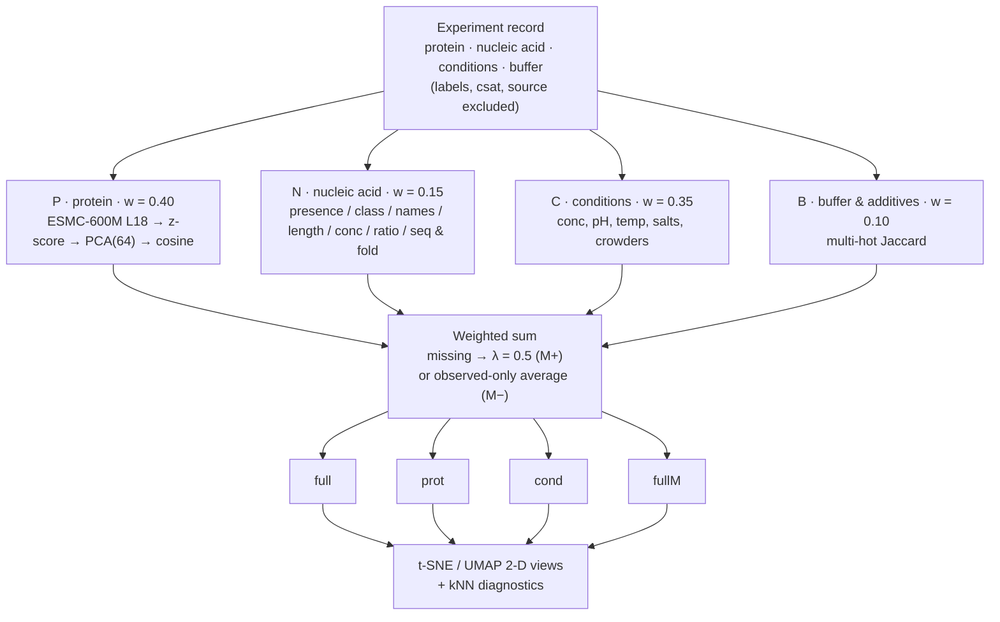
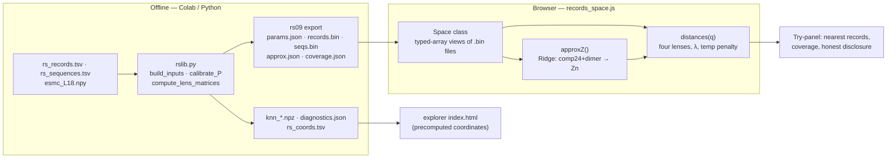

Every dot in the Records Space explorer is one LLPS experiment record, and the model documented here is the reason any two dots sit near each other. The model defines a **weighted block distance** between records — protein, nucleic acid, physico-chemical conditions, buffer/additives — treats unreported values as a first-class state rather than imputing them, and derives four parallel "lens" geometries from it. Two implementations exist and must stay numerically identical: an offline NumPy engine (`colab/rslib.py`) that builds the precomputed 2-D maps, and a dependency-free browser reimplementation (`explorer/js/records_space.js`) that recomputes distances live for pasted experiments. This page dissects both, plus the calibration, diagnostics, and the approximation path for novel sequences.

Sources: [README.md](records_space/README.md#L9-L22), [rslib.py](records_space/colab/rslib.py#L1-L14), [records_space.js](records_space/explorer/js/records_space.js#L1-L2)

## Design Principles

Three commitments shape the whole model. First, a record is decomposed into blocks by data type — protein (sequence embedding), nucleic acid (mixed categorical/numeric), conditions (numeric), buffer/additives (sets) — and each block gets its own natural representation and distance before merging. Second, **readouts are never inputs**: labels, csat values, morphology, source, and paper are excluded from the geometry and only color the dots afterward, which keeps evaluation honest. Third, the weights and the missing-value penalty were fixed a priori and were **not tuned** — the README states this explicitly, so the geometry is a descriptive artifact, not an optimized classifier.

Sources: [README.md](records_space/README.md#L11-L21), [rslib.py](records_space/colab/rslib.py#L3-L13)

## The Four Distance Blocks

The block weights are constants of the model, mirrored in both the Python constants and the exported `params.json` consumed by the browser: `P=0.40, N=0.15, C=0.35, B=0.10`, with `λ=0.5` and a `temp_state_pen=0.2`. The final weighted sum divides by the total weight (1.0), so weights act directly as proportions.

| Block | Weight | Representation | Pairwise distance | Calibration |
|---|---|---|---|---|
| P — protein | 0.40 | ESMC-600M layer-18 residue mean (1,152-d) → z-score → PCA(64) → L2-normalize | cosine distance | divided by q95 of random-pair cosine distances |
| N — nucleic acid | 0.15 | presence/class (RNA=1/DNA=2), 13 name flags, log₁₀ length/conc/ratio, 4 sequence + 2 folding features | class indicator + name Jaccard + scaled \|Δ\| + scaled Euclidean | each sub-dimension scaled so random-pair q95 ≈ 1 |
| C — conditions | 0.35 | conc, pH, temp (range-scaled); salts, crowders (log₁₀(1+x), q95 of nonzero) | mean over 5 grouped dimensions, temp state penalty 0.2 | range: q95−q05 of observed; pos: q95 of nonzero |
| B — buffer/additives | 0.10 | multi-hot vectors: 8 buffer families, 12 additive families | Jaccard per set-dimension, averaged | none (set-based) |

Sources: [rslib.py](records_space/colab/rslib.py#L18-L26), [params.json](records_space/export/params.json#L2-L9), [README.md](records_space/README.md#L13-L18)

### Protein block (P)

`build_inputs` z-scores every ESMC dimension over the 1,338 unique dataset sequences, runs PCA to 64 components, subtracts the mean and L2-normalizes (`Zn`), then forms the full cosine distance matrix `1 − Zn·Znᵀ` clipped at zero. Records reference sequences by index (`pidx`; `pidx < 0` means no sequence). The raw cosine spread is recalibrated by `calibrate_P`, which samples 2,000,000 random sequence pairs and uses the 95th percentile of their distances as the divisor — the exported `scales.P = 1.3449` in `params.json` is exactly this value. Every block distance is also truncated to [0, 1].

Sources: [rslib.py](records_space/colab/rslib.py#L60-L78), [rslib.py](records_space/colab/rslib.py#L272-L281), [params.json](records_space/export/params.json#L28-L29)

### Nucleic acid block (N)

Seven dimensions are averaged: class mismatch (RNA vs DNA), name-class Jaccard over 13 flags (`polyU`, `tRNA`, `G4`, `ssDNA`, …), log₁₀-scaled length, concentration and NA:protein ratio (range-scaled over observed values), plus two vector dimensions — sequence features (GC content, purine fraction, log₁₀ longest homopolymer run, G4 flag) and folding features (MFE/nt, paired fraction). The two vector dimensions are z-scored and then globally rescaled so that the Euclidean distance between a random pair lands at the 95th-percentile ≈ 1, making them commensurate with the scalar dimensions. Crucially, "no nucleic acid" is a legal state, not missingness: present-vs-none contributes exactly 1.0 to the block, while numeric NA features of NA-free records are marked not-applicable rather than missing.

Sources: [rslib.py](records_space/colab/rslib.py#L99-L137), [rslib.py](records_space/colab/rslib.py#L228-L260)

### Conditions block (C)

Five grouped dimensions: protein concentration, pH, temperature, the salt group (MgCl₂/NaCl/KCl) and the crowder group (PEG1k/6k/20k, Ficoll, Dex40/70, Glycerol). Group members each contribute a scaled distance and the group sum is truncated to 1. Temperature carries a special **state penalty**: when one record reports a measured temperature and the other only "room temperature" (recorded as 22 °C), an extra `temp_state_pen = 0.2` is added on top of the numeric difference, encoding the provenance mismatch of the value itself.

Sources: [rslib.py](records_space/colab/rslib.py#L79-L98), [rslib.py](records_space/colab/rslib.py#L210-L225), [rslib.py](records_space/colab/rslib.py#L163-L172)

### Buffer and additives block (B)

Two Jaccard dimensions — buffer families (Tris, HEPES, phosphate, Good's MES, citrate, acetate, imidazole, other) and additive families (reducing agents, chelators, glycerol, nucleotides, denaturants, hexanediol, detergents, protein additives, polyanions, metals, dye probes, other) — averaged 50/50. Each set dimension independently tracks whether it was observed at all (`st_buffer`, `st_additive` states), feeding the missing-value policy below.

Sources: [rslib.py](records_space/colab/rslib.py#L138-L146), [rslib.py](records_space/colab/rslib.py#L263-L269)

## Missing Values as a State: M+ versus M−

The model's most distinctive choice is how it handles unreported dimensions. Instead of imputing, every scalar dimension returns three quantities: `d_plus` (the M+ distance), `d_obs` (observed-only distance), and coverage. The λ constant is deliberately set to 0.5 — half the typical (q95) separation — so a single missing dimension pushes records apart *moderately*: far enough to not fake agreement, near enough to not dominate the block.

| Situation | M+ (`full`, default) | M− (`fullM`) |
|---|---|---|
| both records observed | scaled \|Δ\| | scaled \|Δ\| |
| exactly one missing | λ = 0.5 | dimension excluded from the average |
| both missing | 0 | excluded |
| NA present vs none | 1.0 (hard rule, not missingness) | 1.0 |
| aggregation | fixed mean over all K dimensions | coverage-weighted mean over observed dimensions; 0.5 fallback if nothing observed |

Sources: [rslib.py](records_space/colab/rslib.py#L151-L160), [rslib.py](records_space/colab/rslib.py#L183-L191), [README.md](records_space/README.md#L20-L21)

> [!TIP]
> The `fullM` lens exists purely as a scientific control: comparing `full` against `fullM` layouts isolates how much of the map's structure is driven by the "missing-as-state" convention versus real reported values. The per-block coverage tensors (`cP, cN, cC, cB`) flow into `fullM`'s weighted average, so partial records never silently dominate.

## The Four Lenses

One chunked pass over the record table (`compute_lens_matrices`, 1,024 rows at a time, float32) emits all four N×N matrices simultaneously, reusing the per-block computations. Each lens answers a different question, and all four become selectable views in the explorer (`lens=tsne_full`, `umap_prot`, `umap_cond`, `umap_fullM`, …).

| Lens | Composition | Question it answers |
|---|---|---|
| `full` | 0.40·P + 0.15·N + 0.35·C + 0.10·B (M+) | the default, protein-centred map |
| `prot` | P alone | pure sequence neighbourhoods, no condition confound |
| `cond` | (0.15·N + 0.35·C + 0.10·B) / 0.60 | conditions and NA without any sequence signal |
| `fullM` | full with M− coverage-weighted averaging | sensitivity of the map to the missing-value convention |

Sources: [rslib.py](records_space/colab/rslib.py#L284-L310), [rs03_run.py](records_space/colab/rs03_run.py#L5-L9), [README.md](records_space/README.md#L54)

## Validating the Geometry

The model ships with three families of diagnostics rather than a train/test split, since it is descriptive.

**Condition coherence** (`rs07_coherence.py`) asks: do records that are 15-nearest neighbours in a lens actually have similar measured conditions? For each of four quantities — measured temperature (tolerance 2.0 °C), pH (0.2), NaCl (0.1 in log₁₀(1+mM)), protein concentration (0.2 in log₁₀ µM) — it computes the median |Δ| between neighbour pairs where *both* are observed, and compares against 400,000 random pairs from the same observed subset. This directly tests whether the C block's scaling produces real spatial coherence rather than artefacts.

Sources: [rs07_coherence.py](records_space/colab/rs07_coherence.py#L1-L5), [rs07_coherence.py](records_space/colab/rs07_coherence.py#L13-L37)

**Label structure** (`rs03_run.py` diagnostics b/c) measures k=15 purity for twelve labels (protein, c30 homology cluster, paper, source, NA class, temperature state, pool, phase-separation label, morphology, csat link, buffer family, readout class), always reporting the chance level `(Σp²)` alongside. The sharpest result: a neighbour-vote AUROC on the phase-separation label reaches **0.84 when neighbours from the same paper are allowed** (shared lab conventions make records comparable), but collapses to **0.50 with protein similarity** and **0.59 with conditions only** across papers and proteins — the README quotes these numbers as an explicit warning that the map is not a phase-separation predictor.

Sources: [rs03_run.py](records_space/colab/rs03_run.py#L132-L181), [README.md](records_space/README.md#L31-L31), [rslib.py](records_space/colab/rslib.py#L359-L397)

**Projection fidelity and coverage**: `neighbor_overlap` checks how many high-dimensional k=15 neighbours survive into each 2-D embedding; the missingness analysis counts distinct missing-dimension patterns and their within-paper agreement versus chance; and a csat-coverage diagnostic measures how far csat records fall inside the 15-NN radius of binary records, per NA class. These outputs (`diagnostics.json`, `knn_<lens>.npz`) are the audit trail of every lens.

Sources: [rs03_run.py](records_space/colab/rs03_run.py#L183-L226), [rslib.py](records_space/colab/rslib.py#L388-L397), [rs03_run.py](records_space/colab/rs03_run.py#L77-L84)

## Module Architecture: Offline Engine versus Browser Mirror

The distance model exists twice by design — once where data is private and compute is free (Colab), once where the user's sequence must never leave the page. `rs09_export_explorer_data.py` is the bridge: it serializes the scaled model inputs as typed arrays (`records.bin`, `seqs.bin` with layout manifests in JSON), dumps every scale and normalization constant into `params.json`, and trains the approximation model.

Sources: [rs09_export_explorer_data.py](records_space/colab/rs09_export_explorer_data.py#L2-L10), [records_space.js](records_space/explorer/js/records_space.js#L62-L71)

## The Browser Reimplementation

The `Space.distances(q)` method is a line-for-line port of the Python block functions: the same five-dimension condition mean, the same salt/crowder group truncation, the same λ rule, the same present-vs-none N-block rule, and the same four lens formulas. `buildQuery` converts the parsed condition fields into the exact scaled space using the exported scales (`x / s` for range-scaled, `log10(1+x) / s` for salts and crowders, z-scored NA features divided by the q95 calibration), so a query constructed in JavaScript lands in the identical geometry as the precomputed records.

Sources: [records_space.js](records_space/explorer/js/records_space.js#L106-L160), [records_space.js](records_space/explorer/js/records_space.js#L169-L196), [params.json](records_space/export/params.json#L10-L30)

**Sequence identity handling** decides which P-block input a pasted sequence gets. Every dataset sequence is fingerprinted offline with two FNV-1a 32-bit whole-sequence hashes plus a FracMinHash sketch of 5-mers (keeping hashes below 2³²/8). In the browser, `analyzeSequence` classifies the input: `exact` (hash + length match → the true stored `Zn` is used), `variant` (containment ≥ 0.5 or Jaccard ≥ 0.3), `related`, or `novel` — and only novel sequences fall through to the approximation model. This is also a privacy mechanism: the page stores sketches, never raw sequences, and all matching happens in-page.

Sources: [rs09_export_explorer_data.py](records_space/colab/rs09_export_explorer_data.py#L25-L48), [records_space.js](records_space/explorer/js/records_space.js#L28-L32), [records_space.js](records_space/explorer/js/records_space.js#L75-L95)

## Approximate Embeddings for Novel Sequences

A novel sequence cannot get a real ESMC embedding in a browser, so `rs09` trains a **ridge regression from sequence composition to embedding space**: features are `comp24` (24 dimensions — log length, 20 amino-acid frequencies, charge, acidic/basic, aromatic fractions) concatenated with `dimer400` (400 normalized dipeptide frequencies), giving the 424-feature model exported in `approx.json` with `alpha = 100.0`. Its output is L2-normalized in the browser (`approxZ`) and substituted for `Zn` in the P block.

Model selection is the interesting part: five alphas are evaluated with **GroupKFold(5) grouped by c30 homology clusters**, and the winner is chosen by mean **top-15 neighbour overlap** between approximate and true cosine similarities — optimizing exactly the quantity the Try-panel depends on (neighbourhoods, not pointwise accuracy). The trained model is then re-fit on all sequences and exported as `W (424×64)`, intercept, and feature mean/std.

| Aspect | Detail |
|---|---|
| Features | comp24 (24) + dimer400 (400) = 424, standardized |
| Model | Ridge regression, α = 100 → 64-d Zn, L2-normalized |
| Validation | GroupKFold(5) by c30 cluster; metric = top-15 neighbour overlap + cosine(Ẑ, Z) |
| User contract | the page explicitly states the embedding is approximate and shows nearest records + neighbourhood coverage |

Sources: [approx.json](records_space/export/approx.json#L1-L1), [rs09_export_explorer_data.py](records_space/colab/rs09_export_explorer_data.py#L120-L163), [records_space.js](records_space/explorer/js/records_space.js#L96-L104), [README.md](records_space/README.md#L32-L32)

> [!TIP]
> Grouping the cross-validation folds by c30 homology cluster is what makes the overlap metric trustworthy: ungrouped folds would let near-identical sequences leak between train and test, inflating the neighbour-overlap score for a model that in reality must generalize across protein families.

## End-to-End Data Flow

The full path from raw tables to the interactive page runs through five numbered stages, each a standalone script so results can be cached and re-run selectively (`rs03 → knn/coords/diagnostics → rs09 → export → rs05` builds the final single-file `index.html`).

| Stage | Script | Consumes | Produces |
|---|---|---|---|
| 1. Embeddings | `rs02_embed_new_seqs.py` | csat-only sequences | `esmc_L18_new.npy` |
| 2. Distances + maps | `rs03_run.py` | records, sequences, embeddings | 4 lens matrices, UMAP/t-SNE coords, `diagnostics.json`, `knn_*.npz` |
| 3. Coherence | `rs07_coherence.py` | `knn_*.npz` | `diagnostics_coherence.json` |
| 4. Export | `rs09_export_explorer_data.py` | everything above | `params.json`, `records.bin`, `seqs.bin`, `approx.json`, coverage |
| 5. Build page | `scripts/rs05_build_explorer.py` | export + template | self-contained `records_space/index.html` |

Sources: [rs03_run.py](records_space/colab/rs03_run.py#L1-L10), [rs09_export_explorer_data.py](records_space/colab/rs09_export_explorer_data.py#L164-L200), [README.md](records_space/README.md#L58-L66)

## Where to Go Next

To see the distance model from a user's perspective — lens switching, colouring, and the Try-panel workflow — continue with [Interactive Explorer Tour](4-interactive-explorer-tour). The embedding that powers the P block is documented in [Protein and Nucleic Acid Embeddings](12-protein-and-nucleic-acid-embeddings). The hollow-ring protein universe that extends the same ESMC/UMAP machinery to 6,338 unlabelled proteins is covered in [Negatives and Protein Universe](20-negatives-and-protein-universe), and the scripts that assemble the final site in [Site Build Pipeline](21-site-build-pipeline). For the export parameters consumed by the page, the full grid lives in [Hyperparameter Grid Reference](22-hyperparameter-grid-reference).