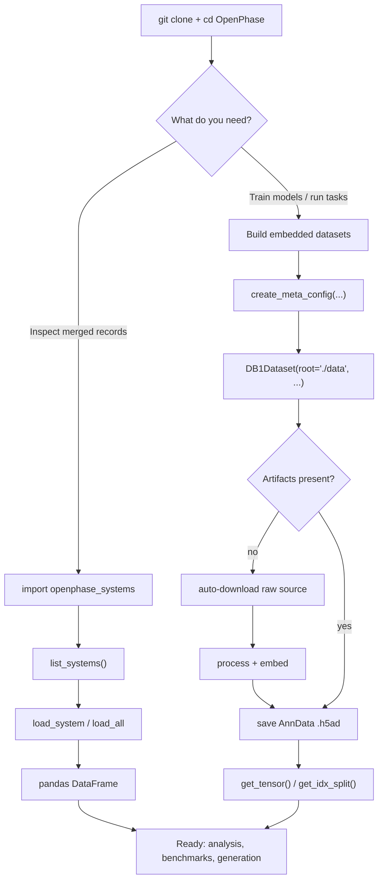
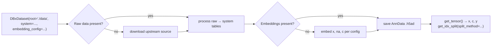
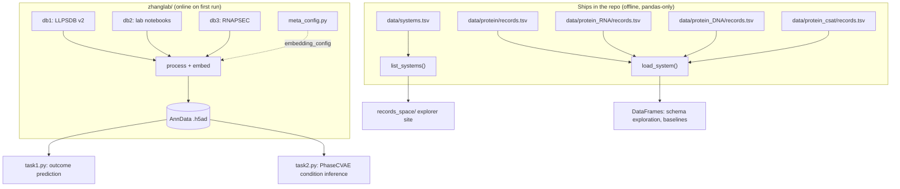

This page gets a beginner from a fresh clone of [OpenPhase](https://github.com/nicetone9/OpenPhase) to working with real phase-separation data in a few minutes. You will install the repository, load condition-level experimental records as pandas DataFrames, and optionally build embedded PyTorch datasets from the three original data sources. No GPU, prior diffusion knowledge, or downloads outside the repo are required for the first path.

OpenPhase is a condition-aware platform for biomolecular Liquid-Liquid Phase Separation (LLPS): it pairs protein/nucleic-acid sequences (components, `x`) with environmental factors like salt, pH, and temperature (conditions, `c`) to explain and predict phase behavior (`y`).


Sources: [README.md](README.md#L12-L16), [README.md](README.md#L1-L4)

## The Quick-Start Journey at a Glance

There are two entry points, and you can stop after either. The **records path** reads tables that ship inside the repository — nothing is downloaded, and `pandas` is the only hard dependency. The **embedded dataset path** instantiates the archived loaders in `zhanglab/`, which automatically download raw data from the original sources (LLPSDB v2, RNAPSEC), process it, and save it as AnnData (`.h5ad`) files with your chosen sequence/condition embeddings.



Sources: [README.md](README.md#L96-L117), [openphase_systems.py](openphase_systems.py#L1-L13), [zhanglab/db1.py](zhanglab/db1.py#L27-L50)

## Step 1: Install and Verify

The repository is self-contained for the records path. Clone it and confirm your Python environment has the few libraries the quick-start code imports:

```bash
git clone https://github.com/nicetone9/OpenPhase.git
cd OpenPhase
python -c "import pandas; print(pandas.__version__)"
```

For the records path, `pandas` is all you need. For the embedded-dataset path (Step 4), you will additionally need `torch`, `anndata`, `loguru`, `scikit-learn`, and `pydantic`; the benchmark scripts also use `optuna` and `swanlab`. One non-obvious rule: **run Python from the repository root**, because the `zhanglab/` loaders import `meta_config.py` and `meta_embed.py` from the root and rely on relative path setup.

| Dependency group | Packages | Needed for |
|---|---|---|
| Records path | `pandas` | Steps 2–3 of this guide |
| Embedded datasets | `torch`, `anndata`, `loguru`, `scikit-learn`, `pydantic` | Step 4, `zhanglab/` loaders |
| Benchmark scripts | `optuna`, `swanlab` (+ above) | `task1.py`, `task2.py` |

> [!TIP]
> Always launch Python from the `OpenPhase/` root directory. The loaders in `zhanglab/` explicitly resolve `meta_config.py` and `meta_embed.py` relative to the root, so importing them from a subdirectory will fail with `ModuleNotFoundError` even though the package is installed.

Sources: [README.md](README.md#L88-L94), [zhanglab/README.md](zhanglab/README.md#L9-L10), [zhanglab/db1.py](zhanglab/db1.py#L17-L21)

## Step 2: Load Your First Records

The module `openphase_systems.py` is the recommended entry point: it reads the merged, de-duplicated, condition-level records that are organized **by system** (the set of experiment components, without concentrations). Four systems ship with the repository, and all counts below come straight from the shipped metadata file `data/systems.tsv`:

| System | Meaning | Records | Positive / Negative |
|---|---|---:|---|
| `protein` | protein only | 7,490 | 4,416 / 3,074 |
| `protein_RNA` | protein + RNA | 2,511 | 1,751 / 760 |
| `protein_DNA` | protein + DNA | 662 | 446 / 216 |
| `protein_csat` | protein, saturation concentration | 776 | no binary label |

The API is three small functions, each returning plain pandas objects:

| Function | Signature | Returns |
|---|---|---|
| `list_systems()` | no arguments | DataFrame, one row per system with records/sequences/papers/source counts |
| `load_system(system, source=None)` | system name; optional source prefix like `"RNAPSEC"` | DataFrame of that system's records, with a `system` column inserted |
| `load_all(systems=None)` | optional iterable of system names | `dict` mapping each system name to its records DataFrame |

Try the canonical first commands — this exact snippet appears in both the top-level README and `data/README.md`:

```python
from openphase_systems import list_systems, load_system

list_systems()                      # overview: records, sequences, papers, sources per system
rna = load_system("protein_RNA")    # 2,511 rows as a DataFrame
rna2 = load_system("protein_RNA", source="RNAPSEC")   # keep only rows whose source starts with "RNAPSEC"
```

Two behaviors worth knowing as a beginner: passing an unknown system name raises a clear `ValueError` that lists the valid choices, and the `source` filter is a *prefix* match on the `source` column (so `"LLPSDB_v2"` also matches `"LLPSDB_v2_phase_diagram"`). You can also execute `python openphase_systems.py` directly to print the systems overview.

> [!TIP]
> The `protein_csat` system has no binary label — each row instead carries a measured saturation concentration under columns like `readout_class` and `log10_value_uM`. If your analysis assumes a 0/1 `label`, exclude this system or handle it separately.

Sources: [openphase_systems.py](openphase_systems.py#L29-L31), [openphase_systems.py](openphase_systems.py#L34-L47), [data/systems.tsv](data/systems.tsv#L1-L6), [data/README.md](data/README.md#L15-L19), [README.md](README.md#L96-L105)

## Step 3: Know What a Record Looks Like

Each row in a `records.tsv` is **one experimental condition of one system with its outcome** — a binary phase-separation label, or a saturation-concentration measurement for `protein_csat`. The schema is documented exhaustively in `data/README.md`; here is the abridged map you need to start exploring:

| Column group | Examples | What it tells you |
|---|---|---|
| identity | `record_id`, `source`, `paper`, `uniprot`, `sequence_state` | provenance and protein identification |
| outcome | `label`, `morphology`, `phase_state`; `log10_value_uM` for csat | the target `y` you predict |
| split groups | `cluster_30`, `cluster_20` | MMseqs2 clusters for leakage-free train/test splits |
| conditions | `log10_protein_conc_uM`, `pH`, `temp_C`, `NaCl_mM`, PEG/Ficoll crowders | the environmental `c` inputs |
| missing-value state | `st_*` flags (`obs`, `miss`, `zero`, `rt`) | how each condition value was resolved |
| nucleic acid | `na_class`, `na_len_log10`, `na_g4` | RNA/DNA partner properties, when present |

Missing values are **not imputed** — an unreported condition is left empty and flagged in its companion `st_*` column, so your preprocessing must decide how to treat them explicitly. Note also that sequence text is deliberately absent from these tables (proteins are identified by UniProt accession + length), and the db2 laboratory-notebook records are not included here at all — they live only behind the archived loaders in Step 4.

For the full column-by-column contract, continue to [Condition-Level Record Schema](7-condition-level-record-schema); for systematic per-system loading recipes, see [Loading Records by System](3-loading-records-by-system).

Sources: [data/README.md](data/README.md#L1-L12), [data/README.md](data/README.md#L30-L41), [data/README.md](data/README.md#L43-L48)

## Step 4 (Optional): Build an Embedded Dataset with the Archived Loaders

When you are ready to train models, use the `zhanglab/` loaders — one per original source: `DB1Dataset` (LLPSDB v2), `DB2Dataset` (laboratory notebooks), `DB3Dataset` (RNAPSEC). Each is a PyTorch `Dataset` that runs a fully automatic pipeline on construction: it downloads the raw upstream files if absent, parses and filters them for your chosen system, computes protein/nucleic-acid/condition embeddings from your configuration, and caches everything as an AnnData `.h5ad` file.



Embedding choices are configured through `meta_config.create_meta_config()`, which returns a pydantic `MetaEmbeddingConfig` that validates your selections at construction time — invalid names fail fast with the list of allowed options:

| Slot | Allowed values | Default |
|---|---|---|
| `protein` | `esmc`, `mtdp`, `rnapsec_protein`, `seq2ind`, `seq2onehot` | `esmc` (factory default: `mtdp`) |
| `dna_rna` | `rnapsec_rna`, `dictionary` | `dictionary` |
| `condition` | `droppler`, `rnapsec_condition`, `rnapsec_condition_class` | `droppler` |

A minimal end-to-end invocation (the same pattern used inside the benchmark scripts) looks like this:

```python
from zhanglab.db1 import DB1Dataset
from meta_config import create_meta_config

cfg = create_meta_config(protein="mtdp", dna_rna="dictionary", condition="droppler")
dataset = DB1Dataset(root="./data", name="DB1", system="protein(1)", embedding_config=cfg)

x, c, y = dataset.get_tensor()               # components, conditions, outcome
train_idx, test_idx = dataset.get_idx_split(split_method="random")
```

The constructor's own docstring uses exactly this two-call pattern, and the benchmark script `task1.py` shows it in a realistic context — building the config, constructing `DB1Dataset`, extracting tensors, and requesting a split in ten lines. The trade-off to understand as a beginner: this path needs network access on first use and more installed packages, but in exchange you get model-ready tensors and embedding machinery; the Step-2 path is instant and offline but returns raw tabular records. For a deeper comparison, continue to [Building Source Datasets with Loaders](5-building-source-datasets-with-loaders) and [Embedding Configuration Matrix](11-embedding-configuration-matrix).

Sources: [zhanglab/db1.py](zhanglab/db1.py#L27-L50), [zhanglab/db1.py](zhanglab/db1.py#L76-L119), [meta_config.py](meta_config.py#L5-L14), [meta_config.py](meta_config.py#L38-L41), [task1.py](task1.py#L87-L94), [task1.py](task1.py#L101)

## Where the Quick-Start Outputs Fit in the Repository

The two paths converge on the canonical benchmark tasks: **Task 1** predicts whether a system undergoes phase separation from components + conditions, **Task 2** infers the conditions that produce an outcome (a conditional VAE over phase diagrams), and **Task 3** generates protein sequences for target phase behavior. The quick-start code you just ran is the data layer underneath all three.



For orientation, the annotated tree of the files you touched today:

```
OpenPhase/
├── data/                    ← Step 2–3: records by system, ships with repo
│   ├── systems.tsv          ← what list_systems() reads
│   └── <system>/records.tsv ← what load_system() reads
├── openphase_systems.py     ← Step 2: the three loading functions
├── meta_config.py           ← Step 4: validated embedding configuration
├── zhanglab/                ← Step 4: db1/db2/db3 archived source loaders
├── task1.py / task2.py      ← benchmark scripts consuming the datasets
└── params_all.yaml          ← hyperparameter grid used by the benchmarks
```

Sources: [README.md](README.md#L58-L69), [README.md](README.md#L71-L86), [params_all.yaml](params_all.yaml#L1-L32), [openphase_systems.py](openphase_systems.py#L19-L26)

## Verify and Troubleshoot

Run this one-liner as a smoke test; success prints the four systems with their record counts:

```bash
python openphase_systems.py
```

If anything fails, the cause is almost always in this table:

| Symptom | Likely cause | Fix |
|---|---|---|
| `ValueError: unknown system '...'` | typo or non-system string passed to `load_system` | use a name from `list_systems()`: `protein`, `protein_RNA`, `protein_DNA`, `protein_csat` |
| `ModuleNotFoundError: meta_config` | running Python from a subdirectory | `cd` back to the `OpenPhase/` root before importing `zhanglab` |
| `AssertionError: System ... is not in the list` | system string not valid for that source loader | each `DBxDataset` has its own `system_list` (e.g. `"protein(1)"`, `"protein(2) + RNA"`); check the loader's docstring |
| Download stalls on first `DB1Dataset(...)` | network needed for LLPSDB v2 zip files | the loaders retry on next construction; artifacts are cached as `.h5ad` afterwards |
| `ImportError` for `torch`/`anndata` | missing packages for the embedded path | install the embedded-dataset dependency group from the Step 1 table |

Sources: [openphase_systems.py](openphase_systems.py#L50-L51), [openphase_systems.py](openphase_systems.py#L36-L42), [zhanglab/db1.py](zhanglab/db1.py#L101-L106), [zhanglab/db1.py](zhanglab/db1.py#L111-L119)

## Where to Go Next

You now hold the two skills the rest of the documentation builds on: reading merged records and constructing embedded datasets. A recommended progression through the catalog:

| Next step | Why now | Link |
|---|---|---|
| Loading recipes per system | go deeper on filtering, sources, and the csat system | [Loading Records by System](3-loading-records-by-system) |
| Visual exploration of the record map | see 11,439 records and the protein universe in your browser — no code | [Interactive Explorer Tour](4-interactive-explorer-tour) |
| Loader internals and artifacts | how `db1`/`db2`/`db3` produce `.h5ad` datasets | [Building Source Datasets with Loaders](5-building-source-datasets-with-loaders) |
| Big-picture architecture | how data, embeddings, and models relate | [Architecture Overview](6-architecture-overview) |
| First benchmark | train the Task 1 outcome-prediction baselines you saw referenced in `task1.py` | [Outcome Prediction Baselines](8-outcome-prediction-baselines) |


