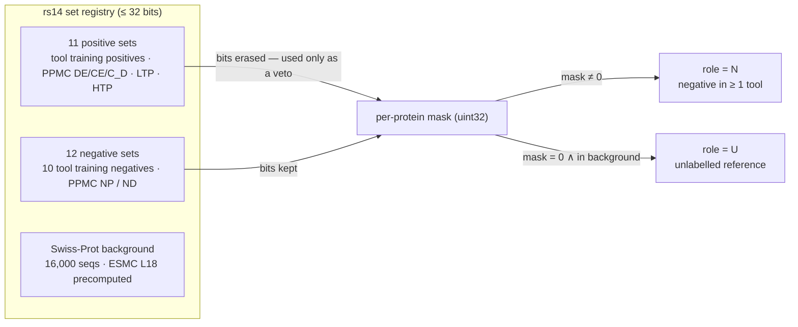
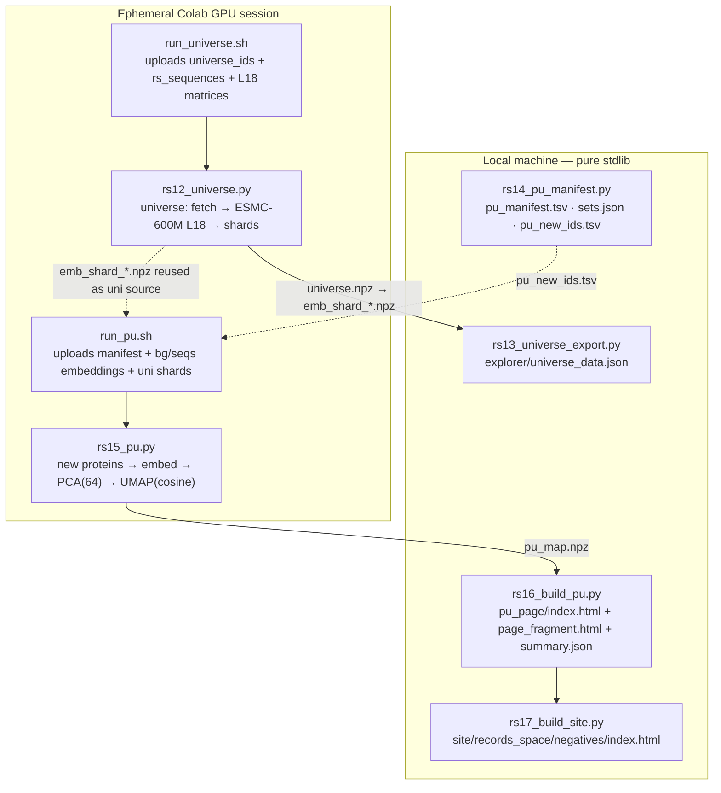

This page documents two closely related artifacts of the Records Space subsystem. The first is the **"LLPS negatives and unlabelled proteins" page** (`records_space/negatives/index.html`) — an interactive map of every protein used as a *training negative* by published LLPS predictors, placed against an unlabelled Swiss-Prot reference background in a shared ESMC-600M embedding space. The second is the **protein universe** (`explorer/universe_data.json`) — the extension of the Records Space to proteins mentioned by the tools but absent from the OpenPhase record tables. Both artifacts share one embedding contract and one build philosophy: heavy GPU work runs on ephemeral Colab sessions, while all assembly is done locally with pure-stdlib scripts so no numpy dependency is needed on the build machine.

Sources: [rs14_pu_manifest.py](records_space/scripts/rs14_pu_manifest.py#L1-L7), [rs16_build_pu.py](records_space/scripts/rs16_build_pu.py#L1-L4), [rs13_universe_export.py](records_space/scripts/rs13_universe_export.py#L1-L4)

## Why Negatives and Unlabelled Deserve Their Own Map

The negative sets in LLPS research are epistemically fragile: a "negative" is almost always a protein that a tool's training corpus simply *does not list* as phase-separating, not a protein experimentally shown not to phase-separate. The page states this caveat directly in its highlight note — "Negative sets are mostly proteins that were not listed as phase-separating, so many may be unlabelled rather than shown not to phase-separate" — and its subtitle frames the whole map as "the training negatives of ten tools and PPMC, and a Swiss-Prot reference sample as the unlabelled background. Positives are not shown." Every protein on the page therefore carries exactly one of two roles: **N** (negative in at least one tool) or **U** (unlabelled Swiss-Prot reference).

Sources: [negatives_template.html](records_space/home_page/negatives_template.html#L244), [negatives_template.html](records_space/home_page/negatives_template.html#L149)

## The Set Registry and the PU Manifest

Everything on the page is derived from one flat manifest, `pu_manifest.tsv`, produced by `rs14_pu_manifest.py`. The script assembles a registry of up to 32 sets, each owning a single bit in a per-protein bitmask:

- **12 negative sets** (these get real bits on the page): PPMC's NP (non-phase-separating, protein-level) and ND (non-phase-separating, disordered) classes, plus the training negatives of ten tools (catGRANULE 2.0, FuzDrop, LLPhyScore, LLPS-predict, OptPredLLPS, PPT-taskA, ProtGPS, PSAP, PScalpel, PSPHunter, PSPire).
- **11 positive sets** (tool training positives, PPMC DE/CE/C_D, LTP, HTP) that receive bits in the working mask but are *stripped before export* — they exist solely to veto proteins from being counted as "unlabelled".
- **A Swiss-Prot background** of 16,000 sequences (12,000 random + 4,000 human, 50–1,000 aa) reused from the world-and-cluster-maps project with precomputed layer-18 embeddings.

The core selection rule is `mask & N_BITS`: a protein with any negative-set bit becomes role `N` (even if it is a positive elsewhere — the page deliberately does not mark that), while a background protein with an all-zero negative mask becomes `U`. Proteins that appear *only* in positive sets never enter the manifest.

Each manifest row also records the **embedding source** for the protein, with strict priority `uni` (protein-universe Colab shards) > `bg` (Swiss-Prot reference matrix) > `seqs` (PPMC full-length sequence table) > `new` (must be fetched and embedded on Colab). IDs with no source are written to `pu_new_ids.tsv`, the exact input format rs15 expects.

Sources: [rs14_pu_manifest.py](records_space/scripts/rs14_pu_manifest.py#L27-L67), [rs14_pu_manifest.py](records_space/scripts/rs14_pu_manifest.py#L84-L90), [rs14_pu_manifest.py](records_space/scripts/rs14_pu_manifest.py#L103-L115), [rs14_pu_manifest.py](records_space/scripts/rs14_pu_manifest.py#L1-L7)

> [!TIP]
> Positive sets are excluded from the exported mask (`mask & N_BITS` in rs14 L89) but still computed — this is what prevents a known driver like FUS from silently counting as "unlabelled" in the U layer. Any consumer of `pu_manifest.tsv` inherits this veto for free; consumers of the final page payload do not, since only negative bits survive.

## From Manifest to Map: the PU Pipeline

The pipeline splits cleanly along the GPU boundary. Colab scripts (`rs12`, `rs15`) handle sequence fetching and embedding; local stdlib scripts (`rs13`, `rs16`, `rs17`) handle assembly and page generation. Orchestration shell scripts request an A100 → L4 → T4 session in fallback order, upload inputs, launch the driver remotely, and mirror output shards back until an `ALL_DONE` sentinel appears.

Both runners persist reusable state: `run_pu.sh` accepts a `RESUME_DIR` whose `emb_shard_*.npz` and `universe.fasta` are pre-uploaded so reruns skip sequence fetching and embedding entirely, and `run_universe.sh` mirrors shard files continuously rather than waiting for job completion.

Sources: [run_pu.sh](records_space/colab/run_pu.sh#L2-L9), [run_pu.sh](records_space/colab/run_pu.sh#L29-L37), [run_universe.sh](records_space/colab/run_universe.sh#L2-L17), [run_universe.sh](records_space/colab/run_universe.sh#L36-L38), [rs17_build_site.py](records_space/scripts/rs17_build_site.py#L94-L97)

## One Embedding Contract, Two Fits

Both scripts honor the same embedding contract established elsewhere in the repository (see [Protein and Nucleic Acid Embeddings](12-protein-and-nucleic-acid-embeddings)): ESMC-600M **layer 18** (hidden-states index), **residue mean** pooling that excludes special tokens and padding. rs12 fixes the constants `LAYER=18, MAXLEN=2000, TOKEN_BUDGET=14000, SHARD=1500`, and its docstring states the reference statistics precisely: `e_mu/e_sd` are the per-dimension mean and standard deviation of the dataset's 1,338 sequences, with PCA(64) fitted on those same dataset embeddings before L2 normalization.

rs15 reuses rs12's fetch and embed functions but **re-fits its own projection** on the assembled PU matrix: z-score the pooled embeddings, `PCA(n_components=64, random_state=0)`, recentre, L2-normalize, then `UMAP(n_neighbors=30, min_dist=0.25, metric="cosine", random_state=0)`. Proteins whose embedding cannot be assembled from any of the four sources are dropped (with a logged count), and a NaN assert guards the matrix before projection.

| Aspect | rs12 (protein universe) | rs15 (negatives/unlabelled page) |
|---|---|---|
| Input proteins | Tool-mentioned IDs not in the records space | All `pu_manifest.tsv` rows |
| Sequence fetch | Batch-of-100 UniProt + per-ID UniParc fallback | Same functions via `R12.fetch_all` |
| Embedding sources | Dataset L18 matrices + fresh shards | `uni` / `bg` / `seqs` / `new` by manifest priority |
| PCA fit | On the dataset's 1,338 sequence embeddings | On the assembled PU matrix itself |
| UMAP input | Universe + dataset sequences jointly | PU proteins only |
| Output | `universe.npz`, `universe.fasta`, `universe_meta.tsv`, shards | `pu_map.npz`, `pu_new_meta.tsv`, `missing_ids.txt` |

Sources: [rs12_universe.py](records_space/colab/rs12_universe.py#L1-L10), [rs12_universe.py](records_space/colab/rs12_universe.py#L22), [rs12_universe.py](records_space/colab/rs12_universe.py#L85-L133), [rs15_pu.py](records_space/colab/rs15_pu.py#L39-L47), [rs15_pu.py](records_space/colab/rs15_pu.py#L57-L77)

> [!TIP]
> Because rs15 fits its own PCA/UMAP on the PU proteins while rs12 projects the universe through dataset-fitted statistics, **coordinates from the two artifacts are not comparable**. Never copy `pu_map.npz` coordinates into a universe-space view or vice versa; each JSON carries its own normalized coordinate frame.

## Page Payload: Typed-Array Encoding

`rs16_build_pu.py` merges `pu_map.npz` coordinates with the manifest and `sets.json` into a single inline JSON blob injected at the template's `/*__DATA__*/null` placeholder. Numeric columns are base64-encoded little-endian typed arrays to keep the standalone HTML small: coordinates as `Uint16` quantized to `[0, 65535]` with a 4% margin and a **Y-axis flip** (canvas origin top-left), role/flag as `Uint8`, the negative-set mask as `Uint32`, and sequence length as `Uint16`. The decoder in the page reconstructs them with `atob` + `Uint16Array`/`Uint32Array` views and computes per-protein set counts with a bitwise population-count routine.

The `flag` byte packs three orthogonal facts per protein:

| Bit (value) | Meaning | Rendered as |
|---|---|---|
| 1 | In the Swiss-Prot reference sample | "Reference" field in the card |
| 2 | Also has records with conditions in the Records space | Dark ring around the dot |
| 4 | Obsolete UniProtKB entry; sequence recovered from UniParc | "No longer in UniProtKB" note |

Set sizes are recomputed at build time (`nn` per set) and the **top-6 pairwise overlaps** between negative sets are emitted as `pairs` — the page's overview card renders the top four, e.g. 11,264 proteins negative in both LLPS-predict and PSAP training sets, 7,665 shared between PSAP and PSPire. rs16 also asserts every exported set has `role == "N"`, structurally guaranteeing the page stays positives-free, and writes a machine-readable `summary.json` (role counts, in-records count, obsolete count, k-set histogram, multi-set percentage, new-embedded and missing-ID counts).

Sources: [rs16_build_pu.py](records_space/scripts/rs16_build_pu.py#L38-L54), [rs16_build_pu.py](records_space/scripts/rs16_build_pu.py#L55-L74), [rs16_build_pu.py](records_space/scripts/rs16_build_pu.py#L75-L91), [negatives_template.html](records_space/home_page/negatives_template.html#L131), [negatives_template.html](records_space/home_page/negatives_template.html#L137-L142), [negatives_template.html](records_space/home_page/negatives_template.html#L252-L257)

## Reading the Interactive Map

The page is a self-contained canvas application — rail (controls) | square stage | card — with no framework dependencies. Its controls map directly onto the payload:

- **Layer toggles** show/hide roles U and N with live counts.
- **Find protein** searches accession prefix, exact gene, or name substring (max 8 hits) and re-pins the map even if the target's layer was hidden.
- **Highlight a negative set** dims everything to 55% opacity and enlarges the selected set's members to 1.9× radius in the source's brand color; the note re-states the absence-of-evidence caveat for that set.
- **Colour negatives by count** bins proteins into 1 / 2 / 3 / 4-or-more set memberships using the palette `--n1…--n4`.
- **Density** renders a Gaussian-smoothed glow (192×192 grid, radius-7 kernel, σ=2.4, normalized to the 99.5th percentile) under the points for negatives, unlabelled, or both — making it easy to see whether tool negatives occupy the same embedding regions as the unlabelled background.
- **Protein card** shows UniProt accession (linking to uniprot.org), gene, organism, length, reference membership, obsolete status, and the list of sets naming this protein as negative; the overview card exposes the totals, overlap pairs, and the background-sample explanation.

Sources: [negatives/index.html](records_space/negatives/index.html#L114-L131), [negatives_template.html](records_space/home_page/negatives_template.html#L179-L198), [negatives_template.html](records_space/home_page/negatives_template.html#L219-L228), [negatives_template.html](records_space/home_page/negatives_template.html#L261-L266), [negatives_template.html](records_space/home_page/negatives_template.html#L269-L282), [negatives_template.html](records_space/home_page/negatives_template.html#L313-L314)

## The Protein Universe Artifact for the Explorer

The parallel artifact, `explorer/universe_data.json`, is produced by `rs13_universe_export.py` from rs12's `universe.npz`. Because the build machine has no numpy, rs13 implements a **stdlib `.npy`/`.npz` reader** (zipfile + struct) supporting float16/32/64, integers, booleans, and fixed-width Unicode strings — the same `load_npz` helper that rs16 imports for `pu_map.npz`. The exported fields:

| Field | Encoding | Content |
|---|---|---|
| `xy`, `xyds` | base64 `Uint16` pairs | UMAP coordinates, normalized to `[0,1]` with 4% margin (universe proteins and dataset sequences through one shared frame) |
| `zn` | base64 `int8` | Projected z-coordinate, scaled ×127 and clamped to ±127 |
| `nn`, `nncos` | int arrays | Nearest dataset-sequence index and its cosine similarity (×100) |
| `trunc`, `obs` | 0/1 arrays | Truncated-sequence flag; obsolete-UniProtKB (UniParc-sourced) flag |
| `lo`, `hi` | base64 `Uint32` pair | 64-bit set-membership mask split into two words |
| `acc/name/gene/len/org/missing` | plain JSON | Metadata, with names truncated to 56 chars, plus the missing-ID count |

This JSON is what powers the universe overlay described in the [Interactive Explorer Tour](4-interactive-explorer-tour); it answers, for every tool-mentioned protein outside the records, "where does it sit relative to our 1,338 sequences, and which one is it closest to?"

Sources: [rs13_universe_export.py](records_space/scripts/rs13_universe_export.py#L1-L4), [rs13_universe_export.py](records_space/scripts/rs13_universe_export.py#L19-L46), [rs13_universe_export.py](records_space/scripts/rs13_universe_export.py#L56-L88)

## Regeneration Playbook

To reproduce either artifact end-to-end, run the stages in this order (paths are relative to `records_space/`):

| Step | Command | Produces |
|---|---|---|
| 1 | `colab/rs12_universe.py --data /content/rs12/data --out /content/rs12/out` (via `colab/run_universe.sh <session>`) | `data/universe/colab_out/universe.npz` + embedding shards |
| 2 | `python3 -I scripts/rs13_universe_export.py` | `explorer/universe_data.json` |
| 3 | `python3 -I scripts/rs14_pu_manifest.py` | `data/pu/pu_manifest.tsv`, `sets.json`, `pu_new_ids.tsv` |
| 4 | `colab/rs15_pu.py --data /content/rs13/data --out /content/rs13/out` (via `colab/run_pu.sh <session> [limit]`, optionally `RESUME_DIR=…`) | `data/pu/colab_out_nu/pu_map.npz` |
| 5 | `python3 -I scripts/rs16_build_pu.py` | `pu_page/index.html`, `page_fragment.html`, `summary.json` |
| 6 | `python3 -I scripts/rs17_build_site.py` | `site/records_space/negatives/index.html` (staged copy of step 5's standalone page) |

The `--limit N` flag on rs15 restricts how many `src=new` proteins are fetched and embedded — useful for smoke-testing the GPU path before committing to a full multi-hour run, since Colab sessions are capped at a 14,400-second execution timeout in both runners.

Sources: [rs15_pu.py](records_space/colab/rs15_pu.py#L23-L38), [run_universe.sh](records_space/colab/run_universe.sh#L36), [run_pu.sh](records_space/colab/run_pu.sh#L39), [rs16_build_pu.py](records_space/scripts/rs16_build_pu.py#L78-L84), [rs17_build_site.py](records_space/scripts/rs17_build_site.py#L95-L97)

## Where to Go Next

- [Record Map Distance Model](19-record-map-distance-model) — how the records themselves are embedded and laid out, the lens system this page visually mirrors.
- [Site Build Pipeline](21-site-build-pipeline) — how `rs17` stages these pages into the GitHub Pages site alongside the home page and explorer.
- [Interactive Explorer Tour](4-interactive-explorer-tour) — the records-space explorer that consumes `universe_data.json`.
- [Condition-Level Record Schema](7-condition-level-record-schema) — the "has records" ring on this page points back into those condition-level records.