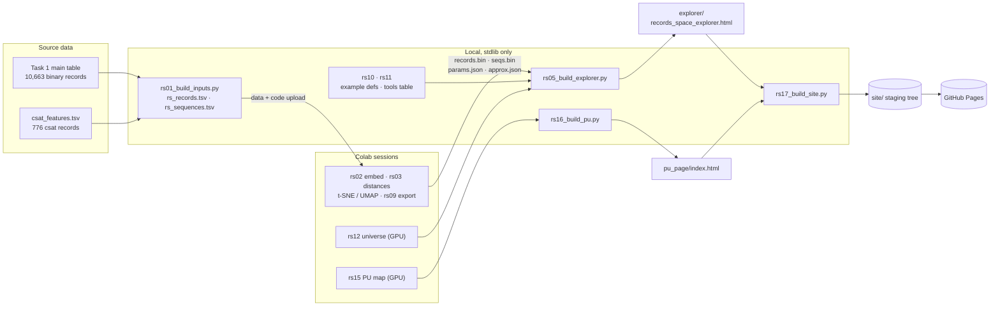
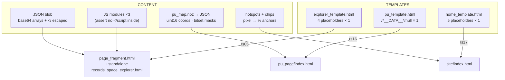

The `records_space/` folder ships three static pages to GitHub Pages: a home page, the records explorer, and a negatives/unlabelled-proteins map. None of them are hand-edited HTML — each is **assembled by a numbered Python script** that injects data blobs and JavaScript modules into HTML templates, then rs17 stages everything into a `site/` tree that mirrors the repository root one-to-one. This page explains how the build works end to end: what each assembler consumes and produces, the template-injection contract they all share, the Colab orchestration layer that feeds them, and the caveats around rebuilding the site from the committed files.

## What the Pipeline Produces
The published site is exactly three HTML entry points plus static assets: `index.html` (home, with the hero figure and two clickable system figures), `records_space/index.html` (the explorer), and `records_space/negatives/index.html` (negatives and unlabelled proteins). The README states that GitHub Pages serves these from the repository, and that the home page is built by `scripts/rs17_build_site.py` from `home_page/home_template.html`. The committed root `index.html` (171 lines) is verifiably the rendered template output — its head section is byte-for-byte the same markup that `home_template.html` defines, confirming the build products are checked into the repo rather than generated at deploy time.
Sources: [README.md](/records_space/README.md#L46-L48), [rs17_build_site.py](/records_space/scripts/rs17_build_site.py#L1-L8), [index.html](/index.html#L1-L10), [home_template.html](/records_space/home_page/home_template.html#L1-L12)

```
site/  (staging tree, mirrors repository root)
├── index.html                              ← rs17: home_template.html + hotspots + chips
├── assets/
│   ├── openphase-main.webp                 ← cwebp-encoded hero figure (q=88)
│   ├── openphase-wordmark.webp             ← cwebp-encoded transparent logo (q=92)
│   ├── fig-protein1-systems.webp           ← system figure A (2000×1793)
│   └── fig-multi-protein-systems.webp      ← system figure B (2000×1475)
├── records_space/
│   ├── index.html                          ← copy of explorer/records_space_explorer.html (rs05 output)
│   └── negatives/
│       └── index.html                      ← copy of pu_page/index.html (rs16 output)
```

## Architecture Overview
The build is a two-tier pipeline: heavy numerical work (embeddings, distances, t-SNE/UMAP) runs in ephemeral **Colab sessions** driven by zsh scripts that use a `colab` CLI, while all **page assembly runs locally** with pure-stdlib Python. Numbered `rsNN` scripts mark the stages: `rs01` prepares input tables from the Task 1 main table (10,663 binary records) and the csat pool (776 records); `rs02`/`rs03` compute embeddings and layouts on Colab; `rs05` packs the result into the self-contained explorer; `rs09` exports the "try your own experiment" data; `rs12`–`rs15` build the protein universe and negatives map; and `rs17` performs the final site staging.
Sources: [rs01_build_inputs.py](/records_space/scripts/rs01_build_inputs.py#L1-L17), [rs05_build_explorer.py](/records_space/scripts/rs05_build_explorer.py#L1-L7), [run_export.sh](/records_space/colab/run_export.sh#L1-L3), [run_universe.sh](/records_space/colab/run_universe.sh#L1-L4)



## The Three Page Assemblers
All three assemblers follow one pattern — read a template, substitute placeholders with generated content, emit both a fragment and a standalone file — but they operate at different pipeline stages and validate different invariants. rs05 is the data-heaviest (it embeds the full record table, five coordinate lenses, and binary export arrays), rs16 is the negatives page builder, and rs17 is the final packager that also encodes image assets and stitches the previously built pages into the staging tree.
Sources: [rs05_build_explorer.py](/records_space/scripts/rs05_build_explorer.py#L195-L215), [rs16_build_pu.py](/records_space/scripts/rs16_build_pu.py#L75-L83), [rs17_build_site.py](/records_space/scripts/rs17_build_site.py#L83-L95)

| Assembler | Inputs | Template | Placeholders | Outputs | Key validation |
|---|---|---|---|---|---|
| `rs05_build_explorer.py` | `out/rs_plot_table.tsv`, `out/rs_coords.tsv`, `export/*` binaries, `explorer/examples/`, `tools_data.json`, `universe_data.json` | `explorer/explorer_template.html` | `/*__DATA__*/null` + 3 JS slots | `explorer/page_fragment.html`, `explorer/records_space_explorer.html` | `records.bin` concentration column cross-checked against the plot table, mismatch must be < 1% of rows |
| `rs16_build_pu.py` | Colab `pu_map.npz`, `pu_manifest.tsv`, `sets.json` | `pu_page/pu_template.html` | `/*__DATA__*/null` | `pu_page/page_fragment.html`, `pu_page/index.html`, `summary.json` | asserts every set has `role == "N"` (negatives only) |
| `rs17_build_site.py` | `home_template.html`, theme PNGs, built explorer/PU pages | `home_page/home_template.html` | `{{HS_B}}`, `{{HS_A}}`, `{{CHIPS_B}}`, `{{LOGO_W}}`, `{{LOGO_H}}` | whole `site/` tree | asserts each placeholder occurs **exactly once**; asserts source figures exist |

Sources: [rs05_build_explorer.py](/records_space/scripts/rs05_build_explorer.py#L154-L180), [rs16_build_pu.py](/records_space/scripts/rs16_build_pu.py#L31-L40), [rs17_build_site.py](/records_space/scripts/rs17_build_site.py#L83-L87)

## rs17: Home Page Assembly
rs17 begins with **asset preparation**. It copies the two session-produced system figures (`fig-multi-protein-systems.webp`, `fig-protein1-systems.webp`) into `home_page/figs/` and then into `site/assets/`, and shells out to the `cwebp` encoder to convert theme PNGs — the hero figure at quality 88 and the transparent wordmark at quality 92 with `alpha_q 100` to preserve the logo's alpha channel. This is the only point in the pipeline with an external binary dependency.
Sources: [rs17_build_site.py](/records_space/scripts/rs17_build_site.py#L21-L30)

The home page's signature feature is its **clickable system figures**. Hotspot geometry is authored as `(shape, geometry_in_native_pixels, href, tooltip)` tuples — 15 entries for the protein(1) figure (2000×1793) and 7 for the multi-protein figure (2000×1475). Each hotspot links into the explorer using its URL-hash parameters, so "FUS" opens `records_space/#protein=FUS`, a source circle opens `#hl=llpsense&na=none`, and the four lower-row panels filter by system type (`#na=none&csat=hide`, `#csat=only`, …). The seven multi-protein hotspots have no `href` and render as `.hs.off` spans with a "not built yet" tooltip.
Sources: [rs17_build_site.py](/records_space/scripts/rs17_build_site.py#L33-L71), [README.md](/records_space/README.md#L50-L59)

| Shape | Pixel geometry | Explorer link | Tooltip |
|---|---|---|---|
| rect | (52, 1158, 506, 1642) | `records_space/#na=none&csat=hide` | protein(1): protein only, 7,490 records |
| rect | (1493, 1158, 1947, 1642) | `records_space/#csat=only` | protein(1), Csat pool, 776 records |
| circle | (605, 365, r=172) | `records_space/#hl=llpsdb&na=none&csat=hide` | LLPSDB v2, protein only |
| circle | (1335, 150–700 box) | `records_space/#protein=FUS` | FUS: 836 records, 46 papers |
| rect (off) | (30, 165, 520, 720) | — (span, no link) | protein(2): 953 systems, 4,406 records |

Sources: [rs17_build_site.py](/records_space/scripts/rs17_build_site.py#L44-L68)

> [!TIP]
> The `box()` helper converts pixel geometry into percentage-based `left/top/width/height`, so hotspots are **resolution-independent**: the image scales fluidly with the viewport while the clickable regions stay locked to the figure's features, and no JavaScript is needed to reposition them on resize.

The substitution step is deliberately brittle: rs17 asserts each placeholder occurs exactly once in the template before replacing it, then writes `site/index.html`. The template itself supplies the responsive layout, light/dark theming (CSS custom properties plus a `localStorage`-persisted toggle), the P and N+U cards with dataset statistics, and a `?debug` query flag that adds a `body.debug` class to outline every hotspot in dashed red — rs17's `--debug` note in the docstring refers to this runtime behaviour, not a build flag.
Sources: [rs17_build_site.py](/records_space/scripts/rs17_build_site.py#L83-L87), [home_template.html](/records_space/home_page/home_template.html#L59-L68), [home_template.html](/records_space/home_page/home_template.html#L137-L151)

## The Self-Contained Page Pattern
Both the explorer and the negatives page are **single-file applications**: the template is a complete styled document with placeholder markers where dynamic content goes, and the assembler injects everything — data, CSS, JS — before writing the standalone output. rs05 injects three JS modules (`condition_parser.js`, `records_space.js`, `try_panel.js`) by string replacement, asserting each placeholder appears once and that no module contains a stray `</script` that would break inlining. The record data travels as one compact JSON blob with arrays stored as **base64-encoded binary** (`records.bin`, `seqs.bin`) decoded in the browser, plus `params.json`, the in-browser approximation model, coverage quantiles, and example definitions.
Sources: [rs05_build_explorer.py](/records_space/scripts/rs05_build_explorer.py#L170-L196), [rs05_build_explorer.py](/records_space/scripts/rs05_build_explorer.py#L198-L211)

Before inlining, rs05 performs a **cross-format integrity check**: it reads the `conc` array out of `records.bin` at its recorded byte offset and compares every value against the `conc_v` column of the TSV plot table, asserting fewer than 1% of rows disagree. This guards against the silent failure mode where the binary export and the plot table were built from different dataset revisions — a real risk in a pipeline where artifacts cross machine boundaries via Colab downloads.
Sources: [rs05_build_explorer.py](/records_space/scripts/rs05_build_explorer.py#L156-L170)

> [!TIP]
> The JSON blob is emitted with `.replace("</", "<\\/")` before injection. Without this escape, any `</` sequence in the data could terminate the enclosing `<script>` element mid-blob and silently corrupt the standalone page — a classic pitfall of data-inlined single-file sites.

The **protein universe lens** shows how rs05 stitches independently computed layers together. It decodes the quantized `xyds` coordinates from `universe_data.json`, places each dataset record at a **sunflower offset** (radius ∝ √r, golden angle 2.39996 rad) around its sequence's position, clamps to [0,1], and registers the result as a sixth embedding lens (`umap_universe`) alongside the five core lenses. It also asserts the tools table's bit-mask length equals the record count before inlining it.
Sources: [rs05_build_explorer.py](/records_space/scripts/rs05_build_explorer.py#L19-L23), [rs05_build_explorer.py](/records_space/scripts/rs05_build_explorer.py#L181-L195)



## Colab Orchestration Layer
The artifacts the assemblers consume are produced in **disposable Colab sessions** driven by two zsh scripts. `run_universe.sh` requests a GPU with a fallback chain (A100 → L4 → T4, stopping and retrying on quota errors), uploads `universe_ids.tsv`, the sequence table, and cached ESMC matrices, then launches `drv_universe.py` in the background while `mirror.sh` incrementally mirrors output shards back to the local machine until it observes the `ALL_DONE` sentinel. `run_export.sh` runs a CPU session for `drv_export.py`, polling `progress.log` every 8 seconds for `EXPORT_FINISHED`.
Sources: [run_universe.sh](/records_space/colab/run_universe.sh#L8-L31), [run_export.sh](/records_space/colab/run_export.sh#L21-L30)

| Downloaded artifact (via `run_export.sh`) | Consumed by | Role in the page |
|---|---|---|
| `records.bin` / `records_meta.json` | rs05 | per-record condition arrays for the try panel |
| `seqs.bin` / `seqs_meta.json` | rs05 | sequence sketches + embeddings for paste-recognition |
| `params.json`, `approx.json`, `coverage.json` | rs05 | distance weights, composition-regression approximation, coverage quantiles |
| `examples.json` | rs05 | built-in example experiments |
| `export_log.txt` | — | session progress log archived beside the artifacts |

Sources: [run_export.sh](/records_space/colab/run_export.sh#L25-L30), [rs05_build_explorer.py](/records_space/scripts/rs05_build_explorer.py#L170-L178)

Both scripts share the same hygiene rules: filter lines containing `colab.dev` (they carry session proxy tokens), wrap every CLI call in `timeout`, upload `rslib.py` alongside task code so Colab-side scripts share the local helper library, and always send `colab stop` at the end. The same CLI-based transport explains why rs13 exists: it parses Colab's `universe.npz` with a **hand-written stdlib NPY reader** (zipfile + struct, supporting float16/32, integers, booleans, and UTF-32 strings) because the build machine has no NumPy.
Sources: [run_universe.sh](/records_space/colab/run_universe.sh#L2-L7), [run_export.sh](/records_space/colab/run_export.sh#L15-L20), [rs13_universe_export.py](/records_space/scripts/rs13_universe_export.py#L1-L6), [rs13_universe_export.py](/records_space/scripts/rs13_universe_export.py#L13-L37)

## Rebuild Caveats
Three facts matter if you want to reproduce the site. First, the assemblers hard-code **machine-local absolute paths** (`ROOT`, `BASE`, `THEME`) pointing to OneDrive directories outside this repository, so the scripts document a process rather than serve as a runnable Makefile. Second, the README states explicitly that `out/rs_plot_table.tsv` and `out/rs_coords.tsv` — rs05's primary inputs — are not included, "so the page cannot be rebuilt from this folder alone"; the same applies to the `pu_page/` and `data/pu/` trees that rs16 references. Third, the committed `index.html`, `assets/*.webp`, `records_space/index.html`, and `records_space/negatives/index.html` are **build outputs**, not sources: editing them directly works for quick fixes but will be overwritten the next time rs17 runs.
Sources: [rs17_build_site.py](/records_space/scripts/rs17_build_site.py#L12-L19), [README.md](/records_space/README.md#L72-L77), [rs16_build_pu.py](/records_space/scripts/rs16_build_pu.py#L14-L17)

The practical maintenance loop therefore separates cleanly: **content changes** to home-page copy, theme, or hotspot geometry go through `home_template.html` and rs17's hotspot tables (with `?debug` to verify regions visually); **data refreshes** re-run the Colab drivers and then the local assemblers; and **explorer behaviour** changes live in `explorer/js/*.js`, which rs05 re-inlines on every build. rs16's `summary.json` output doubles as a build report, recording protein counts, role distribution, set-pair overlaps, and how many manifest entries were newly embedded.
Sources: [rs17_build_site.py](/records_space/scripts/rs17_build_site.py#L44-L87), [rs16_build_pu.py](/records_space/scripts/rs16_build_pu.py#L84-L95), [home_template.html](/records_space/home_page/home_template.html#L137-L151)

## Where to Go Next
To see the pages this pipeline produces in action, start with the [Interactive Explorer Tour](4-interactive-explorer-tour), then dig into the distance model that rs05 inlines as parameters in [Record Map Distance Model](19-record-map-distance-model). The negatives page assembled by rs16 is explained in [Negatives and Protein Universe](20-negatives-and-protein-universe), and the condition vocabulary behind the hotspot links and filters is documented in [Loading Records by System](3-loading-records-by-system).