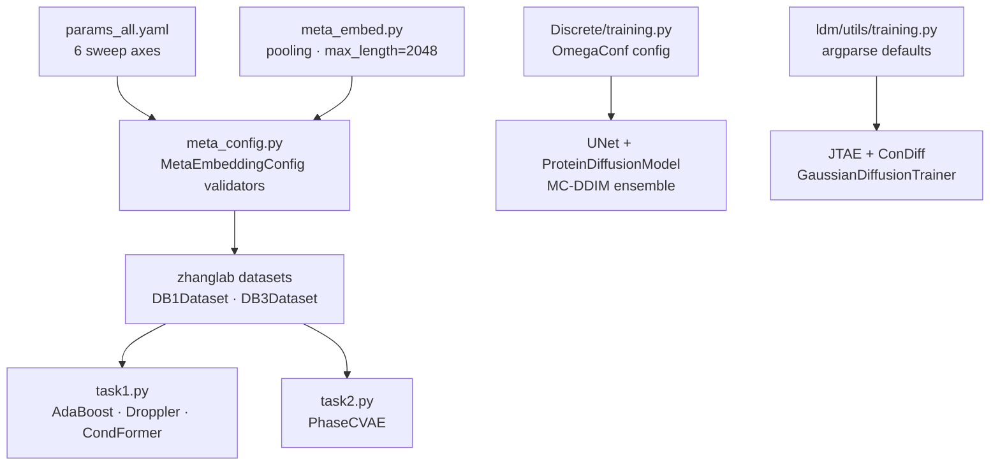

Every experiment in OpenPhase is described by two things: a **sweep axis** (which system, which split, which embedding) and a set of **module-level defaults** (learning rates, loss weights, diffusion schedules). This page is the single consolidated catalog of both. It lists every tunable value that appears in the repository, where it is defined, and how the layers compose — so you can reproduce a specific grid cell or extend the sweep without re-reading every training script.

Sources: [params_all.yaml](params_all.yaml#L1-L32), [meta_config.py](meta_config.py#L38-L40)

## Three Layers of Configuration

Hyperparameters are not stored in one place; they are organized in three verifiable layers. The **sweep layer** (`params_all.yaml`) declares the categorical axes of the experiment space. The **validation layer** (`meta_config.py`) gates embedding names through Pydantic validators before they reach a dataset. The **execution layer** is per-module: benchmark drivers (`task1.py`, `task2.py`) take the sweep axes as function arguments and pin their own optimizer settings, while the generative modules (`Discrete/`, `ldm/`) carry self-contained configuration blocks (OmegaConf / argparse). Notably, `task1.py` contains the YAML load commented out (`# params = yaml.safe_load(f)`), confirming that the YAML serves as the sweep's documentation of record rather than an input consumed at runtime — the axes are passed explicitly to each baseline function.

Sources: [params_all.yaml](params_all.yaml#L1-L32), [meta_config.py](meta_config.py#L5-L40), [task1.py](task1.py#L21-L23), [meta_embed.py](meta_embed.py#L17-L45)

## The Experiment Sweep Axes

`params_all.yaml` declares exactly six categorical axes. Together they define a raw grid of 7 × 7 × 3 × 2 × 3 × 3 = **2,646 combinations**; in practice, protein-only systems do not consume `dna_rna_method`, so the effective space is smaller per-system. The `system_name` values use the dataset-level naming (`protein(1)`, `protein(2) + RNA`, …) that `DB1Dataset` asserts against, which is distinct from the data-directory naming (`protein`, `protein_RNA`, …) used by the merged loaders.

| Axis | Values | Count |
|---|---|---|
| `system_name` | `protein(1)`, `protein(2)`, `protein(3)`, `protein(1) + DNA`, `protein(2) + DNA`, `protein(1) + RNA`, `protein(2) + RNA` | 7 |
| `split_method` | `random`, `phase_label_stratified`, `temperature_stratified`, `component_concentration_stratified`, `ionic_strength_stratified`, `crowding_agent_stratified`, `pH_stratified` | 7 |
| `protein_method` | `rnapsec_protein`, `esmc`, `mtdp` | 3 |
| `dna_rna_method` | `rnapsec_rna`, `dictionary` | 2 |
| `condition_method` | `rnapsec_condition`, `rnapsec_condition_class`, `droppler` | 3 |
| `task` | `task1`, `task2`, `task3` | 3 |

The repository root ships explicit drivers for `task1` and `task2`, while `task3` in the grid points at the generative benchmarks whose configurations live in the `Discrete/` and `ldm/` modules rather than in a root-level script. All seven `split_method` values are consumed verbatim by `dataset.get_idx_split(split_method=...)` in the Task 1 baselines.

Sources: [params_all.yaml](params_all.yaml#L1-L32), [task1.py](task1.py#L74-L77)

## Embedding Vocabulary and Defaults

Before any dataset is built, embedding names pass through `MetaEmbeddingConfig`. Each field has a validator with an explicit allowed set, and a value outside the set raises `ValueError` immediately — this is the gate that keeps the sweep axes consistent with what the embedding code can actually produce. Note that the **class field defaults** and the **factory function defaults** disagree on the protein axis: the class defaults to `esmc`, while `create_meta_config()` defaults to `mtdp`. Because every driver in `task1.py` builds its config through the factory, the effective default protein embedding across benchmarks is `mtdp`.

> [!TIP]
> When constructing configs programmatically, remember that `MetaEmbeddingConfig()` alone gives `esmc` but `create_meta_config()` gives `mtdp`. Benchmark scripts always call the factory, so the factory defaults are the de facto reference values.

| Field | Class default | Factory default | Allowed values |
|---|---|---|---|
| `protein_embedding` | `esmc` | `mtdp` | `esmc`, `mtdp`, `rnapsec_protein`, `seq2ind`, `seq2onehot` |
| `dna_rna_embedding` | `dictionary` | `dictionary` | `rnapsec_rna`, `dictionary` |
| `condition_embedding` | `droppler` | `droppler` | `droppler`, `rnapsec_condition`, `rnapsec_condition_class` |

Two auxiliary embedding-side hyperparameters also apply whenever embeddings are (re)computed: the ESM Cambrian path tokenizes with `max_length=2048` and pools residue states with `tensor_pooling`, which accepts exactly `mean`, `max`, `sum`, `norm`, `prod`, or `median` (default `mean`).

Sources: [meta_config.py](meta_config.py#L8-L35), [meta_config.py](meta_config.py#L38-L40), [meta_embed.py](meta_embed.py#L17-L45), [meta_embed.py](meta_embed.py#L48-L82), [params_all.yaml](params_all.yaml#L17-L27)

## Task 1: Benchmark Baselines

`task1.py` hosts three outcome-prediction baselines, each with a self-contained hyperparameter block. All three receive the sweep axes (`system_name`, `split_method`, `protein_method`, `dna_rna_method`, `condition_method`) as arguments and construct their dataset through `create_meta_config`.

Sources: [task1.py](task1.py#L58-L68)

### AdaBoost + Optuna Search Space

The RNAPSEC-feature baseline is the only place in the repository with a *searched* hyperparameter space: Optuna samples from two categorical distributions and scores candidates with 5-fold cross-validated macro one-vs-rest ROC-AUC, running 32 trials in parallel (`n_jobs=32`).

| Parameter | Values | Notes |
|---|---|---|
| `max_depth` | `5, 6, 7, 8, 9, 10, None` | depth of the `DecisionTreeClassifier` base estimator |
| `learning_rate` | `0.5, 1.0, 1.5, 2.0, 2.5` | AdaBoost boosting weight |
| `random_state` | `30` | fixed inside the model |
| cross-validation | `cv=5` | scored by macro OVR ROC-AUC |
| Optuna budget | `n_trials=32`, `n_jobs=32` | direction = maximize |

Features are the concatenated embedding + condition vector standardized with `StandardScaler` before search and refit.

Sources: [task1.py](task1.py#L40-L48), [task1.py](task1.py#L79-L84)

### Droppler Neural Baseline

The Droppler path bypasses the embedding pipeline for the protein axis (it integer-indexes residues directly, 20 amino acids + padding) but reuses the 14-dimensional condition vector (`temp`, `conc`, `crowd`, `salt`, `ph` columns) scaled by a pretrained scaler marshalled at `./droppler/marshalled/scaler.pickle`.

| Parameter | Value |
|---|---|
| `selfatt_RRN(nfea, nCond, hidden_size, num_layers, heads)` | `20, 14, 10, 2, 10` |
| epochs | `10` |
| batch_size | `1024` |
| weight_decay | `1e-4` |
| learning_rate | `3e-3` |

Sources: [task1.py](task1.py#L131-L137), [task1.py](task1.py#L157-L159), [task1.py](task1.py#L170), [task1.py](task1.py#L181-L185)

### CondFormer Encoder–Classifier

The `protein(1)`-only transformer baseline pairs a `Protein1SystemEncoder` with a `PhaseClassificationHead`, both fixed at 256 embedding dimensions with dropout 0.5, trained with full-batch Adam for 1,000 epochs under binary cross-entropy, checkpointing the best test-AUROC epoch.

| Parameter | Value |
|---|---|
| `embed_dim` | `256` |
| `dropout` | `0.5` (encoder and head) |
| optimizer | Adam, `lr=7e-4`, `weight_decay=7e-6` |
| epochs | `1000` |
| loss | binary cross-entropy |
| model selection | best test AUROC → `condformer_<system>_<split>_best.pth` |
| input dims | `protein_dim` ∈ {29, 1280, 1024}; `condition_dim` ∈ {4, 14} |

Sources: [task1.py](task1.py#L267-L277), [task1.py](task1.py#L291), [task1.py](task1.py#L318-L329), [task1.py](task1.py#L268-L269)

### Frozen-Encoder Regression Transfer

The DB2 IDR regression run initializes from a stored CondFormer checkpoint (default `condformer_protein(1)_random_best.pth`), freezes every encoder parameter via `requires_grad = False`, and splits data 50/50 with seed 42. Its dimension ternary maps `rnapsec_protein → 29`, `mtdp → 1280`, and everything else (`esmc`, `seq2onehot`) → `1152`.

Sources: [task1.py](task1.py#L351-L352), [task1.py](task1.py#L378), [task1.py](task1.py#L384-L397)

## Task 2: PhaseCVAE

The condition-inference VAE is parameterized by three loss weights — `alpha` (reconstruction), `beta` (KL), `gamma` (phase prediction) — alongside standard training knobs. It operates on the 2D concentration slice of the condition vector and evaluates phase diagrams on a regular 30 × 30 inference grid padded by a 10% margin, with grid labels imputed by 5-nearest-neighbor majority voting.

| Parameter | Default | Role |
|---|---|---|
| `latent_dim` / `hidden_dim` | `64` / `128` | VAE capacity |
| `num_epochs` / `learning_rate` | `100` / `1e-2` | Adam schedule |
| `alpha`, `beta`, `gamma` | `10.0`, `0.1`, `5.0` | loss weights |
| `batch_size` | `1024` | dataloader default |
| train/test split | `test_size=0.5`, seed `42` | stratified on phase label |
| LR scheduler | `ReduceLROnPlateau(patience=10, factor=0.5)` | |
| gradient clipping | `max_norm=1.0` | |
| phase-diagram grid | `num_points=30`, `margin=0.1` | 2D protein/RNA concentration plane |
| KNN grid labeling | `k=5` | majority-vote imputation |

All eight configuration values (`num_epochs`, `learning_rate`, `batch_size`, `alpha`, `beta`, `gamma`, plus the three inferred dimensions) are logged to SwanLab at training start, making each run self-describing.

Sources: [task2.py](task2.py#L255-L271), [task2.py](task2.py#L304-L310), [task2.py](task2.py#L312-L316), [task2.py](task2.py#L320-L336), [task2.py](task2.py#L362), [task2.py](task2.py#L52-L61), [task2.py](task2.py#L88-L91), [task2.py](task2.py#L115), [task2.py](task2.py#L203), [task2.py](task2.py#L43)

## Discrete Diffusion Configuration

The discrete sequence diffusion driver is configured through an OmegaConf block plus hardcoded builder functions — there are no CLI arguments, so the values below *are* the configuration. Data is `x_seq2onehot` (N, L, 21) with `c_droppler` conditions, split 10% test / 10% validation from the remainder with seed 42.

| Group | Parameter | Value |
|---|---|---|
| Training (`build_config`) | `batch_size` | `8` |
| Training | `num_steps` | `21,300` |
| Training | `lr` / `weight_decay` | `1e-4` / `1e-4` |
| Training | `use_scheduler` | `True` → `OneCycleLR(max_lr=lr, total_steps=num_steps)` |
| UNet | `T`, `ch`, `ch_mult` | `1000`, `64`, `[1, 2, 4]` |
| UNet | `num_res_blocks`, `dropout` | `2`, `0.1` |
| UNet | `cond_dim`, `num_classes` | `14`, `21` (20 AA + pad) |
| Diffusion wrapper | `timesteps`, `loss_type` | `100`, `"CE"` |
| Diffusion wrapper | `objective`, `noise_type` | `"pred_x0"`, `"marginal"` |
| Diffusion wrapper | `marginal_dist_path` | `train_marginal_x.pt` |
| Optimizer | Adam `betas` | `(0.95, 0.999)` |
| Prior model | ESM2 | `esm2_t33_650M_UR50D` |

Sampling-side hyperparameters live on the `Trainer` signature, and here the **builder overrides matter**: `build_trainer` passes `save_and_sample_every=1` (validate every epoch, not every 100) and `ddim_steps=500` (not the constructor default of 50), while `ensemble_num=50` Monte-Carlo samples per sequence are kept at the default for both validation and test. Gradients are clipped to norm 1.0 on every step.

> [!TIP]
> If you are reproducing discrete-diffusion runs, read `build_trainer`, not the `Trainer` docstring defaults: the effective DDIM step count is 500 and validation cadence is 1 epoch, both overriding the `Trainer.__init__` defaults of 50 and 100.

| Sampler parameter | `Trainer` default | Effective via `build_trainer` |
|---|---|---|
| `train_num_steps` | `200,000` | `21,300` (from config) |
| `save_and_sample_every` | `100` | `1` |
| `ddim_steps` | `50` | `500` |
| `ensemble_num` | `50` | `50` |
| `sample_method` | `"ddim"` | `"ddim"` |

Sources: [Discrete/training.py](Discrete/training.py#L525-L537), [Discrete/training.py](Discrete/training.py#L541-L566), [Discrete/training.py](Discrete/training.py#L570-L586), [Discrete/training.py](Discrete/training.py#L589-L624), [Discrete/training.py](Discrete/training.py#L627-L645), [Discrete/training.py](Discrete/training.py#L25-L43), [Discrete/training.py](Discrete/training.py#L400-L441), [Discrete/training.py](Discrete/training.py#L446-L523), [Discrete/training.py](Discrete/training.py#L88-L113)

## Latent Diffusion: JTAE and ConDiff

The latent-diffusion module exposes its entire configuration as argparse defaults in `ldm/utils/training.py`, grouped into three blocks. Training uses AdamW with a two-phase schedule: linear warmup over `n_epochs // 10` epochs ramping to `multiplier × base_lr`, followed by cosine annealing to zero over the full epoch budget. The validation split (10%) and seed (42) are fixed inside the loader call.

| Block | Parameter | Default |
|---|---|---|
| Training | `batch_size` / `lr` / `n_epochs` | `8` / `2e-5` / `100` |
| Training | `multiplier` (warmup) | `2.5` |
| Training | optimizer | AdamW, `weight_decay=1e-4` |
| Training | schedulers | warmup `warm_epoch = n_epochs // 10` → `CosineAnnealingLR(T_max=n_epochs, eta_min=0)` |
| Training | checkpointing | every 50 epochs |
| Model | `input_dim` / `latent_dim` | `1152` / `256` |
| Model | `hidden_dim` / `embedding_dim` | `512` / `512` |
| Model | `seq_len` / `num_labels` | `2048` / `2` |
| Model | `eta_val` / `gamma_val` / `sigma_val` | `0.001` / `1.0` / `1.5` |
| Model | `layers` / `probs` / `kernel_size` | `4` / `0.2` / `3` |
| Diffusion | `dif_T` | `1000` |
| Diffusion | `dif_beta_1` → `dif_beta_T` | `1e-4` → `0.028` |
| Diffusion | `dif_channel` / `dif_channel_mult` | `64` / `[1, 2, 4]` |
| Diffusion | `dif_res_blocks` / `dif_dropout` | `2` / `0.15` |

The ConDiff training entry point (`ldm/training.py`) consumes three of those diffusion values directly — `GaussianDiffusionTrainer(net_model, dif_beta_1, dif_beta_T, dif_T)` — and adds two configuration behaviors of its own: classifier-free guidance is simulated by zeroing the label tensor with probability `0.1` per batch, and the noise-prediction loss is normalized by the square of the batch size (`loss.sum() / B²`).

Sources: [ldm/utils/training.py](ldm/utils/training.py#L139-L170), [ldm/utils/training.py](ldm/utils/training.py#L66-L83), [ldm/Scheduler.py](ldm/Scheduler.py#L8-L17), [ldm/training.py](ldm/training.py#L21-L28), [ldm/training.py](ldm/training.py#L33-L34)

## Cross-Cutting Conventions

Several conventions repeat across every driver, and knowing them lets you predict values you have not yet looked up. Fixed seeds are `30` (AdaBoost model) and `42` (every train/test split, the Task 2 UMAP projection, and the discrete/LDM data loaders). Validation/test fractions follow two patterns: held-out 10%/10% for the generative modules versus a 50/50 split for PhaseCVAE and the regression transfer. Gradient clipping to `max_norm=1.0` appears in the discrete trainer, PhaseCVAE, and the ConDiff loop. Finally, embedding dimensionality is determined by the `protein_method`/`condition_method` axis through fixed ternary mappings in `task1.py`.

| Convention | Value | Where applied |
|---|---|---|
| `rnapsec_protein` width | 29 | physicochemical feature vector |
| `mtdp` width | 1280 | MTDP encoder output |
| `esmc` width | 1024 | CondFormer branch |
| `seq2onehot` / LDM `input_dim` | 1152 | regression branch, JTAE input |
| condition width | 4 (`rnapsec_condition`) vs 14 (`droppler`/class) | Task 1, discrete diffusion `cond_dim` |
| residue alphabet | 21 (20 AA + pad) | one-hot and `num_classes` |

Sources: [task1.py](task1.py#L268-L269), [task1.py](task1.py#L385-L386), [task1.py](task1.py#L42), [task2.py](task2.py#L43), [Discrete/training.py](Discrete/training.py#L598-L604), [ldm/utils/training.py](ldm/utils/training.py#L66-L71)

## Reproducing a Grid Cell

To reproduce a specific experiment: pick the six axis values from `params_all.yaml`, confirm the embedding triple passes `MetaEmbeddingConfig` validation (or override through `create_meta_config`), then call the matching driver with its documented defaults from the tables above. For deeper background on what each configuration controls, continue with [Condition Inference with PhaseCVAE](9-condition-inference-with-phasecvae) for the Task 2 loss weights, [Split Strategies and Metrics](10-split-strategies-and-metrics) for the seven split methods, [Embedding Configuration Matrix](11-embedding-configuration-matrix) and [Condition Feature Engineering](13-condition-feature-engineering) for the embedding axes, and [Discrete Diffusion Foundations](14-discrete-diffusion-foundations), [Marginal Transition Matrices](15-marginal-transition-matrices), [Conditional UNet Denoiser](16-conditional-unet-denoiser), and [Latent Diffusion with JTAE](17-latent-diffusion-with-jtae) for the generative configuration blocks cataloged here.
