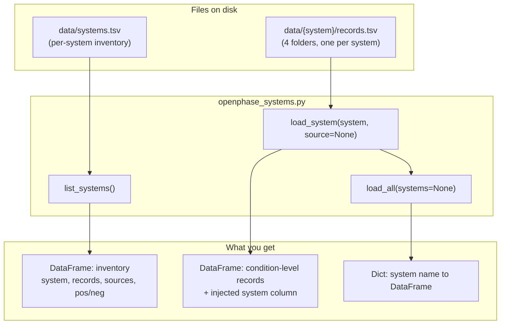

Every machine-learning task in OpenPhase starts with the same raw material: **condition-level records** of protein phase-separation experiments. Rather than forcing you to re-download and re-parse four heterogeneous source databases, the repository ships a small loader module — `openphase_systems.py` — that reads pre-merged tables, one folder per *system*. This page walks you through that loader end to end: what a "system" is, the three public functions you will actually call, how source filtering works, and how to interpret the DataFrame you get back. Everything here assumes only basic Python and pandas familiarity.

Sources: [openphase_systems.py](/openphase_systems.py#L1-L13), [data/README.md](/data/README.md#L1-L5)

## What You Are Loading: Systems and Records

OpenPhase organizes experiments into four **systems**. A system is defined by the *set of components* of the experiment (ignoring concentrations): protein alone, protein with RNA, protein with DNA, or protein with a measured **saturation concentration** (c_sat) readout. A **record** is one experimental condition within a system together with its outcome — either a binary label (phase separation happened or not) or, for the c_sat system, a numeric measurement.

The four systems live as separate folders under `data/`, each containing one tab-separated table:

| System key | Folder | Description | Records | Sequences | UniProt | Papers | Positive / Negative |
|---|---|---|---:|---:|---:|---:|---|
| `protein` | `protein/` | protein only | 7,490 | 1,163 | 311 | 364 | 4,416 / 3,074 |
| `protein_RNA` | `protein_RNA/` | protein + RNA | 2,511 | 241 | 85 | 125 | 1,751 / 760 |
| `protein_DNA` | `protein_DNA/` | protein + DNA | 662 | 99 | 42 | 41 | 446 / 216 |
| `protein_csat` | `protein_csat/` | protein, saturation concentration | 776 | 42 | 3 | 2 | no binary label |

In the three binary systems, a nucleic acid — when present — is just one of the experimental conditions, encoded in the `na_*` columns. Importantly, the tables deliberately **do not contain sequence text, embeddings, or free-text source fields**; sequences are identified by UniProt accession and length. This keeps the tables a compact, processed benchmark view rather than a replacement for the upstream databases.

Sources: [openphase_systems.py](/openphase_systems.py#L5-L26), [data/README.md](/data/README.md#L3-L13), [data/README.md](/data/README.md#L42-L46)


## The Loader API at a Glance

The entire public API is three functions in `openphase_systems.py`. The module resolves its data directory relative to its own file location (`DATA_DIR`), so it works regardless of your current working directory. Internally it is a thin, honest wrapper around `pandas.read_csv` with `sep="\t"` — no hidden downloads, no caching layers, no surprises.



| Function | Signature | Reads | Returns | Key behavior |
|---|---|---|---|---|
| `list_systems()` | no arguments | `data/systems.tsv` | `pd.DataFrame` | One row per system: records, sequences, UniProt accessions, papers, per-source counts, positive/negative split |
| `load_system()` | `system: str`, `source: Optional[str] = None` | `data/<system>/records.tsv` | `pd.DataFrame` | Validates the system name, injects a `system` column at position 1, optionally filters rows by source prefix, resets the index |
| `load_all()` | `systems: Optional[Iterable[str]] = None` | all four (or your subset) | `Dict[str, pd.DataFrame]` | Calls `load_system` once per system; omit the argument to load everything |

The minimal two-liner from the data README is the idiomatic entry point:

```python
from openphase_systems import list_systems, load_system
list_systems()
rna = load_system("protein_RNA")   # or load_system("protein_RNA", source="RNAPSEC")
```

Running the module directly (`python openphase_systems.py`) prints the inventory table, which is a quick sanity check that your checkout is intact.

Sources: [openphase_systems.py](/openphase_systems.py#L19-L31), [openphase_systems.py](/openphase_systems.py#L34-L51), [data/README.md](/data/README.md#L15-L19)

## Loading One System with load_system()

Calling `load_system("protein")` performs four verifiable steps in order. First, it validates your argument against the `SYSTEMS` dictionary — the four keys listed above — and raises a `ValueError` naming the valid choices if you mistype. Second, it reads `data/<system>/records.tsv` as a tab-separated CSV with `low_memory=False` (the condition columns mix types, so pandas should not guess chunk-by-chunk). Third, it inserts a `system` column at position 1, right next to `record_id`, so a merged frame is never ambiguous about its origin. Fourth, it applies the optional source filter and resets the index so row numbers are contiguous.

```python
from openphase_systems import load_system

protein = load_system("protein")          # 7,490 rows, all sources
rnapsec = load_system("protein_RNA", source="RNAPSEC")   # source-filtered subset
```

A sample of what comes back — taken verbatim from the first data rows of `data/protein/records.tsv`:

| Column | Example value | Meaning |
|---|---|---|
| `record_id` | `llpsdb2:PS00000046` | globally unique ID, prefixed by source |
| `source` | `LLPSDB_v2` | provenance database |
| `paper` | `pmid:26317470` | PMID or DOI of the originating paper |
| `uniprot` / `protein_name` / `seq_len` | `P35637` / `FUS` / `526` | sequence identity triple |
| `system_id` | `4a254ab17fd6` | hash of the component set |
| `label` | `1` | 1 = phase separation, 0 = none |
| `log10_protein_conc_uM` / `pH` / `temp_C` | `-0.09691` / `7.4` / `22.0` | experimental conditions |

Sources: [openphase_systems.py](/openphase_systems.py#L34-L42), [data/protein/records.tsv](/data/protein/records.tsv#L1-L3)

> [!TIP]
> The `system` column is *injected*, not stored on disk — `records.tsv` on disk starts with `record_id`, `source`, `paper`… and only gains `system` at position 1 when you call `load_system()`. If you ever read a `records.tsv` with raw `pandas.read_csv`, the `system` column will be missing; that is expected, not corruption.

## Filtering by Source — and the Prefix-Matching Rule

Each system aggregates multiple upstream sources. `list_systems()` surfaces the exact per-source counts in its `sources` column (semicolon-separated `name count` pairs), so you can decide which slice you want before loading. For example, `protein` combines five sources and `protein_RNA` also combines five, while `protein_csat` comes from exactly two papers (Bremer 2022 and Ausserwöger 2025).

| System | Sources and record counts (from `systems.tsv`) |
|---|---|
| `protein` | LLPSDB_v2_phase_diagram 3,656; LLPSDB_v2_site 1,707; LLPSDB_v2 1,375; LLPSense 461; PhaSepDB3_pilot_LLM 291 |
| `protein_RNA` | RNAPSEC 1,141; LLPSDB_v2_site 536; LLPSDB_v2_phase_diagram 515; LLPSDB_v2 284; PhaSepDB3_pilot_LLM 35 |
| `protein_DNA` | LLPSDB_v2_phase_diagram 329; LLPSDB_v2_site 197; LLPSDB_v2 90; PhaSepDB3_pilot_LLM 46 |
| `protein_csat` | Bremer2022 410; Ausserwoger2025 366 |

> [!TIP]
> The `source` argument is a **prefix match** (`df["source"].str.startswith(source)`), not an equality test. Passing `source="LLPSDB_v2"` to `load_system("protein")` returns rows from *all three* LLPSDB v2 variants — `LLPSDB_v2`, `LLPSDB_v2_site`, and `LLPSDB_v2_phase_diagram` — because their source strings share that prefix. To isolate one variant, pass the full name, e.g. `source="LLPSDB_v2_phase_diagram"`.

Sources: [openphase_systems.py](/openphase_systems.py#L40-L41), [data/systems.tsv](/data/systems.tsv#L1-L5), [data/README.md](/data/README.md#L21-L25)

## Reading the Returned DataFrame

The record schema is organized into column groups documented in `data/README.md`. The table below is the map you will reach for on day one; the full per-column detail belongs to the [Condition-Level Record Schema](7-condition-level-record-schema) deep-dive page.

| Group | Columns | What it tells you |
|---|---|---|
| Identity | `record_id`, `system`, `source`, `paper`, `uniprot`, `protein_name`, `seq_len`, `sequence_state`, `system_id`, `mutation`, `fusion`, `cleaved`, `ptm` | Which protein construct, from which paper and database |
| Outcome | `label`, `morphology`, `phase_state`; for c_sat: `readout_class`, `log10_value_uM`, `scan_axis` | Did it phase-separate (binary) or the measured saturation value |
| Split groups | `cluster_30`, `cluster_20` | MMseqs2 clusters at 30 % / 20 % identity (coverage 80 %) for leakage-safe train/test splits |
| Conditions | `log10_protein_conc_uM`, `pH`, `temp_C`, `MgCl2_mM`, `NaCl_mM`, `KCl_mM`, `ionic_strength_mM`, crowders `PEG1k`…`Glycerol` | The experimental variables |
| Buffer & additives | `buf_*`, `add_*` | 0/1 flags for buffer families and additive classes |
| Missing-value state | `st_*` (one next to each condition) | `obs` observed, `miss` missing, `zero` reported absent, `rt` room temperature, `none`/`other` for buffer/additive |
| Nucleic acid | `na_class`, `na_len_log10`, `na_conc_log10`, `na_gc`, `na_g4`, … | Nucleic-acid conditions in the RNA/DNA systems |
| Link | `binary_record_with_same_protein` | Relation between c_sat rows and binary records of the same protein |

Two conventions matter for correct downstream use. First, **missing values are never imputed**: an unreported value stays empty in the numeric column and is flagged in its paired `st_*` column (for instance `st_temp` = `rt` means the temperature was only reported as "room temperature", stored as 22 °C). Second, on `protein_csat` rows the binary `label` is empty by design — the outcome is the continuous `log10_value_uM`, classified into readout classes like `dilute`, `csat_boundary`, and `cloud_point`. Plan for that asymmetry before training a single classifier across systems.

Sources: [data/README.md](/data/README.md#L27-L40), [data/protein/records.tsv](/data/protein/records.tsv#L2-L3)

## Loading Several Systems at Once

When you need the full benchmark in memory, `load_all()` returns a dictionary keyed by system name. Because it simply loops over `load_system`, every dictionary value carries the injected `system` column and behaves exactly like an individually loaded frame.

```python
from openphase_systems import load_all

everything = load_all()                                # all four systems
binary_only = load_all(["protein", "protein_RNA", "protein_DNA"])   # your subset
```

The full data footprint is deliberately small — a few text tables — so keeping all four systems in memory is unremarkable on any modern machine. There is no lazy-loading or streaming machinery to learn.

Sources: [openphase_systems.py](/openphase_systems.py#L45-L47)

## Where the Records Come From, and the Archived Loaders

The merged tables were built from five upstream efforts: LLPSDB v2 (download files, website-only rows, and digitized phase-diagram tables), LLPSense, RNAPSEC, a language-model-assisted pilot extraction of three PhaSepDB papers (`PhaSepDB3_pilot_LLM`), plus Bremer 2022 and Ausserwöger 2025 for the c_sat system. One historical source is intentionally absent: the laboratory-notebook records (`db2`) are **not** in these tables.

The repository also preserves the *first-generation* loaders in `zhanglab/`, one per source — `db1.py` (LLPSDB v2), `db2.py` (laboratory notebooks), `db3.py` (RNAPSEC). Unlike the merged system tables, each archived loader downloads raw data from upstream, parses it, embeds it, and packages it as an AnnData (`.h5ad`) PyTorch `Dataset` (see `DB1Dataset`, which handles downloading, filtering, embedding, and split strategies in one class). These are the building blocks used by the benchmark tasks and the embedding pipeline — `task1.py`, for instance, consumes such a dataset via `system_dataset.get_tensor()` before standardizing features for its baselines. If your goal is model training rather than table exploration, that is your next stop: [Building Source Datasets with Loaders](5-building-source-datasets-with-loaders).

Sources: [data/README.md](/data/README.md#L21-L25), [zhanglab/README.md](/zhanglab/README.md#L1-L13), [zhanglab/db1.py](/zhanglab/db1.py#L27-L38), [task1.py](/task1.py#L26-L37)

## Quick Troubleshooting Reference

| Symptom | Cause | Fix |
|---|---|---|
| `ValueError: unknown system 'protein-rna'` | System keys are exact and case-sensitive: `protein`, `protein_RNA`, `protein_DNA`, `protein_csat` | Use `list_systems()` first, then copy the key verbatim |
| Source filter returns "too many" rows | `source` is a prefix match (`startswith`), so short prefixes match multiple variants | Pass the complete source string, e.g. `LLPSDB_v2_phase_diagram` |
| `label` column has empty values | You loaded `protein_csat`, whose outcome is `log10_value_uM` with no binary label | Treat c_sat as a regression/ordinal problem, or exclude it from classification |
| Sequence text is nowhere in the frame | By design: sequences are identified by `uniprot` + `seq_len`, text lives upstream | Fetch sequences separately; see the embedding pages |
| Unexpected `NaN` in condition columns | Unreported values stay empty and are flagged in `st_*` — they are never imputed | Filter or handle using the `st_*` flags before modeling |

Sources: [openphase_systems.py](/openphase_systems.py#L36-L41), [data/README.md](/data/README.md#L32-L42)

## Suggested Reading Path

You now know how to pull any system's records into a pandas DataFrame in one line. From here, the catalog offers three natural directions depending on your goal: tour the records visually in the browser with [Interactive Explorer Tour](4-interactive-explorer-tour); learn how the per-source `zhanglab` datasets wrap these records with embeddings for training in [Building Source Datasets with Loaders](5-building-source-datasets-with-loaders); or study every column group in depth in [Condition-Level Record Schema](7-condition-level-record-schema). When you are ready to train, [Outcome Prediction Baselines](8-outcome-prediction-baselines) shows the end-to-end consumption pattern of the loaders in real benchmark code.
