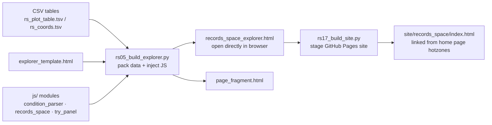
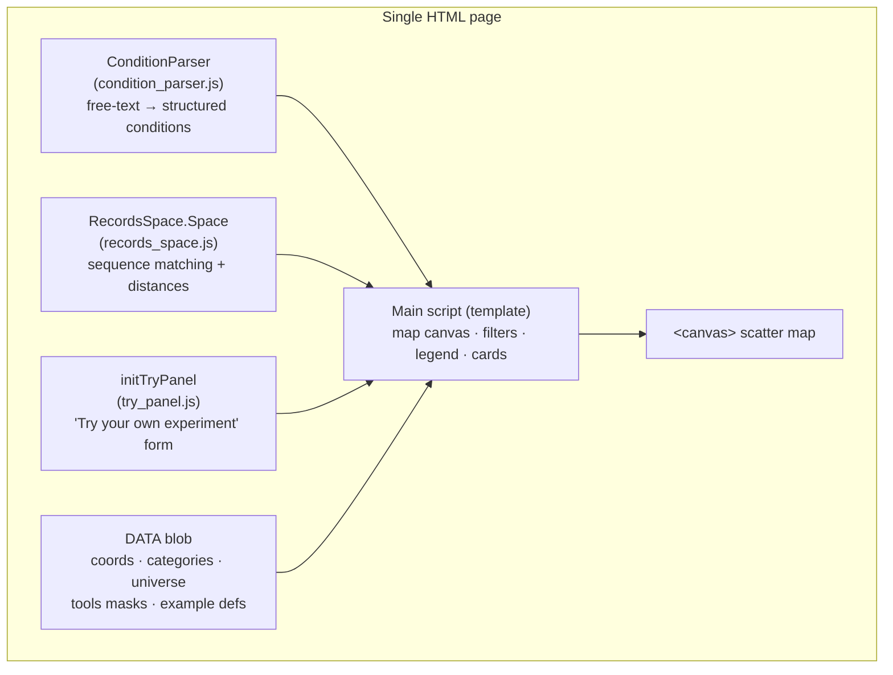
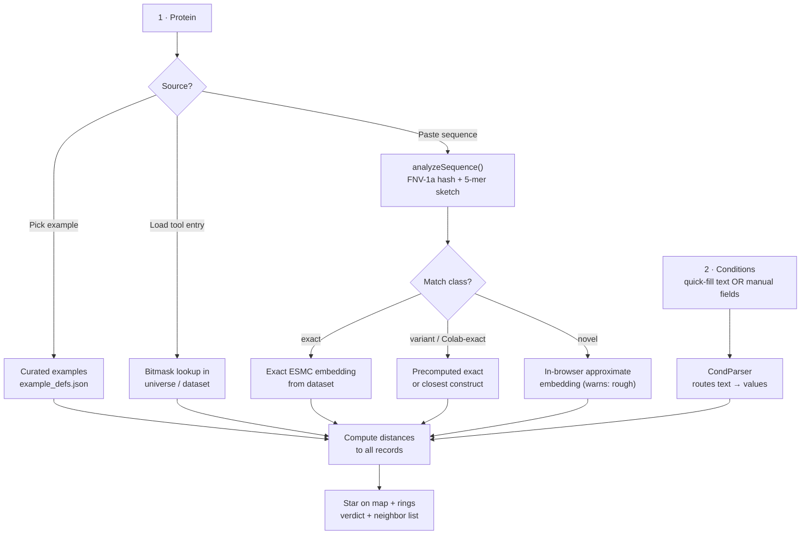

The Records Space Explorer is OpenPhase's browser-based window into the curated LLPS record dataset: a single interactive scatter map where every dot is one experimental record, plus a "Try your own experiment" mode that places *your* hypothetical protein-condition combination onto the same map — entirely in the browser, with no server and no network calls. This page is a guided tour of that interface: how to open it, what each pane and control does, and how the pieces fit together. For the statistical model running under the hood, see [Record Map Distance Model](19-record-map-distance-model); for how the whole website is generated, see [Site Build Pipeline](21-site-build-pipeline).

## What You Are Touring: One Self-Contained Page

The explorer ships as a **self-contained HTML file**: build script `rs05_build_explorer.py` packs coordinates, labels, condition fields, embeddings, and a protein universe into one data blob and injects it — together with three JavaScript modules — into the template `explorer_template.html`. The build produces two artifacts: `records_space_explorer.html`, which you can open directly in any browser, and `page_fragment.html` for embedding elsewhere. The page contains coordinates and annotations (protein names, UniProt IDs, paper IDs, conditions, readouts) but **no protein sequences**, keeping the file light.

Sources: [rs05_build_explorer.py](records_space/scripts/rs05_build_explorer.py#L2-L4), [explorer_template.html](records_space/explorer/explorer_template.html#L213-L217)

## How to Open the Explorer

There are three entry points, all fed by the same build pipeline. Locally, run the build script and open `explorer/records_space_explorer.html`. For publication, `rs17_build_site.py` stages a GitHub Pages directory where `site/records_space/index.html` *is* the explorer. Finally, the home page (`site/index.html`) embeds clickable hotzones and chips over its figure images that deep-link into the explorer with pre-applied filters — for example, clicking the "protein + RNA" region lands on `records_space/#na=RNA&csat=hide`.

Sources: [rs05_build_explorer.py](records_space/scripts/rs05_build_explorer.py#L2-L4), [rs17_build_site.py](records_space/scripts/rs17_build_site.py#L2-L7), [rs17_build_site.py](records_space/scripts/rs17_build_site.py#L36-L52)

## Architecture at a Glance

Understanding the file's composition makes the rest of the tour easier to follow. The template reserves four placeholder slots, and the build script fills them in. Three slots receive the JavaScript modules from `records_space/explorer/js/`; the fourth receives a base64-packed JSON `DATA` object holding all coordinates, categories, and the protein universe.

All four components run **fully offline in your browser**: the `RecordsSpace` module explicitly states it never touches the network and processes all input within the page — relevant if you paste proprietary sequences into Try mode.

Sources: [explorer_template.html](records_space/explorer/explorer_template.html#L213-L217), [records_space.js](records_space/explorer/js/records_space.js#L1-L2)

## The Three-Pane Layout

On a wide screen the page is a three-column grid: a **control rail** on the left, the square **map stage** in the middle, and a sticky **record card** on the right. The grid reflows at two breakpoints — below 760 px everything stacks vertically, and between 760 px and 960 px the rail and card sit under the map — so the explorer works on phones too.

| Pane | HTML root | Purpose |
|---|---|---|
| Control rail | `<aside id="rail">` | Record-type toggles, condition filters, text search, point size, reset |
| Map stage | `<main class="stage">` | Lens/color/style selectors, zoomable canvas, highlight note, glyph key, legend |
| Record card | `<section id="card">` | Details of the hovered or pinned point, with quick actions |

Sources: [explorer_template.html](records_space/explorer/explorer_template.html#L27-L30), [explorer_template.html](records_space/explorer/explorer_template.html#L173-L210)

## Explore Mode: The Control Rail

Explore mode is the default. The rail filters which records are visible; every change triggers `applyFilters()`, which recomputes a visibility array over all records before the canvas redraws. Filtering is purely conjunctive — a record stays visible only if it passes every active filter.

| Control | Options | Effect |
|---|---|---|
| Show checkboxes | Binary records / csat records | Include or exclude non-quantitative records vs. saturation (csat) records |
| Nucleic acid | Any / None / RNA / DNA | Keep records matching the nucleic-acid class |
| Temperature | Measured / Room temp. only / Missing + min–max °C range | Filter by temperature state and numeric band |
| csat link | Any / csat record / identical sequence to csat / same UniProt as csat | Filter by relationship to the saturation-measurement pool |
| Find protein, paper or record | free text | Substring search over name, UniProt, paper, record ID, entry — e.g. `FUS`, `P35637`, `pmid:29064502` |
| Point size | slider 1–6 | Adjust dot radius |
| Reset view and filters | button | Restore every control and the zoom to defaults |

Sources: [explorer_template.html](records_space/explorer/explorer_template.html#L175-L190), [explorer_template.html](records_space/explorer/explorer_template.html#L301-L319), [explorer_template.html](records_space/explorer/explorer_template.html#L749-L752)

## The Map Stage: Lenses, Colors, and Styles

Above the canvas, the toolbar chooses **how** the records are drawn. The **Map** selector picks one of five precomputed projections ("lenses"), each normalizing coordinates into the unit square with north-up orientation at build time. The **Color by** selector recolors every point by any categorical field (protein identity, construct type, phase-separation label, source database, …) or continuous field (temperature, pH, NaCl, NCPR, aromatic fraction, …), and the **Legend** below the map lists each color group — click a legend entry to hide or show that group. **Style** switches between solid blobs, soft glow, and dots only; **Outline** adds light, colored, dashed, or contour-ring edges.

| Lens key | Label | What it emphasizes |
|---|---|---|
| `tsne_full` | t-SNE · full | Default view; cluster shape over all features |
| `umap_full` | UMAP · full | UMAP over protein + condition features |
| `umap_prot` | UMAP · protein only | Sequence-driven structure |
| `umap_cond` | UMAP · nucleic acid + conditions | Condition-driven structure |
| `umap_fullM` | UMAP · full, observed-only (M−) | Complete-observation subset |
| `umap_universe` | (protein universe) | Records **plus** ring glyphs for proteins without records |

On the canvas itself: **scroll to zoom, drag to pan, click a point to pin it**; the `+` / `−` / `Fit` buttons control zoom explicitly, and the counter in the corner reports how many points are visible.

Sources: [rs05_build_explorer.py](records_space/scripts/rs05_build_explorer.py#L20-L21), [rs05_build_explorer.py](records_space/scripts/rs05_build_explorer.py#L48-L56), [explorer_template.html](records_space/explorer/explorer_template.html#L192-L208), [explorer_template.html](records_space/explorer/explorer_template.html#L264-L287)

## Highlighting Tool Entries and the Protein Universe

The **Highlight tool entries** selector overlays the member set of an external tool or database (LLPSDB v2, PhaSepDB 3 pilot, LLPSense, RNAPSEC, Bremer 2022, Ausserwöger 2025, and others) onto the map. Each record carries a compact **bitmask** of tool memberships (two 32-bit words per record), so membership tests are cheap array lookups, and the selector groups options by tool family with live counts. Two glyph kinds exist, explained by the glyph key under the canvas: **filled dots are records with conditions**, **hollow rings are proteins mentioned by a tool but lacking any condition data** (the "protein universe"). Selecting a protein-only tool automatically switches the lens to `umap_universe` so its rings are visible, and a note bar under the canvas reports counts — e.g. "N proteins in the map · M more without records" — with a button to show all universe members.

Hovering or pinning a ring opens a universe card: accession, organism, length, the tools mentioning it, and the **closest protein that does have records** with its cosine similarity. From there, one click hands the protein to Try mode.

Sources: [explorer_template.html](records_space/explorer/explorer_template.html#L206), [explorer_template.html](records_space/explorer/explorer_template.html#L221-L230), [explorer_template.html](records_space/explorer/explorer_template.html#L753-L788), [explorer_template.html](records_space/explorer/explorer_template.html#L813-L849)

## Reading a Record: The Detail Card

Clicking any filled dot pins it and fills the right-hand card: protein name and UniProt ID, paper link, source entry, construct type, quantitative readout class, plus a key/value table of conditions (temperature, pH, salts, crowder, buffer, other solutes, nucleic acid with length and ratio) and a count of missing dimensions. Three quick actions turn a single record into a new query without retyping: **Highlight this protein** and **Highlight this paper** fill the search box, and **Same temperature ±2 °C** sets the temperature range filter around the pinned record.

Sources: [explorer_template.html](records_space/explorer/explorer_template.html#L700-L714)

## Try Your Own Experiment: Step by Step

The header's second mode button swaps the rail for the **Try** pane. You describe a hypothetical experiment; the page computes its protein embedding, its distances to every record, and drops a pink **star** on the map at the inverse-distance-weighted centroid of its 8 nearest neighbors, with rings marking those neighbors. A color-coded **verdict** (green = good, amber = moderate, red = poor phase-separation outlook) and a neighbor list with per-database pills summarize the result; neighbor confidence uses a Wilson interval. Three input paths feed the same pipeline:

**Step 1 — Protein.** Either start from a curated example (grouped, e.g. "New proteins (no record in the dataset)" with GRB2 in HEPES/KCl/MgCl₂/PEG 8000), load an entry from any highlighted tool, or paste an amino-acid sequence (FASTA headers are stripped automatically). A checkbox lets you treat the protein and its relatives as unseen. A short info box then reports what happened: length, molecular weight, match class, and which embedding strategy was used.

**Step 2 — Conditions.** The fastest route is the quick-fill textarea: type a sentence like `20 mM Tris pH 7.5, 150 mM NaCl, 25 °C, 20 µM protein, 1 mM DTT` and `CondParser` — a JavaScript port of the dataset's own Python parsing engine, sharing its unit tables, PEG bins, and salt aliases — fills every field for you to inspect and correct. You can also fill manually: temperature (with an RT chip for "room temperature only, no number given"), pH, protein µM, buffer family, NaCl/KCl/MgCl₂ in mM, crowder and percentage, nucleic-acid kind/type/length/concentration, and additive chips (DTT/TCEP, EDTA, detergents, 1,6-hexanediol, …). Empty boxes mean unknown; once any salt is given, empty salts count as none.

**Sequence classification, in detail.** This is the heart of Try mode, and worth understanding as a beginner:

| Class | Criterion | Protein embedding used |
|---|---|---|
| `exact` | Identical sequence in dataset (double 32-bit hash + length) | Dataset's exact ESMC embedding |
| Colab-exact | Sequence listed in `unseen_examples.fasta` with precomputed vector | Exact embedding computed offline, stored in the page |
| `variant` | ≥50% of query 5-mers contained in a known construct (or ≥30% Jaccard) | Embedding of the closest known construct |
| `related` | A few shared 5-mers (below variant thresholds) | Closest construct embedding |
| `novel` | No similar sequence | Approximate regression embedding |

For novel sequences the page embeds via `approxZ()` — a lightweight regression from amino-acid composition and dimer features — and shows an explicit warning that no ESMC model runs in the browser, quoting held-out recovery statistics so you know how much to trust the placement. Under **Advanced** you can force the approximation even where an exact embedding exists, or copy a request string to obtain an exact embedding offline and, if it is added to the examples file, it will be used automatically on your next visit.

Sources: [try_panel.js](records_space/explorer/js/try_panel.js#L1-L3), [try_panel.js](records_space/explorer/js/try_panel.js#L28-L78), [try_panel.js](records_space/explorer/js/try_panel.js#L90-L135), [records_space.js](records_space/explorer/js/records_space.js#L75-L100), [condition_parser.js](records_space/explorer/js/condition_parser.js#L1-L9), [explorer_template.html](records_space/explorer/explorer_template.html#L851-L879), [example_defs.json](records_space/explorer/examples/example_defs.json#L1)

## Shareable Views: URL Deep Links

Every interesting view is reproducible through the URL fragment — this is exactly how the home page hotzones work. `applyHash()` reads parameters after the `#`, validates each against its dropdown's options, and applies them on load:

| Parameter | Example | Effect |
|---|---|---|
| `na` | `#na=RNA` | Nucleic-acid filter (RNA / DNA / none) |
| `csat` | `#csat=only` or `#csat=hide` | Show only csat records, or hide them |
| `hl` | `#hl=llpsdb` | Highlight a tool entry set |
| `q` | `#q=FUS` | Prefill the text search |
| `protein` | `#protein=FUS` | Isolate one protein's records (hides all others) |
| `lens` | `#lens=umap_prot` | Select the map projection |
| `mode` | `#mode=try` | Open directly in Try-your-own-experiment mode |

The theme toggle (moon/sun button) persists your light/dark choice in `localStorage`, and the "← OpenPhase" home link appears only when the page is served from GitHub Pages or localhost.

Sources: [explorer_template.html](records_space/explorer/explorer_template.html#L715-L734), [explorer_template.html](records_space/explorer/explorer_template.html#L161-L172), [rs17_build_site.py](records_space/scripts/rs17_build_site.py#L62-L64)

## Where to Go Next

You have now toured the explorer end to end. To understand *why* the star lands where it does, continue with [Record Map Distance Model](19-record-map-distance-model); to see how the page, the negatives site, and the protein universe exports are produced, follow [Site Build Pipeline](21-site-build-pipeline) and [Negatives and Protein Universe](20-negatives-and-protein-universe). To work with the underlying records programmatically instead of visually, head to the next catalog page, [Building Source Datasets with Loaders](5-building-source-datasets-with-loaders).
