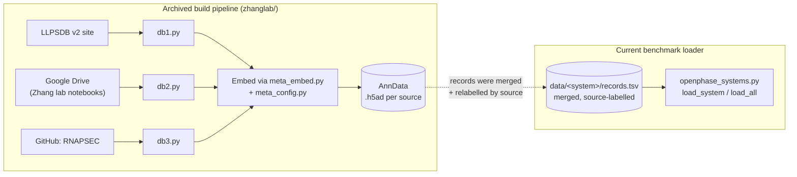
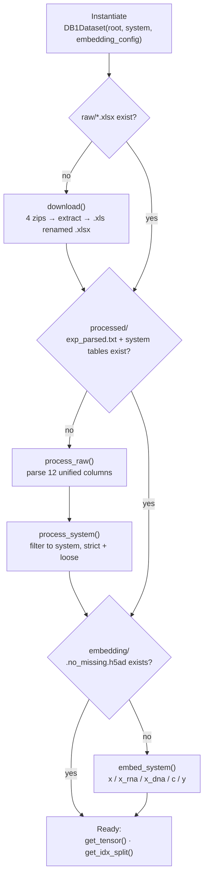

This page covers the **archived source loaders** — `zhanglab/db1.py`, `db2.py`, and `db3.py` — which download raw data from three upstream phase-separation databases, parse it into unified tables, embed it, and persist each result as an AnnData (`.h5ad`) dataset ready for PyTorch training. Where [Loading Records by System](3-loading-records-by-system) showed you how to *read* the pre-merged per-system TSVs, this page shows you how the per-*source* datasets are *built from scratch* — the machinery underneath the benchmark tables.


Sources: [openphase_systems.py](openphase_systems.py#L10-L12), [zhanglab/README.md](zhanglab/README.md#L1-L9)

## Two Layers of Data Loading: Merged Systems vs. Raw Sources

The repository exposes **two generations of loaders**, and understanding their relationship prevents confusion later. The *current* loader, `openphase_systems.py`, reads the benchmark's merged condition-level records — four systems stored as `data/<system>/records.tsv`: `protein` (7,490 records), `protein_RNA` (2,511), `protein_DNA` (662), and `protein_csat` (776 rows of saturation concentrations). Its API is minimal: `list_systems()` returns a summary table, `load_system(system, source=...)` returns one system as a DataFrame, and `load_all()` returns a dictionary of all systems.

The *archived* loaders in `zhanglab/` are the original build pipeline, one module per upstream source: `db1.py` for **LLPSDB v2**, `db2.py` for **laboratory notebooks** (Zhang lab), and `db3.py` for **RNAPSEC**. They do not read the TSVs — they reach upstream websites themselves, so you can reproduce the raw-to-embedded journey end to end. Note one asymmetry: the lab-notebook records (`db2`) are deliberately **not** included in the merged `data/` tables.



Sources: [openphase_systems.py](openphase_systems.py#L1-L47), [data/README.md](data/README.md#L21-L25), [zhanglab/README.md](zhanglab/README.md#L1-L14), [data/systems.tsv](data/systems.tsv#L1-L6)

## The Three Source Loaders at a Glance

Each loader follows the same class contract (a PyTorch `Dataset` subclass) but differs in its upstream transport and its granularity. The table below is your selection guide:

| | `DB1Dataset` (db1.py) | `DB2Dataset` (db2.py) | `DB3Dataset` (db3.py) |
|---|---|---|---|
| **Source** | LLPSDB v2 (bio-comp.org.cn) | Zhang lab experimental notebooks | RNAPSEC / RNAPhaSep literature |
| **Download** | 4 zips via HTTP POST simulation | One XLSX via `gdown` (Google Drive) | One XLSX via `requests` from GitHub |
| **Selection axis** | `system`, e.g. `'protein(1)'`, `'protein(2) + RNA'` | `subset_type`: `'CoREST'`, `'IDR'`, `'RGG'` | whole file (protein+RNA only) |
| **Label semantics** | `'Yes'/'No'` phase separation | binary (IDR has continuous readings) | morphology map: liquid/solid/gel → 1, solute → 0 |
| **Strict filtering** | strict vs. loose system filter | subset filter only | drop rows with any NaN |
| **Output** | `{system}.no_missing.h5ad` | subset `.h5ad` | `rnapsec_no_missing_1298.h5ad` |

Two practical facts to remember: run the imports **from the repository root** (`from zhanglab.db1 import DB1Dataset`), because the archived modules import `meta_config.py` and `meta_embed.py` from the root directory; and DB1 alone knows 14 systems — 7 single-protein variants (`protein(1)`…`protein(7)`), 3 protein+RNA, 4 protein+DNA, plus a `NaN` bucket.

Sources: [zhanglab/db1.py](zhanglab/db1.py#L27-L74), [zhanglab/db1.py](zhanglab/db1.py#L124-L131), [zhanglab/db2.py](zhanglab/db2.py#L21-L54), [zhanglab/db2.py](zhanglab/db2.py#L107-L109), [zhanglab/db3.py](zhanglab/db3.py#L17-L44), [zhanglab/db3.py](zhanglab/db3.py#L216-L217), [zhanglab/README.md](zhanglab/README.md#L11-L13)

## The Four-Stage Build Lifecycle

All three loaders share one orchestration pattern, visible in their `__init__` methods: **download → process → embed**, with every stage guarded by an existence check. The first constructor call does the full build; subsequent calls load the cached artifacts instead. This makes the loaders idempotent — instantiate them repeatedly at zero cost, and delete an artifact to force that stage to rerun.



Each stage writes into a fixed directory layout under `root/<name>/`: `raw/` holds the untouched upstream files, `processed/` holds the parsed TSVs (`exp_raw.txt`, `exp_parsed.txt`, then per-system `{system}.txt` and `{system}.no_missing.txt`), and `embedding/` holds the final AnnData file. The `process_raw` stage of DB1 is the heaviest — it normalizes free-text spreadsheet columns (temperature ranges, semicolon-separated solute concentrations, buffer pH, crowding agents, nucleic acid names) into twelve canonical columns such as `Phase label`, `Phase system`, `Protein sequences`, and `Ionic strength`; DB3 performs the same normalization against RNAPSEC's own schema, collapsing 1,514 parsed rows to 1,298 fully-observed ones.

> [!TIP]
> Treat `raw/`, `processed/`, and `embedding/` as a build cache. If an upstream website changes its file format mid-project, delete only the affected stage's folder — e.g. remove `DB1/processed/` to re-parse without re-downloading.

Sources: [zhanglab/db1.py](zhanglab/db1.py#L76-L121), [zhanglab/db1.py](zhanglab/db1.py#L149-L165), [zhanglab/db1.py](zhanglab/db1.py#L167-L233), [zhanglab/db1.py](zhanglab/db1.py#L235-L315), [zhanglab/db1.py](zhanglab/db1.py#L579-L599), [zhanglab/db2.py](zhanglab/db2.py#L48-L89), [zhanglab/db3.py](zhanglab/db3.py#L40-L79), [zhanglab/db3.py](zhanglab/db3.py#L124-L202)

## Configuring Embeddings: MetaEmbeddingConfig

Every loader accepts a `MetaEmbeddingConfig` object — a small pydantic model defined at the repository root that selects **one embedding per modality**. It validates your choices at construction time, so an invalid model name fails immediately with the allowed set in the error message. The factory function `create_meta_config()` builds one in a single call, and this is where DB1's default (`create_meta_config(protein='mtdp', ...)`) differs from the config class defaults (`esmc`).

| Slot | Field | Allowed values | Default (field) |
|---|---|---|---|
| Protein | `protein_embedding` | `esmc`, `mtdp`, `rnapsec_protein`, `seq2ind`, `seq2onehot` | `esmc` |
| Nucleic acid | `dna_rna_embedding` | `rnapsec_rna`, `dictionary` | `dictionary` |
| Conditions | `condition_embedding` | `droppler`, `rnapsec_condition`, `rnapsec_condition_class` | `droppler` |

```python
from meta_config import create_meta_config
from zhanglab.db1 import DB1Dataset

cfg = create_meta_config(protein="esmc", dna_rna="dictionary", condition="droppler")
dataset = DB1Dataset(root="./data_build", system="protein(1)", embedding_config=cfg, download=True)
```

The full design space — dimensionality, pooling strategies, and which model suits which task — is catalogued in [Embedding Configuration Matrix](11-embedding-configuration-matrix) and [Protein and Nucleic Acid Embeddings](12-protein-and-nucleic-acid-embeddings); here you only need the selection mechanism.

Sources: [meta_config.py](meta_config.py#L1-L41), [zhanglab/db1.py](zhanglab/db1.py#L20-L21)

## Inside the Embedding Dispatch Layer

`meta_embed.py` exposes three public functions, and each is a **dispatcher** that maps your config string to a concrete featurizer. This one indirection point is how a single config change swaps the entire featurization stack without touching loader code.

| Function | Model key | Technique | Output shape per record |
|---|---|---|---|
| `get_protein_embeddings` | `esmc` | ESM Cambrian 600M, residue tensor mean-pooled over sequence | 1 vector (pooled) |
| | `mtdp` | MTDP pretrained checkpoint (`./MTDP/models/UniProtKB/UniProtKB.bin`) | 1280-dim |
| | `rnapsec_protein` | 29 Biopython physicochemical features (weight, AA %, GRAVY, pI, helix/turn/sheet…) | 29-dim |
| `get_dna_rna_embeddings` | `dictionary` | name → integer index mapping (for later `nn.Embedding`) | 1 index + mapping dict |
| | `rnapsec_rna` | 97-dim MathFeature k-mer/ORF/entropy/Fourier features via subprocess | 97-dim |
| `get_condition_embeddings` | `droppler` | 14 numeric condition dims (below) | 14-dim |

The **Droppler-style** condition vector is worth understanding because it appears throughout the project: ten one-hot temperature bins (0–100 °C in ten-degree steps, so a range like 25–40 °C lights up several bins), one log10 protein concentration (with a small epsilon added before the log to keep zeros finite), one log10 ionic strength, one crowding-agent binary, and the pH value. Embeddings are computed per *unique sequence* and cached in a dict first, so duplicated proteins across records are featurized only once.

> [!TIP]
> The nucleic-acid `dictionary` mode returns *indices plus a name-to-index mapping* — the mapping is stored in the AnnData `uns` slot, not `obsm`. Downstream models consume the index tensor through an embedding layer, so if you export the `.h5ad` elsewhere, carry `uns` along or your RNA tokens become meaningless integers.

Sources: [meta_embed.py](meta_embed.py#L407-L430), [meta_embed.py](meta_embed.py#L433-L459), [meta_embed.py](meta_embed.py#L462-L586), [meta_embed.py](meta_embed.py#L44-L69), [meta_embed.py](meta_embed.py#L124-L192), [meta_embed.py](meta_embed.py#L195-L317)

## Consuming a Built Dataset: AnnData, Tensors, and Splits

The embedding stage persists everything into one AnnData file. Tensors live in the `obsm` slot under keys that **encode the model that produced them**, and lookup dictionaries go to `uns`:

| Key pattern (in `obsm`) | Contents | Example key |
|---|---|---|
| `x_{protein_model}` | single-protein embeddings | `x_esmc` |
| `x_{i}_{protein_model}` | i-th protein of multi-protein systems | `x_1_mtdp`, `x_2_mtdp` |
| `x_rna_{na_method}` / `x_dna_{na_method}` | nucleic-acid indices or features | `x_rna_dictionary` |
| `c_{condition_model}` | 14-dim condition matrix | `c_droppler` |
| `y` | binary phase-separation labels | `y` |
| `uns: {rna,dna}_mapping_{na_method}` | name → index dictionaries | `rna_mapping_dictionary` |

From there, two accessor methods finish the job. `get_tensor()` reads the `.h5ad` and returns plain float tensors whose arity adapts to the system — `(x, c, y)` for `protein(1)`, `(x1, x2, x_dna, c, y)` for `protein(2) + DNA`, and so on, exactly matching the composition of the system you selected. `get_idx_split(split_method, seed)` returns `(train_idx, test_idx)` with an 80/20 split under seven strategies, from plain `random` to stratification by `phase_label`, binned `temperature`, quantile-binned concentration or ionic strength, crowding-agent presence, or binned pH — a quick ablation toolbox you can extend with the rigorous protocols described in [Split Strategies and Metrics](10-split-strategies-and-metrics).

Sources: [zhanglab/db1.py](zhanglab/db1.py#L317-L336), [zhanglab/db1.py](zhanglab/db1.py#L404-L420), [zhanglab/db1.py](zhanglab/db1.py#L422-L502), [zhanglab/db1.py](zhanglab/db1.py#L504-L573)

## Putting It Together: A Complete Build Session

The snippet below builds the LLPSDB v2 single-protein source dataset from a clean directory and immediately reads it back as training tensors. On first run it downloads four zips, parses, and embeds (GPU is used by the protein embedders by default); on every later run the constructor returns after the existence checks.

```python
from meta_config import create_meta_config
from zhanglab.db1 import DB1Dataset

cfg  = create_meta_config(protein="esmc", dna_rna="dictionary", condition="droppler")
data = DB1Dataset(root="./data_build", name="DB1",
                  system="protein(1)", embedding_config=cfg)

x, c, y      = data.get_tensor()               # (n, d_prot), (n, 14), (n,)
train, test  = data.get_idx_split(split_method="phase_label_stratified", seed=0)
```

Remember the scope of what you just built: this is the **LLPSDB v2 source in isolation**, with sequences and embeddings attached. For benchmarking against the full merged corpus — LLPSDB v2 *plus* LLPSense, RNAPSEC, PhaSepDB-pilot, and the csat sources — go back to `openphase_systems.load_system()` as covered in [Loading Records by System](3-loading-records-by-system), and note that those merged TSVs deliberately exclude sequence text and embeddings ([see what's included](7-condition-level-record-schema)).

Sources: [zhanglab/db1.py](zhanglab/db1.py#L27-L50), [data/README.md](data/README.md#L42-L46)

## Where to Go Next

A suggested reading order from here: solidify the field-level meaning of what these loaders produce with [Condition-Level Record Schema](7-condition-level-record-schema); then understand why embeddings are the lingua franca between heterogeneous sources in [Embedding Configuration Matrix](11-embedding-configuration-matrix) and [Protein and Nucleic Acid Embeddings](12-protein-and-nucleic-acid-embeddings); finally, see how condition vectors like Droppler's 14 dims are engineered in [Condition Feature Engineering](13-condition-feature-engineering). When you're ready to run real benchmarks on the merged tables, continue to [Outcome Prediction Baselines](8-outcome-prediction-baselines).
