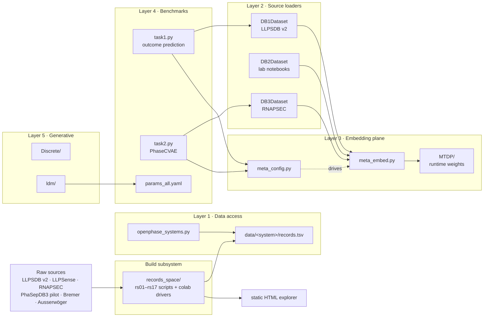
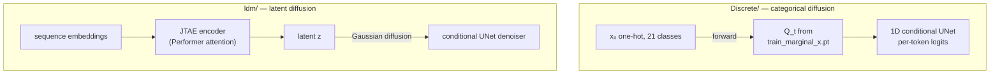

OpenPhase is organized as a layered system: raw experimental sources flow through loaders and embedding services into benchmarks and generative models, while a parallel build pipeline produces both the merged record tables and an interactive browser-based explorer. This page maps the repository's structural anatomy — the layers, their boundaries, and the contracts between them — so that the Deep Dive pages that follow have a stable frame of reference. Everything here is documented from the code itself; deeper mechanics of each subsystem are deferred to their dedicated pages.

Sources: [README.md](README.md#L1-L20)

## The Layer Map

The repository decomposes into five cooperating layers plus one upstream build subsystem. Before reading the diagram, two prerequisites: arrows denote *runtime dependency* (a module imports or loads from its target), and the layers are ordered by data direction — raw sources at the left, models at the right. The single most important structural fact is that `data/` is not the raw source: per [data/README.md](data/README.md#L41-L46), the merged system tables are themselves *built from* the records space pipeline, so `records_space/` sits upstream of everything.

The build subsystem (`records_space/scripts`, `records_space/colab`) performs the merge and de-duplication of the six sources; its outputs branch into the tabular records consumed by `openphase_systems.py` and the self-contained HTML explorer served by GitHub Pages. Layers 2 and 3 form a vertical pairing — every dataset class delegates embedding work to `meta_embed.py` under a configuration object from `meta_config.py` — and Layers 4 and 5 sit on top as alternative consumers of the same embedded tensors.

Sources: [data/README.md](data/README.md#L41-L46), [records_space/README.md](records_space/README.md#L41-L77), [README.md](README.md#L80-L98)

## The (x, c, y) Contract

The unifying abstraction across every layer is a three-tuple convention: **x** = component sequences (protein, optional RNA/DNA), **c** = experimental conditions, **y** = outcome label. This contract appears identically at every altitude of the stack. The PyTorch dataset in `Discrete/dataset.py` returns exactly `x[idx], c[idx], y[idx]` per sample; the benchmark loader in `task1.py` unpacks `*x, c, y = system_dataset.get_tensor()`; and the `DB1Dataset` docstring documents the same `x, c, y = dataset.get_tensor()` interface for the source-level datasets. Because all consumers speak this contract, swapping an embedding method or a dataset class does not change downstream model code — this is the architectural hinge that makes the hyperparameter grid in `params_all.yaml` composable.

Sources: [Discrete/dataset.py](Discrete/dataset.py#L3-L21), [task1.py](task1.py#L21-L34), [zhanglab/db1.py](zhanglab/db1.py#L42-L70)

## Layer 1 — Data Access: System-Level Records

`openphase_systems.py` is a deliberately thin facade — 52 lines, no classes — over four TSV tables, one per **system** (the set of an experiment's components without concentrations). `list_systems()` returns the summary table `data/systems.tsv`; `load_system(system, source=...)` validates the system name against a literal registry, loads `data/<system>/records.tsv`, injects a `system` column, and optionally filters by source prefix; `load_all()` returns a dictionary of data frames. The merged tables are a *processed benchmarking view*: they deliberately exclude sequence text, embeddings, and free-text source fields, identifying sequences instead by UniProt accession and length, and unreported values are left empty with a state flag (`st_*`) rather than imputed.

| System folder | Contents | Records | Sequences | Label |
|---|---|---:|---:|---|
| `data/protein/` | protein only | 7,490 | 1,163 | binary |
| `data/protein_RNA/` | protein + RNA | 2,511 | 241 | binary |
| `data/protein_DNA/` | protein + DNA | 662 | 99 | binary |
| `data/protein_csat/` | saturation concentration | 776 | 42 | measured value |

Sources: [openphase_systems.py](openphase_systems.py#L18-L43), [data/README.md](data/README.md#L6-L11), [data/README.md](data/README.md#L28-L37), [data/README.md](data/README.md#L41-L46)

The column schema is grouped into identity, outcome, split-group, condition, missing-state, nucleic-acid, and link families. Two groups carry architectural weight beyond this page: the `cluster_30` / `cluster_20` MMseqs2 columns pre-compute the material for leakage-safe splits, and the paired `st_*` state columns implement an explicit missing-data semantics ("observed / missing / reported-as-absent") that both the benchmark layer and the explorer's distance model consume. Full column-by-column documentation belongs to the schema page.

Sources: [data/README.md](data/README.md#L28-L37)

## Layer 2 — Source-Level Dataset Loaders (zhanglab/)

The `zhanglab/` package preserves the three original data sources as full lifecycle PyTorch `Dataset` classes: `DB1Dataset` (LLPSDB v2), `DB2Dataset` (laboratory notebooks), and `DB3Dataset` (RNAPSEC). Each class downloads upstream archives, validates the expected file layout, filters by system type, embeds proteins/nucleic acids/conditions through the Layer-3 embedding plane, persists the result as AnnData (`.h5ad`), and supports multiple train/test split strategies. These loaders therefore form the bridge between raw downloads and the `(x, c, y)` tensors of the model layers — and they keep per-*source* identity, which the merged per-*system* tables in Layer 1 deliberately collapse.

> [!TIP]
> A key boundary: the laboratory-notebook source (db2) is **not** included in the merged `data/` tables. The two record planes overlap but are not identical — `data/` is a merged benchmarking view, while `zhanglab/` loaders can yield records (and embeddings) that never enter the system-level tables.

Sources: [zhanglab/db1.py](zhanglab/db1.py#L42-L90), [data/README.md](data/README.md#L21-L24), [README.md](README.md#L39-L48)

## Layer 3 — Embedding and Configuration Plane

Two files at the repository root define the embedding plane. `meta_config.py` declares a Pydantic model, `MetaEmbeddingConfig`, with three validated slots — one per tuple element — and a factory, `create_meta_config()`, that benchmark and dataset code instantiate. `meta_embed.py` implements the actual encoders: `seq2esmc_dict()` runs ESM Cambrian (`Synthyra/ESMplusplus_large`, 600M) with a choice of pooling over residue positions, `seq2mtdp_dict()` loads the MTDP model with a T5 tokenizer, and `seqs2features29()` computes a 29-dimensional handcrafted physicochemical vector adapted from RNAPSEC.

| Config slot | Allowed values | Field default | Factory default |
|---|---|---|---|
| `protein_embedding` | `esmc`, `mtdp`, `rnapsec_protein`, `seq2ind`, `seq2onehot` | `esmc` | `mtdp` |
| `dna_rna_embedding` | `rnapsec_rna`, `dictionary` | `dictionary` | `dictionary` |
| `condition_embedding` | `droppler`, `rnapsec_condition`, `rnapsec_condition_class` | `droppler` | `droppler` |

Each slot is enforced by a `field_validator` with a closed set of names, so an invalid embedding choice fails at configuration time rather than mid-training. Note the deliberate asymmetry in the table above: the Pydantic field default and the factory default differ for the protein slot — code constructing configs via `create_meta_config()` gets `mtdp`, while constructing `MetaEmbeddingConfig()` directly gets `esmc`.

> [!TIP]
> The `MTDP/` folder ships **empty** in the repository — it is a runtime placeholder. `seq2mtdp_dict()` loads weights from `./MTDP/models/UniProtKB/UniProtKB.bin` and a tokenizer from `./MTDP/MTDP_tokenizer/` at call time, so MTDP embeddings require acquiring those assets separately; the `esmc` path needs only a HuggingFace checkpoint.

Sources: [meta_config.py](meta_config.py#L5-L41), [meta_embed.py](meta_embed.py#L48-L77), [meta_embed.py](meta_embed.py#L86-L150)

## Layer 4 — Benchmark Execution Layer

The two top-level task scripts standardize the canonical benchmarks over the source-level datasets. `task1.py` implements outcome prediction: it builds a `DB1Dataset` with a `create_meta_config(...)` selection, concatenates `x` and `c` into one feature matrix, standardizes it, applies a split via `get_idx_split(split_method=...)`, tunes an AdaBoost classifier with Optuna over 5-fold cross-validated AUROC, and reports AUROC, AUPRC, Cohen's kappa, and MCC via swanlab. `task2.py` trains **PhaseCVAE**, a conditional variational autoencoder for condition inference, on `DB3Dataset` slices — extracting protein, RNA, and condition tensors from the AnnData `obsm` store and carving stratified train/test loaders for phase-diagram grids.

The search space is declared centrally in `params_all.yaml`: seven system names, seven split strategies (random plus six condition-stratified variants), three protein methods, two DNA/RNA methods, three condition methods, and three tasks. The grid's composability is a direct consequence of the `(x, c, y)` contract and the validated config slots — every axis of the YAML maps one-to-one onto a parameter of the code path.

Sources: [task1.py](task1.py#L53-L100), [task2.py](task2.py#L1-L17), [task2.py](task2.py#L41-L100), [params_all.yaml](params_all.yaml#L1-L32)

## Layer 5 — Generative Model Families

Two generative stacks coexist, sharing the same conditional-UNet denoiser *pattern* but differing in the space in which diffusion operates. The **Discrete** stack diffuses sequences directly in categorical token space: `DiscreteMarginalTransition` builds one-step transition matrices `Q_t` from a learned amino-acid marginal (`data/train_marginal_x.pt`, 21 classes), the 1D conditional UNet in `protein_diffusion_model.py` injects conditions through `ConditionalEmbedding`/`LabelEmbedding` alongside sinusoidal time embeddings, and the `Trainer` in `training.py` orchestrates training with DDIM sampling (50 steps, 50-sample ensembles) and a `Evaluator` backed by a BLOSUM artifact. The **ldm** stack instead first compresses sequences: the JTAE autoencoder — a transformer with Performer attention and positional encoding — produces a latent `z` on which Gaussian diffusion runs, denoised by the conditional 1D UNet in `unet_conditional_model.py`, with a self-contained minimal variant in `ldm/ldm_minimal/`.

| Dimension | Discrete/ | ldm/ |
|---|---|---|
| Diffusion space | token categories (21-way) | continuous latent (JTAE) |
| Forward process | categorical transitions from data marginal | Gaussian noise |
| Denoiser | 1D UNet + time/condition/label embeddings | 1D UNet + time/condition/label embeddings |
| Compression stage | none | JTAE autoencoder |
| Minimal variant | — | `ldm/ldm_minimal/` |
| Evaluation | `Evaluator` with BLOSUM scores | — |

The mathematical treatment of the marginal transitions, the denoiser internals, and the JTAE architecture each have dedicated Deep Dive pages; architecturally, the point to retain is that both stacks consume the same embedded-condition inputs as Layer 4, differing only in `x`-space representation.

Sources: [Discrete/Discrete_marginal_transition.py](Discrete/Discrete_marginal_transition.py#L4-L29), [Discrete/protein_diffusion_model.py](Discrete/protein_diffusion_model.py#L1-L16), [Discrete/training.py](Discrete/training.py#L25-L67), [ldm/JTAE/jtae_.py](ldm/JTAE/jtae_.py#L16-L60), [ldm/unet_conditional_model.py](ldm/unet_conditional_model.py#L17-L59)

## The records_space Subsystem: Explorer and Build Pipeline

`records_space/` is a self-contained subsystem with a two-sided output. Its **scripts** side (`rs01`–`rs17` numbered build stages, plus Colab driver scripts under `colab/`) produces the merged record tables from the six sources and the material for the map; its **site** side is static, browser-only HTML — the explorer (`index.html`), the negatives page (`negatives/index.html`), and embedded binary arrays in `export/`. The record map itself is a t-SNE over a weighted composite distance: protein embedding similarity (weight 0.40), nucleic-acid features (0.15), conditions (0.35), and buffer/additives (0.10), with unreported values treated as their own state rather than imputed — mirroring the `st_*` semantics of the Layer-1 schema.

| Distance block | Weight | Content |
|---|---:|---|
| protein | 0.40 | ESMC-600M layer-18 embedding (z-score, PCA to 64d, cosine) |
| nucleic acid | 0.15 | presence/class/name/length/concentration/fold features |
| conditions | 0.35 | protein concentration, pH, temperature, salts, crowders |
| buffer & additives | 0.10 | buffer and additive families |

The distance model and the site build pipeline each have dedicated pages in the Records Space Explorer section of this catalog; for the architecture, the essential fact is this subsystem's dual role as both the *origin* of the merged data tables and the *producer* of the interactive frontend.

Sources: [records_space/README.md](records_space/README.md#L8-L17), [records_space/README.md](records_space/README.md#L70-L77), [data/README.md](data/README.md#L41-L46)

## Recommended Reading Path

With the layer map established, the catalog's Deep Dive section can be traversed top-down through the same layers. The schema of the records you just saw is detailed next in [Condition-Level Record Schema](7-condition-level-record-schema); the benchmark layer unfolds in [Outcome Prediction Baselines](8-outcome-prediction-baselines), [Condition Inference with PhaseCVAE](9-condition-inference-with-phasecvae), and [Split Strategies and Metrics](10-split-strategies-and-metrics). The embedding plane is expanded in [Embedding Configuration Matrix](11-embedding-configuration-matrix), [Protein and Nucleic Acid Embeddings](12-protein-and-nucleic-acid-embeddings), and [Condition Feature Engineering](13-condition-feature-engineering). The generative stacks are treated mathematically across [Discrete Diffusion Foundations](14-discrete-diffusion-foundations) through [Latent Diffusion with JTAE](17-latent-diffusion-with-jtae), and the explorer subsystem in [Record Map Distance Model](19-record-map-distance-model) and [Site Build Pipeline](21-site-build-pipeline). For hands-on entry points before diving deep, return to [Quick Start](2-quick-start) and [Loading Records by System](3-loading-records-by-system).
